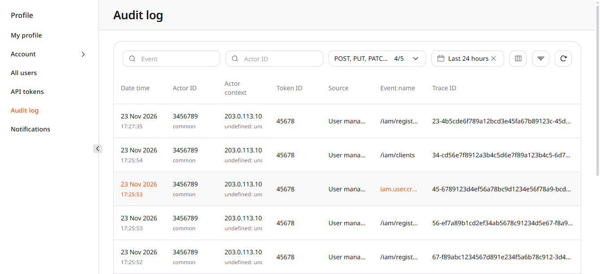

The audit log lists actions on the Gcore account, including sign-ins and API calls. In the [Gcore Customer Portal](https://portal.gcore.com), open the account menu, select **Profile**, then under **Account** select **Audit log**.

<Frame>
  
</Frame>

## Read an entry

The newest events are listed first. A row does not open a detail view.

| Column | What it shows |
|--------|----------------|
| Date time | Local date and time |
| Actor ID | User ID and a context label |
| Actor context | IP address and, when available, browser name and version. If browser details are unavailable, the field may show `undefined: undefined`. |
| Token ID | API token ID when the call used a token. A browser sign-in leaves this empty. |
| Source | Product that recorded the event |
| Event name | Action name or request path |
| Trace ID | Trace identifier for that request |

The column button shows or hides these columns. Drag a column edge to change its width. **Entries per page** can be 10, 20, 50, or 100. The page opens at 10.

## Filter events

The table updates when a filter changes. If nothing matches, the page says **No events match your filters**.

These filters are on the page when it opens:

- **Event** matches an event name that contains the text.
- **Actor ID** matches the user ID.
- The method list contains GET, POST, PUT, PATCH, and DELETE. POST, PUT, PATCH, and DELETE are selected, so GET requests appear only after GET is selected.
- The date filter opens on **Last 24 hours**. The other choices are **Last week**, **Last month**, **Last 3 months**, and **Custom range**. Custom range is a start day and an end day.

The filter button adds filters that stay hidden until selected:

- **Source**
- **Trace ID**, which matches the trace text, including a prefix of it
- **Token ID**, which matches the API token ID
- **(Meta) Entity ID**, **(Meta) Entity type**, and **(Meta) Task ID**, which match metadata stored on the event. Entity type includes Stream and Video.
- **(Meta) Custom filters**, which matches a metadata key and a value

Source is one of these products:

- User management
- Notifications
- Access management
- Authentication
- Billing
- CDN
- Object Storage
- Streaming
- Cloud
- Colocation Services
- DDoS Protection
- Managed DNS
- FastEdge
- WAAP
- Everywhere Inference

Delete the text to clear a text filter. A list filter has its own clear control.

For example, to find account sign-ins, enter `user_login` in the **Event** filter and select **Authentication** as the source. User management records `iam.user.create`, `iam.auth.password.reset`, `iam.auth.password.recover`, `iam.auth.invitation.resend`, and `/iam/register`. Streaming records `streaming.live.stream.created` and `streaming.live.stream.deleted`.
