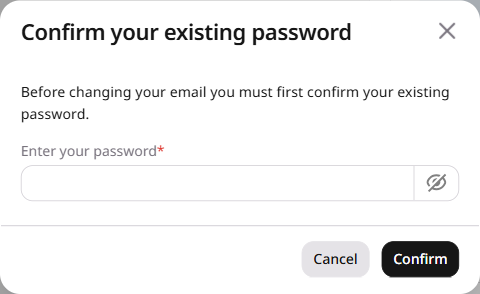
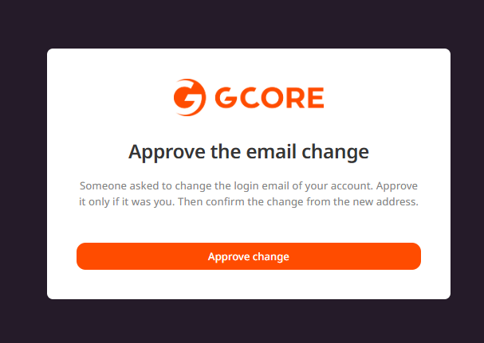
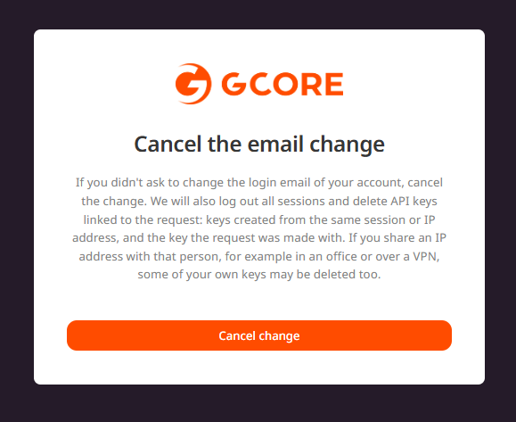

The login email stays the same until the current address approves the request and the new address confirms it. A password alone cannot complete the change. The address can be changed up to 10 times in one hour.

<Info>
Email address changes are not available for accounts created with Google or GitHub authentication.
</Info>

## Request the change

<Steps>
  <Step title="Open My profile">
    In the [Gcore Customer Portal](https://portal.gcore.com), click the avatar in the top-right corner and select **Profile**.
  </Step>
  <Step title="Enter the new address">
    In **General**, enter the new address in **Email** and click **Save**.
  </Step>
  <Step title="Confirm the current password">
    Enter the current password in the dialog and click **Confirm**. When two-factor authentication is enabled, enter the code from the authenticator app as well.

    <Frame></Frame>

    The profile confirms that an approval link was sent to the current email address. The link is valid for 24 hours.
  </Step>
</Steps>

## Approve from the current address

Open the email sent to the current address and follow the approval link. Click **Approve change** when the request was made from this account.

After approval, a confirmation email is sent to the new address.

<Frame></Frame>

## Confirm from the new address

After the request is approved from the current email address, a confirmation email is sent to the new address. Open the link within 24 hours and confirm the change. Sign-in then uses the new email address.

## Cancel an unexpected change

Open the cancel link in the message sent to the current address. **Cancel change** logs out every session and deletes the API keys linked to the request: keys created from the same session or IP address, and the key the request was made with. A shared IP address on an office network or a VPN can include some of the owner's own keys.

<Frame></Frame>

A link that was already used, or that is older than 24 hours, reports that it is no longer valid.
