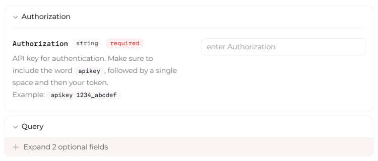
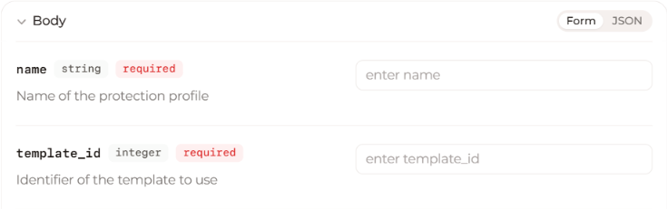
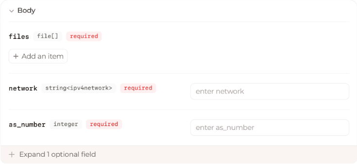
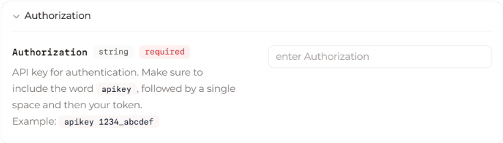
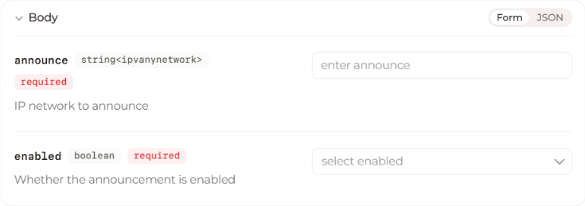

A protected network is a customer prefix submitted for filtering. A protection profile holds the rules for that prefix and is created from a protection template. The template named Basic is the starting set. BGP announcements then enable or disable announcement of a prefix that is already on the account. [Event&nbsp;logs](/api-reference/ddos-protection/event-logs/event-logs-clients-view) return the attack events recorded for the account.

The host is `https://api.gcore.com`. Protected networks, protection profiles, and protection templates use `/security/sifter/v3`. BGP announcements use `/security/sifter/v2`. Event logs use `/security/notifier/v1`.

Creating a network returns `status` and `lifecycle_status` of `PENDING`. Review of the prefix, the AS number, and the Letter of Authorization continues in [network&nbsp;submission](/ddos-protection/onboarding-service/network-submission). After approval, [attach&nbsp;the&nbsp;profile](/ddos-protection/onboarding-service/apply-a-custom-profile-to-a-protected-network) to the network.

## Quick start

An [API&nbsp;token](/account-settings/api-tokens) authorizes the calls. [Use&nbsp;Postman](/developer-tools/rest-api/use-postman) stores that token on the DDoS Protection collection. Run one scenario in a single shell, because later commands read variables set by earlier ones.

```bash
export GCORE_API_KEY="{YOUR_API_KEY}"
```

<Tabs>
  <Tab title="Protect a network">

The calls find the Basic template, create a protection profile from it, and submit the prefix. The network is not filtering traffic at the end of these calls. Its status is `PENDING`.

<Steps>
  <Step title="Find the Basic template">

The [protection&nbsp;template](/api-reference/ddos-protection/protection-templates/list-protection-templates) list includes the template named Basic. Its `id` is `template_id`. The `ACL list` and `Rate limiter low` fields provide the template field IDs needed to configure the protection profile.

<Frame>
  
</Frame>

<Frame>
  
</Frame>

```bash
curl "https://api.gcore.com/security/sifter/v3/templates" \
  -H "Authorization: APIKey $GCORE_API_KEY"
```

A response that contains Basic looks like this. The ids differ by account:

```json
[
  {
    "id": 110,
    "name": "Basic",
    "fields": [
      {
        "id": 201,
        "name": "ACL list"
      },
      {
        "id": 202,
        "name": "Rate limiter low"
      }
    ]
  }
]
```

Copy those three ids into the shell:

```bash
export TEMPLATE_ID="{TEMPLATE_ID}"
export ACL_FIELD_ID="{ACL_FIELD_ID}"
export RATE_FIELD_ID="{RATE_FIELD_ID}"
```

  </Step>
  <Step title="Create the protection profile">

The [protection&nbsp;profile](/api-reference/ddos-protection/protection-profiles/create-protection-profile) request stores the profile name, the Basic template id, one TCP rule, and a rate-limiter cap. The TCP rule uses policy `tcp-server` on port 80 and sits ahead of the four Basic catch-all rules. The rate-limiter value is an integer from 1 to 50.

<Frame>
  
</Frame>

<Frame>
  
</Frame>

```bash
curl -X POST "https://api.gcore.com/security/sifter/v3/profiles" \
  -H "Authorization: APIKey $GCORE_API_KEY" \
  -H "Content-Type: application/json" \
  -d "{
    \"name\": \"my-profile-1\",
    \"template_id\": $TEMPLATE_ID,
    \"fields\": [
      {
        \"template_field_id\": $ACL_FIELD_ID,
        \"value\": [
          {
            \"policy\": \"tcp-server\",
            \"proto_list\": [\"tcp\"],
            \"dport_list\": [\"80\"],
            \"sip_list\": [],
            \"sport_list\": [],
            \"dip_list\": []
          },
          {\"policy\": \"default-tcp\", \"proto_list\": [\"tcp\"], \"sip_list\": [], \"dport_list\": [], \"sport_list\": []},
          {\"policy\": \"default-udp\", \"proto_list\": [\"udp\"], \"sip_list\": [], \"dport_list\": [], \"sport_list\": []},
          {\"policy\": \"default-icmp\", \"proto_list\": [\"icmp\"], \"sip_list\": [], \"dport_list\": [], \"sport_list\": []},
          {\"policy\": \"default-other\", \"proto_list\": [\"any\"], \"sip_list\": [], \"dport_list\": [], \"sport_list\": []}
        ]
      },
      {
        \"template_field_id\": $RATE_FIELD_ID,
        \"value\": 40
      }
    ]
  }"
```

A successful request returns the new profile id:

```json
{
  "id": 102,
  "name": "my-profile-1"
}
```

```bash
export PROFILE_ID="{PROFILE_ID}"
```

  </Step>
  <Step title="Submit the network">

The [protected&nbsp;network](/api-reference/ddos-protection/protected-networks/create-protected-network) request submits an IPv4 prefix, the AS number, and a Letter of Authorization in PDF. Replace the example network and AS number with the prefix you own and its corresponding AS number. Provide a valid Letter of Authorization as `loa.pdf`.

<Frame>
  
</Frame>

<Frame>
  
</Frame>

```bash
curl -X POST "https://api.gcore.com/security/sifter/v3/protected_networks" \
  -H "Authorization: APIKey $GCORE_API_KEY" \
  -F "network=203.0.113.0/24" \
  -F "as_number=64512" \
  -F "files=@loa.pdf;type=application/pdf"
```

The response leaves both statuses at `PENDING`:

```json
{
  "id": 10001,
  "network": "203.0.113.0/24",
  "as_number": 64512,
  "status": "PENDING",
  "lifecycle_status": "PENDING"
}
```

`PROFILE_ID` is not sent here. The profile is attached after the submission is approved.

  </Step>
</Steps>

  </Tab>
  <Tab title="Change a BGP announcement">

The calls read the prefixes already present for the account, then enable one prefix that is not announced. The call does not submit a new network.

<Steps>
  <Step title="List announcements">

The [BGP&nbsp;announces](/api-reference/ddos-protection/bgp-announces/list-bgp-announces) list returns `announced` and `not_announced`.

<Frame>
  
</Frame>

<Frame>
  
</Frame>

```bash
curl "https://api.gcore.com/security/sifter/v2/protected_addresses/announces" \
  -H "Authorization: APIKey $GCORE_API_KEY"
```

A response looks like this:

```json
[
  {
    "client_id": 10001,
    "announced": ["203.0.113.10/32"],
    "not_announced": ["203.0.113.11/32"]
  }
]
```

  </Step>
  <Step title="Enable one prefix">

[Change&nbsp;BGP&nbsp;announces](/api-reference/ddos-protection/bgp-announces/change-bgp-announces) sets `enabled` for one prefix from that list. `announce` is the prefix. Replace `203.0.113.11/32` with a prefix from `not_announced`. `enabled` set to `true` announces it.

<Frame>
  
</Frame>

<Frame>
  
</Frame>

```bash
curl -X POST "https://api.gcore.com/security/sifter/v2/protected_addresses/announces" \
  -H "Authorization: APIKey $GCORE_API_KEY" \
  -H "Content-Type: application/json" \
  -d "{\"announce\": \"203.0.113.11/32\", \"enabled\": true}"
```

A successful call returns HTTP 200. Listing announcements again shows that prefix under `announced`. Set `enabled` to `false` to stop announcing it.

  </Step>
</Steps>

  </Tab>
</Tabs>
