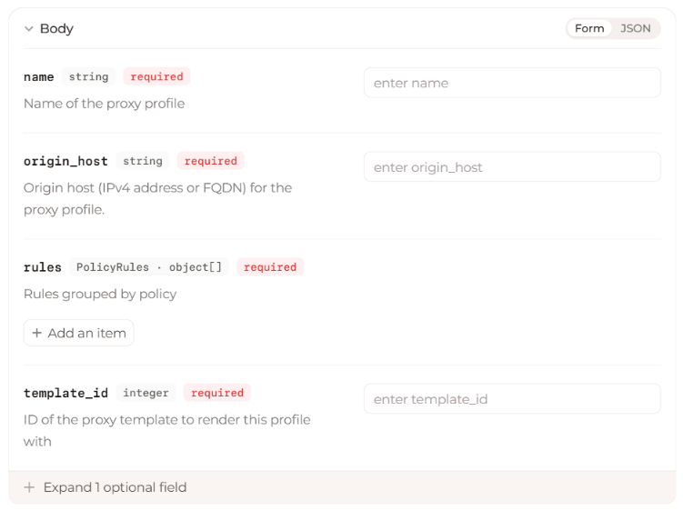

Edge Proxy protects an origin by routing connections through a protected IPv4 address. A proxy profile links that address to the origin and holds the rules that filter and forward traffic. The rules take their policies from a proxy template.

The host is `https://api.gcore.com`. Profiles and templates use `/security/edgeproxy/v3`.

The template list returns one shared default template, marked with `is_default` set to true, and any template already visible on the account. A rule stores a policy id from that template. Generic TCP Server uses the id `tcp-server`. A profile holds one origin and one protected address, and further ports stay on that same profile. An origin already used by an active profile cannot be assigned to another profile.

Creating a profile returns its protected address with `status` of `INACTIVE` and `is_processing` true. Clients can connect after a later read shows `status` of `ACTIVE` and `is_processing` false.

## Quick start

An [API&nbsp;token](/account-settings/api-tokens) authorizes the calls. [Use&nbsp;Postman](/developer-tools/rest-api/use-postman) stores that token on the Edge Proxy collection. Run the steps in one shell, because later commands read variables set by earlier ones.

Edge Proxy must be active on the account, and the origin must be a public IPv4 address or a domain name. The application must accept TCP connections on port 80. When a firewall restricts access, allow the Gcore [edge&nbsp;IP&nbsp;addresses](/edge-proxy/setup-and-configuration#restrict-access-to-the-origin) to reach that port.

```bash
export GCORE_API_KEY="{YOUR_API_KEY}"
export EDGE_PROXY_ORIGIN="{YOUR_ORIGIN_HOST}"
```

<Steps>
  <Step title="Find the default template">

The [proxy&nbsp;template](/api-reference/edge-proxy/proxy-templates/list-proxy-templates) list returns `results`. Copy the `id` of the template whose `is_default` is true. Confirm that template includes the policy id `tcp-server`, and stop when it does not. The template id differs by account.

```bash
curl "https://api.gcore.com/security/edgeproxy/v3/templates?limit=100" \
  -H "Authorization: APIKey $GCORE_API_KEY"
```

A default template in `results` contributes these fields:

```json
{
  "results": [
    {
      "id": 1,
      "is_default": true,
      "policies": [
        {
          "id": "tcp-server",
          "name": "Generic TCP Server"
        }
      ]
    }
  ]
}
```

```bash
export TEMPLATE_ID="{TEMPLATE_ID}"
export POLICY_ID="tcp-server"
```

  </Step>
  <Step title="Create the profile">

[Create&nbsp;proxy&nbsp;profile](/api-reference/edge-proxy/proxy-profiles/create-proxy-profile) sets the name `edge-proxy-profile` (1 to 60 characters), the origin, the template id, and one rule. The rule applies `tcp-server` to TCP port 80. The request omits `protected_ip_address`, so Gcore allocates the address. When the origin listens on another port, set `outbound_port` on that mapping and allow edge traffic on the origin port.

<Frame>
  
</Frame>

```bash
curl -X POST "https://api.gcore.com/security/edgeproxy/v3/profiles" \
  -H "Authorization: APIKey $GCORE_API_KEY" \
  -H "Content-Type: application/json" \
  -d "{
    \"name\": \"edge-proxy-profile\",
    \"origin_host\": \"$EDGE_PROXY_ORIGIN\",
    \"template_id\": $TEMPLATE_ID,
    \"rules\": [
      {
        \"policy\": \"$POLICY_ID\",
        \"mappings\": [{\"protocol\": \"tcp\", \"port\": 80}]
      }
    ]
  }"
```

A successful request returns HTTP 201. Deployment has started, so `status` is `INACTIVE` and `is_processing` is true:

```json
{
  "id": 42,
  "status": "INACTIVE",
  "is_processing": true,
  "is_error": false,
  "error_details": null,
  "protected_ip_address": "203.0.113.20"
}
```

An HTTP 400 response can mean that the service is inactive, no protected address is available, the origin is already used by an active profile, or the profile limit has been reached.

```bash
export PROFILE_ID="{PROFILE_ID}"
```

  </Step>
  <Step title="Read the profile until it is ready">

[Get&nbsp;proxy&nbsp;profile](/api-reference/edge-proxy/proxy-profiles/get-proxy-profile) returns the same profile. Repeat the request while `is_processing` is true. Save the address only when `status` is `ACTIVE`, `is_processing` is false, and `is_error` is false. When `is_error` is true, read `error_details` before sending client traffic.

```bash
curl "https://api.gcore.com/security/edgeproxy/v3/profiles/$PROFILE_ID" \
  -H "Authorization: APIKey $GCORE_API_KEY"
```

A finished deployment looks like this:

```json
{
  "id": 42,
  "status": "ACTIVE",
  "is_processing": false,
  "is_error": false,
  "error_details": null,
  "protected_ip_address": "203.0.113.20"
}
```

```bash
export PROTECTED_IP="{PROTECTED_IP}"
```

  </Step>
  <Step title="Send clients to the protected address">

Clients connect to `PROTECTED_IP` on TCP port 80. A domain name uses that address in its DNS A record. Connections sent straight to the origin bypass filtering. [Connection&nbsp;failures](/edge-proxy/faqs-and-troubleshooting) covers an origin that blocks Gcore edge addresses, a policy that does not match the application, and a Host value the application does not recognize.

  </Step>
</Steps>

## Existing profiles

An account with an assigned non-common pool can choose the protected address. [Available&nbsp;protected&nbsp;addresses](/api-reference/edge-proxy/proxy-profiles/list-available-protected-ipv4-addresses) returns the addresses in that pool, and the create request then sends one of them as `protected_ip_address`.

[Replace&nbsp;proxy&nbsp;profile](/api-reference/edge-proxy/proxy-profiles/replace-proxy-profile) submits the full configuration of an existing profile. [Update&nbsp;proxy&nbsp;profile](/api-reference/edge-proxy/proxy-profiles/update-proxy-profile) submits only the fields that change, and can move the profile to another free address from that pool.

[Deactivate&nbsp;proxy&nbsp;profile](/api-reference/edge-proxy/proxy-profiles/deactivate-proxy-profile) stops an existing profile. [Activate&nbsp;proxy&nbsp;profile](/api-reference/edge-proxy/proxy-profiles/activate-proxy-profile) starts that profile again. A profile created in the quick start becomes active without that call. [Redeploy&nbsp;proxy&nbsp;profile](/api-reference/edge-proxy/proxy-profiles/redeploy-proxy-profile) sends the current configuration again.

[Get&nbsp;ACL&nbsp;limit](/api-reference/edge-proxy/proxy-profiles/get-acl-limit) shows how many rules the account can hold and how many it currently uses.
