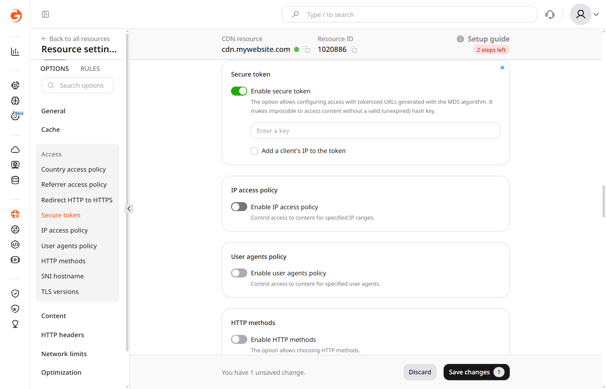

import { MethodSwitch, MethodSection } from "/snippets/method-switch.jsx";

<MethodSwitch>
  <MethodSection id="portal" label="Customer Portal">

<p>Secure token restricts CDN content to requests that carry a valid signed URL with an `md5` hash and an `expires` timestamp. The CDN checks the token before it serves the file.</p>

<p>The CDN resource stores the signing key, and the application or backend builds each signed URL with that key. Configuring the resource and generating the URLs are separate operations, and protected content needs both.</p>

<p>The Customer Portal sets the signing key and the IP option on an existing [CDN&nbsp;resource](/cdn/getting-started/create-a-cdn-resource/create-a-cdn-resource). The portal accepts a key of 6–32 characters.</p>

<p>1. Log in to the [Gcore Customer Portal](https://portal.gcore.com) and navigate to **CDN** > **CDN resources**. Click the resource CNAME.</p>

<p>2. On the **OPTIONS** tab, select **Access** > **Secure token**.</p>

<p>3. Turn on **Enable secure token**.</p>

<p>4. In **Enter a key**, enter a key of 6–32 characters. The application or backend uses this key in the hash.</p>

<p>5. Leave **Add a client's IP to the token** unchecked to allow any client IP address, or check it to restrict access to one IP address. The client's IP address is then added to the hash in the [generation&nbsp;scripts](#portal-scripts-for-link-generation).</p>

<p>Enterprise customers with mobile audiences can tie the token to a subnet rather than a single IP address. That mode is covered under [IP&nbsp;binding](#portal-ip-binding-and-mobile-networks).</p>

<Frame>
  
</Frame>

<p>6. Click **Save changes**.</p>

<p>Confirm that a request without a token is rejected:</p>

```bash
curl -I "https://cdn.example.com/photo.jpeg"
```

<p>A missing token returns `403 Forbidden`. The CDN does not forward the request to the origin.</p>

<p>With the key saved, generate each signed URL in the generation scripts. The hash must use that key and the same IP mode.</p>

<h2 id="portal-signed-url-format">Signed URL format</h2>

<p>The application or backend generates a signed link for each protected file. The link has this form:</p>

```text
http://cdn.example.com/photo.jpeg?md5=TOKEN&expires=2147483647
```

<p>The link has three parts:</p>

- The host and path identify the file
- `TOKEN` is the MD5 hash of `{expires}{path}{ip} {key}` when IP binding is enabled, or `{expires}{path} {key}` when it is disabled (base64-encoded, URL-safe)
- `2147483647` is the expiration time in Unix timestamp format

<p>A missing or incorrect hash returns `403 Forbidden`, and an expired link returns `410 Gone`. The CDN does not forward either request to the origin.</p>

<p>The PHP and Python scripts build this hash and append it to the file URL. The OpenSSL commands return the token only.</p>

<p>On the origin server, block direct client access to the origin — restricting inbound connections to CDN server IP ranges is one approach. The CDN validates the token at the edge before forwarding the request to the origin, so the origin does not need to perform token validation and must remain reachable by CDN servers without a token.</p>

<Warning>
Enabling secure token may decrease the cache hit ratio, because each signed URL carries its own `md5` and `expires`. The edge checks the token before it serves the file, including a file that is already in cache. Set [Ignore&nbsp;Query&nbsp;String](/cdn/cdn-resource-options/cache/ignore-the-set-cookie-or-query-string-parameters-when-caching-content-on-cdn-servers#query-string-setting) to **Ignore only** for `md5` and `expires`, so the signed URLs of one file share one cache entry.
</Warning>

<h2 id="portal-secure-token-url-matching">Secure token URL matching</h2>

<p>Secure token validates three things from the request URL:</p>

- `md5`: the token hash
- `expires`: the Unix timestamp until which the URL is valid
- Path: the file path or directory path used when the token was generated

<p>The CDN recomputes the hash with the path used when generating the token. For a directory token, the CDN uses the directory of the requested path, which can be shorter than the full requested path.</p>

- When the token was generated for the exact file `/images/poster.jpeg`, the CDN uses that same path on every request, so only that file passes.
- When the token was generated for the directory `/videos/video-1/`, the CDN uses the directory of the requested path. A request for `/videos/video-1/segment-001.ts` uses `/videos/video-1/` and passes, while a request for `/videos/video-1/360p/segment.ts` uses `/videos/video-1/360p/` and returns `403 Forbidden`.

<h3 id="portal-token-for-exact-file">Token for exact file</h3>

<p>Use an exact file token when each file has its own signature: an image, an archive, an MP4 file, or one video manifest. Generate the token for `/images/poster.jpeg`:</p>

```text
/images/poster.jpeg
```

<p>The client requests:</p>

```text
https://cdn.example.com/images/poster.jpeg?md5=TOKEN&expires=1777545540
```

<p>This token matches only `/images/poster.jpeg`, so the adjacent paths return `403 Forbidden`:</p>

```text
https://cdn.example.com/images/poster.webp      → 403 Forbidden
https://cdn.example.com/images/poster.png       → 403 Forbidden
https://cdn.example.com/images/master.m3u8      → 403 Forbidden
```

<h2 id="portal-scripts-for-link-generation">Scripts for link generation</h2>

<p>These scripts build the token from the expiration, the path, and the signing key. Use the variant that matches the IP mode configured on the resource.</p>

<p>Use the exact key saved on the CDN resource. The examples use `secretkey`.</p>

<p>Set the host in the generated URL to the CDN resource hostname. `cdn.site.com` in the scripts is a placeholder for that hostname.</p>

<p>The hash uses the path, and the link uses the requested file. For one file, both values are that file, and for a directory token the path is the directory and the requested file is the manifest.</p>

<h3 id="portal-php">PHP</h3>

<p>This script matches `type` `0`: it adds the client IP address to the hash, so the file stays reachable from that address until the link expires:</p>

```php
<?php
$secret = 'secretkey';
$ip = '1.2.3.4';
$path = '/live/133529_2/chunklist.m3u8';
$file = '/live/133529_2/chunklist.m3u8';
$expires = time() + 10000;
$link = "$expires$path$ip $secret";
$md5 = md5($link, true);
$md5 = base64_encode($md5);
$md5 = strtr($md5, '+/', '-_');
$md5 = str_replace('=', '', $md5);
$url = "http://cdn.site.com{$file}?md5={$md5}&expires={$expires}";
echo $url;
echo "\n";
```

<p>This script matches `type` `2`: it signs the expiration, the path, and the key, so any client IP address can open the file until the link expires:</p>

```php
<?php
$secret = 'secretkey';
$path = '/live/133529_2/chunklist.m3u8';
$file = '/live/133529_2/chunklist.m3u8';
$expires = time() + 10000;
$link = "$expires$path $secret";
$md5 = md5($link, true);
$md5 = base64_encode($md5);
$md5 = strtr($md5, '+/', '-_');
$md5 = str_replace('=', '', $md5);
$url = "http://cdn.site.com{$file}?md5={$md5}&expires={$expires}";
echo $url;
echo "\n";
```

<p>In these scripts:</p>

- `$secret` is the signing key saved on the CDN resource
- `$path` is the path included in the hash
- `$file` is the requested file in the link
- `$ip` is the IP address allowed to access the content
- `$expires` is the link expiration time as a Unix timestamp
- `$url` is the address of the file

<h3 id="portal-python">Python</h3>

<p>This script matches `type` `0`: it signs the expiration, the path, the client IP address, and the key:</p>

```python
import base64
from hashlib import md5
from time import time

secret = 'secretkey'
path = "/images/1.jpg"
file = "/images/1.jpg"
ip = '1.2.3.4'
ttl = 100000
expires = int(time()) + ttl
token_hash = md5(f"{expires}{path}{ip} {secret}".encode()).digest()
token = base64.b64encode(token_hash).decode().replace("\n", "").replace("+", "-").replace("/", "_").replace("=", "")
secured_url = f"http://cdn.site.com{file}?md5={token}&expires={expires}"
print(secured_url)
```

<p>This script matches `type` `2`: it signs the expiration, the path, and the key:</p>

```python
import base64
from hashlib import md5
from time import time

secret = 'secretkey'
path = "/images/1.jpg"
file = "/images/1.jpg"
ttl = 100000
expires = int(time()) + ttl
token_hash = md5(f"{expires}{path} {secret}".encode()).digest()
token = base64.b64encode(token_hash).decode().replace("\n", "").replace("+", "-").replace("/", "_").replace("=", "")
secured_url = f"http://cdn.site.com{file}?md5={token}&expires={expires}"
print(secured_url)
```

<p>In these scripts:</p>

- `secret` is the signing key saved on the CDN resource
- `path` is the path included in the hash
- `file` is the requested file in the link
- `ip` is the IP address allowed to access the content
- `expires` is the link expiration time as a Unix timestamp
- `secured_url` is the link to the file

<h3 id="portal-openssl">OpenSSL</h3>

<p>This command matches `type` `0`: it limits the link lifespan and adds the client IP address to the hash:</p>

```bash
echo -n '2147483647/images/1.jpg1.2.3.4 secretkey' | openssl md5 -binary | openssl base64 | tr +/ -_ | tr -d =
# Pattern: '{expires}{path}{ip} {key}'
```

<p>This command matches `type` `2`: it signs the expiration, the path, and the key:</p>

```bash
echo -n '2147483647/images/1.jpg secretkey' | openssl md5 -binary | openssl base64 | tr +/ -_ | tr -d =
# Pattern: '{expires}{path} {key}'
```

<p>In these scripts:</p>

- `2147483647/images/1.jpg` is the path to the file prefixed with the expiration timestamp
- `1.2.3.4` is the IP address allowed to access the content
- `secretkey` is the signing key saved on the CDN resource

<p>These scripts return the token only. Build the link from the requested file by adding `md5` and `expires`.</p>

<p>For one file, the requested file is the path in the command. For a directory token, the command signs the directory and the link uses the manifest in that directory.</p>

<h2 id="portal-hls-and-mpeg-dash">HLS and MPEG-DASH</h2>

<p>Use a token with Query String Forwarding enabled for HLS and MPEG-DASH when the master manifest, nested manifests, media segments, and subtitles are stored in the same directory.</p>

<p>Generate the token for the directory path, including the trailing slash. The hash uses that directory, and the link uses the master manifest:</p>

```text
/videos/video-1/
/videos/video-1/master.m3u8
```

<p>For PHP, set the hash path and the requested file separately:</p>

```php
$path = '/videos/video-1/';
$file = '/videos/video-1/master.m3u8';
```

<p>For Python:</p>

```py
path = "/videos/video-1/"
file = "/videos/video-1/master.m3u8"
```

<p>This token matches files directly inside `/videos/video-1/`. A file in `/videos/video-1/360p/` returns `403 Forbidden`, so split layouts need a separate token per directory, or the manifests and segments stay in one directory.</p>

<p>HLS files in that directory:</p>

```text
/videos/video-1/master.m3u8
/videos/video-1/rendition-1080.m3u8
/videos/video-1/segment-001.ts
/videos/video-1/segment-002.ts
```

<p>The client requests only the master manifest with the token:</p>

```text
https://cdn.example.com/videos/video-1/master.m3u8?md5=TOKEN&expires=1893456000
```

<p>[Query&nbsp;String&nbsp;Forwarding](/cdn/cdn-resource-options/query-string-forwarding) copies `md5` and `expires` from playlist links onto the media segment requests, so a player that receives the token with the master manifest sends it on each nested request. Each nested request is still checked against the token path.</p>

```text
https://cdn.example.com/videos/video-1/rendition-1080.m3u8?md5=TOKEN&expires=1893456000
https://cdn.example.com/videos/video-1/segment-001.ts?md5=TOKEN&expires=1893456000
https://cdn.example.com/videos/video-1/segment-002.ts?md5=TOKEN&expires=1893456000
```

<p>For HLS and MPEG-DASH, turn on Query String Forwarding and set these fields:</p>

- **Forward from file types**: `m3u8`, `mpd`
- **Forward to file types**: `ts`, `mp4`, `m3u8`, `m4s`, `vtt`
- **Forward only keys**: `md5`, `expires`

<p>The [demo&nbsp;manifest](http://demo-files-protected.gvideo.io/coffee_run/master.m3u8?md5=eBx15p01_a9JNuo1iZpTfQ&expires=1893456000&other=parameter) includes an extra parameter that the CDN does not forward, and the [player&nbsp;demo](https://hlsjs.video-dev.org/demo/?src=https%3A%2F%2Fdemo-files-protected.gvideo.io%2Fcoffee_run%2Fmaster.m3u8%3Fmd5%3DeBx15p01_a9JNuo1iZpTfQ%26expires%3D1893456000%26other%3Dparameter) loads that manifest:</p>

```text
http://demo-files-protected.gvideo.io/coffee_run/master.m3u8?md5=eBx15p01_a9JNuo1iZpTfQ&expires=1893456000&other=parameter
http://demo-files-protected.gvideo.io/coffee_run/index-svod720n-v1-a1.m3u8?expires=1893456000&md5=eBx15p01_a9JNuo1iZpTfQ
http://demo-files-protected.gvideo.io/coffee_run/segment-1-svod720n-v1-a1.ts?expires=1893456000&md5=eBx15p01_a9JNuo1iZpTfQ
http://demo-files-protected.gvideo.io/coffee_run/segment-2-svod720n-v1-a1.ts?expires=1893456000&md5=eBx15p01_a9JNuo1iZpTfQ
```

<h2 id="portal-ip-binding-and-mobile-networks">IP binding and mobile networks</h2>

<p>When a secure token includes the client IP address, the CDN recomputes the hash with the IP on the incoming request. A token signed for one address fails when the carrier moves the client to another address or the client switches between IPv4 and IPv6.</p>

<p>For downloads and media, leave the client IP out of the hash.</p>

<p>On some mobile networks the public address changes within minutes, because the ISP routes many subscribers through carrier-grade NAT and rotates addresses across a pool.</p>

<p>The effect shows up with Query String Forwarding for video. The player requests the manifest and receives a token, and the CDN forwards that token to the related segments.</p>

<p>If the address changes between those requests, a later segment can return `403` after earlier segments returned `200`. An address change or a bad hash can produce that pair of codes.</p>

<p>An expired signature returns `410 Gone`.</p>

<p>For Enterprise customers, Gcore can bind the token to a `/24` or `/16` subnet instead of one address. The wider mask still ties the URL to the ISP block, so sharing outside that block stays blocked, while the client can move between addresses inside it. Contact [Gcore&nbsp;support](https://support.gcore.com/hc/en-us) or an account manager to enable the wider mask.</p>

<h2 id="portal-token-in-a-url-path">Token in a URL path</h2>

<p>CDN secure token carries `md5` and `expires` in the query string. [Gcore&nbsp;Video&nbsp;Streaming](/streaming/interaction-with-cdn/video-secure-token) places the token and the expiration in the path, after the video identifier:</p>

```text
https://demo-protected.gvideo.io/videos/2675_pG8TfmKx2LU2qs/rI1224fiE3USCa8qYnMuGQ/1861919999/master.m3u8
```

<p>The path has four parts:</p>

- `https://demo-protected.gvideo.io` is the CDN URL
- `/videos/2675_pG8TfmKx2LU2qs/` is the video ID
- `rI1224fiE3USCa8qYnMuGQ` is the token
- `1861919999` is the expiration time in Unix timestamp format

</MethodSection>
  <MethodSection id="api" label="REST API">

<p>Secure token restricts CDN content to requests that carry a valid signed URL with an `md5` hash and an `expires` timestamp. The CDN checks the token before it serves the file.</p>

<p>The CDN resource stores the signing key, and the application or backend builds each signed URL with that key. Configuring the resource and generating the URLs are separate operations, and protected content needs both.</p>

<p>Enable secure token on an existing CDN resource with the CDN Resources API. The call sets the signing key and the IP-binding mode.</p>

<p>The CDN uses those values to check each signed URL. The application then generates URLs with the same key and the same mode.</p>

<Info>
An [API&nbsp;token](/account-settings/api-tokens) is required. `CDN_RESOURCE_ID` is the `id` from [list&nbsp;CDN&nbsp;resources](/api-reference/cdn/cdn-resources/list-cdn-resources).
</Info>

<p>Export the token and the resource ID before running the calls.</p>

```bash
export GCORE_API_KEY="{YOUR_API_KEY}"
export CDN_RESOURCE_ID="{YOUR_RESOURCE_ID}"
```

<p>`type` `0` includes the client IP in the signature. `type` `2` signs the expiration, the path, and the key, and does not include the client IP.</p>

<p>When `type` is omitted, the stored value is `0`.</p>

<p>The calls below set `enabled` to true, `key` to `secretkey`, and `type` to `2`.</p>

<Tabs>
  <Tab title="Python SDK">
    ```python
    import os

    from gcore import Gcore

    client = Gcore()
    resource_id = int(os.environ["CDN_RESOURCE_ID"])

    resource = client.cdn.cdn_resources.update(
        resource_id,
        options={
            "secure_key": {
                "enabled": True,
                "key": "secretkey",
                "type": 2,
            },
        },
    )
    print(
        resource.options.secure_key.enabled,
        resource.options.secure_key.type,
    )
    ```
  </Tab>
  <Tab title="Go SDK">
    ```go
    package main

    import (
        "context"
        "fmt"
        "os"
        "strconv"

        gcore "github.com/G-Core/gcore-go"
        "github.com/G-Core/gcore-go/cdn"
        "github.com/G-Core/gcore-go/packages/param"
    )

    func main() {
        client := gcore.NewClient()
        ctx := context.Background()
        resourceID, err := strconv.ParseInt(os.Getenv("CDN_RESOURCE_ID"), 10, 64)
        if err != nil {
            panic(err)
        }

        resource, err := client.CDN.CDNResources.Update(ctx, resourceID, cdn.CDNResourceUpdateParams{
            Options: cdn.CDNResourceUpdateParamsOptions{
                SecureKey: cdn.CDNResourceUpdateParamsOptionsSecureKey{
                    Enabled: true,
                    Key:     param.NewOpt("secretkey"),
                    Type:    2,
                },
            },
        })
        if err != nil {
            panic(err)
        }
        fmt.Println(resource.Options.SecureKey.Enabled, resource.Options.SecureKey.Type)
    }
    ```
  </Tab>
  <Tab title="curl">
    ```bash
    curl -X PATCH "https://api.gcore.com/cdn/resources/$CDN_RESOURCE_ID" \
      -H "Authorization: APIKey $GCORE_API_KEY" \
      -H "Content-Type: application/json" \
      -d '{
        "options": {
          "secure_key": {
            "enabled": true,
            "key": "secretkey",
            "type": 2
          }
        }
      }'
    ```

    <p>The API returns HTTP 200:</p>

    ```json
    {
      "id": 12345,
      "options": {
        "secure_key": {
          "enabled": true,
          "key": "secretkey",
          "type": 2
        }
      }
    }
    ```
  </Tab>
</Tabs>

<p>A successful update returns HTTP 200. The saved `secure_key` has `enabled`, `key`, and `type` set to the values in the request.</p>

<p>`enabled` and `key` are required. A blank `key` returns HTTP 400, and a `key` longer than 255 characters returns HTTP 400.</p>

<p>`type` accepts `0` or `2`, so any other value returns HTTP 400.</p>

<p>Send JSON `null` to clear `secure_key`. `enabled` false keeps the key and turns the option off.</p>

<p>Generate the signed URLs with that key and the same `type` in the [generation&nbsp;scripts](#api-scripts-for-link-generation).</p>

<h2 id="api-signed-url-format">Signed URL format</h2>

<p>The application or backend generates a signed link for each protected file. The link has this form:</p>

```text
http://cdn.example.com/photo.jpeg?md5=TOKEN&expires=2147483647
```

<p>The link has three parts:</p>

- The host and path identify the file
- `TOKEN` is the MD5 hash of `{expires}{path}{ip} {key}` when IP binding is enabled, or `{expires}{path} {key}` when it is disabled (base64-encoded, URL-safe)
- `2147483647` is the expiration time in Unix timestamp format

<p>A missing or incorrect hash returns `403 Forbidden`, and an expired link returns `410 Gone`. The CDN does not forward either request to the origin.</p>

<p>The PHP and Python scripts build this hash and append it to the file URL. The OpenSSL commands return the token only.</p>

<p>On the origin server, block direct client access to the origin — restricting inbound connections to CDN server IP ranges is one approach. The CDN validates the token at the edge before forwarding the request to the origin, so the origin does not need to perform token validation and must remain reachable by CDN servers without a token.</p>

<Warning>
Enabling secure token may decrease the cache hit ratio, because each signed URL carries its own `md5` and `expires`. The edge checks the token before it serves the file, including a file that is already in cache. Set [Ignore&nbsp;Query&nbsp;String](/cdn/cdn-resource-options/cache/ignore-the-set-cookie-or-query-string-parameters-when-caching-content-on-cdn-servers#query-string-setting) to **Ignore only** for `md5` and `expires`, so the signed URLs of one file share one cache entry.
</Warning>

<h2 id="api-secure-token-url-matching">Secure token URL matching</h2>

<p>Secure token validates three things from the request URL:</p>

- `md5`: the token hash
- `expires`: the Unix timestamp until which the URL is valid
- Path: the file path or directory path used when the token was generated

<p>The CDN recomputes the hash with the path used when generating the token. For a directory token, the CDN uses the directory of the requested path, which can be shorter than the full requested path.</p>

- When the token was generated for the exact file `/images/poster.jpeg`, the CDN uses that same path on every request, so only that file passes.
- When the token was generated for the directory `/videos/video-1/`, the CDN uses the directory of the requested path. A request for `/videos/video-1/segment-001.ts` uses `/videos/video-1/` and passes, while a request for `/videos/video-1/360p/segment.ts` uses `/videos/video-1/360p/` and returns `403 Forbidden`.

<h3 id="api-token-for-exact-file">Token for exact file</h3>

<p>Use an exact file token when each file has its own signature: an image, an archive, an MP4 file, or one video manifest. Generate the token for `/images/poster.jpeg`:</p>

```text
/images/poster.jpeg
```

<p>The client requests:</p>

```text
https://cdn.example.com/images/poster.jpeg?md5=TOKEN&expires=1777545540
```

<p>This token matches only `/images/poster.jpeg`, so the adjacent paths return `403 Forbidden`:</p>

```text
https://cdn.example.com/images/poster.webp      → 403 Forbidden
https://cdn.example.com/images/poster.png       → 403 Forbidden
https://cdn.example.com/images/master.m3u8      → 403 Forbidden
```

<h2 id="api-scripts-for-link-generation">Scripts for link generation</h2>

<p>These scripts build the token from the expiration, the path, and the signing key. Use the variant that matches the IP mode configured on the resource.</p>

<p>Use the exact key saved on the CDN resource. The examples use `secretkey`.</p>

<p>Set the host in the generated URL to the CDN resource hostname. `cdn.site.com` in the scripts is a placeholder for that hostname.</p>

<p>The hash uses the path, and the link uses the requested file. For one file, both values are that file, and for a directory token the path is the directory and the requested file is the manifest.</p>

<h3 id="api-php">PHP</h3>

<p>This script matches `type` `0`: it adds the client IP address to the hash, so the file stays reachable from that address until the link expires:</p>

```php
<?php
$secret = 'secretkey';
$ip = '1.2.3.4';
$path = '/live/133529_2/chunklist.m3u8';
$file = '/live/133529_2/chunklist.m3u8';
$expires = time() + 10000;
$link = "$expires$path$ip $secret";
$md5 = md5($link, true);
$md5 = base64_encode($md5);
$md5 = strtr($md5, '+/', '-_');
$md5 = str_replace('=', '', $md5);
$url = "http://cdn.site.com{$file}?md5={$md5}&expires={$expires}";
echo $url;
echo "\n";
```

<p>This script matches `type` `2`: it signs the expiration, the path, and the key, so any client IP address can open the file until the link expires:</p>

```php
<?php
$secret = 'secretkey';
$path = '/live/133529_2/chunklist.m3u8';
$file = '/live/133529_2/chunklist.m3u8';
$expires = time() + 10000;
$link = "$expires$path $secret";
$md5 = md5($link, true);
$md5 = base64_encode($md5);
$md5 = strtr($md5, '+/', '-_');
$md5 = str_replace('=', '', $md5);
$url = "http://cdn.site.com{$file}?md5={$md5}&expires={$expires}";
echo $url;
echo "\n";
```

<p>In these scripts:</p>

- `$secret` is the signing key saved on the CDN resource
- `$path` is the path included in the hash
- `$file` is the requested file in the link
- `$ip` is the IP address allowed to access the content
- `$expires` is the link expiration time as a Unix timestamp
- `$url` is the address of the file

<h3 id="api-python">Python</h3>

<p>This script matches `type` `0`: it signs the expiration, the path, the client IP address, and the key:</p>

```python
import base64
from hashlib import md5
from time import time

secret = 'secretkey'
path = "/images/1.jpg"
file = "/images/1.jpg"
ip = '1.2.3.4'
ttl = 100000
expires = int(time()) + ttl
token_hash = md5(f"{expires}{path}{ip} {secret}".encode()).digest()
token = base64.b64encode(token_hash).decode().replace("\n", "").replace("+", "-").replace("/", "_").replace("=", "")
secured_url = f"http://cdn.site.com{file}?md5={token}&expires={expires}"
print(secured_url)
```

<p>This script matches `type` `2`: it signs the expiration, the path, and the key:</p>

```python
import base64
from hashlib import md5
from time import time

secret = 'secretkey'
path = "/images/1.jpg"
file = "/images/1.jpg"
ttl = 100000
expires = int(time()) + ttl
token_hash = md5(f"{expires}{path} {secret}".encode()).digest()
token = base64.b64encode(token_hash).decode().replace("\n", "").replace("+", "-").replace("/", "_").replace("=", "")
secured_url = f"http://cdn.site.com{file}?md5={token}&expires={expires}"
print(secured_url)
```

<p>In these scripts:</p>

- `secret` is the signing key saved on the CDN resource
- `path` is the path included in the hash
- `file` is the requested file in the link
- `ip` is the IP address allowed to access the content
- `expires` is the link expiration time as a Unix timestamp
- `secured_url` is the link to the file

<h3 id="api-openssl">OpenSSL</h3>

<p>This command matches `type` `0`: it limits the link lifespan and adds the client IP address to the hash:</p>

```bash
echo -n '2147483647/images/1.jpg1.2.3.4 secretkey' | openssl md5 -binary | openssl base64 | tr +/ -_ | tr -d =
# Pattern: '{expires}{path}{ip} {key}'
```

<p>This command matches `type` `2`: it signs the expiration, the path, and the key:</p>

```bash
echo -n '2147483647/images/1.jpg secretkey' | openssl md5 -binary | openssl base64 | tr +/ -_ | tr -d =
# Pattern: '{expires}{path} {key}'
```

<p>In these scripts:</p>

- `2147483647/images/1.jpg` is the path to the file prefixed with the expiration timestamp
- `1.2.3.4` is the IP address allowed to access the content
- `secretkey` is the signing key saved on the CDN resource

<p>These scripts return the token only. Build the link from the requested file by adding `md5` and `expires`.</p>

<p>For one file, the requested file is the path in the command. For a directory token, the command signs the directory and the link uses the manifest in that directory.</p>

<h2 id="api-hls-and-mpeg-dash">HLS and MPEG-DASH</h2>

<p>Use a token with Query String Forwarding enabled for HLS and MPEG-DASH when the master manifest, nested manifests, media segments, and subtitles are stored in the same directory.</p>

<p>Generate the token for the directory path, including the trailing slash. The hash uses that directory, and the link uses the master manifest:</p>

```text
/videos/video-1/
/videos/video-1/master.m3u8
```

<p>For PHP, set the hash path and the requested file separately:</p>

```php
$path = '/videos/video-1/';
$file = '/videos/video-1/master.m3u8';
```

<p>For Python:</p>

```py
path = "/videos/video-1/"
file = "/videos/video-1/master.m3u8"
```

<p>This token matches files directly inside `/videos/video-1/`. A file in `/videos/video-1/360p/` returns `403 Forbidden`, so split layouts need a separate token per directory, or the manifests and segments stay in one directory.</p>

<p>HLS files in that directory:</p>

```text
/videos/video-1/master.m3u8
/videos/video-1/rendition-1080.m3u8
/videos/video-1/segment-001.ts
/videos/video-1/segment-002.ts
```

<p>The client requests only the master manifest with the token:</p>

```text
https://cdn.example.com/videos/video-1/master.m3u8?md5=TOKEN&expires=1893456000
```

<p>[Query&nbsp;String&nbsp;Forwarding](/cdn/cdn-resource-options/query-string-forwarding) copies `md5` and `expires` from playlist links onto the media segment requests, so a player that receives the token with the master manifest sends it on each nested request. Each nested request is still checked against the token path.</p>

```text
https://cdn.example.com/videos/video-1/rendition-1080.m3u8?md5=TOKEN&expires=1893456000
https://cdn.example.com/videos/video-1/segment-001.ts?md5=TOKEN&expires=1893456000
https://cdn.example.com/videos/video-1/segment-002.ts?md5=TOKEN&expires=1893456000
```

<p>For HLS and MPEG-DASH, turn on Query String Forwarding and set these fields:</p>

- **Forward from file types**: `m3u8`, `mpd`
- **Forward to file types**: `ts`, `mp4`, `m3u8`, `m4s`, `vtt`
- **Forward only keys**: `md5`, `expires`

<p>The [demo&nbsp;manifest](http://demo-files-protected.gvideo.io/coffee_run/master.m3u8?md5=eBx15p01_a9JNuo1iZpTfQ&expires=1893456000&other=parameter) includes an extra parameter that the CDN does not forward, and the [player&nbsp;demo](https://hlsjs.video-dev.org/demo/?src=https%3A%2F%2Fdemo-files-protected.gvideo.io%2Fcoffee_run%2Fmaster.m3u8%3Fmd5%3DeBx15p01_a9JNuo1iZpTfQ%26expires%3D1893456000%26other%3Dparameter) loads that manifest:</p>

```text
http://demo-files-protected.gvideo.io/coffee_run/master.m3u8?md5=eBx15p01_a9JNuo1iZpTfQ&expires=1893456000&other=parameter
http://demo-files-protected.gvideo.io/coffee_run/index-svod720n-v1-a1.m3u8?expires=1893456000&md5=eBx15p01_a9JNuo1iZpTfQ
http://demo-files-protected.gvideo.io/coffee_run/segment-1-svod720n-v1-a1.ts?expires=1893456000&md5=eBx15p01_a9JNuo1iZpTfQ
http://demo-files-protected.gvideo.io/coffee_run/segment-2-svod720n-v1-a1.ts?expires=1893456000&md5=eBx15p01_a9JNuo1iZpTfQ
```

<h2 id="api-ip-binding-and-mobile-networks">IP binding and mobile networks</h2>

<p>When a secure token includes the client IP address, the CDN recomputes the hash with the IP on the incoming request. A token signed for one address fails when the carrier moves the client to another address or the client switches between IPv4 and IPv6.</p>

<p>For downloads and media, leave the client IP out of the hash.</p>

<p>On some mobile networks the public address changes within minutes, because the ISP routes many subscribers through carrier-grade NAT and rotates addresses across a pool.</p>

<p>The effect shows up with Query String Forwarding for video. The player requests the manifest and receives a token, and the CDN forwards that token to the related segments.</p>

<p>If the address changes between those requests, a later segment can return `403` after earlier segments returned `200`. An address change or a bad hash can produce that pair of codes.</p>

<p>An expired signature returns `410 Gone`.</p>

<p>For Enterprise customers, Gcore can bind the token to a `/24` or `/16` subnet instead of one address. The wider mask still ties the URL to the ISP block, so sharing outside that block stays blocked, while the client can move between addresses inside it. Contact [Gcore&nbsp;support](https://support.gcore.com/hc/en-us) or an account manager to enable the wider mask.</p>

<h2 id="api-token-in-a-url-path">Token in a URL path</h2>

<p>CDN secure token carries `md5` and `expires` in the query string. [Gcore&nbsp;Video&nbsp;Streaming](/streaming/interaction-with-cdn/video-secure-token) places the token and the expiration in the path, after the video identifier:</p>

```text
https://demo-protected.gvideo.io/videos/2675_pG8TfmKx2LU2qs/rI1224fiE3USCa8qYnMuGQ/1861919999/master.m3u8
```

<p>The path has four parts:</p>

- `https://demo-protected.gvideo.io` is the CDN URL
- `/videos/2675_pG8TfmKx2LU2qs/` is the video ID
- `rI1224fiE3USCa8qYnMuGQ` is the token
- `1861919999` is the expiration time in Unix timestamp format

</MethodSection>
  <MethodSection id="terraform" label="Terraform">

<p>Secure token restricts CDN content to requests that carry a valid signed URL with an `md5` hash and an `expires` timestamp. The CDN checks the token before it serves the file.</p>

<p>The CDN resource stores the signing key, and the application or backend builds each signed URL with that key. Configuring the resource and generating the URLs are separate operations, and protected content needs both.</p>

<p>Terraform declares the secure token settings of a CDN resource with the [Terraform&nbsp;provider](/developer-tools/terraform/overview) v2. The block supplies the signing key and the token mode, and `terraform apply` writes them to the resource.</p>

<p>The example creates a new origin group and a new CDN resource with secure token enabled. When the CDN resource is already managed in Terraform, put the same `secure_key` block in that resource's `options`.</p>

## Signing mode

<p>`type` `2` signs the expiration, the path, and the key, and does not bind the token to a client IP. `type` `0` also includes the client IP, with a space before the key. Set `enabled` to `true` and `key` to the signing key.</p>

```hcl
resource "gcore_cdn_origin_group" "example" {
  name = "my-origin-group"

  sources = [
    {
      source  = "example.com"
      enabled = true
    }
  ]
}

resource "gcore_cdn_resource" "example" {
  cname           = "cdn.example.com"
  origin_group    = gcore_cdn_origin_group.example.id
  origin_protocol = "HTTPS"

  options = {
    secure_key = {
      enabled = true
      key     = "secretkey"
      type    = 2
    }
  }
}
```

<p>A blank `key` returns HTTP 400 and the message `This field may not be blank.`</p>

<p>After apply, generate signed URLs with the same key and `type` in the [generation&nbsp;scripts](#terraform-scripts-for-link-generation).</p>

<h2 id="terraform-signed-url-format">Signed URL format</h2>

<p>The application or backend generates a signed link for each protected file. The link has this form:</p>

```text
http://cdn.example.com/photo.jpeg?md5=TOKEN&expires=2147483647
```

<p>The link has three parts:</p>

- The host and path identify the file
- `TOKEN` is the MD5 hash of `{expires}{path}{ip} {key}` when IP binding is enabled, or `{expires}{path} {key}` when it is disabled (base64-encoded, URL-safe)
- `2147483647` is the expiration time in Unix timestamp format

<p>A missing or incorrect hash returns `403 Forbidden`, and an expired link returns `410 Gone`. The CDN does not forward either request to the origin.</p>

<p>The PHP and Python scripts build this hash and append it to the file URL. The OpenSSL commands return the token only.</p>

<p>On the origin server, block direct client access to the origin — restricting inbound connections to CDN server IP ranges is one approach. The CDN validates the token at the edge before forwarding the request to the origin, so the origin does not need to perform token validation and must remain reachable by CDN servers without a token.</p>

<Warning>
Enabling secure token may decrease the cache hit ratio, because each signed URL carries its own `md5` and `expires`. The edge checks the token before it serves the file, including a file that is already in cache. Set [Ignore&nbsp;Query&nbsp;String](/cdn/cdn-resource-options/cache/ignore-the-set-cookie-or-query-string-parameters-when-caching-content-on-cdn-servers#query-string-setting) to **Ignore only** for `md5` and `expires`, so the signed URLs of one file share one cache entry.
</Warning>

<h2 id="terraform-secure-token-url-matching">Secure token URL matching</h2>

<p>Secure token validates three things from the request URL:</p>

- `md5`: the token hash
- `expires`: the Unix timestamp until which the URL is valid
- Path: the file path or directory path used when the token was generated

<p>The CDN recomputes the hash with the path used when generating the token. For a directory token, the CDN uses the directory of the requested path, which can be shorter than the full requested path.</p>

- When the token was generated for the exact file `/images/poster.jpeg`, the CDN uses that same path on every request, so only that file passes.
- When the token was generated for the directory `/videos/video-1/`, the CDN uses the directory of the requested path. A request for `/videos/video-1/segment-001.ts` uses `/videos/video-1/` and passes, while a request for `/videos/video-1/360p/segment.ts` uses `/videos/video-1/360p/` and returns `403 Forbidden`.

<h3 id="terraform-token-for-exact-file">Token for exact file</h3>

<p>Use an exact file token when each file has its own signature: an image, an archive, an MP4 file, or one video manifest. Generate the token for `/images/poster.jpeg`:</p>

```text
/images/poster.jpeg
```

<p>The client requests:</p>

```text
https://cdn.example.com/images/poster.jpeg?md5=TOKEN&expires=1777545540
```

<p>This token matches only `/images/poster.jpeg`, so the adjacent paths return `403 Forbidden`:</p>

```text
https://cdn.example.com/images/poster.webp      → 403 Forbidden
https://cdn.example.com/images/poster.png       → 403 Forbidden
https://cdn.example.com/images/master.m3u8      → 403 Forbidden
```

<h2 id="terraform-scripts-for-link-generation">Scripts for link generation</h2>

<p>These scripts build the token from the expiration, the path, and the signing key. Use the variant that matches the IP mode configured on the resource.</p>

<p>Use the exact key saved on the CDN resource. The examples use `secretkey`.</p>

<p>Set the host in the generated URL to the CDN resource hostname. `cdn.site.com` in the scripts is a placeholder for that hostname.</p>

<p>The hash uses the path, and the link uses the requested file. For one file, both values are that file, and for a directory token the path is the directory and the requested file is the manifest.</p>

<h3 id="terraform-php">PHP</h3>

<p>This script matches `type` `0`: it adds the client IP address to the hash, so the file stays reachable from that address until the link expires:</p>

```php
<?php
$secret = 'secretkey';
$ip = '1.2.3.4';
$path = '/live/133529_2/chunklist.m3u8';
$file = '/live/133529_2/chunklist.m3u8';
$expires = time() + 10000;
$link = "$expires$path$ip $secret";
$md5 = md5($link, true);
$md5 = base64_encode($md5);
$md5 = strtr($md5, '+/', '-_');
$md5 = str_replace('=', '', $md5);
$url = "http://cdn.site.com{$file}?md5={$md5}&expires={$expires}";
echo $url;
echo "\n";
```

<p>This script matches `type` `2`: it signs the expiration, the path, and the key, so any client IP address can open the file until the link expires:</p>

```php
<?php
$secret = 'secretkey';
$path = '/live/133529_2/chunklist.m3u8';
$file = '/live/133529_2/chunklist.m3u8';
$expires = time() + 10000;
$link = "$expires$path $secret";
$md5 = md5($link, true);
$md5 = base64_encode($md5);
$md5 = strtr($md5, '+/', '-_');
$md5 = str_replace('=', '', $md5);
$url = "http://cdn.site.com{$file}?md5={$md5}&expires={$expires}";
echo $url;
echo "\n";
```

<p>In these scripts:</p>

- `$secret` is the signing key saved on the CDN resource
- `$path` is the path included in the hash
- `$file` is the requested file in the link
- `$ip` is the IP address allowed to access the content
- `$expires` is the link expiration time as a Unix timestamp
- `$url` is the address of the file

<h3 id="terraform-python">Python</h3>

<p>This script matches `type` `0`: it signs the expiration, the path, the client IP address, and the key:</p>

```python
import base64
from hashlib import md5
from time import time

secret = 'secretkey'
path = "/images/1.jpg"
file = "/images/1.jpg"
ip = '1.2.3.4'
ttl = 100000
expires = int(time()) + ttl
token_hash = md5(f"{expires}{path}{ip} {secret}".encode()).digest()
token = base64.b64encode(token_hash).decode().replace("\n", "").replace("+", "-").replace("/", "_").replace("=", "")
secured_url = f"http://cdn.site.com{file}?md5={token}&expires={expires}"
print(secured_url)
```

<p>This script matches `type` `2`: it signs the expiration, the path, and the key:</p>

```python
import base64
from hashlib import md5
from time import time

secret = 'secretkey'
path = "/images/1.jpg"
file = "/images/1.jpg"
ttl = 100000
expires = int(time()) + ttl
token_hash = md5(f"{expires}{path} {secret}".encode()).digest()
token = base64.b64encode(token_hash).decode().replace("\n", "").replace("+", "-").replace("/", "_").replace("=", "")
secured_url = f"http://cdn.site.com{file}?md5={token}&expires={expires}"
print(secured_url)
```

<p>In these scripts:</p>

- `secret` is the signing key saved on the CDN resource
- `path` is the path included in the hash
- `file` is the requested file in the link
- `ip` is the IP address allowed to access the content
- `expires` is the link expiration time as a Unix timestamp
- `secured_url` is the link to the file

<h3 id="terraform-openssl">OpenSSL</h3>

<p>This command matches `type` `0`: it limits the link lifespan and adds the client IP address to the hash:</p>

```bash
echo -n '2147483647/images/1.jpg1.2.3.4 secretkey' | openssl md5 -binary | openssl base64 | tr +/ -_ | tr -d =
# Pattern: '{expires}{path}{ip} {key}'
```

<p>This command matches `type` `2`: it signs the expiration, the path, and the key:</p>

```bash
echo -n '2147483647/images/1.jpg secretkey' | openssl md5 -binary | openssl base64 | tr +/ -_ | tr -d =
# Pattern: '{expires}{path} {key}'
```

<p>In these scripts:</p>

- `2147483647/images/1.jpg` is the path to the file prefixed with the expiration timestamp
- `1.2.3.4` is the IP address allowed to access the content
- `secretkey` is the signing key saved on the CDN resource

<p>These scripts return the token only. Build the link from the requested file by adding `md5` and `expires`.</p>

<p>For one file, the requested file is the path in the command. For a directory token, the command signs the directory and the link uses the manifest in that directory.</p>

<h2 id="terraform-hls-and-mpeg-dash">HLS and MPEG-DASH</h2>

<p>Use a token with Query String Forwarding enabled for HLS and MPEG-DASH when the master manifest, nested manifests, media segments, and subtitles are stored in the same directory.</p>

<p>Generate the token for the directory path, including the trailing slash. The hash uses that directory, and the link uses the master manifest:</p>

```text
/videos/video-1/
/videos/video-1/master.m3u8
```

<p>For PHP, set the hash path and the requested file separately:</p>

```php
$path = '/videos/video-1/';
$file = '/videos/video-1/master.m3u8';
```

<p>For Python:</p>

```py
path = "/videos/video-1/"
file = "/videos/video-1/master.m3u8"
```

<p>This token matches files directly inside `/videos/video-1/`. A file in `/videos/video-1/360p/` returns `403 Forbidden`, so split layouts need a separate token per directory, or the manifests and segments stay in one directory.</p>

<p>HLS files in that directory:</p>

```text
/videos/video-1/master.m3u8
/videos/video-1/rendition-1080.m3u8
/videos/video-1/segment-001.ts
/videos/video-1/segment-002.ts
```

<p>The client requests only the master manifest with the token:</p>

```text
https://cdn.example.com/videos/video-1/master.m3u8?md5=TOKEN&expires=1893456000
```

<p>[Query&nbsp;String&nbsp;Forwarding](/cdn/cdn-resource-options/query-string-forwarding) copies `md5` and `expires` from playlist links onto the media segment requests, so a player that receives the token with the master manifest sends it on each nested request. Each nested request is still checked against the token path.</p>

```text
https://cdn.example.com/videos/video-1/rendition-1080.m3u8?md5=TOKEN&expires=1893456000
https://cdn.example.com/videos/video-1/segment-001.ts?md5=TOKEN&expires=1893456000
https://cdn.example.com/videos/video-1/segment-002.ts?md5=TOKEN&expires=1893456000
```

<p>For HLS and MPEG-DASH, turn on Query String Forwarding and set these fields:</p>

- **Forward from file types**: `m3u8`, `mpd`
- **Forward to file types**: `ts`, `mp4`, `m3u8`, `m4s`, `vtt`
- **Forward only keys**: `md5`, `expires`

<p>The [demo&nbsp;manifest](http://demo-files-protected.gvideo.io/coffee_run/master.m3u8?md5=eBx15p01_a9JNuo1iZpTfQ&expires=1893456000&other=parameter) includes an extra parameter that the CDN does not forward, and the [player&nbsp;demo](https://hlsjs.video-dev.org/demo/?src=https%3A%2F%2Fdemo-files-protected.gvideo.io%2Fcoffee_run%2Fmaster.m3u8%3Fmd5%3DeBx15p01_a9JNuo1iZpTfQ%26expires%3D1893456000%26other%3Dparameter) loads that manifest:</p>

```text
http://demo-files-protected.gvideo.io/coffee_run/master.m3u8?md5=eBx15p01_a9JNuo1iZpTfQ&expires=1893456000&other=parameter
http://demo-files-protected.gvideo.io/coffee_run/index-svod720n-v1-a1.m3u8?expires=1893456000&md5=eBx15p01_a9JNuo1iZpTfQ
http://demo-files-protected.gvideo.io/coffee_run/segment-1-svod720n-v1-a1.ts?expires=1893456000&md5=eBx15p01_a9JNuo1iZpTfQ
http://demo-files-protected.gvideo.io/coffee_run/segment-2-svod720n-v1-a1.ts?expires=1893456000&md5=eBx15p01_a9JNuo1iZpTfQ
```

<h2 id="terraform-ip-binding-and-mobile-networks">IP binding and mobile networks</h2>

<p>When a secure token includes the client IP address, the CDN recomputes the hash with the IP on the incoming request. A token signed for one address fails when the carrier moves the client to another address or the client switches between IPv4 and IPv6.</p>

<p>For downloads and media, leave the client IP out of the hash.</p>

<p>On some mobile networks the public address changes within minutes, because the ISP routes many subscribers through carrier-grade NAT and rotates addresses across a pool.</p>

<p>The effect shows up with Query String Forwarding for video. The player requests the manifest and receives a token, and the CDN forwards that token to the related segments.</p>

<p>If the address changes between those requests, a later segment can return `403` after earlier segments returned `200`. An address change or a bad hash can produce that pair of codes.</p>

<p>An expired signature returns `410 Gone`.</p>

<p>For Enterprise customers, Gcore can bind the token to a `/24` or `/16` subnet instead of one address. The wider mask still ties the URL to the ISP block, so sharing outside that block stays blocked, while the client can move between addresses inside it. Contact [Gcore&nbsp;support](https://support.gcore.com/hc/en-us) or an account manager to enable the wider mask.</p>

<h2 id="terraform-token-in-a-url-path">Token in a URL path</h2>

<p>CDN secure token carries `md5` and `expires` in the query string. [Gcore&nbsp;Video&nbsp;Streaming](/streaming/interaction-with-cdn/video-secure-token) places the token and the expiration in the path, after the video identifier:</p>

```text
https://demo-protected.gvideo.io/videos/2675_pG8TfmKx2LU2qs/rI1224fiE3USCa8qYnMuGQ/1861919999/master.m3u8
```

<p>The path has four parts:</p>

- `https://demo-protected.gvideo.io` is the CDN URL
- `/videos/2675_pG8TfmKx2LU2qs/` is the video ID
- `rI1224fiE3USCa8qYnMuGQ` is the token
- `1861919999` is the expiration time in Unix timestamp format

</MethodSection>
</MethodSwitch>
