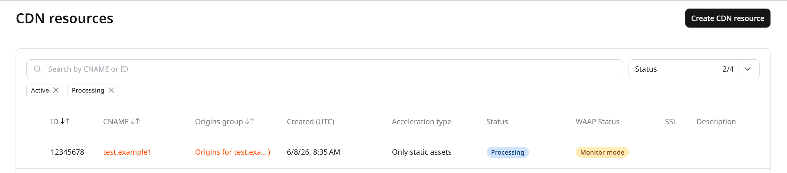
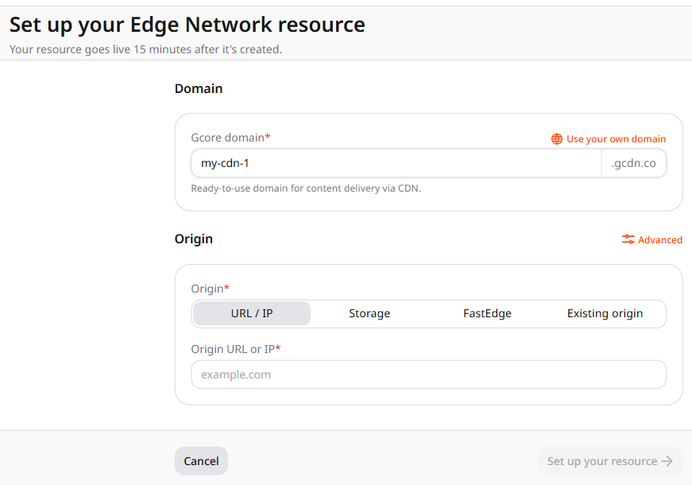
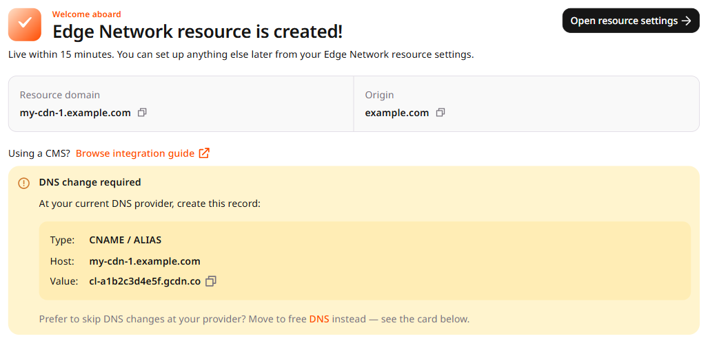
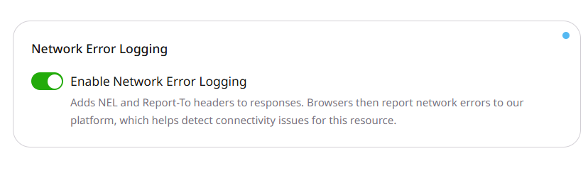

import { MethodSwitch, MethodSection } from "/snippets/method-switch.jsx";

<MethodSwitch>
  <MethodSection id="portal" label="Customer Portal">

<p>A CDN resource connects an origin to Gcore edge servers, which cache content and are hosted in geographically distributed data centers located closer to end users. The creation form can take a URL, IP address, S3 storage, or FastEdge application, or it can reuse an existing [origin&nbsp;group](/cdn/add-an-origin-group). The resource goes live 15 minutes after it is created.</p>

<Steps>
  <Step title="Open the creation form">
    In the Customer Portal, navigate to **CDN** > **CDN resources** and click **Create CDN resource**.

    <Frame>
      
    </Frame>
  </Step>

  <Step title="Set the domain">
    The form is titled **Set up your Edge Network resource**.

    **Gcore domain** is selected when the account has a shared domain. Enter the hostname prefix. A new Gcore account gets the suffix `gcorecdn.com`. An account that already used CDN gets the suffix `gcdn.co`. That hostname is ready for delivery, and no DNS record is required.

    **Use your own domain** takes the domain that viewers request. The CNAME record is shown after the resource is created. **Add another domain** adds another domain to the same resource. When a shared domain is not on the form, **Use your own domain** is the only choice.

    <Frame>
      
    </Frame>
  </Step>

  <Step title="Set the origin">
    Under **Origin**, choose where the CDN fetches content:

    - **URL / IP** takes the origin hostname or IP address.
    - **Storage** takes an S3 storage. Select **Gcore**, **Amazon**, or **Other**, then select the storage and the bucket.
    - **FastEdge** takes an existing FastEdge application. The application handles traffic instead of a server origin.
    - **Existing origin** reuses an [origin&nbsp;group](/cdn/add-an-origin-group). Only one origin is allowed.

    **Advanced** adds **Port**, **Host header override**, and **Add another origin** for a URL, IP, storage, or FastEdge origin. **Existing origin** stays on the simple form.
  </Step>

  <Step title="Create the resource">
    Click **Set up your resource**.
  </Step>

  <Step title="Complete DNS for a custom domain">
    The confirmation says **Edge Network resource is created**. The resource is live within 15 minutes.

    A Gcore domain needs no DNS record. A custom domain shows **DNS change required**. Add this record at the DNS provider:

    | Field | Value |
    |---|---|
    | **Type** | `CNAME` or `ALIAS` |
    | **Host** | The custom domain (`cdn.example.com`) |
    | **Value** | The account CNAME shown on the page |

    The value is the account hostname, shaped `cl-*.gcdn.co`, not the resource id. Create one record for each custom domain. **Move to free DNS** delegates the zone to Gcore Managed DNS instead of creating that record at the current provider.

    <Frame>
      
    </Frame>

    DNS updates can take up to 24 hours. Open **Setup guide** in the resource settings and click **Check DNS setup status** before sending production traffic.
  </Step>

  <Step title="Integrate the resource with the website">
    For a custom domain, update static file URLs to that domain. Change `example.com/images/image.jpg` to `cdn.example.com/images/image.jpg`. A Gcore domain is already the delivery hostname.

    Sites built on WordPress, Joomla, Drupal, or another CMS can use an integration plugin to replace domains in asset paths. The [CMS&nbsp;integration guide](/cdn/getting-started/integrate-cdn-with-cms) lists supported systems.
  </Step>

  <Step title="(Optional) Adjust resource settings">
    Click **Open resource settings**. Add notes in **Description**, or add more custom domains in **Custom domain**.

    **Enable Network Error Logging** is on for a new CDN resource, while an existing resource keeps its current setting. When the option is on, the CDN adds `NEL` and `Report-To` headers to responses, so supported browsers report network errors for the resource. To disable network error reporting, turn the option off and click **Save changes**.

    <Frame>
      
    </Frame>
  </Step>
</Steps>

## Resource creation troubleshooting

<p>If content is not served through the CDN after setup, verify the following:</p>

- For a custom domain, the CNAME or ALIAS record matches the value on the confirmation page or in **Setup guide**.
- DNS propagation has completed.
- Static file URLs use the custom domain, or the Gcore domain when that hostname was chosen.

<p>If the issue persists, contact [Gcore&nbsp;Support](mailto:support@gcore.com).</p>

</MethodSection>
  <MethodSection id="api" label="REST API">

<p>Create a CDN resource programmatically in two steps: create an origin group that defines the content origin, then create the CDN resource that ties a delivery subdomain to that origin. DNS setup is completed at the domain registrar or DNS provider after the resource is created.</p>

<Info>
An [API&nbsp;token](/account-settings/api-tokens) is required.
</Info>

```bash
export GCORE_API_KEY="{YOUR_API_KEY}"
```

## Quickstart

<p>The scripts below create an origin group and CDN resource, then print the resource ID and delivery subdomain.</p>

<Tabs>
  <Tab title="Python SDK">
    ```python
    from gcore import Gcore

    client = Gcore()  # Reads GCORE_API_KEY from env

    # Step 1. Create an origin group
    og = client.cdn.origin_groups.create(
        name="my-origin-group",
        sources=[{"source": "origin.example.com", "enabled": True}],
    )

    # Step 2. Create a CDN resource
    resource = client.cdn.cdn_resources.create(
        cname="cdn.example.com",
        origin_group=og.id,
        origin_protocol="HTTPS",
    )

    print(f"Resource ID:    {resource.id}")
    print(f"Delivery domain: {resource.cname}")
    ```
  </Tab>
  <Tab title="Go SDK">
    ```go
    package main

    import (
        "context"
        "fmt"

        gcore "github.com/G-Core/gcore-go"
        "github.com/G-Core/gcore-go/cdn"
    )

    func main() {
        client := gcore.NewClient()  // Reads GCORE_API_KEY from env
        ctx := context.Background()

        // Step 1. Create an origin group
        og, err := client.CDN.OriginGroups.New(ctx, cdn.OriginGroupNewParams{
            OfNoneAuth: &cdn.OriginGroupNewParamsBodyNoneAuth{
                Name: "my-origin-group",
                Sources: []cdn.OriginGroupNewParamsBodyNoneAuthSourceUnion{
                    {OfHostSource: &cdn.OriginGroupNewParamsBodyNoneAuthSourceHostSource{
                        Source:  "origin.example.com",
                        Enabled: gcore.Bool(true),
                    }},
                },
            },
        })
        if err != nil {
            panic(err)
        }

        // Step 2. Create a CDN resource
        resource, err := client.CDN.CDNResources.New(ctx, cdn.CDNResourceNewParams{
            Cname:          "cdn.example.com",
            OriginGroup:    gcore.Int(og.ID),
            OriginProtocol: cdn.CDNResourceNewParamsOriginProtocolHTTPS,
        })
        if err != nil {
            panic(err)
        }

        fmt.Printf("Resource ID:    %v\n", resource.ID)
        fmt.Printf("Delivery domain: %v\n", resource.Cname)
    }
    ```
  </Tab>
</Tabs>

## Step 1. Create an origin group

<p>An origin group defines the server that CDN edge servers fetch content from. Create one group per origin server; reuse an existing group across multiple CDN resources when the origin is shared.</p>

| Parameter | Required | Description |
|-----------|----------|-------------|
| `name` | Yes | Unique label for the group |
| `sources[].source` | Yes | Domain or IP address of the origin server |
| `sources[].enabled` | No | Whether this source is active. Defaults to `true` |

<Tabs>
  <Tab title="Python SDK">
    ```python
    from gcore import Gcore

    client = Gcore()

    og = client.cdn.origin_groups.create(
        name="my-origin-group",
        sources=[{"source": "origin.example.com", "enabled": True}],
    )
    print(og.id, og.name)
    ```
  </Tab>
  <Tab title="Go SDK">
    ```go
    package main

    import (
        "context"
        "fmt"

        gcore "github.com/G-Core/gcore-go"
        "github.com/G-Core/gcore-go/cdn"
    )

    func main() {
        client := gcore.NewClient()
        ctx := context.Background()

        og, err := client.CDN.OriginGroups.New(ctx, cdn.OriginGroupNewParams{
            OfNoneAuth: &cdn.OriginGroupNewParamsBodyNoneAuth{
                Name: "my-origin-group",
                Sources: []cdn.OriginGroupNewParamsBodyNoneAuthSourceUnion{
                    {OfHostSource: &cdn.OriginGroupNewParamsBodyNoneAuthSourceHostSource{
                        Source:  "origin.example.com",
                        Enabled: gcore.Bool(true),
                    }},
                },
            },
        })
        if err != nil {
            panic(err)
        }
        fmt.Println(og.ID, og.Name)
    }
    ```
  </Tab>
  <Tab title="curl">
    ```bash
    curl -X POST "https://api.gcore.com/cdn/origin_groups" \
      -H "Authorization: APIKey $GCORE_API_KEY" \
      -H "Content-Type: application/json" \
      -d '{
        "name": "my-origin-group",
        "sources": [
          {"source": "origin.example.com", "enabled": true}
        ]
      }'
    ```

    <p>The API returns the created origin group:</p>

    ```json
    {
      "id": 10001,
      "name": "my-origin-group",
      "sources": [
        {
          "source": "origin.example.com",
          "backup": false,
          "enabled": true
        }
      ],
      "use_next": true,
      "auth_type": "none"
    }
    ```
  </Tab>
</Tabs>

## Step 2. Create a CDN resource

<p>The CDN resource ties the delivery domain to the origin group. The `cname` value is the domain that viewers request. The DNS CNAME target is the [account&nbsp;CNAME](/cdn/cdn-resource-options/general/create-and-set-a-custom-domain-for-the-content-delivery-via-cdn#read-the-account-cname-target), not the resource id.</p>

| Parameter | Required | Description |
|-----------|----------|-------------|
| `cname` | Yes | Delivery subdomain — `cdn.example.com`. Cannot be changed after creation |
| `originGroup` | Yes | Origin group ID from Step 1 |
| `originProtocol` | No | Protocol CDN servers use to fetch content: `HTTP`, `HTTPS`, or `MATCH`. Defaults to `HTTP` |

<Tabs>
  <Tab title="Python SDK">
    ```python
    from gcore import Gcore

    client = Gcore()

    resource = client.cdn.cdn_resources.create(
        cname="cdn.example.com",
        origin_group=10001,  # origin group ID from Step 1
        origin_protocol="HTTPS",
    )
    print(resource.id, resource.cname, resource.status)
    ```
  </Tab>
  <Tab title="Go SDK">
    ```go
    package main

    import (
        "context"
        "fmt"

        gcore "github.com/G-Core/gcore-go"
        "github.com/G-Core/gcore-go/cdn"
    )

    func main() {
        client := gcore.NewClient()
        ctx := context.Background()

        resource, err := client.CDN.CDNResources.New(ctx, cdn.CDNResourceNewParams{
            Cname:          "cdn.example.com",
            OriginGroup:    gcore.Int(10001),  // origin group ID from Step 1
            OriginProtocol: cdn.CDNResourceNewParamsOriginProtocolHTTPS,
        })
        if err != nil {
            panic(err)
        }
        fmt.Println(resource.ID, resource.Cname, resource.Status)
    }
    ```
  </Tab>
  <Tab title="curl">
    ```bash
    curl -X POST "https://api.gcore.com/cdn/resources" \
      -H "Authorization: APIKey $GCORE_API_KEY" \
      -H "Content-Type: application/json" \
      -d '{
        "cname": "cdn.example.com",
        "originGroup": 10001,
        "originProtocol": "HTTPS"
      }'
    ```

    <p>The API returns the created CDN resource:</p>

    ```json
    {
      "id": 12345,
      "cname": "cdn.example.com",
      "status": "processed",
      "active": true,
      "originGroup": 10001,
      "originProtocol": "HTTPS"
    }
    ```
  </Tab>
</Tabs>

## DNS setup

<p>After the CDN resource is created, add a CNAME record at the domain's DNS provider when the resource uses a custom domain. The target is the [account&nbsp;CNAME](/cdn/cdn-resource-options/general/create-and-set-a-custom-domain-for-the-content-delivery-via-cdn#read-the-account-cname-target), not the resource id.</p>

| DNS record field | Value |
|------------------|-------|
| **Type** | `CNAME` |
| **Name / Host** | The custom domain (`cdn.example.com`) |
| **Value / Points to** | The account CNAME |

<p>DNS propagation takes up to 24 hours. To verify the record is live, run:</p>

```bash
dig cdn.example.com CNAME +short
```

<p>The output should show the account CNAME.</p>

## Network error logging

<p>New CDN resources are created with network error logging enabled, while existing resources keep their current setting. Change it with a resource update.</p>

| Field | Required | Description |
|-------|----------|-------------|
| `enabled` | Yes | `true` adds the `NEL` and `Report-To` headers. `false` removes them. |
| `value` | Yes | `true` for both states |

<p>The call below turns the option off. The resource id is the id returned in Step 2.</p>

```bash
export CDN_RESOURCE_ID="{YOUR_CDN_RESOURCE_ID}"
```

<Tabs>
  <Tab title="Python SDK">
    ```python
    import os

    from gcore import Gcore

    client = Gcore()
    resource_id = int(os.environ["CDN_RESOURCE_ID"])

    updated = client.cdn.cdn_resources.update(
        resource_id,
        options={"network_error_logging": {"enabled": False, "value": True}},
    )
    print(updated.options.network_error_logging.enabled, updated.options.network_error_logging.value)
    ```
  </Tab>
  <Tab title="Go SDK">
    ```go
    package main

    import (
        "context"
        "fmt"
        "os"
        "strconv"

        gcore "github.com/G-Core/gcore-go"
        "github.com/G-Core/gcore-go/cdn"
    )

    func main() {
        client := gcore.NewClient()
        ctx := context.Background()
        resourceID, err := strconv.ParseInt(os.Getenv("CDN_RESOURCE_ID"), 10, 64)
        if err != nil {
            panic(err)
        }

        updated, err := client.CDN.CDNResources.Update(ctx, resourceID, cdn.CDNResourceUpdateParams{
            Options: cdn.CDNResourceUpdateParamsOptions{
                NetworkErrorLogging: cdn.CDNResourceUpdateParamsOptionsNetworkErrorLogging{
                    Enabled: false,
                    Value:   true,
                },
            },
        })
        if err != nil {
            panic(err)
        }
        fmt.Println(updated.Options.NetworkErrorLogging.Enabled, updated.Options.NetworkErrorLogging.Value)
    }
    ```
  </Tab>
  <Tab title="curl">
    ```bash
    curl -X PATCH "https://api.gcore.com/cdn/resources/$CDN_RESOURCE_ID" \
      -H "Authorization: APIKey $GCORE_API_KEY" \
      -H "Content-Type: application/json" \
      -d '{
        "options": {
          "network_error_logging": {"enabled": false, "value": true}
        }
      }'
    ```

    <p>The API returns HTTP 200. The saved option is:</p>

    ```json
    {
      "enabled": false,
      "value": true
    }
    ```
  </Tab>
</Tabs>

<p>To turn the option on, send the same request with <code>enabled</code> set to <code>true</code> and <code>value</code> set to <code>true</code>.</p>

</MethodSection>
  <MethodSection id="terraform" label="Terraform">

<p>Declare an origin group and a CDN resource that pulls that origin over HTTPS with the [Terraform&nbsp;provider](/developer-tools/terraform/overview) v2.</p>

## Create the CDN resource

<p>The origin hostname must resolve in DNS. Set `origin_protocol` to `HTTPS` so edge servers fetch the origin over HTTPS.</p>

```hcl
resource "gcore_cdn_origin_group" "example" {
  name = "my-origin-group"

  sources = [
    {
      source  = "example.com"
      enabled = true
    }
  ]
}

resource "gcore_cdn_resource" "example" {
  cname           = "cdn.example.com"
  origin_group    = gcore_cdn_origin_group.example.id
  origin_protocol = "HTTPS"
}

output "cdn_resource_id" {
  value = gcore_cdn_resource.example.id
}
```

## DNS setup

<p>Apply prints `cdn_resource_id`. For a custom domain, add a CNAME record at the DNS provider. The target is the [account&nbsp;CNAME](/cdn/cdn-resource-options/general/create-and-set-a-custom-domain-for-the-content-delivery-via-cdn#read-the-account-cname-target), not that id.</p>

| DNS record field | Value |
|------------------|-------|
| **Type** | `CNAME` |
| **Name / Host** | The custom domain (`cdn.example.com`) |
| **Value / Points to** | The account CNAME |

## Delete the CDN resource

<p>Remove both resource blocks and the `cdn_resource_id` output. The next `terraform apply` deletes the CDN resource, then the origin group.</p>

```hcl
# Remove the CDN resource and the origin group:
# resource "gcore_cdn_origin_group" "example" {
#   name = "my-origin-group"
#
#   sources = [
#     {
#       source  = "example.com"
#       enabled = true
#     }
#   ]
# }
#
# resource "gcore_cdn_resource" "example" {
#   cname           = "cdn.example.com"
#   origin_group    = gcore_cdn_origin_group.example.id
#   origin_protocol = "HTTPS"
# }
#
# output "cdn_resource_id" {
#   value = gcore_cdn_resource.example.id
# }
```

```bash
terraform apply
```

</MethodSection>
</MethodSwitch>
