import { MethodSwitch, MethodSection } from "/snippets/method-switch.jsx";

<MethodSwitch>
<MethodSection id="portal" label="Customer Portal">

<p>FastEdge CDN applications run inside the CDN request pipeline, modifying requests and responses before they reach the origin or end users.</p>

<p>A CDN resource configured for the origin is required. To create one, follow the [CDN&nbsp;resource](/cdn/getting-started/create-a-cdn-resource/overview) guide.</p>

## Request lifecycle

<p>The CDN runtime invokes a CDN application at five stages:</p>

- **On request headers (before cache):** when the CDN receives request headers, before the cache is checked.
- **On request headers (after cache):** after the CDN cache lookup.
- **On request body:** when the CDN receives the request body.
- **On response headers:** before the CDN sends response headers to the client.
- **On response body:** before the CDN sends the response body to the client.

## Execution limits

<p>All five processing stages have the same default execution time limit: 100 ms on the Free plan and 5 seconds on the Pro plan. If an application exceeds the limit, the CDN stops its execution. With <code>interrupt_on_error</code> set to <code>true</code>, the client receives HTTP 532 with an empty body. With <code>false</code>, the CDN continues processing the request.</p>

<Info>CDN applications are built on the [Proxy-Wasm](https://github.com/proxy-wasm/spec) specification — an open standard for WebAssembly-based proxy extensions.</Info>

<p>Each stage has an independent application slot.</p>

<Warning>Only one FastEdge application can be attached to each processing stage.</Warning>

<p>The same application can be attached to more than one stage.</p>

<p>Replacing the binary of an attached application updates that application on the CDN resource. The resource keeps the same application ID. An edge can keep running the previous binary for a few minutes after the API stores the new binary.</p>

## Step 1. Create a FastEdge application

<p>Deploy an application from a predefined template or upload a custom binary. Custom binaries must conform to the [Proxy-Wasm](https://github.com/proxy-wasm/spec) specification.</p>

<Tabs>
  <Tab title="Deploy from template">

<p>Several predefined templates are available for common use cases, including JWT authentication, basic HTTP authentication, and header manipulation. The JWT template verifies the JSON Web Token in the request `Authorization` header before the request reaches the origin.</p>

1. In the [Gcore Customer Portal](https://portal.gcore.com), navigate to **FastEdge**.
2. Open the **CDN Applications** page and click **Create new application**.

<Frame>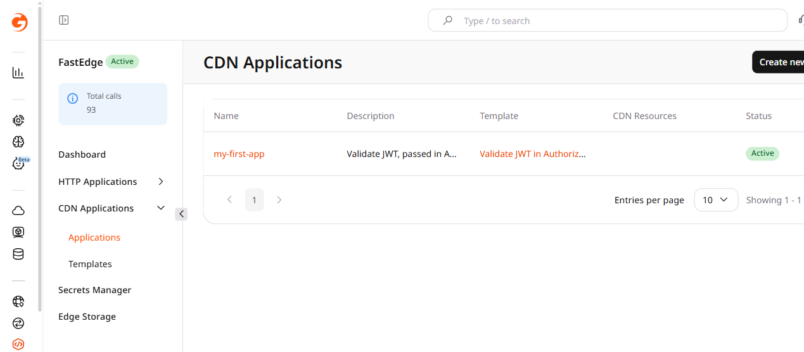</Frame>

3. In the **Create from a template** section, select a template. For JWT authentication, select **Validate JWT in Authorization header**.

<Frame>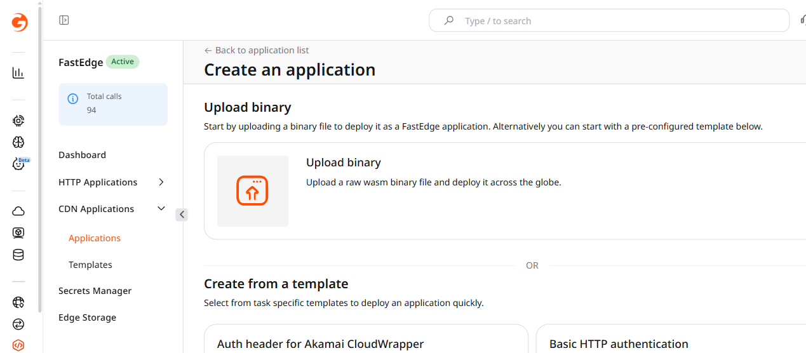</Frame>

4. Enter a name for the application and, optionally, a description.
5. Fill in the **Template environment variables** section. The variables are pre-defined by the template — for the JWT template, enter the token signing key in the **secret** field. Custom environment variables and secrets can be added in the **Environment variables** and **Secrets** sections.

<Frame>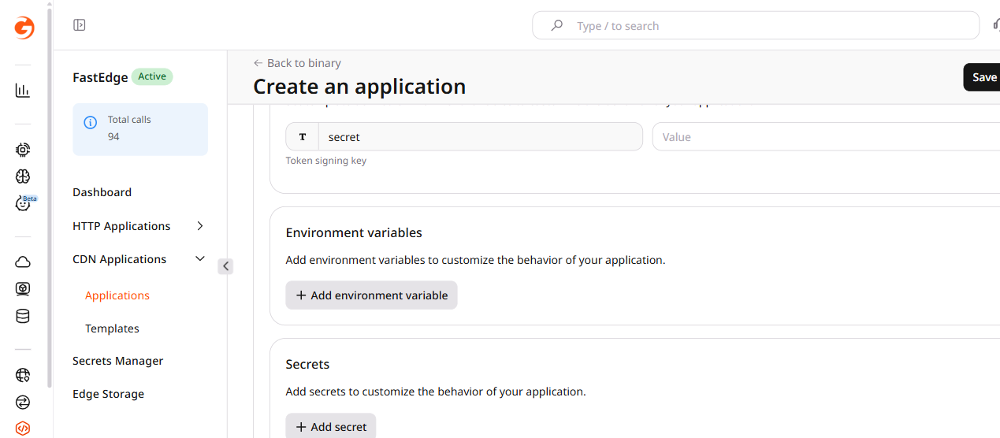</Frame>

6. Click **Save and deploy**.

<p>The application is deployed and ready to be linked to a CDN resource.</p>

<Frame>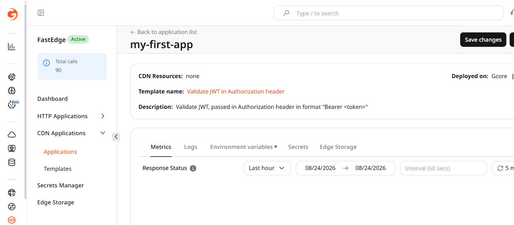</Frame>

<p>To adjust the configuration later, click the three-dot icon (...) next to the application, select **Manage**, then click **Actions** > **Edit application**.</p>

<Frame>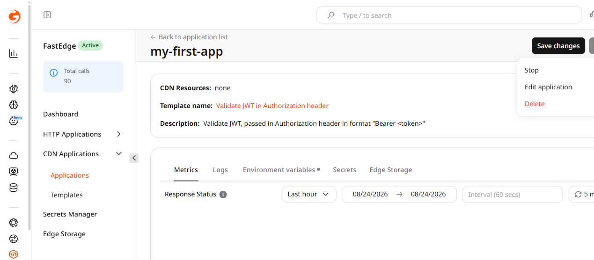</Frame>

  </Tab>
  <Tab title="Deploy custom binary">

<p>Custom implementations are available in the [FastEdge&nbsp;SDK](https://github.com/G-Core/FastEdge-sdk-rust) and [proxy-wasm&nbsp;SDK](https://github.com/G-Core/proxy-wasm-sdk-as) repositories.</p>

1. In the [Gcore Customer Portal](https://portal.gcore.com), navigate to **FastEdge**.
2. Open the **CDN Applications** page and click **Create new application**.

<Frame></Frame>

3. Click **Upload binary**.

<Frame>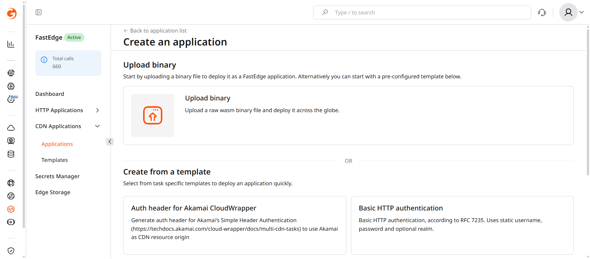</Frame>

4. Select the compiled `.wasm` file.

<Frame></Frame>

5. Enter a name for the application and, optionally, a description.
6. Add any required environment variables as key-value pairs. For sensitive values, click **+ Add Secret** to store them in [Secrets&nbsp;Manager](/fastedge/secrets-manager/manage-secrets) instead.

<Frame>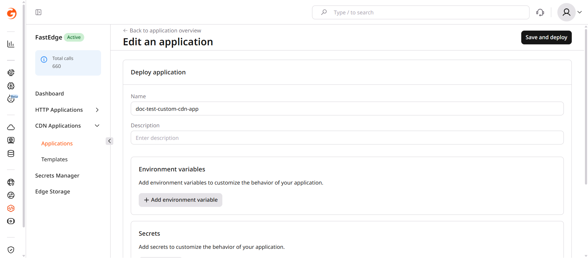</Frame>

7. Click **Save and deploy**.

<p>The application is deployed and ready to be linked to a CDN resource. To adjust the configuration later, click the three-dot icon (...) next to the application, select **Manage**, then click **Actions** > **Edit application**.</p>

<Frame>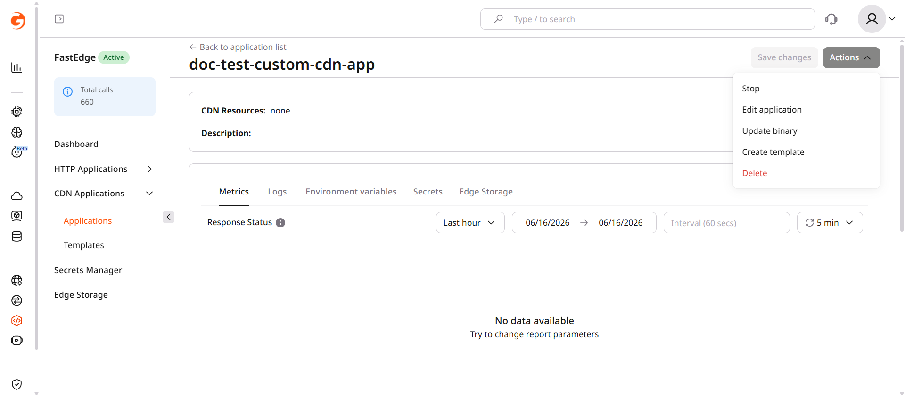</Frame>

  </Tab>
</Tabs>

## Step 2. Enable FastEdge for a CDN resource

<p>FastEdge can be enabled for all requests on a CDN resource, or limited to specific URL paths using CDN rules.</p>

<Tabs>
  <Tab title="For a whole CDN resource">

1. In the Customer Portal, navigate to **CDN**.
2. Find the resource and open its settings.

<Frame>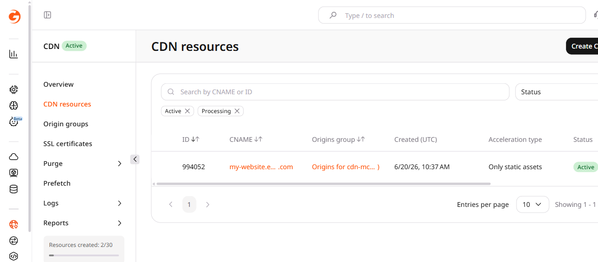</Frame>

3. Scroll to the **FastEdge apps** section and enable the **FastEdge** checkbox to activate the feature.

<Frame>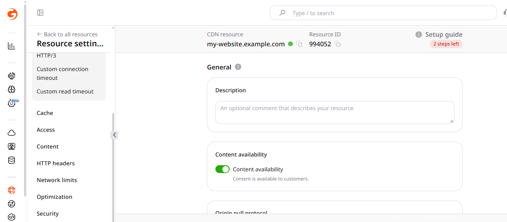</Frame>

4. Enable the checkbox for the required processing stage. For the most common use case, enable **On request headers (before cache)**.
5. Select the application from the dropdown.

<Frame>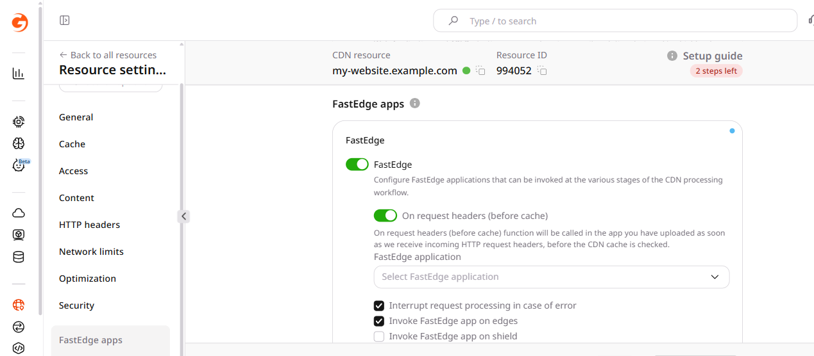</Frame>

6. (Optional) Configure additional stage options:
   - **Interrupt request processing in case of error** — enabled by default. When active, errors on the FastEdge side return the relevant response code to the client. When disabled, the CDN ignores the error and continues the request. Keep this enabled for security-sensitive applications.
   - **Invoke FastEdge app on edges** — enabled by default. Runs the application on CDN edge nodes.
   - **Invoke FastEdge app on shield** — disabled by default. Runs the application on CDN shield (precache) nodes in addition to edge nodes.

7. Click **Save changes**.

  </Tab>
  <Tab title="For specific URL paths">

<p>URL-specific rules apply FastEdge logic only to certain paths — protecting `/api/` with JWT validation while leaving static assets unaffected, for instance.</p>

1. In the Customer Portal, navigate to **CDN**.
2. Find the resource and open its settings.
3. Click **Rules** > **Create rule**.

<Frame>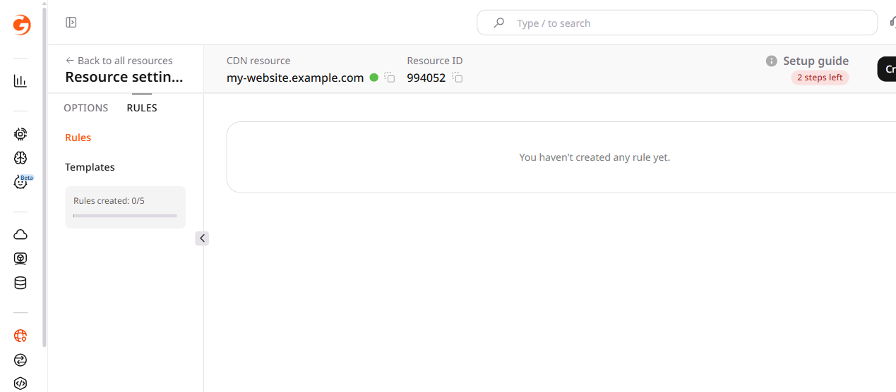</Frame>

4. Click **Create blank rule**.
5. Enter a rule name.
6. In the **Match criteria** section, specify the URL paths affected by the application.
7. In the **Options** section, click **Add option**.
8. Scroll to the **FastEdge apps** section.

<Frame>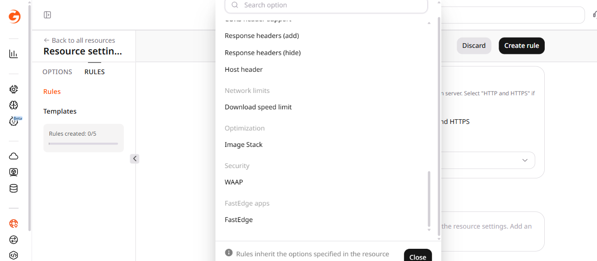</Frame>

9. Enable the checkbox for the required processing stage. For the most common use case, enable **On request headers (before cache)**.
10. Select the application from the dropdown.
11. (Optional) Configure additional stage options:
    - **Interrupt request processing in case of error** — enabled by default. When active, errors on the FastEdge side return the relevant response code to the client. When disabled, the CDN ignores the error and continues the request.
    - **Invoke FastEdge app on edges** — enabled by default. Runs the application on CDN edge nodes.
    - **Invoke FastEdge app on shield** — disabled by default. Runs the application on CDN shield (precache) nodes in addition to edge nodes.

12. Click **Create rule**.

  </Tab>
</Tabs>

## Step 3. Check the application

<p>These checks apply to the **Validate JWT in Authorization header** template. Send each request to a URL covered by the FastEdge setting from Step 2.</p>

<p>Request the CDN hostname with no <code>Authorization</code> header. The application returns 401 and the body <code>No Authorization header</code>.</p>

<p>Request it again with <code>Authorization: Bearer</code> and a value that is not a JWT signed with the <code>secret</code> key. The application returns 403.</p>

<p>Sign a JWT with HS256 and the same <code>secret</code> key, and set the <code>exp</code> claim to a future Unix time. Send that token in <code>Authorization: Bearer</code>. The CDN returns the origin response.</p>

## Disconnect FastEdge from CDN

<p>To stop FastEdge processing, clear the **FastEdge** checkbox on the CDN resource, or disable the rule that attaches the application.</p>

<p>1. In the Customer Portal, navigate to **CDN**.</p>
<p>2. Find the resource and open its settings.</p>

<Frame></Frame>

<p>3. To disable FastEdge for the **whole CDN resource**, scroll to the **FastEdge apps** section and clear the **FastEdge** checkbox.</p>
<p>4. To disable FastEdge for **specific URL paths**, open the **Rules** page and disable the relevant rule.</p>
<p>5. Click **Save changes**.</p>

## Delete a CDN application

<Info>
An enabled FastEdge application linked to a CDN resource cannot be deleted. Disconnect it from the CDN resource first.
</Info>

<p>1. In the Customer Portal, navigate to **FastEdge**.</p>
<p>2. Open the **CDN Applications** page and click the three-dot icon next to the application.</p>

<Frame>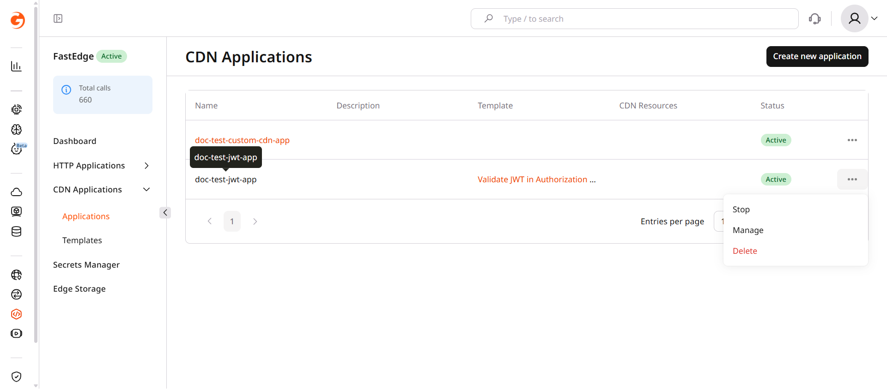</Frame>

<p>3. Click **Delete**.</p>
<p>4. Confirm by clicking **Yes, delete**.</p>

<Frame>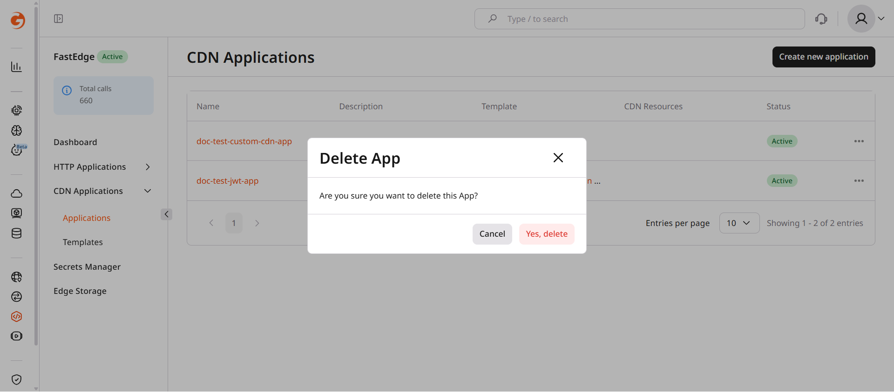</Frame>

</MethodSection>
<MethodSection id="api" label="REST API">

<p>FastEdge CDN applications run inside the CDN request pipeline, modifying requests and responses before they reach the origin or end users.</p>

<p>A CDN resource configured for the origin is required; the [Create CDN&nbsp;resource](/api-reference/cdn/cdn-resources/create-cdn-resource) endpoint covers the parameters.</p>

## Request lifecycle

<p>The CDN runtime invokes a CDN application at five stages:</p>

- **on_request_headers:** when the CDN receives request headers, before cache.
- **on_request_headers_after_cache:** after the CDN cache lookup.
- **on_request_body:** when the CDN receives the request body.
- **on_response_headers:** before the CDN sends response headers to the client.
- **on_response_body:** before the CDN sends the response body to the client.

## Execution limits

<p>All five processing stages have the same default execution time limit: 100 ms on the Free plan and 5 seconds on the Pro plan. If an application exceeds the limit, the CDN stops its execution. With <code>interrupt_on_error</code> set to <code>true</code>, the client receives HTTP 532 with an empty body. With <code>false</code>, the CDN continues processing the request.</p>

<Info>CDN applications are built on the [Proxy-Wasm](https://github.com/proxy-wasm/spec) specification — an open standard for WebAssembly-based proxy extensions.</Info>

<p>Each stage has an independent application slot.</p>

<Warning>Only one FastEdge application can be attached to each processing stage.</Warning>

<p>The same application can be attached to more than one stage.</p>

<p>Replacing the binary of an attached application updates that application on the CDN resource. The resource keeps the same application ID. An edge can keep running the previous binary for a few minutes after the API stores the new binary.</p>

<p>These steps configure FastEdge with the FastEdge API and the CDN API.</p>

<Info>
An [API&nbsp;token](/account-settings/api-tokens) is required, along with the ID of an existing [CDN&nbsp;resource](/cdn/getting-started/create-a-cdn-resource/overview).
</Info>

<p>Open a terminal and export these environment variables:</p>

```bash
export GCORE_API_KEY="{YOUR_API_KEY}"
export CDN_RESOURCE_ID="{YOUR_CDN_RESOURCE_ID}"
```

## Quickstart

<p>Scripts that create a FastEdge application from the JWT authentication template and enable it on a CDN resource.</p>

<Tabs>
  <Tab title="Python SDK">

```python
import os
from gcore import Gcore
from gcore.types.cdn import cdn_resource_update_params as cdn_params

client = Gcore()
resource_id = int(os.environ["CDN_RESOURCE_ID"])

# Step 1. Find the JWT template and create an application
templates = list(client.fastedge.templates.list(api_type="proxy-wasm"))
jwt_template = next((t for t in templates if "validate jwt" in t.name.lower()), None)
if jwt_template is None:
    raise RuntimeError("Validate JWT template was not found")

app = client.fastedge.apps.create(
    name="my-cdn-app-1",
    template=jwt_template.id,
    status=1,
    env={"secret": "your-signing-key"},
)
print(f"app id={app.id}")

# Step 2. Enable FastEdge on the CDN resource
client.cdn.cdn_resources.update(
    resource_id,
    options=cdn_params.Options(
        fastedge=cdn_params.OptionsFastedge(
            enabled=True,
            on_request_headers=cdn_params.OptionsFastedgeOnRequestHeaders(
                app_id=str(app.id),
                interrupt_on_error=True,
            ),
        )
    ),
)
print(f"FastEdge enabled on resource {resource_id}")
```

  </Tab>
  <Tab title="Go SDK">

```go
package main

import (
    "context"
    "fmt"
    "os"
    "strconv"
    "strings"

    gcore "github.com/G-Core/gcore-go"
    "github.com/G-Core/gcore-go/cdn"
    "github.com/G-Core/gcore-go/fastedge"
)

func main() {
    client := gcore.NewClient()
    ctx := context.Background()
    resourceID, _ := strconv.ParseInt(os.Getenv("CDN_RESOURCE_ID"), 10, 64)

    // Step 1. Find the JWT template and create an application
    var templateID int64
    pager := client.Fastedge.Templates.ListAutoPaging(ctx, fastedge.TemplateListParams{
        APIType: fastedge.TemplateListParamsAPITypeProxyWasm,
    })
    for pager.Next() {
        t := pager.Current()
        if strings.Contains(strings.ToLower(t.Name), "validate jwt") {
            templateID = t.ID
            break
        }
    }
    if err := pager.Err(); err != nil {
        panic(err)
    }
    if templateID == 0 {
        panic("Validate JWT template was not found")
    }

    app, err := client.Fastedge.Apps.New(ctx, fastedge.AppNewParams{
        App: fastedge.AppParam{
            Name:     gcore.String("my-cdn-app-1"),
            Template: gcore.Int(templateID),
            Status:   gcore.Int(1),
            Env:      map[string]string{"secret": "your-signing-key"},
        },
    })
    if err != nil {
        panic(err)
    }
    fmt.Printf("app id=%d\n", app.ID)

    // Step 2. Enable FastEdge on the CDN resource
    _, err = client.CDN.CDNResources.Update(ctx, resourceID, cdn.CDNResourceUpdateParams{
        Options: cdn.CDNResourceUpdateParamsOptions{
            Fastedge: cdn.CDNResourceUpdateParamsOptionsFastedge{
                Enabled: true,
                OnRequestHeaders: cdn.CDNResourceUpdateParamsOptionsFastedgeOnRequestHeaders{
                    AppID: strconv.FormatInt(app.ID, 10),
                },
            },
        },
    })
    if err != nil {
        panic(err)
    }
    fmt.Printf("FastEdge enabled on resource %d\n", resourceID)
}
```

  </Tab>
</Tabs>

<p>Request the CDN hostname with no <code>Authorization</code> header. The application returns 401 and the body <code>No Authorization header</code>. An <code>Authorization: Bearer</code> value that is not a JWT signed with the <code>secret</code> key returns 403. A JWT signed with HS256 and that key, with <code>exp</code> set to a future Unix time, reaches the origin.</p>

## Step-by-step

<p>Each step explains what the call does, which parameters matter, and what the response looks like.</p>

<Accordion title="Show all steps">

### Step 1. Create a FastEdge application

<p>Deploy an application from a predefined template or upload a custom Proxy-Wasm binary.</p>

**From a template**

<p>List available templates to find the template ID:</p>

```bash
curl https://api.gcore.com/fastedge/v1/template \
  -H "Authorization: APIKey $GCORE_API_KEY"
```

<p>The response lists all available templates with their IDs and names:</p>

```json
{
  "count": 2,
  "templates": [
    { "id": 10, "name": "Validate JWT in Authorization header", "api_type": "proxy-wasm" },
    { "id": 111, "name": "Basic HTTP authentication", "api_type": "proxy-wasm" }
  ]
}
```

<p>Create the application using the template ID. The `env` object holds values for the template's pre-defined variables. The JWT template reads the signing key from `secret`. The sample value is a placeholder.</p>

| Parameter | Required | Description |
|-----------|----------|-------------|
| `name` | Yes | Application name — alphanumeric, hyphens allowed |
| `template` | Yes | Template ID from the listing |
| `status` | Yes | Set to active to deploy immediately; inactive saves as draft |
| `env` | No | Template environment variables as key-value pairs |

<Tabs>
  <Tab title="Python SDK">

```python
from gcore import Gcore

client = Gcore()

app = client.fastedge.apps.create(
    name="my-cdn-app-1",
    template=10,  # Validate JWT in Authorization header
    status=1,
    env={"secret": "your-signing-key"},
)
print(f"app id={app.id}")
```

  </Tab>
  <Tab title="Go SDK">

```go
app, err := client.Fastedge.Apps.New(ctx, fastedge.AppNewParams{
    App: fastedge.AppParam{
        Name:     gcore.String("my-cdn-app-1"),
        Template: gcore.Int(10), // Validate JWT in Authorization header
        Status:   gcore.Int(1),
        Env:      map[string]string{"secret": "your-signing-key"},
    },
})
```

  </Tab>
  <Tab title="curl">

```bash
curl -X POST https://api.gcore.com/fastedge/v1/apps \
  -H "Authorization: APIKey $GCORE_API_KEY" \
  -H "Content-Type: application/json" \
  -d '{
    "name": "my-cdn-app-1",
    "template": 10,
    "status": 1,
    "env": { "secret": "your-signing-key" }
  }'
```

<p>The API returns the application ID used in Step 2:</p>

```json
{
  "id": 67890,
  "name": "my-cdn-app-1",
  "status": 1,
  "api_type": "proxy-wasm"
}
```

  </Tab>
</Tabs>

**Upload a custom binary**

<p>Upload the compiled `.wasm` file to the FastEdge binary store. The binary must conform to the Proxy-Wasm specification:</p>

| Parameter | Required | Description |
|-----------|----------|-------------|
| Request body | Yes | Raw `.wasm` file with `Content-Type: application/octet-stream` |

<Tabs>
  <Tab title="Python SDK">

```python
from gcore import Gcore

client = Gcore()

with open("app.wasm", "rb") as f:
    binary = client.fastedge.binaries.create(body=f)
print(f"binary id={binary.id}")
```

  </Tab>
  <Tab title="Go SDK">

```go
import "os"

f, err := os.Open("app.wasm")
if err != nil {
    panic(err)
}
defer f.Close()

binary, err := client.Fastedge.Binaries.New(ctx, f)
```

  </Tab>
  <Tab title="curl">

```bash
curl -X POST https://api.gcore.com/fastedge/v1/binaries/raw \
  -H "Authorization: APIKey $GCORE_API_KEY" \
  -H "Content-Type: application/octet-stream" \
    --data-binary @app.wasm
```

<p>The API returns the binary ID needed in the next call:</p>

```json
{
  "id": 12345,
  "api_type": "proxy-wasm"
}
```

  </Tab>
</Tabs>

<p>Create the application using the binary ID:</p>

| Parameter | Required | Description |
|-----------|----------|-------------|
| `name` | Yes | Application name — alphanumeric, hyphens allowed |
| `binary` | Yes | Binary ID from the upload response |
| `status` | Yes | Set to active to deploy immediately; inactive saves as draft |
| `env` | No | Environment variables as key-value pairs |

<Tabs>
  <Tab title="Python SDK">

```python
app = client.fastedge.apps.create(
    name="my-cdn-app-1",
    binary=binary.id,
    status=1,
    env={"MY_VARIABLE": "value"},
)
print(f"app id={app.id}")
```

  </Tab>
  <Tab title="Go SDK">

```go
app, err := client.Fastedge.Apps.New(ctx, fastedge.AppNewParams{
    App: fastedge.AppParam{
        Name:   gcore.String("my-cdn-app-1"),
        Binary: gcore.Int(binary.ID),
        Status: gcore.Int(1),
        Env:    map[string]string{"MY_VARIABLE": "value"},
    },
})
```

  </Tab>
  <Tab title="curl">

```bash
curl -X POST https://api.gcore.com/fastedge/v1/apps \
  -H "Authorization: APIKey $GCORE_API_KEY" \
  -H "Content-Type: application/json" \
  -d '{
    "name": "my-cdn-app-1",
    "binary": 12345,
    "status": 1,
    "env": { "MY_VARIABLE": "value" }
  }'
```

<p>The API returns the application ID used in Step 2:</p>

```json
{
  "id": 67890,
  "name": "my-cdn-app-1",
  "status": 1,
  "api_type": "proxy-wasm"
}
```

  </Tab>
</Tabs>

<p>Set `FASTEDGE_APP_ID` to the `id` returned by the create call. Later calls read that variable.</p>

```bash
export FASTEDGE_APP_ID="{YOUR_FASTEDGE_APP_ID}"
```

### Step 2. Enable FastEdge for a CDN resource

<p>Update the CDN resource to route traffic through the FastEdge application. The `fastedge` option accepts five processing stages — configure the stages the application handles.</p>

| Parameter | Required | Description |
|-----------|----------|-------------|
| `fastedge.enabled` | Yes | `true` activates FastEdge on the resource |
| `on_request_headers.app_id` | Yes | Application ID from Step 1 |
| `on_request_headers.interrupt_on_error` | No | Default `true`. When `false`, errors are ignored and the request forwards to origin |
| `on_request_headers.execute_on_edge` | No | Default `true`. Runs the application on CDN edge nodes |
| `on_request_headers.execute_on_shield` | No | Default `false`. Runs the application on shield (precache) nodes |

<Tabs>
  <Tab title="Python SDK">

```python
import os
from gcore.types.cdn import cdn_resource_update_params as cdn_params

resource_id = int(os.environ["CDN_RESOURCE_ID"])

client.cdn.cdn_resources.update(
    resource_id,
    options=cdn_params.Options(
        fastedge=cdn_params.OptionsFastedge(
            enabled=True,
            on_request_headers=cdn_params.OptionsFastedgeOnRequestHeaders(
                app_id=str(app.id),
                interrupt_on_error=True,
            ),
        )
    ),
)
```

  </Tab>
  <Tab title="Go SDK">

```go
_, err = client.CDN.CDNResources.Update(ctx, resourceID, cdn.CDNResourceUpdateParams{
    Options: cdn.CDNResourceUpdateParamsOptions{
        Fastedge: cdn.CDNResourceUpdateParamsOptionsFastedge{
            Enabled: true,
            OnRequestHeaders: cdn.CDNResourceUpdateParamsOptionsFastedgeOnRequestHeaders{
                AppID: strconv.FormatInt(app.ID, 10),
            },
        },
    },
})
```

  </Tab>
  <Tab title="curl">

```bash
curl -X PATCH https://api.gcore.com/cdn/resources/$CDN_RESOURCE_ID \
  -H "Authorization: APIKey $GCORE_API_KEY" \
  -H "Content-Type: application/json" \
  -d '{
    "options": {
      "fastedge": {
        "enabled": true,
        "on_request_headers": {
          "app_id": "'"$FASTEDGE_APP_ID"'",
          "enabled": true,
          "interrupt_on_error": true
        }
      }
    }
  }'
```

  </Tab>
</Tabs>

<p>The five supported stages are `on_request_headers`, `on_request_headers_after_cache`, `on_request_body`, `on_response_headers`, and `on_response_body`. Each stage accepts the same `app_id`, `interrupt_on_error`, `execute_on_edge`, and `execute_on_shield` parameters.</p>

<p>A rule stores FastEdge for paths that match `/api/.*`. `ruleType` 0 is a regular expression and must start with `^/` or `/`. Keep `fastedge.enabled` false on the CDN resource so the application runs only for those paths. If the resource option is already on, turn that stage off before relying on the rule.</p>

```bash
curl -X POST "https://api.gcore.com/cdn/resources/$CDN_RESOURCE_ID/rules" \
  -H "Authorization: APIKey $GCORE_API_KEY" \
  -H "Content-Type: application/json" \
  -d '{
    "name": "fastedge-api",
    "rule": "/api/.*",
    "ruleType": 0,
    "options": {
      "fastedge": {
        "enabled": true,
        "on_request_headers": {
          "app_id": "'"$FASTEDGE_APP_ID"'",
          "enabled": true
        }
      }
    }
  }'
```

<p>The saved stage is `on_request_headers`. Fields left out of the stage are stored as `interrupt_on_error` true, `execute_on_edge` true, and `execute_on_shield` false. The rule ID in the response is used to turn the rule off later.</p>

</Accordion>

## Disable FastEdge integration

<p>Set `fastedge.enabled` to false. On the CDN resource, leaving the stage out of the request keeps the stored stage, so set that stage's `enabled` to false as well. On a rule, `fastedge.enabled` set to false removes the stage. Set `FASTEDGE_APP_ID` to the application `id` from the create call, and `CDN_RULE_ID` to the rule `id` from the create response. The calls below read those variables.</p>

```bash
export FASTEDGE_APP_ID="{YOUR_FASTEDGE_APP_ID}"
export CDN_RULE_ID="{YOUR_CDN_RULE_ID}"
```

<Tabs>
  <Tab title="Python SDK">

```python
import os
from gcore.types.cdn import cdn_resource_update_params as cdn_params

resource_id = int(os.environ["CDN_RESOURCE_ID"])

client.cdn.cdn_resources.update(
    resource_id,
    options=cdn_params.Options(
        fastedge=cdn_params.OptionsFastedge(
            enabled=False,
            on_request_headers=cdn_params.OptionsFastedgeOnRequestHeaders(
                app_id=os.environ["FASTEDGE_APP_ID"],
                enabled=False,
            ),
        )
    ),
)
```

  </Tab>
  <Tab title="Go SDK">

```go
_, err = client.CDN.CDNResources.Update(ctx, resourceID, cdn.CDNResourceUpdateParams{
    Options: cdn.CDNResourceUpdateParamsOptions{
        Fastedge: cdn.CDNResourceUpdateParamsOptionsFastedge{
            Enabled: false,
            OnRequestHeaders: cdn.CDNResourceUpdateParamsOptionsFastedgeOnRequestHeaders{
                AppID:   os.Getenv("FASTEDGE_APP_ID"),
                Enabled: gcore.Bool(false),
            },
        },
    },
})
```

  </Tab>
  <Tab title="curl">

```bash
curl -X PATCH https://api.gcore.com/cdn/resources/$CDN_RESOURCE_ID \
  -H "Authorization: APIKey $GCORE_API_KEY" \
  -H "Content-Type: application/json" \
  -d '{
    "options": {
      "fastedge": {
        "enabled": false,
        "on_request_headers": {
          "app_id": "'"$FASTEDGE_APP_ID"'",
          "enabled": false
        }
      }
    }
  }'
```

  </Tab>
</Tabs>

<p>On the rule, `fastedge.enabled` set to false removes the stored stage.</p>

```bash
curl -X PATCH "https://api.gcore.com/cdn/resources/$CDN_RESOURCE_ID/rules/$CDN_RULE_ID" \
  -H "Authorization: APIKey $GCORE_API_KEY" \
  -H "Content-Type: application/json" \
  -d '{
    "options": {
      "fastedge": {
        "enabled": false
      }
    }
  }'
```

## Delete a CDN application

<Info>
An enabled FastEdge application linked to a CDN resource or rule cannot be deleted. Set `fastedge.enabled` to false on the resource and on every rule that references the application. On the resource, also set the stage `enabled` to false, because leaving the stage out keeps the stored stage.
</Info>

<Tabs>
  <Tab title="Python SDK">

```python
import os

app_id = int(os.environ["FASTEDGE_APP_ID"])
client.fastedge.apps.delete(app_id)
```

  </Tab>
  <Tab title="Go SDK">

```go
appID, err := strconv.ParseInt(os.Getenv("FASTEDGE_APP_ID"), 10, 64)
if err != nil {
    panic(err)
}
err = client.Fastedge.Apps.Delete(ctx, appID)
```

  </Tab>
  <Tab title="curl">

```bash
curl -X DELETE https://api.gcore.com/fastedge/v1/apps/$FASTEDGE_APP_ID \
  -H "Authorization: APIKey $GCORE_API_KEY"
```

  </Tab>
</Tabs>

<p>A `204 No Content` response confirms the application was deleted.</p>

</MethodSection>
<MethodSection id="terraform" label="Terraform">

<p>FastEdge CDN applications run inside the CDN request pipeline, modifying requests and responses before they reach the origin or end users. A CDN application is built on the [Proxy-Wasm](https://github.com/proxy-wasm/spec) specification. Terraform 1.11 or later and the Gcore provider <code>~&gt; 2.0</code> are required. [Terraform&nbsp;setup](/developer-tools/terraform/get-started-with-terraform) covers installation, provider authentication, and <code>terraform init</code>.</p>

<p>The CDN option has five stage attributes: `on_request_headers`, `on_request_headers_after_cache`, `on_request_body`, `on_response_headers`, and `on_response_body`. Each stage holds one application. Set `on_request_headers` to run the application when the CDN receives request headers, before the cache is checked.</p>

## Execution limits

<p>All five processing stages have the same default execution time limit: 100 ms on the Free plan and 5 seconds on the Pro plan. If an application exceeds the limit, the CDN stops its execution. With <code>interrupt_on_error</code> set to <code>true</code>, the client receives HTTP 532 with an empty body. With <code>false</code>, the CDN continues processing the request.</p>

<Warning>Only one FastEdge application can be attached to each processing stage.</Warning>

<p>The same application can be attached to more than one stage.</p>

<p>Replacing the binary of an attached application updates that application on the CDN resource. The resource keeps the same application ID. An edge can keep running the previous binary for a few minutes after the API stores the new binary.</p>

## Deploy the application on a CDN resource

<p>The JWT template checks the token in the <code>Authorization</code> header before the request reaches the origin. Setting `status = 1` deploys the application. The template reads the signing key from the <code>secret</code> environment variable. The sample value is a placeholder. Attach that application to the CDN resource, then run <code>terraform apply</code>. A stage created without <code>interrupt_on_error</code>, <code>execute_on_edge</code>, or <code>execute_on_shield</code> stores those fields as true, true, and false.</p>

```hcl
data "gcore_fastedge_templates" "cdn" {
  api_type = "proxy-wasm"
}

resource "gcore_fastedge_app" "jwt" {
  name = "my-cdn-app"
  template = one([
    for item in data.gcore_fastedge_templates.cdn.items : item.id
    if item.name == "Validate JWT in Authorization header"
  ])
  status = 1
  env = {
    secret = "your-signing-key"
  }
}

resource "gcore_cdn_origin_group" "example" {
  name = "my-origin-group"

  sources = [
    {
      source  = "example.com"
      enabled = true
    }
  ]
}

resource "gcore_cdn_resource" "example" {
  cname           = "cdn.example.com"
  origin_group    = gcore_cdn_origin_group.example.id
  origin_protocol = "HTTPS"

  options = {
    fastedge = {
      enabled = true
      on_request_headers = {
        enabled            = true
        app_id             = tostring(gcore_fastedge_app.jwt.id)
        interrupt_on_error = true
        execute_on_edge    = true
        execute_on_shield  = false
      }
    }
  }
}
```

<p>Request the CDN hostname with no <code>Authorization</code> header. The application returns 401 and the body <code>No Authorization header</code>. An <code>Authorization: Bearer</code> value that is not a JWT signed with the <code>secret</code> key returns 403. A JWT signed with HS256 and that key, with <code>exp</code> set to a future Unix time, reaches the origin.</p>

## Limit the application to URL paths

<p>A rule stores the stage for paths that match `/api/.*`. `rule_type` 0 is a regular expression and must start with `^/` or `/`. The CDN resource has no FastEdge option, so the application runs only for those paths. Run `terraform apply`.</p>

```hcl
data "gcore_fastedge_templates" "cdn" {
  api_type = "proxy-wasm"
}

resource "gcore_fastedge_app" "jwt" {
  name = "my-cdn-app"
  template = one([
    for item in data.gcore_fastedge_templates.cdn.items : item.id
    if item.name == "Validate JWT in Authorization header"
  ])
  status = 1
  env = {
    secret = "your-signing-key"
  }
}

resource "gcore_cdn_origin_group" "example" {
  name = "my-origin-group"

  sources = [
    {
      source  = "example.com"
      enabled = true
    }
  ]
}

resource "gcore_cdn_resource" "example" {
  cname           = "cdn.example.com"
  origin_group    = gcore_cdn_origin_group.example.id
  origin_protocol = "HTTPS"
}

resource "gcore_cdn_resource_rule" "api" {
  resource_id = gcore_cdn_resource.example.id
  name        = "fastedge-api"
  rule        = "/api/.*"
  rule_type   = 0

  options = {
    fastedge = {
      enabled = true
      on_request_headers = {
        enabled = true
        app_id  = tostring(gcore_fastedge_app.jwt.id)
      }
    }
  }
}
```

## Turn FastEdge off

<p>To turn FastEdge off for the whole CDN resource, set <code>fastedge.enabled</code> to false and set the stage <code>enabled</code> to false. Leaving the stage out of the configuration keeps the stored stage. Run <code>terraform apply</code>.</p>

```hcl
data "gcore_fastedge_templates" "cdn" {
  api_type = "proxy-wasm"
}

resource "gcore_fastedge_app" "jwt" {
  name = "my-cdn-app"
  template = one([
    for item in data.gcore_fastedge_templates.cdn.items : item.id
    if item.name == "Validate JWT in Authorization header"
  ])
  status = 1
  env = {
    secret = "your-signing-key"
  }
}

resource "gcore_cdn_origin_group" "example" {
  name = "my-origin-group"

  sources = [
    {
      source  = "example.com"
      enabled = true
    }
  ]
}

resource "gcore_cdn_resource" "example" {
  cname           = "cdn.example.com"
  origin_group    = gcore_cdn_origin_group.example.id
  origin_protocol = "HTTPS"

  options = {
    fastedge = {
      enabled = false
      on_request_headers = {
        enabled = false
        app_id  = tostring(gcore_fastedge_app.jwt.id)
      }
    }
  }
}
```

<p>To turn FastEdge off for a URL path, set <code>fastedge.enabled</code> to false on the CDN rule. That removes the stage from the rule. The CDN resource has no FastEdge option. Run <code>terraform apply</code>.</p>

```hcl
data "gcore_fastedge_templates" "cdn" {
  api_type = "proxy-wasm"
}

resource "gcore_fastedge_app" "jwt" {
  name = "my-cdn-app"
  template = one([
    for item in data.gcore_fastedge_templates.cdn.items : item.id
    if item.name == "Validate JWT in Authorization header"
  ])
  status = 1
  env = {
    secret = "your-signing-key"
  }
}

resource "gcore_cdn_origin_group" "example" {
  name = "my-origin-group"

  sources = [
    {
      source  = "example.com"
      enabled = true
    }
  ]
}

resource "gcore_cdn_resource" "example" {
  cname           = "cdn.example.com"
  origin_group    = gcore_cdn_origin_group.example.id
  origin_protocol = "HTTPS"
}

resource "gcore_cdn_resource_rule" "api" {
  resource_id = gcore_cdn_resource.example.id
  name        = "fastedge-api"
  rule        = "/api/.*"
  rule_type   = 0

  options = {
    fastedge = {
      enabled = false
    }
  }
}
```

## Delete the application

<p>Remove the <code>gcore_fastedge_app</code> resource and every <code>app_id</code> that reads <code>gcore_fastedge_app.jwt.id</code>. Keep <code>fastedge.enabled</code> set to false on the same object that had the application, either the CDN resource or the CDN rule. Then run <code>terraform apply</code>. Deleting the application while a stage is still enabled fails because the application is used by the CDN. A CDN resource update that still sends the deleted application id is rejected.</p>

<p>When FastEdge is off on the whole CDN resource, apply this configuration.</p>

```hcl
resource "gcore_cdn_origin_group" "example" {
  name = "my-origin-group"

  sources = [
    {
      source  = "example.com"
      enabled = true
    }
  ]
}

resource "gcore_cdn_resource" "example" {
  cname           = "cdn.example.com"
  origin_group    = gcore_cdn_origin_group.example.id
  origin_protocol = "HTTPS"

  options = {
    fastedge = {
      enabled = false
    }
  }
}
```

<p>When FastEdge is off on a CDN rule, apply this configuration.</p>

```hcl
resource "gcore_cdn_origin_group" "example" {
  name = "my-origin-group"

  sources = [
    {
      source  = "example.com"
      enabled = true
    }
  ]
}

resource "gcore_cdn_resource" "example" {
  cname           = "cdn.example.com"
  origin_group    = gcore_cdn_origin_group.example.id
  origin_protocol = "HTTPS"
}

resource "gcore_cdn_resource_rule" "api" {
  resource_id = gcore_cdn_resource.example.id
  name        = "fastedge-api"
  rule        = "/api/.*"
  rule_type   = 0

  options = {
    fastedge = {
      enabled = false
    }
  }
}
```

```bash
terraform apply
```

</MethodSection>
</MethodSwitch>
