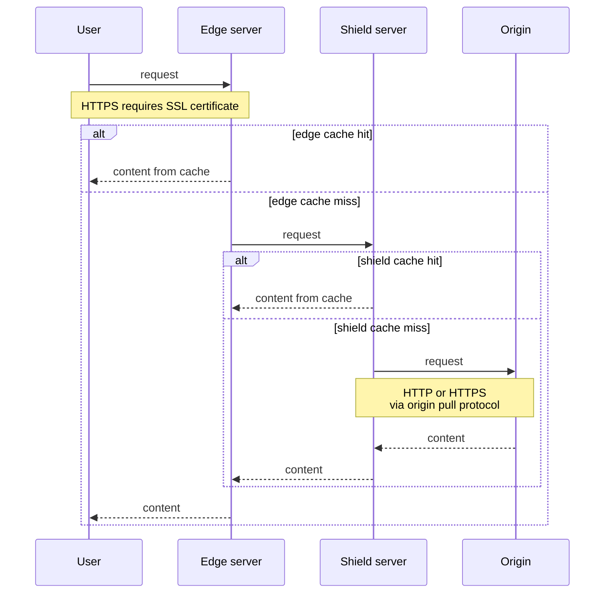

When a user requests a file from a domain connected to Gcore CDN, the request goes to a nearby Gcore edge server. If the server has the file in its cache, it sends the file to the user. Otherwise, it retrieves the file from the origin, the server that stores the original files. Answering from the cache helps content load faster and reduces requests to the origin.

## CDN resource

To deliver your content, the CDN needs to know where to get the files and how to handle requests. This information is configured in a CDN resource, which can serve one or more domains.

A resource has one main domain and can have additional ones. All of them share the same settings, so domains that need different settings are separate resources.

Each resource uses an [origin&nbsp;group](/cdn/add-an-origin-group) to specify where files come from. An origin group can contain one or more origins, such as servers, storage buckets, or FastEdge HTTP applications.

## Cache

When an edge server retrieves a file from the origin, it can keep a copy in its cache for future requests. Whether the file can be cached depends on the HTTP status code and the `Cache-Control` header of the response.

The copy does not stay in the cache forever. How long it stays is set by the [cache&nbsp;lifetime](/cdn/cdn-resource-options/cache/specify-cache-lifetime-on-a-cdn-resource-or-origin), which comes from the origin headers or from the CDN resource settings.

## Origin shielding

The cache reduces the number of requests to the origin, but not to zero: a file that is not cached yet, or whose copy has expired, is requested again. If this happens often on many edge servers, the origin can be overloaded with requests.

You can reduce this load with [Origin&nbsp;Shielding](/cdn/cdn-resource-options/general/enable-and-configure-origin-shielding), which adds a shield server: another cache between the edge servers and the origin. Edge servers request missing files from the shield server first. If the file is not there either, the shield server retrieves it from the origin.

## The complete delivery path

The CDN resource, edge cache, origin, and optional Origin Shielding work together to deliver content to users. The diagram below shows how a request moves through these components and where cached content can be served.

The connections along this path can use different protocols. Even if a user connects to an edge server over HTTPS, the connection to the origin may still use HTTP.

Between the user and the edge server, an [SSL&nbsp;certificate](/cdn/ssl-certificates/add-an-ssl-certificate-to-deliver-content-over-https) lets the CDN serve the domain over HTTPS. Between the CDN and the origin, you choose HTTP or HTTPS with the [origin&nbsp;pull&nbsp;protocol](/cdn/cdn-resource-options/general/specify-an-origin-and-the-origin-pull-protocol), depending on what the origin supports.
