import { MethodSwitch, MethodSection } from "/snippets/method-switch.jsx";

<MethodSwitch>
  <MethodSection id="portal" label="Customer Portal">

<p>When HTML pages and static files share the same CDN caching policy, visitors may receive outdated pages even though CSS, JavaScript, fonts, and images benefit from longer caching. Two CDN rules separate these behaviors, keeping pages uncached and static assets cached for four days.</p>

<p>A new CDN resource follows origin cache headers, with a four-day fallback when the origin sends none. That fallback applies to every file type, because [CDN&nbsp;caching](/cdn/cdn-resource-options/cache/specify-cache-lifetime-on-a-cdn-resource-or-origin) follows the status code and `Cache-Control`, not the extension.</p>

<Frame>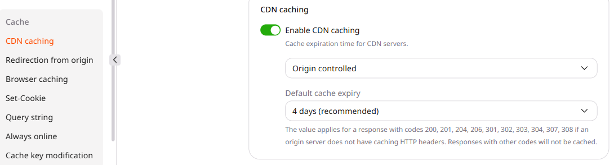</Frame>

<p>Files with no requests for 36 hours leave the edge cache, whatever lifetime is set.</p>

## Leave HTML uncached

<p>With only that fallback, HTML is cached the same way as CSS. A rule sets `/`, any path ending in `.html`, and any path whose last segment has no dot to **Do not cache**.</p>

<p>1. In the [Gcore&nbsp;Customer&nbsp;Portal](https://portal.gcore.com), navigate to **CDN** > **CDN resources** and click the resource CNAME.</p>

<Frame>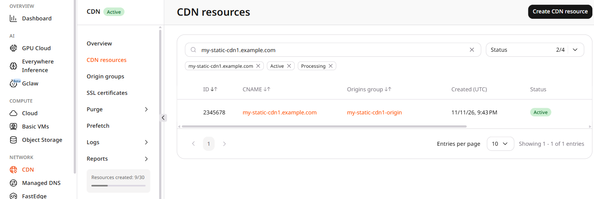</Frame>

<p>2. Open the **Rules** tab. Click **Create rule**, then **Create blank rule**.</p>

<p>3. Name the rule and enter `^/($|.*\.html$|[^./]+|.*/[^./]+)$`. The pattern is a regular expression and must start with `^/` or `/`.</p>

<p>The pattern covers the root path, `.html` files, and extensionless URLs. Adjust the pattern to match the website's URL structure.</p>

<Frame>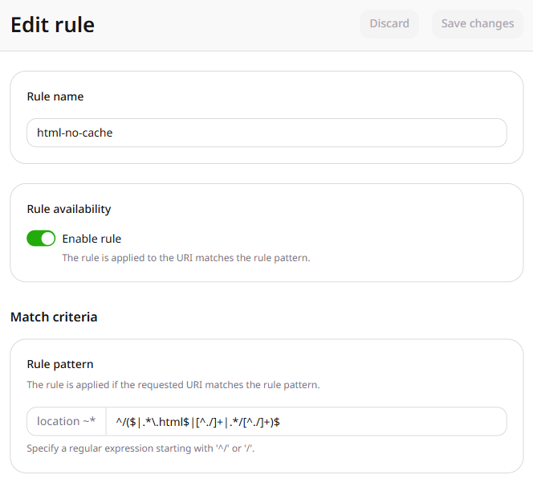</Frame>

<p>4. Click **Add option**. Add **CDN caching**, set it to **CDN controlled**, and select **Do not cache**.</p>

<Frame>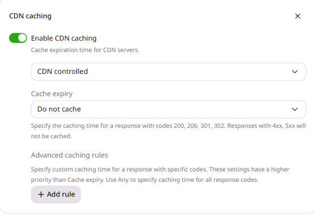</Frame>

<p>5. Click **Create rule**.</p>

<p>The first matching rule wins, and this pattern does not overlap the static pattern below. A request for `/`, for `index.html`, or for a path whose last segment has no dot returns no `Cache` header, so the response is not stored.</p>

## Cache the static files

<p>CSS, JavaScript, fonts, and images need their own rule, because the resource fallback caches them the same way as HTML. Browser lifetime, query strings, compression, and CORS go on that same rule, and a resource allows five rules.</p>

<p>1. On the **Rules** tab, click **Create rule**, then **Create blank rule**.</p>

<p>2. Name the rule. Enter `^/.*\.(css|js|gif|png|jpe?g|webp|svg|ico|woff2?|ttf|otf|eot)$`.</p>

<Frame>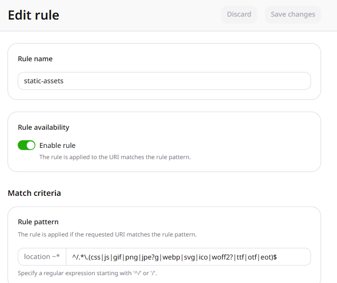</Frame>

<p>3. Add **CDN caching**. Set **CDN controlled** and a lifetime of four days, the same length as the resource fallback.</p>

<Frame>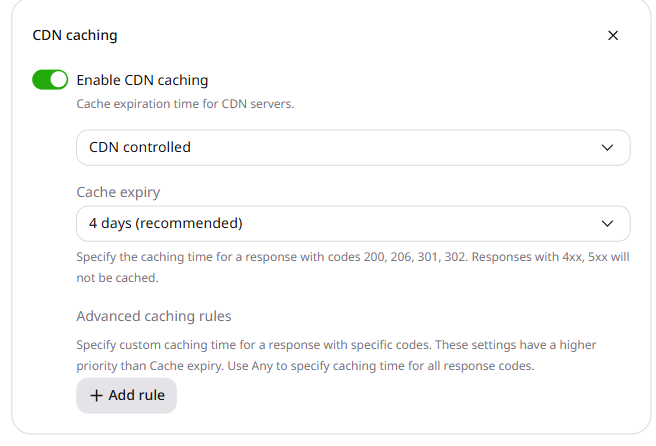</Frame>

<p>4. Add **Browser caching** and set **CDN controlled** to 12 hours, shorter than the four-day edge lifetime. [Browser&nbsp;caching](/cdn/cdn-resource-options/cache/specify-cache-lifetime-for-user-browsers) sets that lifetime independently of the origin headers.</p>

<Frame>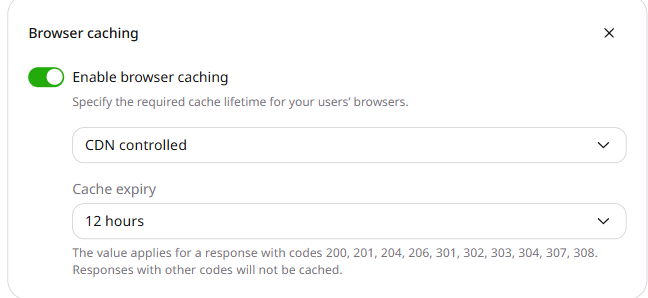</Frame>

<p>5. Add **Ignore query string** and select **Ignore all**, only when the query string does not change the file. The [query&nbsp;string](/cdn/cdn-resource-options/cache/ignore-the-set-cookie-or-query-string-parameters-when-caching-content-on-cdn-servers) article lists the other two modes.</p>

<Frame>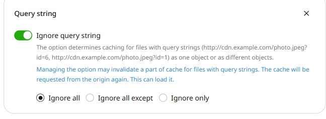</Frame>

<p>6. Add **Gzip compression**.</p>

<Frame>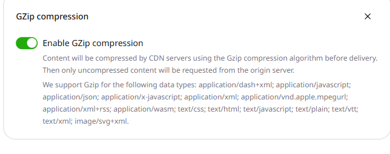</Frame>

<p>7. Add **CORS header support**, because fonts loaded from another site need `Access-Control-Allow-Origin`. The [CORS&nbsp;header](/cdn/cdn-resource-options/http-headers/add-the-access-control-allow-origin-header-to-the-browser-response) article covers a star value and a specific origin.</p>

<Frame>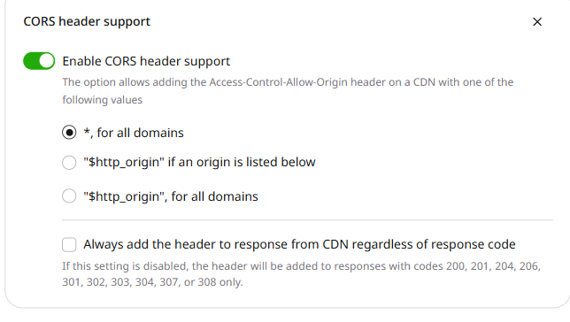</Frame>

<p>8. Click **Create rule**.</p>

<Frame>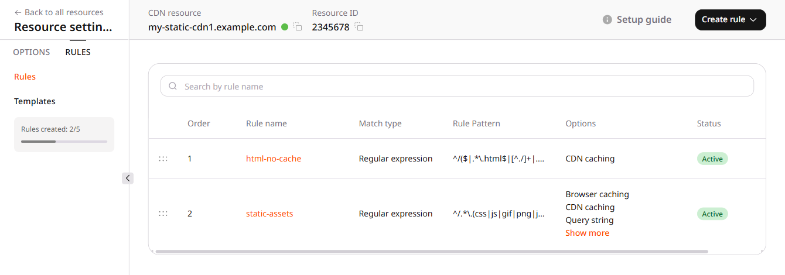</Frame>

<p>The **Static content** template matches a much wider list, including archives and video. The pattern above stays on text, fonts, and images.</p>

<p>[Image&nbsp;Stack](/cdn/cdn-resource-options/image-optimization-paid/about-image-stack) transforms photos. Caching a JPEG does not require it.</p>

## Publish a new file name

<p>A new CSS, JavaScript, or image file goes out under a new URL, and `app.v2.css` is one name. The previous URL keeps serving its cached body, so that release does not need a purge.</p>

<p>When the bytes at an existing URL change, the edge keeps the previous body until that path is [purged](/cdn/clear-cdn-resource-cache-by-url-pattern-or-all). With **Ignore all** on, purging the path without the query string also clears the query variants, and a different file name stays cached.</p>

## Check the response headers

<p>Request the same URL twice and read `Cache`, `Cache-Control`, and `Content-Encoding`.</p>

```bash
curl -sI -H "Accept-Encoding: gzip" "https://cdn.example.com/"
curl -sI -H "Accept-Encoding: gzip" "https://cdn.example.com/index.html"
curl -sI -H "Accept-Encoding: gzip" "https://cdn.example.com/about"
curl -sI -H "Accept-Encoding: gzip" "https://cdn.example.com/static/app.css"
curl -sI -H "Accept-Encoding: gzip" "https://cdn.example.com/static/app.css"
curl -sI -H "Accept-Encoding: gzip" "https://cdn.example.com/static/app.css?build=1"
curl -sI -H "Accept-Encoding: gzip" "https://cdn.example.com/static/app.css?build=2"
curl -sI -H "Accept-Encoding: gzip" -H "Origin: https://example.com" "https://cdn.example.com/static/font.woff2"
```

<p>A request for `/`, a path ending in `.html`, or a path whose last segment has no dot returns no `Cache` header. A second request for a CSS, font, or image file returns HIT, and `Cache-Control` carries the 12-hour browser lifetime.</p>

<p>Two query strings on the same CSS path share one cached object. A font requested with an `Origin` header returns `Access-Control-Allow-Origin`.</p>

<p>Gzip compresses a CSS file of 128 bytes or larger. A smaller CSS file, and a JPEG, are returned without `Content-Encoding`.</p>

</MethodSection>
  <MethodSection id="api" label="REST API">

<p>Two rules split HTML from CSS, JavaScript, fonts, and images. The HTML rule disables the edge cache, and the static rule sets the edge lifetime, a shorter browser lifetime, query-string handling, Gzip, and CORS.</p>

<Info>
An [API&nbsp;token](/account-settings/api-tokens) is required. The resource ID comes from the [resources&nbsp;list](/api-reference/cdn/cdn-resources/list-cdn-resources).
</Info>

```bash
export GCORE_API_KEY="{YOUR_API_KEY}"
export CDN_RESOURCE_ID="{YOUR_CDN_RESOURCE_ID}"
```

<p>A new resource leaves the edge lifetime origin-controlled, with a four-day fallback and an empty value field. Browser caching, Gzip, query strings, and CORS stay unset until a rule overrides that fallback.</p>

<p>Set `ruleType` to `0` for both rules. Rules are evaluated by ascending `weight`, and the first matching rule wins. A resource allows five rules.</p>

## Leave HTML uncached

<p>`value` `0s` is **Do not cache**. The pattern covers the root path, `.html` files, and extensionless URLs.</p>

<p>Adjust the pattern to match the website's URL structure.</p>

<Tabs>
  <Tab title="Python SDK">
    ```python
    import os

    from gcore import Gcore

    client = Gcore()
    resource_id = int(os.environ["CDN_RESOURCE_ID"])

    rule = client.cdn.cdn_resources.rules.create(
        resource_id,
        name="html-no-cache",
        rule=r"^/($|.*\.html$|[^./]+|.*/[^./]+)$",
        rule_type=0,
        active=True,
        weight=1,
        options={
            "edge_cache_settings": {"enabled": True, "value": "0s"},
        },
    )
    print(rule.id, rule.rule)
    ```
  </Tab>
  <Tab title="Go SDK">
    ```go
    package main

    import (
        "context"
        "fmt"
        "os"
        "strconv"

        gcore "github.com/G-Core/gcore-go"
        "github.com/G-Core/gcore-go/cdn"
    )

    func main() {
        client := gcore.NewClient()
        ctx := context.Background()
        resourceID, err := strconv.ParseInt(os.Getenv("CDN_RESOURCE_ID"), 10, 64)
        if err != nil {
            panic(err)
        }

        rule, err := client.CDN.CDNResources.Rules.New(ctx, resourceID, cdn.CDNResourceRuleNewParams{
            Name:     "html-no-cache",
            Rule:     `^/($|.*\.html$|[^./]+|.*/[^./]+)$`,
            RuleType: 0,
            Active:   gcore.Bool(true),
            Weight:   gcore.Int(1),
            Options: cdn.CDNResourceRuleNewParamsOptions{
                EdgeCacheSettings: cdn.CDNResourceRuleNewParamsOptionsEdgeCacheSettings{
                    Enabled: true,
                    Value:   gcore.String("0s"),
                },
            },
        })
        if err != nil {
            panic(err)
        }
        fmt.Println(rule.ID, rule.Rule)
    }
    ```
  </Tab>
  <Tab title="curl">
    ```bash
    curl -X POST "https://api.gcore.com/cdn/resources/$CDN_RESOURCE_ID/rules" \
      -H "Authorization: APIKey $GCORE_API_KEY" \
      -H "Content-Type: application/json" \
      -d '{
        "name": "html-no-cache",
        "rule": "^/($|.*\\.html$|[^./]+|.*/[^./]+)$",
        "ruleType": 0,
        "active": true,
        "weight": 1,
        "options": {
          "edge_cache_settings": {"enabled": true, "value": "0s"}
        }
      }'
    ```
  </Tab>
</Tabs>

<p>The API returns the rule, including `id` and `rule`. A later request for `/`, for `index.html`, or for a path whose last segment has no dot is not stored.</p>

## Cache the static files

<p>The edge lifetime is four days and does not follow origin headers, while the browser lifetime is 12 hours. Query strings are ignored only when the query string does not change the file.</p>

<p>Gzip is on, and CORS allows any origin. Replace `*` with the site origin when a font should stay limited to that site.</p>

<Tabs>
  <Tab title="Python SDK">
    ```python
    import os

    from gcore import Gcore

    client = Gcore()
    resource_id = int(os.environ["CDN_RESOURCE_ID"])

    rule = client.cdn.cdn_resources.rules.create(
        resource_id,
        name="static-assets",
        rule=r"^/.*\.(css|js|gif|png|jpe?g|webp|svg|ico|woff2?|ttf|otf|eot)$",
        rule_type=0,
        active=True,
        weight=2,
        options={
            "edge_cache_settings": {"enabled": True, "value": "4d"},
            "browser_cache_settings": {"enabled": True, "value": "12h"},
            "ignore_query_string": {"enabled": True, "value": True},
            "gzipOn": {"enabled": True, "value": True},
            "cors": {"enabled": True, "value": ["*"], "always": False},
        },
    )
    print(rule.id, rule.rule)
    ```
  </Tab>
  <Tab title="Go SDK">
    ```go
    package main

    import (
        "context"
        "fmt"
        "os"
        "strconv"

        gcore "github.com/G-Core/gcore-go"
        "github.com/G-Core/gcore-go/cdn"
    )

    func main() {
        client := gcore.NewClient()
        ctx := context.Background()
        resourceID, err := strconv.ParseInt(os.Getenv("CDN_RESOURCE_ID"), 10, 64)
        if err != nil {
            panic(err)
        }

        rule, err := client.CDN.CDNResources.Rules.New(ctx, resourceID, cdn.CDNResourceRuleNewParams{
            Name:     "static-assets",
            Rule:     `^/.*\.(css|js|gif|png|jpe?g|webp|svg|ico|woff2?|ttf|otf|eot)$`,
            RuleType: 0,
            Active:   gcore.Bool(true),
            Weight:   gcore.Int(2),
            Options: cdn.CDNResourceRuleNewParamsOptions{
                EdgeCacheSettings: cdn.CDNResourceRuleNewParamsOptionsEdgeCacheSettings{
                    Enabled: true,
                    Value:   gcore.String("4d"),
                },
                BrowserCacheSettings: cdn.CDNResourceRuleNewParamsOptionsBrowserCacheSettings{
                    Enabled: true,
                    Value:   "12h",
                },
                IgnoreQueryString: cdn.CDNResourceRuleNewParamsOptionsIgnoreQueryString{
                    Enabled: true,
                    Value:   true,
                },
                GzipOn: cdn.CDNResourceRuleNewParamsOptionsGzipOn{
                    Enabled: true,
                    Value:   true,
                },
                Cors: cdn.CDNResourceRuleNewParamsOptionsCors{
                    Enabled: true,
                    Value:   []string{"*"},
                    Always:  gcore.Bool(false),
                },
            },
        })
        if err != nil {
            panic(err)
        }
        fmt.Println(rule.ID, rule.Rule)
    }
    ```
  </Tab>
  <Tab title="curl">
    ```bash
    curl -X POST "https://api.gcore.com/cdn/resources/$CDN_RESOURCE_ID/rules" \
      -H "Authorization: APIKey $GCORE_API_KEY" \
      -H "Content-Type: application/json" \
      -d '{
        "name": "static-assets",
        "rule": "^/.*\\.(css|js|gif|png|jpe?g|webp|svg|ico|woff2?|ttf|otf|eot)$",
        "ruleType": 0,
        "active": true,
        "weight": 2,
        "options": {
          "edge_cache_settings": {"enabled": true, "value": "4d"},
          "browser_cache_settings": {"enabled": true, "value": "12h"},
          "ignoreQueryString": {"enabled": true, "value": true},
          "gzipOn": {"enabled": true, "value": true},
          "cors": {"enabled": true, "value": ["*"], "always": false}
        }
      }'
    ```
  </Tab>
</Tabs>

<p>The API returns the rule. A second request for a static file returns HIT, `Cache-Control` carries the 12-hour browser lifetime, and two query strings on that file share one object.</p>

<p>Gzip compresses a CSS file of 128 bytes or larger, while a JPEG is returned without `Content-Encoding`. A font requested with an `Origin` header returns `Access-Control-Allow-Origin`.</p>

<p>Publish the next CSS, JavaScript, or image file under a new URL, and [purge](/cdn/clear-cdn-resource-cache-by-url-pattern-or-all) an existing path only when its bytes change. That purge clears the query variants, and a different file name stays cached.</p>

</MethodSection>
</MethodSwitch>
