import { MethodSwitch, MethodSection } from "/snippets/method-switch.jsx";

<MethodSwitch>
  <MethodSection id="portal" label="Customer Portal">

<p>A Bare Metal server is a physical machine allocated entirely to a single tenant, with no hypervisor layer. All CPU, RAM, and storage resources are dedicated — not shared with other users.</p>

<Info>
  Bare Metal servers require a quota increase before creation. Select a region and server type in the creation form, then click **Send quota request** in the **Quota Increase Required** block. Requests are reviewed by the operations team.
</Info>

## Step 1. Open the creation page

In the [Gcore Customer Portal](https://portal.gcore.com/accounts/reports/dashboard), navigate to **Cloud** > **Bare Metal** and click **Create Bare Metal**.

<Frame>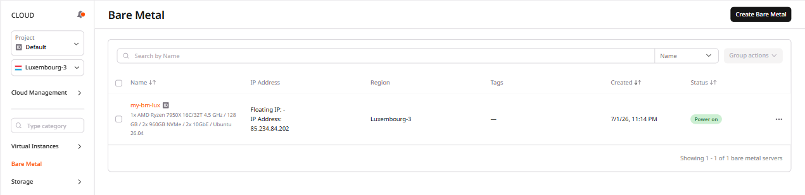</Frame>

## Step 2. Select a region

<p>Select the deployment region.</p>

## Step 3. Select an image

<p>Select the architecture — **x86-64** or **ARM** — then choose an OS image from one of three tabs:</p>

- **Distributions** - prepared OS templates (Ubuntu, CentOS, Debian, Windows, Rocky Linux).
- **Marketplace** - pre-configured application images.
- **Custom Images** - images previously uploaded to the account. Only images built for Bare Metal servers are compatible; standard VM images do not work. Build requirements are covered in [image upload](/cloud/images/upload-an-image-to-the-storage).

<Frame>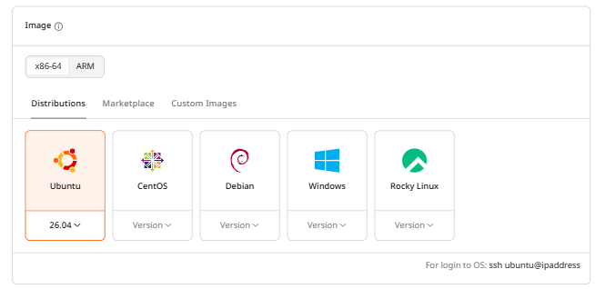</Frame>

## Step 4. Select a server type

<p>Server types are grouped into categories. Available categories depend on the region:</p>

- **High frequency** - high clock-speed CPUs for latency-sensitive workloads.
- **Infrastructure** - high core count and NVMe storage for compute-intensive tasks.
- **Storage** - large-capacity drives for data-heavy workloads (available in select regions).

<p>Each server card shows availability (**In Stock: N**) and whether the type requires a quota increase (**Quotas required**). Enable **Show out of stock** to see unavailable types in the current region.</p>

<Frame>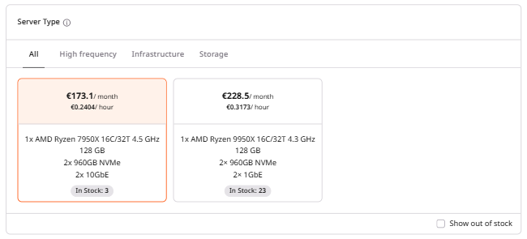</Frame>

## Step 5. Configure network interfaces

<p>Configure all required network interfaces before provisioning. Up to six interfaces can be attached. Public interfaces cannot be added after the server is created.</p>

<Tabs>
  <Tab title="Public">

    1. Select **Public** as the **Network type**.

    <Frame>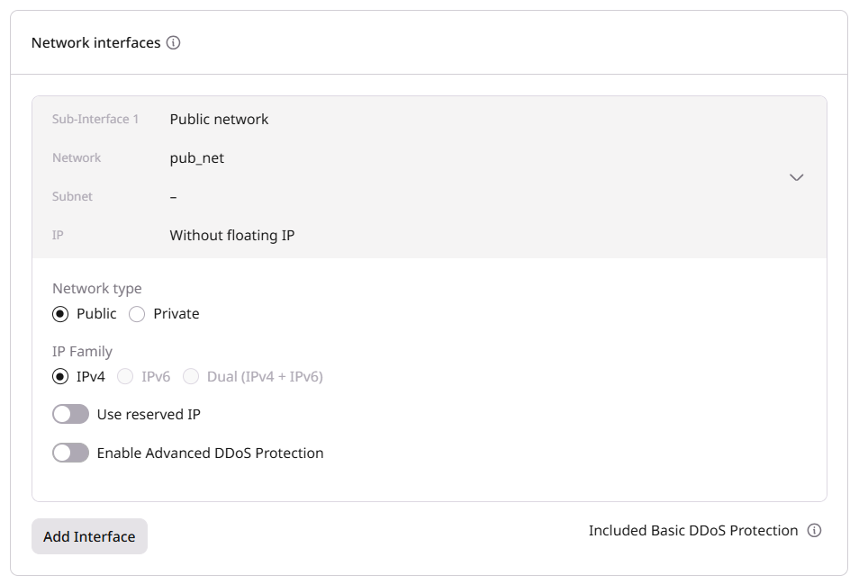</Frame>

    2. In the **IP Family** section, select the IP version: **IPv4**, **IPv6**, or **Dual (IPv4 + IPv6)**. IPv6 availability depends on the selected region.

    3. (Optional) Enable **Use reserved IP** to assign a [reserved IP](/cloud/networking/ip-address/create-and-configure-a-reserved-ip-address) to the server.

    4. (Optional) Enable **Advanced DDoS Protection** for enhanced security.

    <Frame>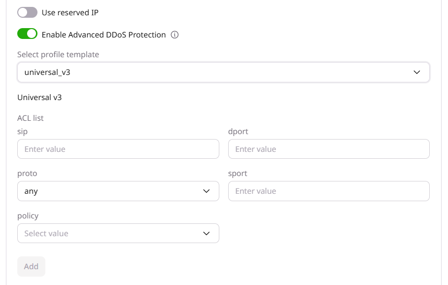</Frame>

  </Tab>
  <Tab title="Private">

    <Warning>
      With both a public and a private interface, disable the default gateway on the private subnet to avoid routing conflicts.
    </Warning>

    <p>**Network**: Select an existing network from the **Network** dropdown, or click **Add a new network** to create one:</p>

    1. Enter the network name.

    2. Confirm that the **Bare Metal Network** checkbox is enabled — this is required to connect Bare Metal servers to the network.

    3. (Optional) Disable **Create router** if an existing router should be used instead of creating a new one.

    4. (Optional) Enable **Add tags** to attach metadata to the network.

    5. Click **Create & Proceed**.

    <Frame>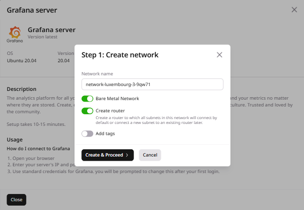</Frame>

    <p>**Subnet**: Select an existing subnet from the **Subnet** dropdown. Choosing **Automatic** assigns the subnet with the most available resources.</p>

    <p>To create a new subnet, click **Add a new subnet** and follow the [subnet guide](/cloud/networking/create-and-manage-a-subnetwork#create-a-subnet).</p>

    <Info>
      With multiple subnets, set only one as [routable](/cloud/networking/create-and-manage-a-subnetwork#set-up-the-default-gateway). Multiple routable subnets cause default gateway conflicts that prevent connecting to the server.
    </Info>

    <p>(Optional) Enable **Use floating IP** to assign a floating IP to the private interface.</p>

  </Tab>
  <Tab title="Dedicated public">

    <p>A dedicated public network provides an individual address pool, allowing multiple public IPs on a single network port — useful for high-traffic applications, load distribution, or virtualization scenarios where each workload needs a distinct public IP.</p>

    1. Select **Dedicated public** as the **Network type**.

    2. Select an existing dedicated public network from the **Network** dropdown, then select a subnet from the **Subnet** dropdown.

    3. **IP Family** is fixed to **IPv4** for dedicated public networks — IPv6 and dual-stack are not available.

    4. (Optional) Enable **Use reserved IP** to assign a [reserved IP](/cloud/networking/ip-address/create-and-configure-a-reserved-ip-address) to the server.

    5. (Optional) Enable **Advanced DDoS Protection** for enhanced security.

  </Tab>
</Tabs>

### Interface order

<p>Bare Metal servers use LACP bonding: all physical ports are aggregated into a single bond (`bond0`). Each sub-interface added in the creation form becomes a logical port on top of that bond. The sub-interface order is fixed at creation and determines routing priority — the first sub-interface has higher priority for outbound traffic.</p>

- **Sub-Interface 1** (public) maps to `bond0`.
- **Sub-Interface 2** (private) maps to a VLAN sub-interface named `bond0.<vlan_id>` (for example, `bond0.2853`).

<p>After the server is created, the **Networking** tab shows the sub-interfaces in the same order as they were added during setup. Running `ip a` in the OS confirms the mapping:</p>

<Frame>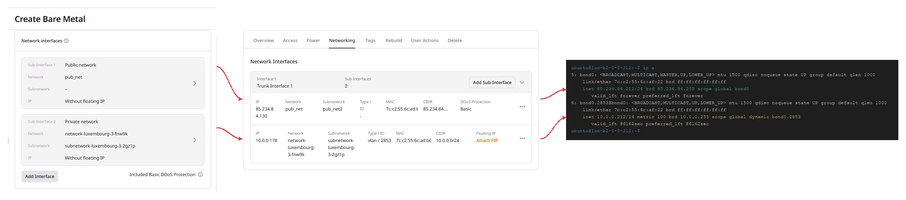</Frame>

```bash
$ ip a
1: lo: <LOOPBACK,UP,LOWER_UP> mtu 65536 ...
2: enp1s0f0: <BROADCAST,MULTICAST,SLAVE,UP,LOWER_UP> mtu 1500 ... master bond0
4: enp1s0f1: <BROADCAST,MULTICAST,SLAVE,UP,LOWER_UP> mtu 1500 ... master bond0
5: bond0: <BROADCAST,MULTICAST,MASTER,UP,LOWER_UP> mtu 1500 qdisc noqueue state UP
    link/ether 7c:c2:55:6c:ad:b0 brd ff:ff:ff:ff:ff:ff
    inet 85.234.84.162/24 brd 85.234.84.255 scope global bond0
6: bond0.2853@bond0: <BROADCAST,MULTICAST,UP,LOWER_UP> mtu 1500 qdisc noqueue state UP
    link/ether 7c:c2:55:6c:ad:b0 brd ff:ff:ff:ff:ff:ff
    inet 10.0.0.125/24 brd 10.0.0.255 scope global dynamic bond0.2853
```

<p>Sub-Interface 1 (`bond0`) is the public interface; Sub-Interface 2 (`bond0.2853`) is the private interface.</p>

## Step 6. Configure access

<p>Select an existing [SSH key](/cloud/bare-metal-servers/connect-to-your-bare-metal-server-via-ssh) for Linux servers, or set a password for Windows servers.</p>

<Frame>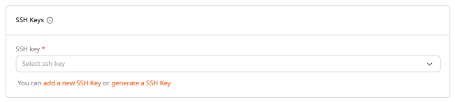</Frame>

<p>For Windows servers, the password must be 8–16 characters and may contain Latin letters (`a-zA-Z`), digits (`0-9`), and special characters (`!#$%&'()*+,-./:;<=>?@[]^_{|}~`). Connect via [portal console](/cloud/virtual-instances/connect/connect-to-your-instance-via-control-panel) or RDP.</p>

<Frame>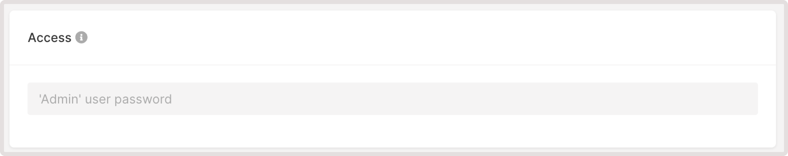</Frame>

## Step 7. Configure additional options

<p>In the **Additional options** section, you can optionally configure:</p>

- **User data**: Provide a `cloud-init` script to automate initial configuration — install packages, create users, or run commands on first boot.
- **Add tags**: Attach key-value metadata to the server for filtering and organization.

<Frame>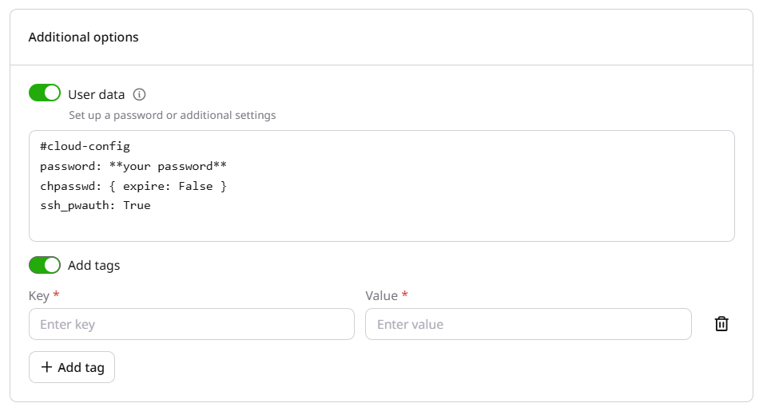</Frame>

## Step 8. Set quantity and name

<p>Specify the number of servers (up to 10, subject to quota) and the name template. Click **Create Server** — the server provisions in the cloud.</p>

<Frame>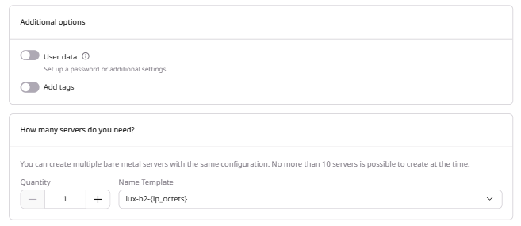</Frame>

## Limitations

- External volumes cannot be attached to Bare Metal servers.
- Volume configuration cannot be changed after provisioning.
- No more than six network interfaces can be attached.
- After deployment, private network interfaces can only be attached or detached manually via the OS.
- Public interfaces cannot be added after the server is created.

</MethodSection>
<MethodSection id="api" label="REST API">

<p>A Bare Metal server is a physical machine allocated entirely to one tenant — no hypervisor, no shared resources. Provisioning takes 4–5 minutes.</p>

<Info>
An [API token](/developer-tools/rest-api/authentication) is required, along with a [project ID](/api-reference/cloud/projects/list-projects) and [region ID](/api-reference/cloud/regions/list-regions).
</Info>

<p>Open a bash terminal and set these as environment variables before running the examples:</p>

```bash
export GCORE_API_KEY="{YOUR_API_KEY}"
export GCORE_CLOUD_PROJECT_ID="{YOUR_PROJECT_ID}"
export GCORE_CLOUD_REGION_ID="{YOUR_REGION_ID}"
```

## Check quota

<p>Bare Metal servers have per-region quotas tracked separately for `baremetal_hf`, `baremetal_basic`, `baremetal_storage`, `baremetal_network`, and `baremetal_infrastructure` categories. Before creating a server, verify [quota usage](/cloud/getting-started/request-a-quota-increase) is below the limit.</p>

## Quickstart

<p>The scripts below list available flavors and images, provision a Bare Metal server with a public interface, and print its IP address. Replace `my-key` with an existing SSH key name from the project.</p>

<Warning>
The scripts pick the first available flavor. Bare Metal flavors differ in hardware and cost. Read the flavor list and set `flavor_name` to the flavor for the workload before creating a server.
</Warning>

<p>The server is provisioned in about 4–5 minutes.</p>

<Tabs>
  <Tab title="Python SDK">
    ```python
    import os
    from gcore import Gcore

    client = Gcore()

    region_id = int(os.environ["GCORE_CLOUD_REGION_ID"])

    images = client.cloud.baremetal.images.list(region_id=region_id, visibility="public")
    image = next(img for img in images.results if "ubuntu" in img.name and "x64" in img.name)

    flavors = client.cloud.baremetal.flavors.list(
        region_ids=[region_id],
        compatible_with_image_id=image.id,
        os_types=["linux"],
    )
    flavor_name = next(item.name for item in flavors.results if item.capacity > 0)

    # A port with only the region gets one public IPv4 address.
    # A server without a DPU rejects a port that still has security groups.
    port = client.cloud.ports.create_and_poll(region_id=region_id)
    client.cloud.ports.update_and_poll(port_id=port.id, security_group_ids=[])

    server = client.cloud.baremetal.servers.create_and_poll(
        region_id=region_id,
        flavor_name=flavor_name,
        image_id=image.id,
        interfaces=[{"port_id": port.id}],
        ssh_key_id=os.environ["SSH_KEY_ID"],
    )

    details = client.cloud.baremetal.servers.get(server_id=server.id)
    for iface in details.interfaces:
        for assignment in iface.ip_assignments:
            print(f"ssh ubuntu@{assignment.ip_address}")
    ```
  </Tab>
  <Tab title="Go SDK">
    ```go
    package main

    import (
        "context"
        "fmt"
        "log"
        "os"
        "strconv"
        "strings"

        gcore "github.com/G-Core/gcore-go"
        "github.com/G-Core/gcore-go/cloud"
    )

    func main() {
        client := gcore.NewClient()
        ctx := context.Background()

        regionID, err := strconv.ParseInt(os.Getenv("GCORE_CLOUD_REGION_ID"), 10, 64)
        if err != nil {
            log.Fatal(err)
        }

        images, err := client.Cloud.Baremetal.Images.List(ctx, cloud.BaremetalImageListParams{
            RegionID:   gcore.Int(regionID),
            Visibility: cloud.BaremetalImageListParamsVisibilityPublic,
        })
        if err != nil {
            log.Fatal(err)
        }
        var imageID string
        for _, img := range images.Results {
            if strings.Contains(img.Name, "ubuntu") && strings.Contains(img.Name, "x64") {
                imageID = img.ID
                break
            }
        }
        if imageID == "" {
            log.Fatal("ubuntu x64 image not found")
        }

        flavors, err := client.Cloud.Baremetal.Flavors.List(ctx, cloud.BaremetalFlavorListParams{
            RegionIDs:             []int64{regionID},
            CompatibleWithImageID: gcore.String(imageID),
            OsTypes:               []string{"linux"},
        })
        if err != nil {
            log.Fatal(err)
        }
        var flavorName string
        for _, item := range flavors.Results {
            if item.Capacity > 0 {
                flavorName = item.Name
                break
            }
        }
        if flavorName == "" {
            log.Fatal("no available flavor")
        }

        port, err := client.Cloud.Ports.NewAndPoll(ctx, cloud.PortNewParams{RegionID: regionID})
        if err != nil {
            log.Fatal(err)
        }
        if _, err = client.Cloud.Ports.UpdateAndPoll(ctx, port.ID, cloud.PortUpdateParams{
            SecurityGroupIDs: []string{},
        }); err != nil {
            log.Fatal(err)
        }

        server, err := client.Cloud.Baremetal.Servers.NewAndPoll(ctx, cloud.BaremetalServerNewParams{
            RegionID:   regionID,
            FlavorName: flavorName,
            ImageID:    imageID,
            Interfaces: []cloud.BaremetalServerNewParamsInterface{{PortID: port.ID}},
            SSHKeyID:   gcore.String(os.Getenv("SSH_KEY_ID")),
        })
        if err != nil {
            log.Fatal(err)
        }

        details, err := client.Cloud.Baremetal.Servers.Get(ctx, server.ID, cloud.BaremetalServerGetParams{})
        if err != nil {
            log.Fatal(err)
        }
        for _, iface := range details.Interfaces {
            for _, assignment := range iface.IPAssignments {
                fmt.Printf("ssh ubuntu@%s\n", assignment.IPAddress)
            }
        }
    }
    ```
  </Tab>
</Tabs>

## Step-by-step

<p>Each step below explains what the call does, which parameters matter, and what the response looks like. Use this section to understand the flow or to debug a specific step.</p>

<Accordion title="Show all steps">

### Step 1. List available flavors

<p>BM [flavors](/api-reference/cloud/bare-metal/list-bare-metal-flavors) describe the physical hardware: CPU model, core count, RAM, local storage, and NIC speed. The `capacity` field shows how many machines of that type are physically available in the region.</p>

<Tabs>
  <Tab title="Python SDK">
    ```python
    flavors = client.cloud.baremetal.flavors.list(
        region_ids=[int(os.environ["GCORE_CLOUD_REGION_ID"])],
        os_types=["linux"],
    )
    for item in flavors.results:
        print(item.name, item.capacity, item.hardware_description)
    ```
  </Tab>
  <Tab title="Go SDK">
    ```go
    regionID, err := strconv.ParseInt(os.Getenv("GCORE_CLOUD_REGION_ID"), 10, 64)
    if err != nil {
        log.Fatal(err)
    }
    flavors, err := client.Cloud.Baremetal.Flavors.List(ctx, cloud.BaremetalFlavorListParams{
        RegionIDs: []int64{regionID},
        OsTypes:   []string{"linux"},
    })
    for _, item := range flavors.Results {
        fmt.Println(item.Name, item.Capacity)
    }
    ```
  </Tab>
  <Tab title="curl">
    ```bash
    curl "https://api.gcore.com/cloud/v1/projects/$GCORE_CLOUD_PROJECT_ID/baremetal/flavors?region_ids=$GCORE_CLOUD_REGION_ID" \
      -H "Authorization: APIKey $GCORE_API_KEY"
    ```

    Response:

    ```json
    {
      "count": 8,
      "results": [
        {
          "name": "bm2a-storage-2x7643-1024-10x15tb-2x100nic",
          "cpu_threads": 192,
          "ram_mib": 1048576,
          "region_id": 148,
          "hardware_description": {
            "cpu": "2x AMD EPYC 7643 48C/96T 2.30 GHz",
            "ram": "1024 GB",
            "disk": "10x 15TB SSD",
            "network": "2x 100GbE"
          },
          "capacity": 1
        }
      ]
    }
    ```
  </Tab>
</Tabs>

<p>`capacity: 0` means the flavor is temporarily unavailable in the region. Flavor IDs are region-specific — run this call to see what is available in the target region. Save the chosen flavor ID for the next step:</p>

```bash
export FLAVOR_ID="{YOUR_FLAVOR_ID}"
```

<Info>
Replace `{YOUR_FLAVOR_ID}` with the flavor id from the response above. The curl field is `name`.
</Info>

### Step 2. List bare metal images

<p>BM images use a dedicated [endpoint](/api-reference/cloud/images/list-bare-metal-images) — standard VM images from <code>GET&nbsp;/cloud/v1/images</code> are not compatible. Each BM image name ends with `-ironic` and contains `"is_baremetal": true` in the response.</p>

<Tabs>
  <Tab title="Python SDK">
    ```python
    images = client.cloud.baremetal.images.list()
    for img in images.results:
        print(img.id, img.name)
    ```
  </Tab>
  <Tab title="Go SDK">
    ```go
    images, err := client.Cloud.Baremetal.Images.List(ctx, cloud.BaremetalImageListParams{})
    for _, img := range images.Results {
        fmt.Println(img.ID, img.Name)
    }
    ```
  </Tab>
  <Tab title="curl">
    ```bash
    curl "https://api.gcore.com/cloud/v1/bmimages/$GCORE_CLOUD_PROJECT_ID/$GCORE_CLOUD_REGION_ID" \
      -H "Authorization: APIKey $GCORE_API_KEY"
    ```

    Response:

    ```json
    {
      "count": 16,
      "results": [
        {
          "id": "6918eaaa-05b8-4aaf-a6de-15edc94c1a25",
          "name": "ubuntu-24.04-x64-ironic",
          "is_baremetal": true,
          "visibility": "public",
          "os_distro": "ubuntu",
          "os_version": "24.04"
        }
      ]
    }
    ```
  </Tab>
</Tabs>

<p>Pick an image that matches the server architecture (x86-64 or ARM) and the target OS, then save its ID for the next step:</p>

```bash
export IMAGE_ID="{YOUR_IMAGE_ID}"
```

<Info>
Replace `{YOUR_IMAGE_ID}` with the `id` of the chosen image from the response above. BM image IDs are region-specific and differ from standard VM images.
</Info>

### Step 3. Create the server

<p>The [create](/api-reference/cloud/bare-metal/create-bare-metal-server) call submits a provisioning request and returns a task ID. The Python and Go SDKs block until the task completes (4–5 minutes), then return the server object. With curl, poll the task manually.</p>

<Info>
An SSH key must already exist in the project. Add one following the [SSH guide](/cloud/virtual-instances/connect/connect-via-ssh).
</Info>

| Parameter | Required | Description |
|-----------|----------|-------------|
| `flavor_name` | Yes | Flavor name from Step 1. |
| `image_id` | Yes | Bare metal image ID from Step 2. A virtual machine image is not accepted. |
| `region_id` | Yes | Region of the server. The ports must be in the same region. |
| `interfaces[].port_id` | Yes | ID of a port created before the server. A server without a DPU rejects a port that still has security groups. |
| `ssh_key_id` | No | ID of an existing SSH key. A Linux image uses this key for the default user. |
| `name` | No | When `name` is omitted, Gcore assigns the name. |
| `password` | No | For Windows images: sets the Admin user password. For Linux: sets the default user password when no SSH key is used. |
| `user_data` | No | Base64-encoded [cloud-init](https://cloudinit.readthedocs.io/en/latest/) script applied on first boot. Ignored when `password` is set. |

<Tabs>
  <Tab title="Python SDK">
    ```python
    server = client.cloud.baremetal.servers.create_and_poll(
        region_id=int(os.environ["GCORE_CLOUD_REGION_ID"]),
        flavor_name=os.environ["FLAVOR_NAME"],
        image_id=os.environ["IMAGE_ID"],
        interfaces=[{"port_id": os.environ["PORT_ID"]}],
        ssh_key_id=os.environ["SSH_KEY_ID"],
    )
    server_id = server.id
    ```
  </Tab>
  <Tab title="Go SDK">
    ```go
    server, err := client.Cloud.Baremetal.Servers.NewAndPoll(ctx, cloud.BaremetalServerNewParams{
        RegionID:   regionID,
        FlavorName: os.Getenv("FLAVOR_NAME"),
        ImageID:    os.Getenv("IMAGE_ID"),
        Interfaces: []cloud.BaremetalServerNewParamsInterface{{PortID: os.Getenv("PORT_ID")}},
        SSHKeyID:   gcore.String(os.Getenv("SSH_KEY_ID")),
    })
    serverID := server.ID
    ```
  </Tab>
  <Tab title="curl">
    ```bash
    curl -X POST "https://api.gcore.com/cloud/v1/bminstances/$GCORE_CLOUD_PROJECT_ID/$GCORE_CLOUD_REGION_ID" \
      -H "Authorization: APIKey $GCORE_API_KEY" \
      -H "Content-Type: application/json" \
      -d "{
        \"flavor\": \"$FLAVOR_ID\",
        \"image_id\": \"$IMAGE_ID\",
        \"name\": \"my-bm-server\",
        \"ssh_key_name\": \"my-key\",
        \"interfaces\": [{\"type\": \"external\"}]
      }"
    ```

    Response:

    ```json
    {
      "tasks": ["d4a4b10e-5d22-4c23-8e09-f7a3e1c1a999"]
    }
    ```

    Poll `GET /cloud/v1/tasks/{task_id}` every 30 seconds until `state` is `FINISHED`:

    ```bash
    curl "https://api.gcore.com/cloud/v1/tasks/$TASK_ID" \
      -H "Authorization: APIKey $GCORE_API_KEY"
    ```

    When complete:

    ```json
    {
      "state": "FINISHED",
      "created_on": "2026-05-29T12:48:58",
      "finished_on": "2026-05-29T12:53:46",
      "created_resources": {
        "instances": ["90ba53c5-def5-4825-83fb-9adc78bd3266"]
      }
    }
    ```

    ```bash
    export SERVER_ID="90ba53c5-def5-4825-83fb-9adc78bd3266"
    ```
  </Tab>
</Tabs>

### Step 4. Get server details

<p>Retrieve the server to confirm `status: ACTIVE` and find the assigned [IP address](/api-reference/cloud/bare-metal/get-bare-metal-server).</p>

<Tabs>
  <Tab title="Python SDK">
    ```python
    server = client.cloud.baremetal.servers.get(server_id=server_id)
    for iface in server.interfaces:
        for assignment in iface.ip_assignments:
            print(assignment.ip_address)
    ```
  </Tab>
  <Tab title="Go SDK">
    ```go
    details, err := client.Cloud.Baremetal.Servers.Get(ctx, serverID, cloud.BaremetalServerGetParams{})
    for _, iface := range details.Interfaces {
        for _, assignment := range iface.IPAssignments {
            fmt.Println(assignment.IPAddress)
        }
    }
    ```
  </Tab>
  <Tab title="curl">
    ```bash
    curl "https://api.gcore.com/cloud/v1/bminstances/$GCORE_CLOUD_PROJECT_ID/$GCORE_CLOUD_REGION_ID/$SERVER_ID" \
      -H "Authorization: APIKey $GCORE_API_KEY"
    ```

    Response:

    ```json
    {
      "id": "90ba53c5-def5-4825-83fb-9adc78bd3266",
      "name": "my-bm-server",
      "status": "ACTIVE",
      "flavor": {
        "flavor_id": "bm1a-hf-1x7950x-128-2x960gb-2x10nic",
        "hardware_description": {
          "cpu": "1x AMD Ryzen 7950X 16C/32T 4.5 GHz",
          "disk": "2x 960GB NVMe"
        }
      },
      "addresses": {
        "pub_net": [
          {"addr": "85.234.84.18", "type": "fixed"}
        ]
      },
      "security_groups": [],
      "volumes": []
    }
    ```
  </Tab>
</Tabs>

<p>`security_groups: []` is expected — Bare Metal servers have no security groups, so all ports are accessible by default. Restrict traffic with `ufw` or `iptables` after connecting.</p>

<p>Use the public IP from the response to connect. The default user for Ubuntu images is `ubuntu`:</p>

```bash
ssh -i ~/.ssh/my-key ubuntu@<public-ip>
```

<p>Bare Metal servers use LACP bonding, so interfaces are named `bond0` rather than `eth0`. If a private network was attached at creation, it appears as `bond0.<vlan_id>`.</p>

</Accordion>

## Create a server with a private network interface

<p>Create one port for each interface before the server. A port created with only `region_id` is a public address. A port created with `network_id` is on that network. Remove security groups from both ports, then pass both port IDs in `interfaces`. A bare metal server rejects a `vxlan` network. The network has to be a bare metal network. Create one in the [network guide](/cloud/networking/create-and-manage-a-network) and enable **Bare Metal network**.</p>

<Tabs>
  <Tab title="Python SDK">
    ```python
    server = client.cloud.baremetal.servers.create_and_poll(
        region_id=int(os.environ["GCORE_CLOUD_REGION_ID"]),
        flavor_name=os.environ["FLAVOR_NAME"],
        image_id=os.environ["IMAGE_ID"],
        ssh_key_id=os.environ["SSH_KEY_ID"],
        interfaces=[
            {"port_id": os.environ["PUBLIC_PORT_ID"]},
            {"port_id": os.environ["PRIVATE_PORT_ID"]},
        ],
    )
    ```
  </Tab>
  <Tab title="Go SDK">
    ```go
    server, err := client.Cloud.Baremetal.Servers.NewAndPoll(ctx, cloud.BaremetalServerNewParams{
        RegionID:   regionID,
        FlavorName: os.Getenv("FLAVOR_NAME"),
        ImageID:    os.Getenv("IMAGE_ID"),
        SSHKeyID:   gcore.String(os.Getenv("SSH_KEY_ID")),
        Interfaces: []cloud.BaremetalServerNewParamsInterface{
            {PortID: os.Getenv("PUBLIC_PORT_ID")},
            {PortID: os.Getenv("PRIVATE_PORT_ID")},
        },
    })
    ```
  </Tab>
  <Tab title="curl">
    ```bash
    curl -X POST "https://api.gcore.com/cloud/v1/bminstances/$GCORE_CLOUD_PROJECT_ID/$GCORE_CLOUD_REGION_ID" \
      -H "Authorization: APIKey $GCORE_API_KEY" \
      -H "Content-Type: application/json" \
      -d "{
        \"flavor\": \"$FLAVOR_ID\",
        \"image_id\": \"$IMAGE_ID\",
        \"name\": \"my-bm-server\",
        \"ssh_key_name\": \"my-key\",
        \"interfaces\": [
          {\"type\": \"external\"},
          {
            \"type\": \"subnet\",
            \"network_id\": \"$NETWORK_ID\",
            \"subnet_id\": \"$SUBNET_ID\"
          }
        ]
      }"
    ```
  </Tab>
</Tabs>

<p>Inside the OS, the public interface maps to `bond0` and the private interface to `bond0.<vlan_id>`. With both interfaces present, disable the default gateway on the private subnet to avoid routing conflicts.</p>

## Multi-bond network configuration

<p>Standard BM servers aggregate all physical ports into a single LACP bond (`bond0`). Multi-bond separates traffic across multiple independent bonds, isolating networks at the hardware level for higher availability and throughput. Multi-bond must be enabled for the server by [Gcore support](https://gcore.com/contact-us) before provisioning.</p>

<p>Once enabled, set `port_group` on each interface. Interfaces with the same `port_group` share a trunk. A flavor that supports one port group rejects a second group.</p>

<Tabs>
  <Tab title="Python SDK">
    ```python
    server = client.cloud.baremetal.servers.create_and_poll(
        region_id=int(os.environ["GCORE_CLOUD_REGION_ID"]),
        flavor_name=os.environ["FLAVOR_NAME"],
        image_id=os.environ["IMAGE_ID"],
        ssh_key_id=os.environ["SSH_KEY_ID"],
        interfaces=[
            {"port_id": os.environ["PUBLIC_PORT_ID"], "port_group": 0},
            {"port_id": os.environ["PRIVATE_PORT_ID"], "port_group": 1},
        ],
    )
    ```
  </Tab>
  <Tab title="Go SDK">
    ```go
    server, err := client.Cloud.Baremetal.Servers.NewAndPoll(ctx, cloud.BaremetalServerNewParams{
        RegionID:   regionID,
        FlavorName: os.Getenv("FLAVOR_NAME"),
        ImageID:    os.Getenv("IMAGE_ID"),
        SSHKeyID:   gcore.String(os.Getenv("SSH_KEY_ID")),
        Interfaces: []cloud.BaremetalServerNewParamsInterface{
            {PortID: os.Getenv("PUBLIC_PORT_ID"), PortGroup: gcore.Int(0)},
            {PortID: os.Getenv("PRIVATE_PORT_ID"), PortGroup: gcore.Int(1)},
        },
    })
    ```
  </Tab>
  <Tab title="curl">
    ```bash
    curl -X POST "https://api.gcore.com/cloud/v1/bminstances/$GCORE_CLOUD_PROJECT_ID/$GCORE_CLOUD_REGION_ID" \
      -H "Authorization: APIKey $GCORE_API_KEY" \
      -H "Content-Type: application/json" \
      -d "{
        \"flavor\": \"$FLAVOR_ID\",
        \"image_id\": \"$IMAGE_ID\",
        \"name\": \"my-bm-server\",
        \"ssh_key_name\": \"my-key\",
        \"interfaces\": [
          {\"type\": \"external\", \"port_group\": 1},
          {
            \"type\": \"subnet\",
            \"network_id\": \"$NETWORK_ID\",
            \"subnet_id\": \"$SUBNET_ID\",
            \"port_group\": 2
          }
        ]
      }"
    ```
  </Tab>
</Tabs>

<p>After provisioning, retrieve the server. Each trunk is a separate entry in `interfaces`, with its `port_group`.</p>

## Limitations

<p>These constraints apply to all Bare Metal servers regardless of the provisioning method.</p>

- External block volumes cannot be attached. All storage is the local NVMe included with the server.
- Local storage configuration (RAID, disk layout) cannot be changed after provisioning.
- No more than six network interfaces can be attached at creation time.
- Private network interfaces added after deployment must be configured manually inside the OS — they are not managed by the Gcore control plane.
- The interface order set at creation determines routing priority and cannot be changed after provisioning.

</MethodSection>
<MethodSection id="terraform" label="Terraform">

<p>Provision a dedicated Bare Metal server — physical hardware with no virtualization layer — using [`gcore_cloud_baremetal_server`](https://registry.terraform.io/providers/G-Core/gcore/latest/docs/resources/cloud_baremetal_server). Provisioning is asynchronous and may take several minutes to complete.</p>


## Create a Bare Metal server

<p>Declares a server with a public IPv4 interface and an SSH key. Creation takes 4–5 minutes.</p>

```hcl
resource "gcore_cloud_baremetal_server" "example" {
  project_id   = var.project_id
  region_id    = var.region_id
  flavor       = var.flavor_id   # region-specific; find with the Customer Portal or flavors API
  name         = "my-bare-metal"
  image_id     = var.image_id    # region-specific; find with the Customer Portal or images API
  ssh_key_name = "my-keypair"

  interfaces = [{
    type      = "external"
    ip_family = "ipv4"
  }]
}

output "public_ip" {
  value = gcore_cloud_baremetal_server.example.addresses
}
```

<Info>
Flavor IDs and image IDs are region-specific. Find available values in the Gcore Customer Portal under **Cloud** > **Bare Metal** > **Create server**, then pass them as `var.flavor_id` and `var.image_id` in `terraform.tfvars`. The Terraform provider does not include a data source for listing Bare Metal flavors or images.
</Info>

<p>After `terraform apply`, `status` is `ACTIVE` and `addresses` contains the assigned public IP. Use the IP to connect over SSH.</p>

## Create a server with a private network

<p>Private networks for Bare Metal require `type = "vlan"` on the network resource — add both interfaces at creation, as interface order determines routing priority.</p>

```hcl
resource "gcore_cloud_network" "bm_net" {
  project_id = var.project_id
  region_id  = var.region_id
  name       = "my-bm-network"
  type       = "vlan"  # required for Bare Metal
}

resource "gcore_cloud_network_subnet" "bm_subnet" {
  project_id = var.project_id
  region_id  = var.region_id
  name       = "my-bm-subnet"
  network_id = gcore_cloud_network.bm_net.id
  cidr       = "192.168.10.0/24"
}

resource "gcore_cloud_baremetal_server" "example" {
  project_id   = var.project_id
  region_id    = var.region_id
  flavor       = var.flavor_id
  name         = "my-bare-metal"
  image_id     = var.image_id
  ssh_key_name = "my-keypair"

  interfaces = [
    {
      type      = "external"
      ip_family = "ipv4"
    },
    {
      type       = "subnet"
      network_id = gcore_cloud_network.bm_net.id
      subnet_id  = gcore_cloud_network_subnet.bm_subnet.id
    },
  ]
}
```

<Warning>
The interface order is fixed at creation. With both a public and a private interface, disable the default gateway on the private subnet to avoid routing conflicts.
</Warning>


</MethodSection>
</MethodSwitch>
