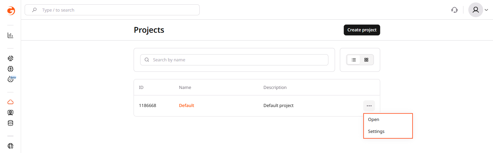
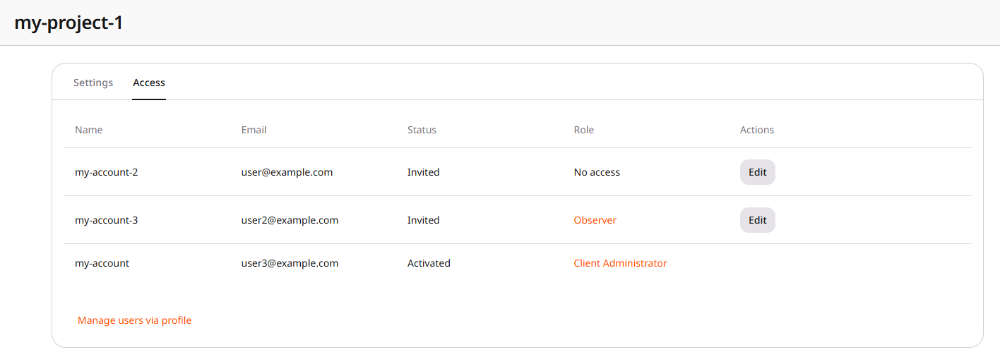
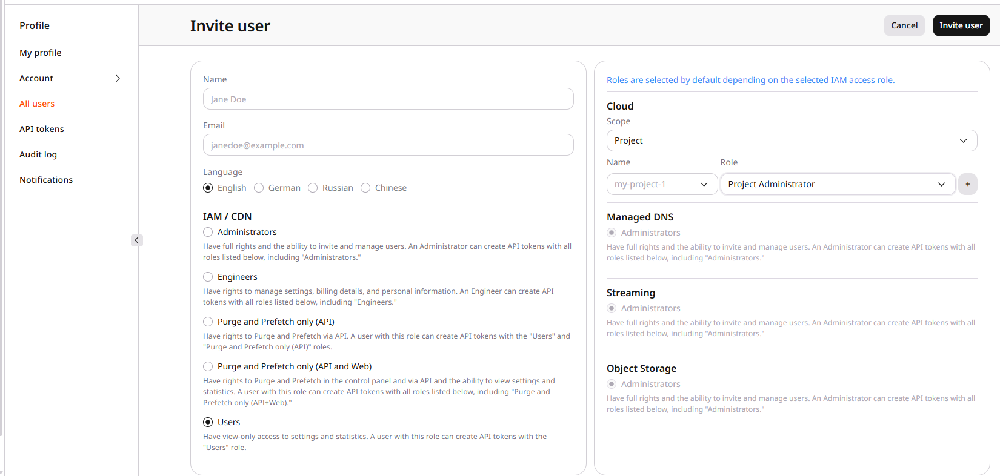

Only users with the Client Administrator or Project Administrator role can invite new users to a project. To send an invitation:

1. In the Gcore Customer Portal, navigate to the [Projects](https://portal.gcore.com/cloud/projects/list) section, click the three-dots menu next to the project, and select **Settings**.

<Frame></Frame>

2. Open the **Access** tab. The tab lists each user's name, email, status, and role. Click **Manage users via profile**.

<Frame></Frame>

3. On the **All users** page, click **Invite user**. Enter the name and email address, and select the language. Select **Users** under **IAM / CDN**. Under **Cloud**, set **Scope** to **Project**, select the project and a role, then click **Invite user**.

<Frame></Frame>

A project role is **Project Administrator**, **User**, or **Observer**. Both existing and new users can be invited.

  * If the user is not registered, Gcore sends an email with a link to create a password. After creating a password, the user can log in.
  * If the user already has a Gcore account, Gcore sends a notification about the newly granted project access. After accepting the invitation, the user can select the project when signing in.