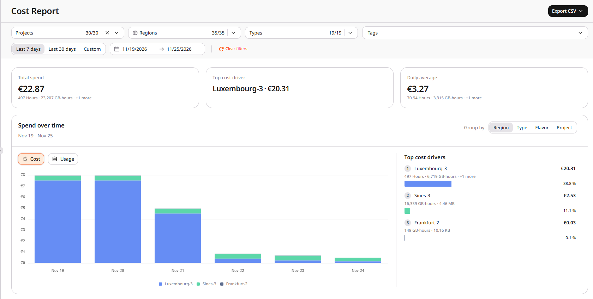
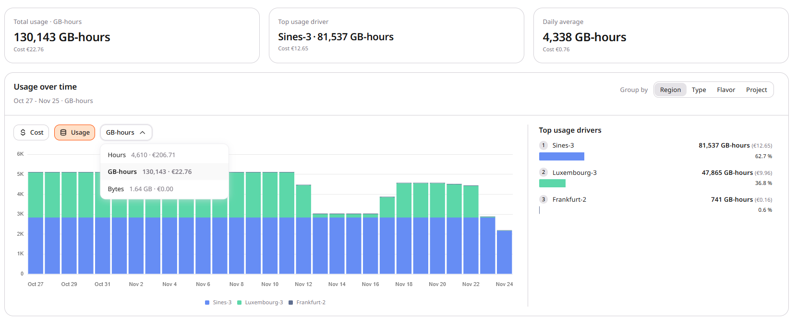
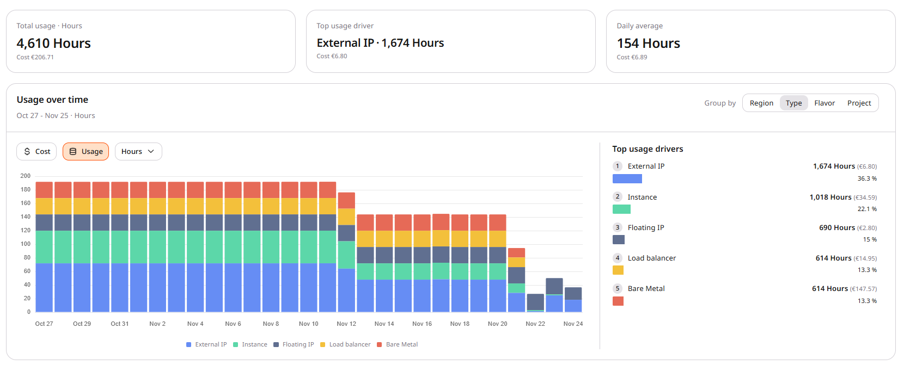
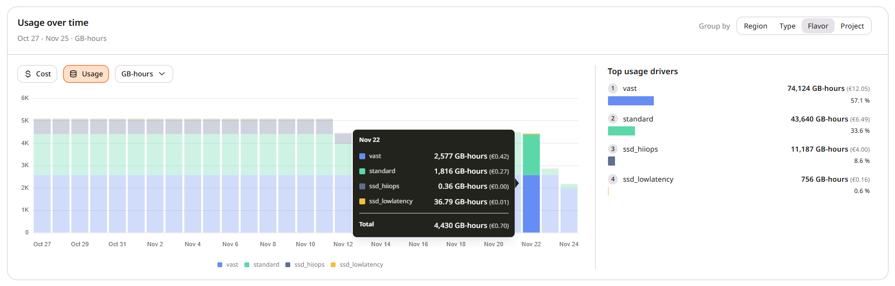
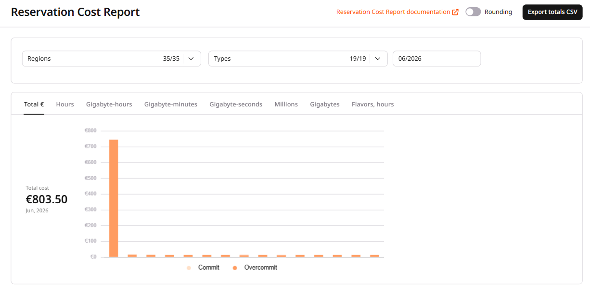

Cloud has two cost reports.

- **Cost Report**: costs for all Cloud resources used, calculated at on-demand rates. If active resource commitments exist, the prices shown don't reflect actual costs because commit discounts are not applied.
- **Reservation Cost Report**: monthly resource usage and costs that account for resource commitments. This report shows how much of the committed resources were consumed, whether commits were fully utilized, and any overcommit costs incurred when usage exceeded the reserved amount.

To open either report:

1. Log in to the [Gcore Customer Portal](https://portal.gcore.com) and open **Cloud**.

2. Open a project.

3. In the left sidebar, select **Cloud Management**.

4. Click **Cost Report** or **Reservation Cost Report**.

Statistics for the last hour may contain incomplete data — for accurate results, review data collected more than an hour ago.

## Cost Report

<Info>
On-demand figures for this report are returned by the [Cost&nbsp;reports&nbsp;API](/api-reference/cloud#tag/Cost-Reports/operation/CostReportResourcesV2Handler.post).
</Info>

The report covers the selected period, including resources in projects marked **(Deleted)**.

The cost data can be filtered by:

- **Projects**: view costs for all projects or a selected subset. Deleted projects appear in the **Projects** dropdown with a **(Deleted)** label and can be selected like active ones.
- **Regions**: filter by the region where resources were created.
- **Types**: filter by resource type.
- **Tags**: filter by tags assigned to resources.
- **Last 7 days**, **Last 30 days**, or a **Custom** range of at most one month.

After applying filters, the chart shows the selected period. **Group by** splits that chart by **Region**, **Type**, **Flavor**, or **Project**.

**Cost** displays spending in the account currency. The cards are **Total spend**, **Top cost driver**, and **Daily average**. The chart title is **Spend over time**, and the panel title is **Top cost drivers**.

<Frame></Frame>

**Usage** shows consumption for one unit over the same period, and the cards still show cost. The menu lists every unit that has volume in the period. **Hours**, **GB-hours**, and **Bytes** are units in that menu. The selected unit is shown on **Total usage**, **Top usage driver**, and **Daily average**. The chart title is **Usage over time**, and the panel title is **Top usage drivers**.

<Frame></Frame>

**Type** in **Group by** splits the chart by resource type.

<Frame></Frame>

**Flavor** in **Group by** splits the chart by configuration. The tooltip on a bar lists the volume and cost of each series for that day.

<Frame></Frame>

The table under the chart lists each resource in the selected period:

- **Resource Name**
- **Resource Flavor**
- **Region**
- **Project**
- **Tags**
- **Usage**
- **Cost**

**Manage Columns** adds **First Seen Date** and **Last Seen Date**.

The search field above the table matches part of a resource detail. The table and the chart update to the matches.

### Cost Report export

To export data for the selected period, click **Export CSV** in the top-right corner. Two file types are available:

- **Detailed**: a detailed breakdown of each resource.
- **Totals**: the total cost of resources in each location.

A row with no tariff has `Error` set to `No tariff`, and `Feature_name`, `Cost`, and `Currency` are empty.

<Tabs>
  <Tab title="Detailed CSV report">
    The following table describes the columns in the **Detailed** CSV export.

    Column | Description
    ---|---
    Service | Resource type.
    UUID | Resource identifier. Empty for external IP addresses and egress traffic.
    Feature | Configuration identifier: a flavor or a storage class. Empty for external IP addresses, floating IP addresses, egress traffic, file shares, and images.
    Tags | Tags on the resource, including system-generated tags.
    Service_name | Resource name shown in the portal. Empty for egress traffic.
    Region_id | ID of the region where the resource was created, as listed by the [regions&nbsp;API](/api-reference/cloud/regions/list-regions).
    Region_name | Name of the geographical location of the data center where the resource was created.
    Project_id | ID of the project where the resource was created. The project ID is visible on the **Projects** page in the [grid&nbsp;view](/cloud/getting-started/projects/create-a-project#view-projects-in-different-layouts).
    Project_name | Name of the project where the resource was created.
    Period_from | Start of this row's usage interval inside the selected range.
    Period_to | End of this row's usage interval inside the selected range.
    Units | Unit of Value: `minutes`, `gbminutes`, `bytes`, or `GBH` (gigabyte-hours).
    Value | Amount of usage in `Units`.
    Feature_name | Billing name, including the pricing model.
    Error | Empty, or `No tariff` when the row has no price.
    Cost | Cost for this row's interval.
    Currency | Currency of `Cost`.
    Attached_to | Identifier of the resource this row is attached to. Filled for volumes, snapshots, and some external IP addresses.
    Port_id | Network port on an external IP address or egress traffic row. Empty for other resource types.
  </Tab>
  <Tab title="Totals CSV report">
    The following table describes the columns in the **Totals** CSV export.

    Column | Description
    ---|---
    Type | Resource type.
    Feature | Configuration identifier. Empty when the row has no flavor or storage class.
    Region_id | ID of the region where the resource was created.
    Region_name | Name of the geographical location of the data center where the resource was created.
    Period_from | Midnight at the start of the selected range. Every row uses this value.
    Period_to | Midnight after the last day of the selected range. Every row uses this value.
    Units | Unit of Value: `minutes`, `gbminutes`, `bytes`, or `GBH` (gigabyte-hours).
    Value | Total usage in `Units`.
    Feature_name | Billing name, including the pricing model.
    Error | Empty, or `No tariff` when the row has no price.
    Cost | Cost for the selected range.
    Currency | Currency of `Cost`.
  </Tab>
</Tabs>

## Reservation Cost Report

The Reservation Cost Report presents monthly usage and costs for prepaid and [reserved](/cloud/getting-started/resource-reservation/about-resource-reservation) resources. Data is grouped by resource type and feature.

Monthly totals are returned by the [reservation&nbsp;totals&nbsp;API](/api-reference/cloud#tag/Cost-Reports/operation/ReservationCostReportTotalsHandler.post).

The cost data can be filtered by:

- **Regions**: filter by the region where resources were created.
- **Types**: filter by resource type.
- **Month**: one calendar month.

The report includes statistics for all regions, including deleted ones.

Select **Rounding** to round costs in the report. **Export totals CSV** then writes `Cost` with five decimal places.

Cost data is displayed as a chart and a table. In the chart view, the **Total €** tab displays the cumulative costs for the selected period.

<Frame></Frame>

These tabs show the selected month in one unit:

- **Hours**
- **Gigabyte-hours**
- **Gigabyte-minutes**
- **Gigabyte-seconds**
- **Millions**
- **Gigabytes**
- **Flavors, hours**

Under the chart, the table shows a detailed breakdown of resources consumed during the selected month. The table includes the following columns:

- **Resource type**: the type of Cloud resource.
- **Feature name**: the billing name, including the pricing model.
- **Region**: the region where the resource is located.
- **Usage**: the amount of resource consumed.
- **Cost**: the cost for the selected period.

### Reservation Cost Report export

To export the selected month, click **Export totals CSV** in the top-right corner. The chart separates **Commit** and **Overcommit**. The file has one `Cost` column.

A row with no tariff has `Error` set to `No tariff`, and `Feature_name`, `Cost`, and `Currency` are empty.

Column | Description
---|---
Type | Resource type.
Feature | Configuration identifier. Empty when the row has no flavor or storage class.
Region_id | ID of the region for the row.
Region_name | Name of the geographical location of the data center.
Period | First moment of the month after the selected month. Every row uses this value.
Feature_name | Billing name, including the pricing model.
Units | Unit of Value: `minutes`, `gbminutes`, `bytes`, or `GBH` (gigabyte-hours).
Value | Usage for the month, in `Units`.
Cost | Cost for the month.
Error | Empty, or `No tariff` when the row has no price.
Currency | Currency of `Cost`.