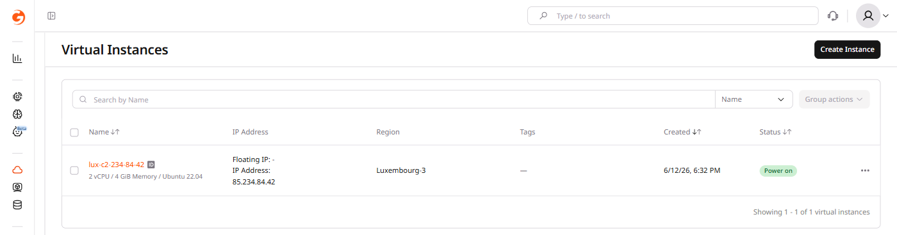

import { MethodSwitch, MethodSection } from "/snippets/method-switch.jsx";

<MethodSwitch>

<MethodSection id="portal" label="Customer Portal">

<p>Virtual Machine statuses are visible on the **Virtual Instances** page inside a project. Check the **Status** column:</p>

<Frame></Frame>

<p>[Status&nbsp;values](#status-values) lists the meaning of each status.</p>

<Tip>
If a Virtual Machine enters the `Error` state, contact [Gcore&nbsp;support](mailto:support@gcore.com) for assistance.
</Tip>

</MethodSection>

<MethodSection id="api" label="REST API">

<p>The list and the detail endpoints return `status` for each VM. `rebooting`, `rebuilding`, and `resizing` mean that operation is still running.</p>

<Info>An [API&nbsp;token](/account-settings/api-tokens) is required, along with a [project&nbsp;ID](/api-reference/cloud/projects/list-projects).</Info>

<p>Set these variables before running the examples:</p>

```bash
export GCORE_API_KEY="{YOUR_API_KEY}"
export GCORE_CLOUD_PROJECT_ID="{YOUR_PROJECT_ID}"
export INSTANCE_ID="{YOUR_INSTANCE_ID}"
```

<Info>
`INSTANCE_ID` is the UUID of the Virtual Machine — retrieve it from the `id` field in the list endpoint response below.
</Info>

## List instances

<p>Returns every Virtual Machine in the project with its current `status`.</p>

<Tabs>
  <Tab title="Python SDK">
```python
import os
from gcore import Gcore

client = Gcore()

for instance in client.cloud.instances.list():
    print(f"{instance.name}: {instance.status}")
```
  </Tab>
  <Tab title="Go SDK">
```go
import (
    "context"
    "fmt"
    "log"

    gcore "github.com/G-Core/gcore-go"
    "github.com/G-Core/gcore-go/cloud"
)

client := gcore.NewClient()
ctx := context.Background()

page, err := client.Cloud.Instances.List(ctx, cloud.InstanceListParams{})
if err != nil {
    log.Fatalf("list instances: %v", err)
}
for _, inst := range page.Results {
    fmt.Printf("%s: %s\n", inst.Name, inst.Status)
}
```
  </Tab>
  <Tab title="curl">
```bash
curl -X GET "https://api.gcore.com/cloud/v1/projects/${GCORE_CLOUD_PROJECT_ID}/instances" \
  -H "Authorization: APIKey ${GCORE_API_KEY}"
```

Response:

```json
{
  "count": 2,
  "results": [
    {
      "id": "4f89fc5a-3f68-4ae5-8b32-6e5304987872",
      "name": "my-instance",
      "status": "active",
      "managed_by": null
    },
    {
      "id": "9a1bc2d3-4e5f-6789-abcd-ef0123456789",
      "name": "prod-cluster-worker-1",
      "status": "active",
      "managed_by": {
        "type": "k8s_cluster",
        "resource_name": "prod-cluster"
      }
    }
  ]
}
```
  </Tab>
</Tabs>

## Get instance details

<p>Returns one VM. `status` is `active` while the VM is running, and `rebooting`, `rebuilding`, or `resizing` while that operation is in progress.</p>

<Tabs>
  <Tab title="Python SDK">
```python
instance = client.cloud.instances.get(instance_id=os.environ["INSTANCE_ID"])
print(f"status={instance.status}")
```
  </Tab>
  <Tab title="Go SDK">
```go
instance, err := client.Cloud.Instances.Get(ctx, os.Getenv("INSTANCE_ID"), cloud.InstanceGetParams{})
if err != nil {
    log.Fatalf("get instance: %v", err)
}
fmt.Printf("status=%s\n", instance.Status)
```
  </Tab>
  <Tab title="curl">
```bash
curl -X GET "https://api.gcore.com/cloud/v1/projects/${GCORE_CLOUD_PROJECT_ID}/instances/${INSTANCE_ID}" \
  -H "Authorization: APIKey ${GCORE_API_KEY}"
```

Response:

```json
{
  "id": "4f89fc5a-3f68-4ae5-8b32-6e5304987872",
  "name": "my-instance",
  "status": "active",
  "managed_by": null
}
```
  </Tab>
</Tabs>

</MethodSection>

<MethodSection id="terraform" label="Terraform">

<p>Read Virtual Machine status without managing the instance. Two data sources are available: [`gcore_cloud_instances`](https://registry.terraform.io/providers/G-Core/gcore/latest/docs/data-sources/cloud_instances) returns all VMs for a project and region; [`gcore_cloud_instance`](https://registry.terraform.io/providers/G-Core/gcore/latest/docs/data-sources/cloud_instance) fetches a single VM by ID.</p>

## List instance statuses

<p>Returns all Virtual Machines in the project and region with their current `status` and `vm_state`. Use to check or map statuses across multiple instances.</p>

```hcl
data "gcore_cloud_instances" "all" {
  project_id = var.project_id
  region_id  = var.region_id
}

output "instance_statuses" {
  value = {
    for inst in data.gcore_cloud_instances.all.items :
    inst.name => inst.status
  }
}
```

<p>Save this as a standalone `.tf` file containing only the data source, then run `terraform apply`. Terraform queries the API and prints the current status for each instance:</p>

```bash
instance_statuses = {
  "my-instance" = "ACTIVE"
}
```

## Get instance status

<p>Reads a single instance by ID and surfaces its `status`, `vm_state`, and `task_state`. Use when the live state of an existing VM must be known before provisioning dependent resources.</p>

```hcl
data "gcore_cloud_instance" "status" {
  project_id  = var.project_id
  region_id   = var.region_id
  instance_id = "{INSTANCE_ID}"
}

output "instance_status" {
  value = data.gcore_cloud_instance.status.status
}

output "instance_task_state" {
  value = data.gcore_cloud_instance.status.task_state
}
```

<p>Save this as a standalone `.tf` file and run `terraform apply`. Terraform queries the API and prints:</p>

```bash
instance_status     = "ACTIVE"
instance_task_state = tostring(null)
```

<p>The API `status` values are listed in [Status&nbsp;values](#status-values).</p>

## Check state of a managed instance

<p>For instances declared as `gcore_cloud_instance` resources, `terraform show` reads from the state file — it reflects the state at the last `apply` or `refresh`, not the current API value:</p>

```bash
terraform show
```

<p>To query the live API and update the state file:</p>

```bash
terraform apply -refresh-only
```

</MethodSection>
</MethodSwitch>

## Status values

The API `status` field is a lowercase value. `rebooting`, `rebuilding`, and `resizing` mean that operation is still running.

| `status` | Portal label | Meaning |
|----------|--------------|---------|
| `active` | Power on | The VM is running. |
| `stopped` | Power off | The VM is powered off. |
| `provisioning` | Building | The VM is being allocated. |
| `error` | Error | Resource allocation failed. |
| `rebooting` | — | Soft reboot in progress. |
| `rebuilding` | — | The VM is being rebuilt from an image. |
| `resizing` | — | The VM flavor is being changed. |
