import { MethodSwitch, MethodSection } from "/snippets/method-switch.jsx";

<MethodSwitch>
  <MethodSection id="portal" label="Customer Portal">

<p>Create Linux or Windows Virtual Instances in Gcore Cloud.</p>

<Tip>
  When using [VAST&nbsp;file&nbsp;shares](/cloud/file-shares/configure-file-shares), it is best to create them **before** provisioning the corresponding compute resources.
</Tip>

## Step 1. Select a region

1. In the [Gcore Customer Portal](https://portal.gcore.com/accounts/reports/dashboard), navigate to **Virtual Instances** and click **Create Instance**.

<Frame>
  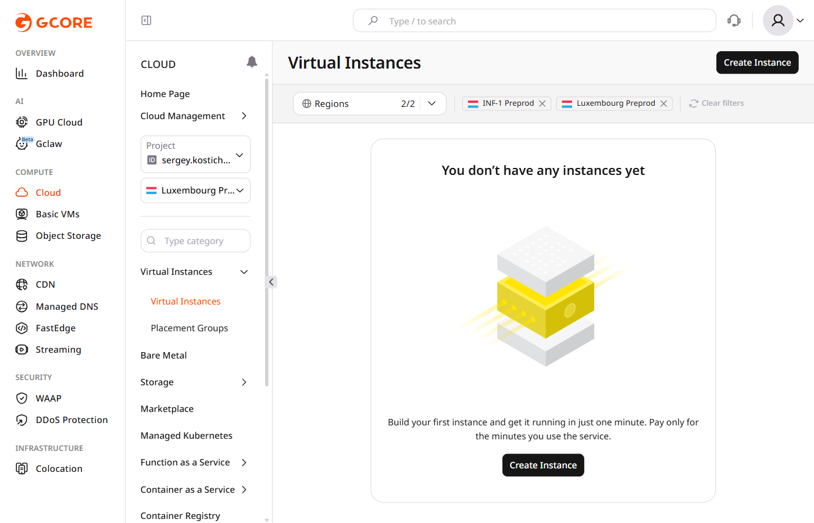
</Frame>

2. Select the region where the Virtual Instance will be deployed.

<Frame>
  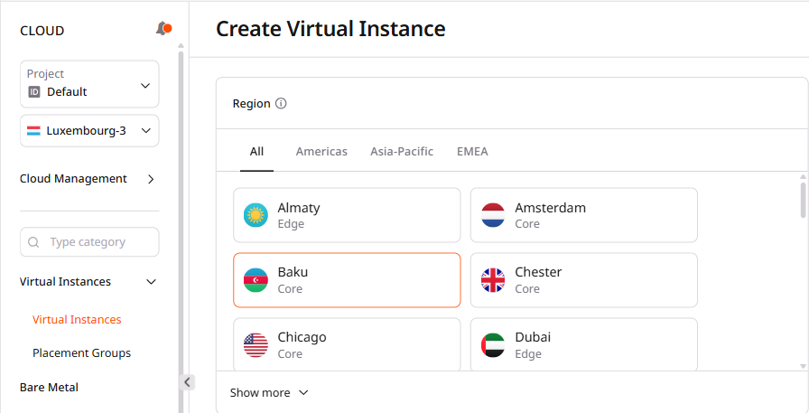
</Frame>

<p>Notice that regions are labeled either Core or Edge. This represents the region's equipment specifications.</p>

|                                          | Core                        | Edge\*                          |
| ---------------------------------------- | --------------------------- | ------------------------------- |
| Equipment generation                     | The latest                  | Different                       |
| Designed for high scalability on the fly | Yes                         | Not                             |
| Available resources                      | 1000 cores and 30 TB of RAM | Up to 300 cores and 1 TB of RAM |
| Ports for user traffic and storage       | Separate                    | Shared                          |
| Price                                    | Higher                      | Lower                           |

- Edge regions can be transformed into Core regions — contact [support](mailto:support@gcore.com) to request the conversion.

## Step 2. Configure the image

<p>Select the type of hardware architecture for the instance:</p>

- **x86-64** : This architecture is known for its broad compatibility with Linux operating systems and Windows distributions. It is commonly used in general purpose computing applications.
- **ARM** : ARM architecture is designed for energy efficiency and low power consumption, which also supports strong performance, making it ideal for high-performance computing tasks. However, ARM Virtual Machines are compatible with fewer OS distributions.

<Frame>
  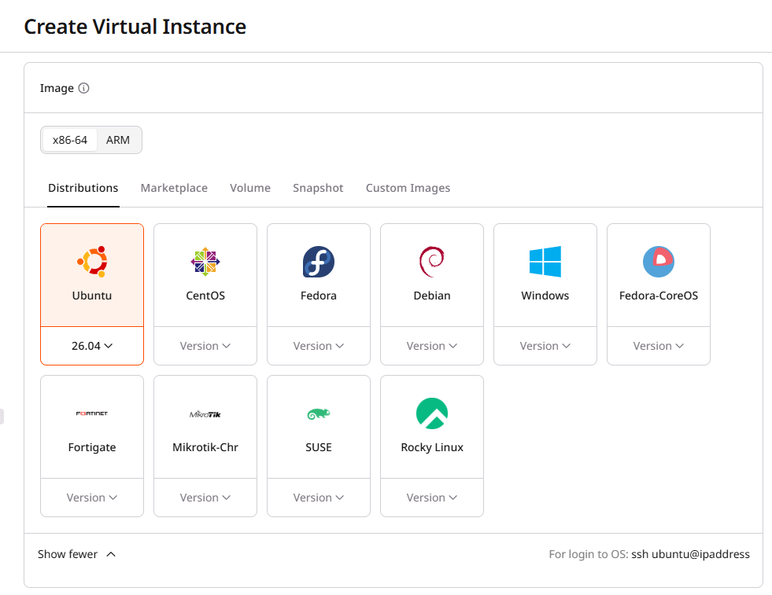
</Frame>

<p>The selected hardware architecture determines the available OS options and instance flavors. Select the image source from one of the tabs:</p>

- **Distributions** — standard OS distributions: Ubuntu, Debian, CentOS, Windows, and others.
- **Marketplace** — pre-configured templates with software already installed.
- **Volume** — boot from an existing volume.
- **Snapshot** — boot from a previously created snapshot.
- **Custom Images** — use an image uploaded to the project.

## Step 3. Select the VM type

<p>The available CPU generation is determined by the selected region and displayed in the **CPU generation** field. Select one of the available flavors:</p>

- **Standard** — balanced compute, memory, and networking for a wide range of workloads.
- **CPU-Optimized** — higher vCPU-to-RAM ratio, suited for CPU-intensive tasks — batch processing, video encoding, and large-scale data processing.
- **Memory-Optimized** — higher RAM-to-vCPU ratio, suited for memory-intensive workloads — databases, SRM/ERP, and data warehouses.

<Info>
  GPU, High-frequency, and Shared flavors are available in select regions only. The flavor tabs appear automatically when those flavors are available in the selected region.
</Info>

## Step 4. Set up volumes

<p>Enter a volume name, select its type, and set its size in GiB.</p>

<Frame>
  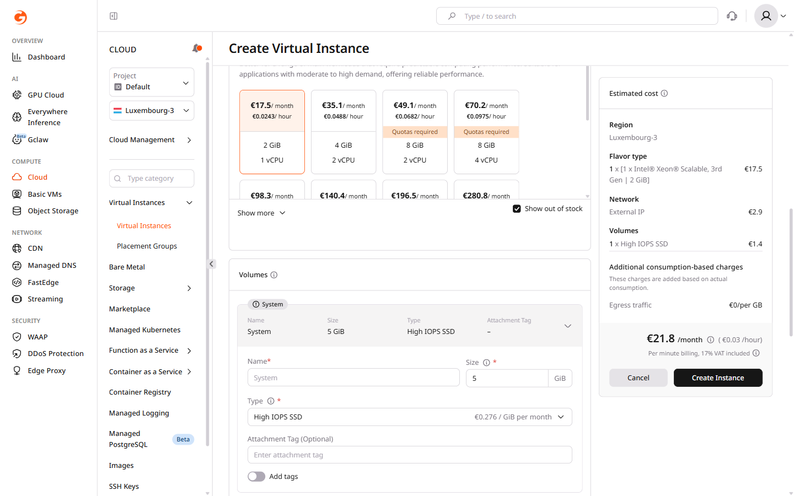
</Frame>

<Accordion title="Available volume types">
  - **High IOPS SSD**. High-performance SSD block storage designed for latency-sensitive transactional workloads (60 IOPS per 1 GB; 2.5 MB/s per 1 GiB). The IOPS performance limit is 9,000. The bandwidth limit is 500 MB/s.

  - **Standard**. Network SSD disk that provides stable and high random I/O performance, as well as high data reliability (6 IOPS per 1 GB; 0.4 MB/s per 1 GiB). The IOPS performance limit is 4,500. The bandwidth limit is 300 MB/s.

  - **SSD Low-Latency**. SSD block storage designed for applications that require low-latency storage and real-time data processing. 50 IOPS per 1 GB; minimum 1,000 IOPS; maximum 75,000 IOPS. Bandwidth limit: 1,500 MB/s. Average latency: 300 µs.
</Accordion>

<p>(Optional) Add an **Attachment Tag**.</p>

## Step 5. Configure networking

### Configure the interface

<p>Configure the network interface:</p>

1. Select the **Network type**: **Public** or **Private**.

2. In the **IP Family** section, select the IP version: **IPv4**, **IPv6**, or **Dual (IPv4 + IPv6)**.

3. In the **Security Groups** section, select the security groups to attach. The default security group is attached automatically if no selection is made.

4. (Optional) Enable **Use reserved IP** to assign a [reserved&nbsp;IP&nbsp;address](/cloud/networking/ip-address/create-and-configure-a-reserved-ip-address) to the instance, or enable **Use floating IP** to assign a [floating&nbsp;IP&nbsp;address](/cloud/networking/ip-address/create-and-configure-a-floating-ip-address).

<p>On a **Public** interface, IPv6 is available in every Cloud region. **IPv6** and **Dual (IPv4 + IPv6)** assign one public IPv6 address, not a subnet, and the address has internet access.</p>

<p>To assign multiple public IP addresses, add additional public interfaces after the instance is created: open the **Networking** tab in the VM settings and click **Add Interface**.</p>

<Frame>
  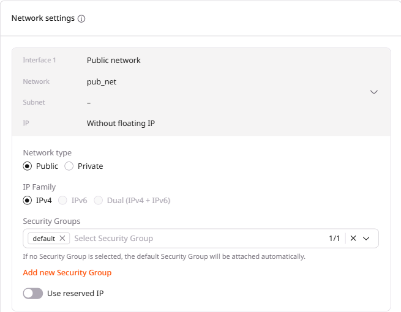
</Frame>

<Info>
  The default security group allows inbound traffic over ICMP, SSH (TCP/22), and RDP (TCP/3389 and UDP/3389). All outbound traffic is allowed. [Custom&nbsp;security&nbsp;groups](/cloud/networking/add-and-configure-a-firewall) can override these defaults.
</Info>

<p>For a **private** interface, configure a network and a subnet as described below.</p>

<Tip>
  If both a public and private interface are needed, disable the default gateway on the private network's subnet and assign a floating IP to the private interface.
</Tip>

### Configure the network

<p>Select an existing network from the dropdown list or create a new one by clicking **Add a new network**.</p>

<Frame>
  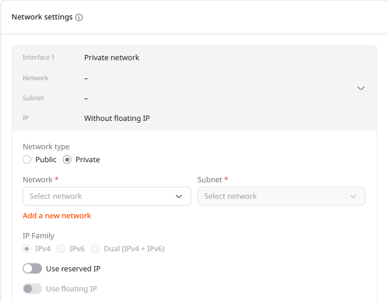
</Frame>

<Accordion title="Create a new network">
  1. Click **Add a new network**.
  2. Enter the network name.
  3. (Optional) Enable **Bare Metal Network** to make the network available to Bare Metal servers.
  4. (Optional) Enable **Create router** to create a router that all subnets in this network will connect to by default.
  5. (Optional) Enable **Add tags** to attach metadata to the network.
  6. Click **Create & Proceed**.

  <Frame>
    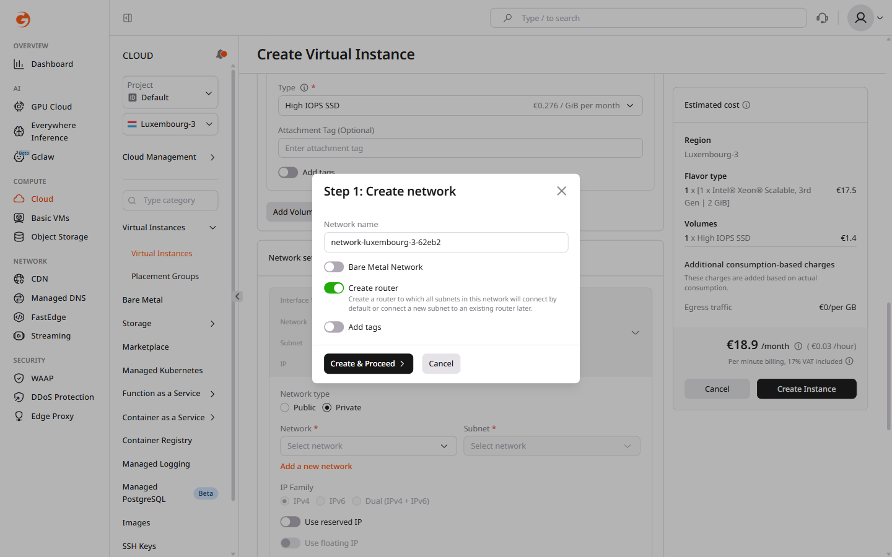
  </Frame>
</Accordion>

### Configure the subnet

<Info>
  When a Virtual Instance has several subnets, keep only one routable — [default&nbsp;gateway&nbsp;conflicts](/cloud/networking/create-and-manage-a-subnet#set-up-the-default-gateway) otherwise prevent connecting to the instance.
</Info>

<p>Select an existing subnet from the dropdown list or create a new one by clicking **Add a new subnet**.</p>

<Frame>
  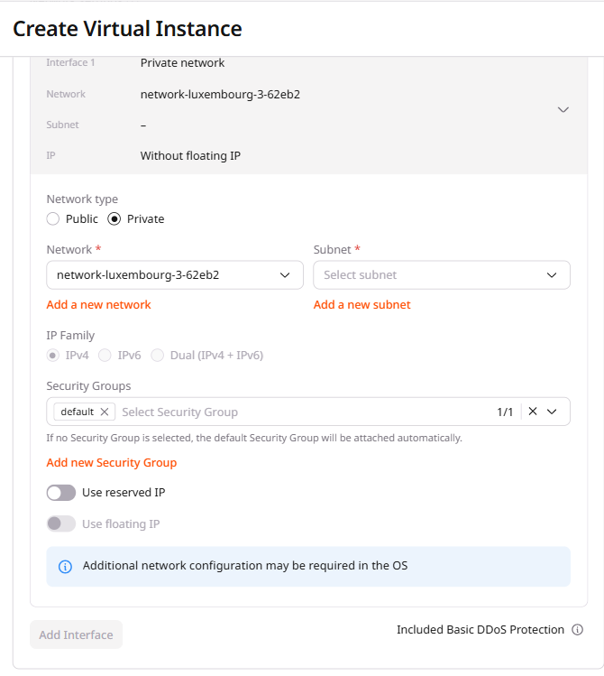
</Frame>

<Accordion title="Create a new subnet">
  1. Click **Add a new subnet**.
  2. Enter the subnet name.
  3. Set CIDR in one of the private ranges: 10.0.0.0–10.255.255.255, 172.16.0.0–172.31.255.255, or 192.168.0.0–192.168.255.255. Set the mask between /16 and /29.
  4. (Optional) Enable **Enable DHCP** to assign IP addresses to machines in the subnet automatically.
  5. (Optional) Enable **Connect to network router** to connect this subnet to the network's router by default.
  6. Select **Gateway IP** assignment: **Automatically** or **Specific**.
  7. (Optional) Enter **Custom DNS** server addresses.
  8. (Optional) Enter static routes using the **Destination** and **Nexthop** fields.
  9. (Optional) Enable **Add tags** to attach metadata to the subnet.
  10. Click **Create subnet**.

  <Frame>
    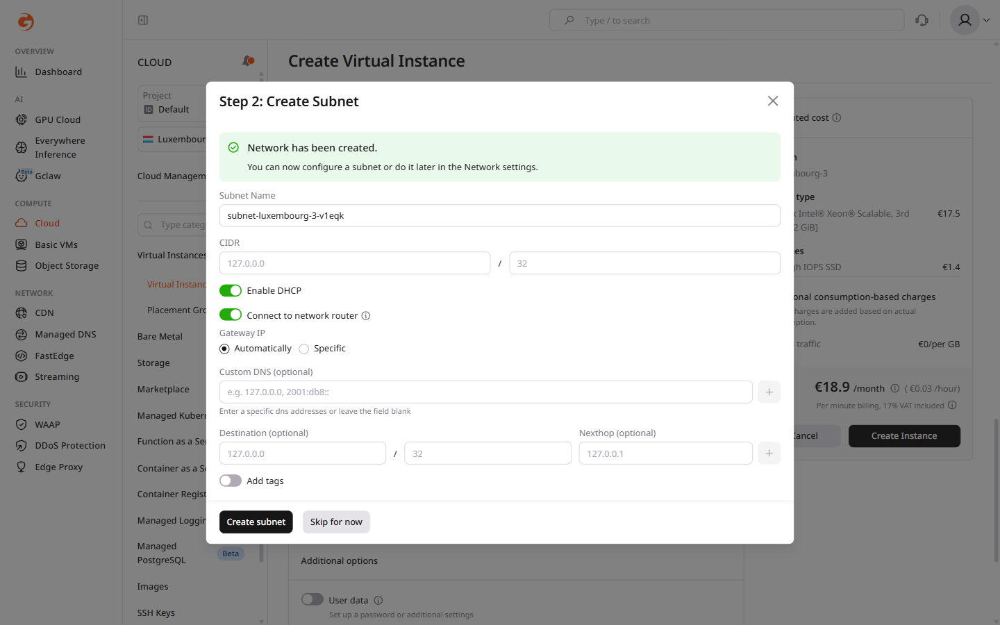
  </Frame>
</Accordion>

### Interface order

<Accordion title="Interface naming when using multiple interfaces">
  <p>When adding multiple interfaces, the order in the creation form determines how the OS names them after the instance starts. The diagram below shows how the selection order carries through to the **Networking** tab and then to the OS interface names:</p>

  <Frame>
    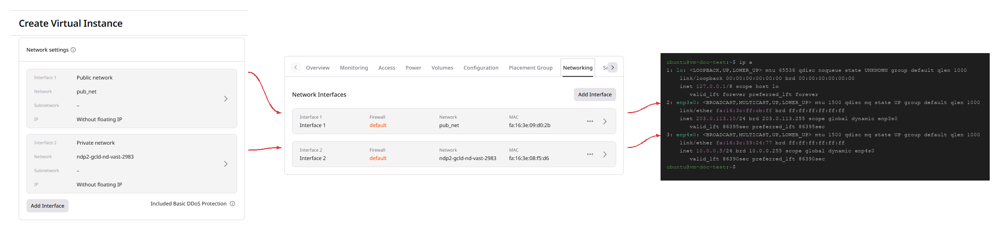
  </Frame>

  ```bash
  $ ip addr show enp3s0
  2: enp3s0: <BROADCAST,MULTICAST,UP,LOWER_UP> mtu 1500 ...
      inet 85.234.84.186/24 metric 1000 brd 85.234.84.255 scope global dynamic enp3s0

  $ ip addr show enp4s0
  3: enp4s0: <BROADCAST,MULTICAST,UP,LOWER_UP> mtu 1500 ...
      inet 10.0.0.132/24 metric 2000 brd 10.0.0.255 scope global dynamic enp4s0
  ```

  <p>The first interface (`enp3s0`) is the public interface; the second interface (`enp4s0`) is the private interface. The order set at creation determines routing priority: the first interface has higher priority for outbound traffic than subsequent ones. The interface order cannot be changed after the instance is created.</p>
</Accordion>

## Step 6. Set up authentication

<Tabs>
  <Tab title="Linux Virtual Machine">
    Configure an SSH key for a remote SSH connection. Add an existing SSH key or generate a new one using the [SSH&nbsp;key&nbsp;guide](/cloud/virtual-instances/connect/connect-via-ssh).

    <Frame>
      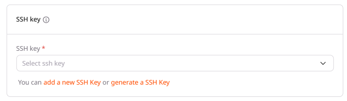
    </Frame>
    In addition to SSH keys, a password can also be set for the Virtual Instance, as described in step 7. A password is required to connect to a Linux instance from the [Customer&nbsp;Portal](/cloud/virtual-instances/connect/connect-to-your-instance-via-control-panel#connect-to-a-linux-instance).
  </Tab>
  <Tab title="Windows Virtual Machine">
    Configure **Access** by setting a password for the Admin user.

    <Frame>
      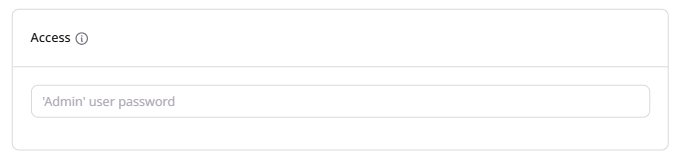
    </Frame>
    <Info>
      The password must contain 8-16 characters, including at least one lowercase letter (`a-z`), one uppercase letter (`A-Z`), one number (`0-9`), and one special character (`!#$%&'()*+,-./:;<=>?@[]^_{|}~`).
    </Info>
    The password can be used to connect to a Windows instance from the [Customer&nbsp;Portal](/cloud/virtual-instances/connect/connect-to-your-instance-via-control-panel) or from a local machine using RDP (Remote Desktop Protocol).
  </Tab>
</Tabs>

## Step 7 (Optional). Configure additional options

### Instance initialization

<p>Enable the **User data** toggle to customize the instance during the initial boot using a `cloud-init` agent.</p>

<Frame>
  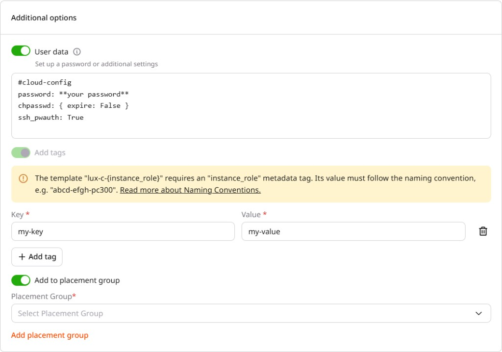
</Frame>

<p>A password for connecting to a Linux instance from the [Customer&nbsp;Portal](/cloud/virtual-instances/connect/connect-to-your-instance-via-control-panel) or [via&nbsp;SSH](/cloud/virtual-instances/connect/connect-via-ssh) can be set via **User data**. Insert the following code into the field, replacing `my-password` with the chosen password:</p>

```yaml
#cloud-config 
password: my-password 
chpasswd: { expire: False } 
ssh_pwauth: True
```

<Info>
  On Cloud instances with Windows OS, the `password` parameter cannot be used in both the "Access" and "User data" fields. Since the "Access" field is required, configuring user data on Windows instances is not possible. Allowed parameters are listed in the [API&nbsp;reference](/api-reference/cloud#tag/Instances/operation/InstanceCreateSetV2.post).
</Info>

<Accordion title="Configure a password hash">
  A password hash — a machine-readable set of symbols — can be configured to protect the actual password from being exposed. To generate a hash, use the following Python script:

  ```
  #!/usr/bin/env python3  
  \# based on [https://stackoverflow.com/a/17992126/117471](https://stackoverflow.com/a/17992126/117471)\# pip3 install passlib  
  import sys  
  from getpass import getpass  
  from passlib.hash import sha512_crypt  
  passwd = input() if not sys.stdin.isatty() else getpass()  
  print(sha512_crypt.hash(passwd, rounds = 5000 ))
  ```
</Accordion>

<Warning>
  When an instance is only in a private subnet, DHCP must be enabled in the subnet settings to allow password-based login.
</Warning>

### Tags

<p>Enable **Add tags** to add a key-value pair as metadata for the Virtual Instance.</p>

### Placement

<p>Enable **Add to placement group** to determine how to place multiple instances.</p>

<Frame>
  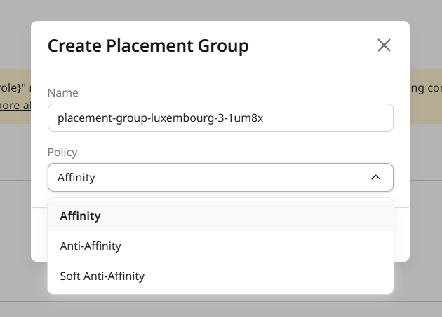
</Frame>

<Accordion title="Types of placement groups">
  <p>Instances can be placed in one of three types of groups:</p>

  - **Affinity** groups assemble virtual machines on the same hardware. Machines launched in one affinity group will exchange data faster because they are located on the same server.
  - **Anti-Affinity** groups work the opposite way: all Virtual Machines in this group will be separated across different physical hardware. This increases fault tolerance of a cluster: Even if something goes wrong with one server, machines on the other servers will remain available.
  - **Soft Anti-Affinity** groups encourage, but don't strictly enforce, the separation of Virtual Machines. Unlike a strict anti-affinity policy, where machines may never be placed together, soft anti-affinity allows placement on the same hardware when it is necessary due to factors like resource constraints or high demand. It is suitable for users who want to use the anti-affinity policy by default while also avoiding machine creation failures if an unused host is not found.
</Accordion>

<p>Add the instance to an existing placement group or create a new one by clicking **Add placement group**.</p>

## Step 8. Specify the number of instances

<p>Indicate how many instances with the same configuration are needed. No more than 10 instances can be created at a time.</p>

<Frame>
  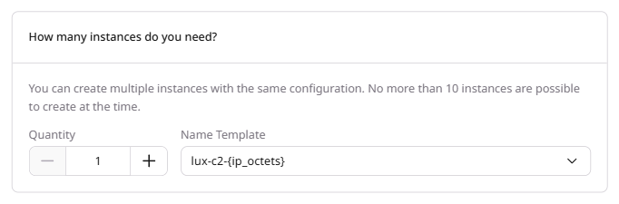
</Frame>

<p>Set the **Name Template** for the instances. Select one of the available options from the dropdown:</p>

- `{ip_octets}` — the placeholder is replaced with the last three octets of the assigned IP address — `my-vm-{ip_octets}` becomes `my-vm-10-0-5`.
- `{instance_role}` — the placeholder is replaced with the value of the `instance_role` metadata tag set in the **Add tags** section.

## Step 9. Create the instance

<p>Click **Create Instance**.</p>

<p>The instance transitions to the **Building** status while resources are being allocated.</p>

<p>After that, the instance moves to the **Power on** status and is ready to use.</p>

  </MethodSection>
  <MethodSection id="api" label="REST API">

<p>Creating a Linux VM via the REST API consists of three API calls: list available images, list flavors, then submit the create request. The instance is reachable via SSH within about 30 seconds of the task finishing.</p>

<p>A [Basic&nbsp;VM](/cloud/virtual-instances/create-a-basic-vm) boots from a local system disk and attaches existing ports. [Rebuild](/cloud/virtual-instances/rebuild-a-virtual-instance) reinstalls the operating system on an existing instance.</p>

<Info>
An [API&nbsp;token](/account-settings/api-tokens) is required, along with a [project&nbsp;ID](/api-reference/cloud/projects/list-projects) and [region&nbsp;ID](/api-reference/cloud/regions/list-regions).
</Info>

<p>Open a bash terminal and set these as environment variables before running the examples:</p>

```bash
export GCORE_API_KEY="{YOUR_API_KEY}"
export GCORE_CLOUD_PROJECT_ID="{YOUR_PROJECT_ID}"
export GCORE_CLOUD_REGION_ID="{YOUR_REGION_ID}"
```

## Add an SSH key

<p>If the project does not yet have an SSH key, register one before creating the instance. The Python and Go instance calls take the key `id`. The curl instance body takes the key name.</p>

| Parameter | Required | Description |
|-----------|----------|-------------|
| `name` | Yes | Name of the key. The SDK instance call uses the returned `id`. |
| `public_key` | No | An RSA or Ed25519 public key string. Omit to generate a new key pair. |

<Tabs>
  <Tab title="Python SDK">
    ```python
    ssh_key = client.cloud.ssh_keys.create(
        name="my-key",
        public_key="ssh-ed25519 AAAA... user@host",
    )
    ```
  </Tab>
  <Tab title="Go SDK">
    ```go
    sshKeyCreated, err := client.Cloud.SSHKeys.New(ctx, cloud.SSHKeyNewParams{
        Name:      "my-key",
        PublicKey: gcore.String("ssh-ed25519 AAAA... user@host"),
    })
    if err != nil {
        panic(err.Error())
    }
    fmt.Printf("%s\n", sshKeyCreated.ID)
    ```
  </Tab>
  <Tab title="curl">
    ```bash
    curl -X POST "https://api.gcore.com/cloud/v1/ssh_keys/$GCORE_CLOUD_PROJECT_ID" \
      -H "Authorization: APIKey $GCORE_API_KEY" \
      -H "Content-Type: application/json" \
      -d '{
        "name": "my-key",
        "public_key": "ssh-ed25519 AAAA... user@host"
      }'
    ```

    Response:

    ```json
    {
      "id": "36a7a97a-0672-4911-8f2b-92cd4e5b0d91",
      "name": "my-key",
      "state": "ACTIVE"
    }
    ```
  </Tab>
</Tabs>

<p>When `public_key` is omitted, the response includes `private_key`. The Go SDK field is `PrivateKey`. Save that value immediately. It is not shown again. Save the key `id` as `SSH_KEY_ID` for the SDK instance call.</p>

```bash
export SSH_KEY_ID="{SSH_KEY_ID}"
```

## Quickstart

<p>Complete scripts for the full flow. See the step-by-step section below for details on each call.</p>

<Tabs>
  <Tab title="Python SDK">
    ```python
    import os
    from gcore import Gcore

    client = Gcore()
    region_id = int(os.environ["GCORE_CLOUD_REGION_ID"])

    # Step 1. Find Ubuntu 22.04 image
    images = client.cloud.instances.images.list(region_id=region_id, visibility="public")
    image = next(img for img in images.results if "ubuntu-22.04" in img.name and "x64" in img.name)
    print(f"Image: {image.name} ({image.id}), min_disk={image.min_disk} GiB")

    # Step 2. Pick a flavor (this selects 2 vCPU / 4 GiB)
    flavors = client.cloud.instances.flavors.list(
        region_ids=[region_id],
        available=True,
        order_by="vcpus.asc",
    )
    flavor = next(f for f in flavors.results if f.vcpus == 2 and f.ram_mib == 4096)
    print(f"Flavor: {flavor.name} ({flavor.vcpus} vCPU / {flavor.ram_mib // 1024} GiB RAM)")

    # The public address comes from a port on the shared external network
    networks = client.cloud.networks.list(region_id=region_id, external=True, owned_by="any")
    network = networks.results[0]
    subnets = client.cloud.networks.subnets.list(
        region_id=region_id,
        network_id=network.id,
        owned_by="any",
    )
    subnet = subnets.results[0]
    keys = client.cloud.ssh_keys.list()
    ssh_key = next(key for key in keys.results if key.name == "my-key")

    # Step 3. Create the boot volume, the port, and the instance
    volume = client.cloud.volumes.create_and_poll(
        region_id=region_id,
        source="image",
        image_id=image.id,
        name="my-boot-volume",
        size=max(10, image.min_disk),
        type_name="standard",
    )
    port = client.cloud.ports.create_and_poll(
        region_id=region_id,
        network_id=network.id,
        ip_assignments=[{"subnet_id": subnet.id}],
    )
    instance = client.cloud.instances.create_and_poll(
        region_id=region_id,
        flavor_name=flavor.name,
        boot_volume_id=volume.id,
        interfaces=[{"port_id": port.id}],
        ssh_key_id=ssh_key.id,
    )
    print(f"Instance ID: {instance.id}, Status: {instance.status}")

    # Step 4. The public IP is a fixed address on the interface
    for interface in instance.interfaces:
        for assignment in interface.ip_assignments:
            print(f"ssh ubuntu@{assignment.ip_address}")
    ```
  </Tab>
  <Tab title="Go SDK">
    ```go
    package main

    import (
        "context"
        "fmt"
        "os"
        "strconv"
        "strings"

        gcore "github.com/G-Core/gcore-go"
        "github.com/G-Core/gcore-go/cloud"
    )

    func main() {
        client := gcore.NewClient()
        ctx := context.Background()
        regionID, err := strconv.ParseInt(os.Getenv("GCORE_CLOUD_REGION_ID"), 10, 64)
        if err != nil {
            panic(err.Error())
        }

        // Step 1. Find Ubuntu 22.04 image
        imageList, err := client.Cloud.Instances.Images.List(ctx, cloud.InstanceImageListParams{
            RegionID:   gcore.Int(regionID),
            Visibility: cloud.InstanceImageListParamsVisibilityPublic,
        })
        if err != nil {
            panic(err.Error())
        }
        var imageID string
        var minDisk int64
        for _, img := range imageList.Results {
            if strings.Contains(img.Name, "ubuntu-22.04") && strings.Contains(img.Name, "x64") {
                imageID = img.ID
                minDisk = img.MinDisk
                fmt.Printf("Image: %s (%s)\n", img.Name, img.ID)
                break
            }
        }

        // Step 2. Pick a flavor (this selects 2 vCPU / 4 GiB)
        flavorList, err := client.Cloud.Instances.Flavors.List(ctx, cloud.InstanceFlavorListParams{
            RegionIDs: []int64{regionID},
            Available: gcore.Bool(true),
            OrderBy:   cloud.InstanceFlavorListParamsOrderByVcpusAsc,
        })
        if err != nil {
            panic(err.Error())
        }
        var flavorName string
        for _, flavor := range flavorList.Results {
            if flavor.Vcpus == 2 && flavor.RamMib == 4096 {
                flavorName = flavor.Name
                fmt.Printf("Flavor: %s (%d vCPU / %d MiB RAM)\n", flavor.Name, flavor.Vcpus, flavor.RamMib)
                break
            }
        }

        // The public address comes from a port on the shared external network
        networks, err := client.Cloud.Networks.List(ctx, cloud.NetworkListParams{
            RegionID: gcore.Int(regionID),
            External: gcore.Bool(true),
            OwnedBy:  cloud.NetworkListParamsOwnedByAny,
        })
        if err != nil {
            panic(err.Error())
        }
        network := networks.Results[0]
        subnets, err := client.Cloud.Networks.Subnets.List(ctx, cloud.NetworkSubnetListParams{
            RegionID:  gcore.Int(regionID),
            NetworkID: gcore.String(network.ID),
            OwnedBy:   cloud.NetworkSubnetListParamsOwnedByAny,
        })
        if err != nil {
            panic(err.Error())
        }
        subnet := subnets.Results[0]
        keyList, err := client.Cloud.SSHKeys.List(ctx, cloud.SSHKeyListParams{})
        if err != nil {
            panic(err.Error())
        }
        var sshKeyID string
        for _, key := range keyList.Results {
            if key.Name == "my-key" {
                sshKeyID = key.ID
                break
            }
        }

        // Step 3. Create the boot volume, the port, and the instance
        size := int64(10)
        if minDisk > size {
            size = minDisk
        }
        volume, err := client.Cloud.Volumes.NewAndPoll(ctx, cloud.VolumeNewParams{
            OfImage: &cloud.VolumeNewParamsBodyImage{
                ImageID:  imageID,
                Name:     "my-boot-volume",
                Size:     size,
                TypeName: "standard",
            },
        })
        if err != nil {
            panic(err.Error())
        }
        port, err := client.Cloud.Ports.NewAndPoll(ctx, cloud.PortNewParams{
            RegionID:  regionID,
            NetworkID: gcore.String(network.ID),
            IPAssignments: []cloud.IPAssignmentRequestParam{
                {SubnetID: subnet.ID},
            },
        })
        if err != nil {
            panic(err.Error())
        }
        instance, err := client.Cloud.Instances.NewAndPoll(ctx, cloud.InstanceNewParams{
            RegionID:     regionID,
            FlavorName:   flavorName,
            BootVolumeID: volume.ID,
            SSHKeyID:     gcore.String(sshKeyID),
            Interfaces: []cloud.InstanceNewParamsInterface{
                {PortID: port.ID},
            },
        })
        if err != nil {
            panic(err.Error())
        }
        fmt.Printf("Instance ID: %s, Status: %s\n", instance.ID, instance.Status)

        // Step 4. The public IP is a fixed address on the interface
        for _, iface := range instance.Interfaces {
            for _, assignment := range iface.IPAssignments {
                fmt.Printf("ssh ubuntu@%s\n", assignment.IPAddress)
            }
        }
    }
    ```
  </Tab>
</Tabs>

## Step-by-step

<p>Each step below explains what the call does, which parameters matter, and what the response looks like. Use this section to understand the flow or to debug a specific step.</p>

<Accordion title="Show all steps">

### Step 1. Select an OS image

The image determines the operating system and sets the minimum boot volume size for Step 3.

<Tabs>
  <Tab title="Python SDK">
    ```python
    import os
    from gcore import Gcore

    client = Gcore()
    images = client.cloud.instances.images.list()
    for img in images.results:
        print(img.id, img.name)
    ```
  </Tab>
  <Tab title="Go SDK">
    ```go
    package main

    import (
        "context"
        "fmt"

        gcore "github.com/G-Core/gcore-go"
        "github.com/G-Core/gcore-go/cloud"
    )

    func main() {
        client := gcore.NewClient()
        ctx := context.Background()
        imageList, err := client.Cloud.Instances.Images.List(ctx, cloud.InstanceImageListParams{})
        if err != nil {
            panic(err.Error())
        }
        for _, img := range imageList.Results {
            fmt.Printf("%s %s\n", img.ID, img.Name)
        }
    }
    ```
  </Tab>
  <Tab title="curl">
    ```bash
    curl "https://api.gcore.com/cloud/v1/images/$GCORE_CLOUD_PROJECT_ID/$GCORE_CLOUD_REGION_ID" \
      -H "Authorization: APIKey $GCORE_API_KEY"
    ```

    Response:

    ```json
    {
      "results": [
        {
          "id": "e460e48c-6836-447e-bc9c-16fc4225d318",   // save as IMAGE_ID
          "name": "ubuntu-22.04-x64",
          "os_distro": "ubuntu",
          "os_version": "22.04",
          "architecture": "x86_64",
          "min_disk": 5
        }
      ]
    }
    ```
  </Tab>
</Tabs>

Save the `id` of the chosen image. The `min_disk` value is the minimum boot volume size in GiB.

```bash
export IMAGE_ID="{IMAGE_ID}"
```

### Step 2. Select a flavor

A [flavor](/api-reference/cloud/flavors/list-flavors) sets the vCPU count and RAM for the instance. The flavor name is region-specific. Run this call to list the flavors in the selected region.

<Tabs>
  <Tab title="Python SDK">
    ```python
    flavors = client.cloud.instances.flavors.list(
        region_ids=[int(os.environ["GCORE_CLOUD_REGION_ID"])],
        available=True,
    )
    for f in flavors.results:
        print(f.name, f"{f.vcpus} vCPU / {f.ram_mib // 1024} GiB RAM")
    ```
  </Tab>
  <Tab title="Go SDK">
    ```go
    instanceFlavorList, err := client.Cloud.Instances.Flavors.List(ctx, cloud.InstanceFlavorListParams{
        RegionIDs: []int64{regionID},
        Available: gcore.Bool(true),
    })
    if err != nil {
        panic(err.Error())
    }
    for _, f := range instanceFlavorList.Results {
        fmt.Printf("%s %d vCPU / %d MiB RAM\n", f.Name, f.Vcpus, f.RamMib)
    }
    ```
  </Tab>
  <Tab title="curl">
    ```bash
    curl "https://api.gcore.com/cloud/v1/projects/$GCORE_CLOUD_PROJECT_ID/instances/flavors?region_ids=$GCORE_CLOUD_REGION_ID" \
      -H "Authorization: APIKey $GCORE_API_KEY"
    ```

    Response:

    ```json
    {
      "count": 42,
      "results": [
        {"name": "g2-cpu-16-16", "vcpus": 16, "ram_mib": 16384, "region_id": 148},
        {"name": "g2-cpu-2-2", "vcpus": 2, "ram_mib": 2048, "region_id": 148}
      ]
    }
    ```
  </Tab>
</Tabs>

```bash
export FLAVOR_ID="{FLAVOR_ID}"   # flavor name from the list
```

### Step 3. Create the instance

The Python and Go SDKs create a boot volume from the image and a port on the external network, then create the instance from those IDs. `flavor_name` is the flavor name from Step 2. `ssh_key_id` is the ID of an existing SSH key. The volume `size` must be at least `min_disk` from Step 1. Leave `name` unset. The account name template assigns it, and an account that forbids a custom name rejects any other value. The curl request on this step still sends the volume and the public interface in the instance body, and that body needs `name` or `name_template`.

<Tabs>
  <Tab title="Python SDK">
    ```python
    region_id = int(os.environ["GCORE_CLOUD_REGION_ID"])
    networks = client.cloud.networks.list(region_id=region_id, external=True, owned_by="any")
    network = networks.results[0]
    subnets = client.cloud.networks.subnets.list(
        region_id=region_id,
        network_id=network.id,
        owned_by="any",
    )
    subnet = subnets.results[0]
    volume = client.cloud.volumes.create_and_poll(
        region_id=region_id,
        source="image",
        image_id=os.environ["IMAGE_ID"],
        name="my-boot-volume",
        size=10,
        type_name="standard",
    )
    port = client.cloud.ports.create_and_poll(
        region_id=region_id,
        network_id=network.id,
        ip_assignments=[{"subnet_id": subnet.id}],
    )
    instance = client.cloud.instances.create_and_poll(
        region_id=region_id,
        flavor_name=os.environ["FLAVOR_ID"],
        boot_volume_id=volume.id,
        interfaces=[{"port_id": port.id}],
        ssh_key_id=os.environ["SSH_KEY_ID"],
    )
    instance_id = instance.id
    ```
  </Tab>
  <Tab title="Go SDK">
    ```go
    regionID, err := strconv.ParseInt(os.Getenv("GCORE_CLOUD_REGION_ID"), 10, 64)
    if err != nil {
        panic(err.Error())
    }
    networks, err := client.Cloud.Networks.List(ctx, cloud.NetworkListParams{
        RegionID: gcore.Int(regionID),
        External: gcore.Bool(true),
        OwnedBy:  cloud.NetworkListParamsOwnedByAny,
    })
    if err != nil {
        panic(err.Error())
    }
    network := networks.Results[0]
    subnets, err := client.Cloud.Networks.Subnets.List(ctx, cloud.NetworkSubnetListParams{
        RegionID:  gcore.Int(regionID),
        NetworkID: gcore.String(network.ID),
        OwnedBy:   cloud.NetworkSubnetListParamsOwnedByAny,
    })
    if err != nil {
        panic(err.Error())
    }
    subnet := subnets.Results[0]
    volume, err := client.Cloud.Volumes.NewAndPoll(ctx, cloud.VolumeNewParams{
        OfImage: &cloud.VolumeNewParamsBodyImage{
            ImageID:  os.Getenv("IMAGE_ID"),
            Name:     "my-boot-volume",
            Size:     10,
            TypeName: "standard",
        },
    })
    if err != nil {
        panic(err.Error())
    }
    port, err := client.Cloud.Ports.NewAndPoll(ctx, cloud.PortNewParams{
        RegionID:  regionID,
        NetworkID: gcore.String(network.ID),
        IPAssignments: []cloud.IPAssignmentRequestParam{
            {SubnetID: subnet.ID},
        },
    })
    if err != nil {
        panic(err.Error())
    }
    instance, err := client.Cloud.Instances.NewAndPoll(ctx, cloud.InstanceNewParams{
        RegionID:     regionID,
        FlavorName:   os.Getenv("FLAVOR_ID"),
        BootVolumeID: volume.ID,
        SSHKeyID:     gcore.String(os.Getenv("SSH_KEY_ID")),
        Interfaces: []cloud.InstanceNewParamsInterface{
            {PortID: port.ID},
        },
    })
    if err != nil {
        panic(err.Error())
    }
    // instance status is active when NewAndPoll returns
    instanceID := instance.ID
    ```
  </Tab>
  <Tab title="curl">
    ```bash
    curl -X POST "https://api.gcore.com/cloud/v2/instances/$GCORE_CLOUD_PROJECT_ID/$GCORE_CLOUD_REGION_ID" \
      -H "Authorization: APIKey $GCORE_API_KEY" \
      -H "Content-Type: application/json" \
      -d '{
        "name": "my-vm",
        "flavor": "'"$FLAVOR_ID"'",
        "ssh_key_name": "my-key",
        "interfaces": [{"type": "external"}],
        "volumes": [
          {
            "source": "image",
            "image_id": "'"$IMAGE_ID"'",
            "size": 20,
            "boot_index": 0
          }
        ]
      }'
    ```

    Response:

    ```json
    {
      "tasks": ["d4a4b10e-5d22-4c23-8e09-f7a3e1c1a999"]
    }
    ```
  </Tab>
</Tabs>

```bash
export TASK_ID="d4a4b10e-5d22-4c23-8e09-f7a3e1c1a999"   # tasks[0] from the create response
```

### Step 4. Wait for the instance

Instance creation is asynchronous. The Python SDK `create_and_poll()` and the Go SDK `NewAndPoll()` in Step 3 handle polling automatically and return only when the instance status is `active`. For curl, poll `GET /cloud/v1/tasks/{task_id}` every 5 seconds until `state` is `FINISHED`.

<Tabs>
  <Tab title="Python SDK">
    `create_and_poll()` in Step 3 polls automatically. `instance` is ACTIVE when Step 3 returns.
  </Tab>
  <Tab title="Go SDK">
    `NewAndPoll()` in Step 3 polls automatically. `instance` is ACTIVE when Step 3 returns.
  </Tab>
  <Tab title="curl">
    ```bash
    curl "https://api.gcore.com/cloud/v1/tasks/$TASK_ID" \
      -H "Authorization: APIKey $GCORE_API_KEY"
    ```

    While provisioning:

    ```json
    {"state": "RUNNING", "task_type": "create_vm"}
    ```

    When complete:

    ```json
    {
      "state": "FINISHED",
      "created_resources": {
        "instances": ["169942e0-9b53-42df-95ef-1a8b6525c2bd"],   // save as INSTANCE_ID
        "volumes": ["726ecfcc-7fd0-4e30-a86e-7892524aa483"]   // save as BOOT_VOLUME_ID
      }
    }
    ```
  </Tab>
</Tabs>

```bash
export INSTANCE_ID="169942e0-9b53-42df-95ef-1a8b6525c2bd"       # created_resources.instances[0]
export BOOT_VOLUME_ID="726ecfcc-7fd0-4e30-a86e-7892524aa483"   # created_resources.volumes[0]
```

### Step 5. Get the public IP address

The Python and Go SDKs return the public IP on the instance interface. The curl response uses `addresses`.

<Tabs>
  <Tab title="Python SDK">
    ```python
    for interface in instance.interfaces:
        for assignment in interface.ip_assignments:
            print(f"IP: {assignment.ip_address}")
    ```
  </Tab>
  <Tab title="Go SDK">
    ```go
    for _, iface := range instance.Interfaces {
        for _, assignment := range iface.IPAssignments {
            fmt.Printf("IP: %s\n", assignment.IPAddress)
        }
    }
    ```
  </Tab>
  <Tab title="curl">
    ```bash
    curl "https://api.gcore.com/cloud/v1/instances/$GCORE_CLOUD_PROJECT_ID/$GCORE_CLOUD_REGION_ID/$INSTANCE_ID" \
      -H "Authorization: APIKey $GCORE_API_KEY"
    ```

    Response:

    ```json
    {
      "status": "ACTIVE",
      "addresses": {
        "pub_net": [
          {"addr": "203.0.113.42", "type": "fixed"}
        ]
      }
    }
    ```
  </Tab>
</Tabs>

In the curl response, the keys in `addresses` are network names that vary by region, so iterate over all keys when parsing programmatically.

### Step 6. Connect via SSH

Connect using the public IP from Step 5. Replace `ubuntu` with the default user for the chosen OS image.

```bash
ssh -i ~/.ssh/my-key ubuntu@203.0.113.42
```

| OS | Default user |
|----|-------------|
| Ubuntu | `ubuntu` |
| Debian | `debian` |
| CentOS | `centos` |
| Rocky Linux | `rocky` |
| Fedora | `fedora` |

The default security group is applied automatically, allowing inbound SSH (port 22) and ICMP.

</Accordion>

## Filter images by OS

<p>To list only Gcore-managed public images, add the `visibility=public` parameter.</p>

<Tabs>
  <Tab title="Python SDK">
    ```python
    images = client.cloud.instances.images.list(visibility="public")
    for img in images.results:
        print(img.id, img.name, img.os_distro, img.os_version)
    ```
  </Tab>
  <Tab title="Go SDK">
    ```go
    imageList, err := client.Cloud.Instances.Images.List(ctx, cloud.InstanceImageListParams{
        Visibility: cloud.InstanceImageListParamsVisibilityPublic,
    })
    if err != nil {
        panic(err.Error())
    }
    for _, img := range imageList.Results {
        fmt.Printf("%s %s\n", img.ID, img.Name)
    }
    ```
  </Tab>
  <Tab title="curl">
    ```bash
    curl "https://api.gcore.com/cloud/v1/images/$GCORE_CLOUD_PROJECT_ID/$GCORE_CLOUD_REGION_ID?visibility=public" \
      -H "Authorization: APIKey $GCORE_API_KEY"
    ```
  </Tab>
</Tabs>

## Clean up

<p>The SDK delete call removes the instance, the boot volume, and the port when those IDs are passed. The curl request passes the boot volume ID in the `volumes` query parameter.</p>

<Tabs>
  <Tab title="Python SDK">
    ```python
    client.cloud.instances.delete_and_poll(
        instance_id=instance.id,
        volume_ids=[volume.id],
        port_ids=[port.id],
    )
    ```
  </Tab>
  <Tab title="Go SDK">
    ```go
    err := client.Cloud.Instances.DeleteAndPoll(ctx, instance.ID, cloud.InstanceDeleteParams{
        VolumeIDs: []string{volume.ID},
        PortIDs:   []string{port.ID},
    })
    if err != nil {
        panic(err.Error())
    }
    ```
  </Tab>
  <Tab title="curl">
    ```bash
    curl -X DELETE \
      "https://api.gcore.com/cloud/v1/instances/$GCORE_CLOUD_PROJECT_ID/$GCORE_CLOUD_REGION_ID/$INSTANCE_ID?volumes=$BOOT_VOLUME_ID" \
      -H "Authorization: APIKey $GCORE_API_KEY"
    ```

    Response:

    ```json
    {"tasks": ["ef3b0d34-..."]}
    ```

    Poll `GET /cloud/v1/tasks/{task_id}` every 5 seconds until `state` is `FINISHED`.
  </Tab>
</Tabs>

<p>If a floating IP was assigned to the instance, add `delete_floatings=true` to the query string.</p>

  </MethodSection>
  <MethodSection id="terraform" label="Terraform">

<p>Declare a Virtual Machine and its boot volume together. The [Terraform&nbsp;provider](/developer-tools/terraform/overview) models these as two separate resources — [`gcore_cloud_volume`](https://registry.terraform.io/providers/G-Core/gcore/latest/docs/resources/cloud_volume) and [`gcore_cloud_instance`](https://registry.terraform.io/providers/G-Core/gcore/latest/docs/resources/cloud_instance) — provisioned in order.</p>


## Create a VM

<p>Declares a boot volume from an Ubuntu 22.04 image and a VM with a public IPv4 interface. `ssh_key_name` takes the name of an [SSH&nbsp;key](#add-an-ssh-key) registered in the project.</p>

```hcl
resource "gcore_cloud_volume" "boot" {
  project_id = var.project_id
  region_id  = var.region_id
  name       = "my-boot-volume"
  source     = "image"
  image_id   = var.image_id
  size       = 20
  type_name  = "ssd_hiiops"
}

resource "gcore_cloud_instance" "example" {
  project_id   = var.project_id
  region_id    = var.region_id
  flavor       = "g2-standard-2-4"
  name         = "my-vm"
  ssh_key_name = "my-keypair"

  volumes = [{ volume_id = gcore_cloud_volume.boot.id }]

  interfaces = [{
    type      = "external"
    ip_family = "ipv4"
  }]
}

output "instance_id" {
  value = gcore_cloud_instance.example.id
}

output "public_ip" {
  value = gcore_cloud_instance.example.addresses
}
```

<p>To find the image ID for the region, query the [Images&nbsp;API](/api-reference/cloud#tag/Images/operation/ImageListForProjectRegion.get):</p>

```bash
curl "https://api.gcore.com/cloud/v1/images/{project_id}/{region_id}?visibility=public&os_distro=ubuntu" \
  -H "Authorization: APIKey $GCORE_API_KEY" | jq '.results[] | select(.name | contains("22.04")) | {id, name}'
```

<Warning>
`gcore_cloud_volume` is an independent resource. Removing `gcore_cloud_instance.example` from the configuration does not delete its boot volume. To deprovision both, remove `gcore_cloud_volume.boot` from the configuration as well, then run `terraform apply`.
</Warning>

## Add an SSH key

<p>If the project does not yet have an SSH key, declare it as a Terraform resource. SSH keys are project-wide and do not require `region_id`.</p>

```hcl
resource "gcore_cloud_ssh_key" "my_key" {
  project_id = var.project_id
  name       = "my-keypair"
  public_key = "ssh-ed25519 AAAA... user@example.com"
}

resource "gcore_cloud_instance" "example" {
  # ...
  ssh_key_name = gcore_cloud_ssh_key.my_key.name
}
```

<p><code>public_key</code> is required. Generate the key pair locally and set <code>public_key</code> to the contents of the public key file. The provider has no attribute for a generated private key.</p>

## Optional fields

| Field | Description |
|-------|-------------|
| `user_data` | Base64-encoded cloud-init script that runs at first boot. |
| `security_groups` | List of security group IDs. If omitted, the default security group is applied. |
| `username` / `password_wo` | Creates a Linux user or sets the Windows Admin password at boot. |
| `vm_state` | `"active"` (default) to start immediately; `"stopped"` to keep the VM off. |
| `tags` | Map of key-value labels attached to the instance. |
| `name_template` | Auto-generates the name from the public IP, e.g. `"my-vm-{ip_octets}"`. Use instead of `name` when dynamic naming is required. |

<p>Example with `user_data` and `tags`:</p>

```hcl
resource "gcore_cloud_instance" "example" {
  # ... required fields ...

  user_data = base64encode(<<-EOF
    #cloud-config
    password: your-password
    chpasswd: { expire: false }
    ssh_pwauth: true
  EOF
  )

  tags = {
    env  = "production"
    team = "backend"
  }
}
```

## Delete a VM

<Warning>
  `gcore_cloud_volume` is an independent resource. Removing `gcore_cloud_instance.example` from the configuration does not delete its boot volume. To deprovision both, remove `gcore_cloud_volume.boot` from the configuration as well, then run `terraform apply`.
</Warning>

<p>Remove both `gcore_cloud_instance.example` and `gcore_cloud_volume.boot` from the configuration, then run `terraform apply` — Terraform deletes the instance first, then the volume.</p>

```hcl
# Remove or comment out both blocks:
# resource "gcore_cloud_instance" "example" {
#   name       = "my-vm"
#   flavor     = "g2-standard-2-4"
#   ...
# }
# resource "gcore_cloud_volume" "boot" {
#   name      = "my-boot-volume"
#   source    = "image"
#   ...
# }
```

```bash
terraform apply
```

## Import a VM

<p>Import the instance and its boot volume separately to bring existing infrastructure under configuration management:</p>

```bash
terraform import gcore_cloud_instance.example '<project_id>/<region_id>/<instance_id>'
terraform import gcore_cloud_volume.boot '<project_id>/<region_id>/<volume_id>'
```

<p>To find the boot volume ID, look for `"is_root_volume": true` in the instance details:</p>

```bash
curl "https://api.gcore.com/cloud/v1/instances/$GCORE_CLOUD_PROJECT_ID/$GCORE_CLOUD_REGION_ID/$INSTANCE_ID" \
  -H "Authorization: APIKey $GCORE_API_KEY" | jq '.volumes[] | select(.is_root_volume == true) | .id'
```

  </MethodSection>
</MethodSwitch>
