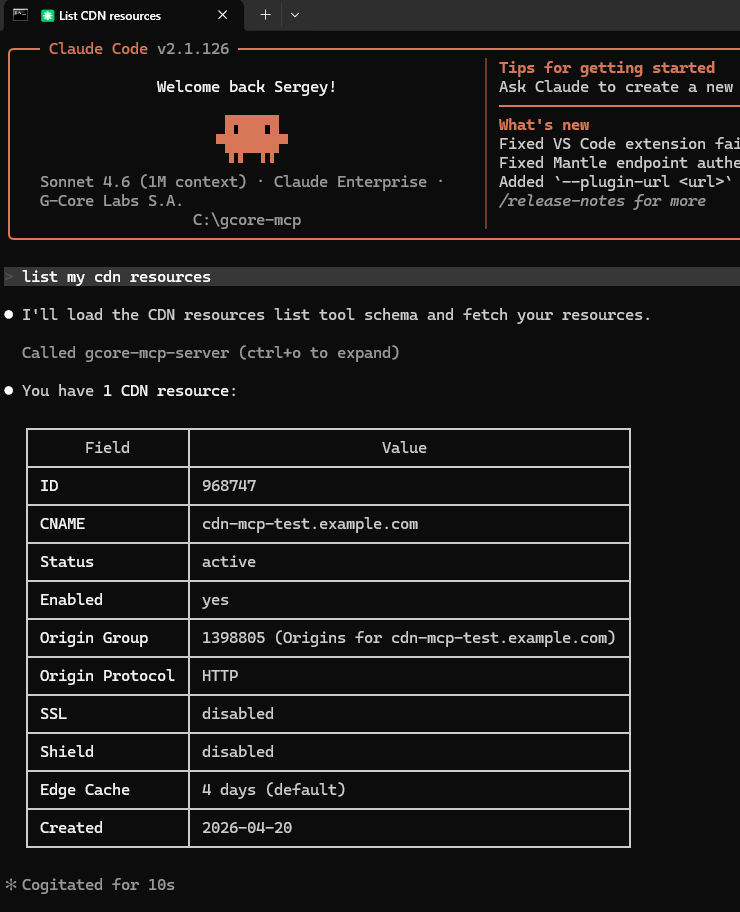

Claude Code connects to Gcore MCP Server in dynamic mode. Leave `GCORE_TOOLS` unset. The client receives six tools and can reach every operation. Pattern rules for a narrower set are in [Tool&nbsp;filtering](/developer-tools/mcp-server/filter-tools-with-gcore-tools).

- [Gcore&nbsp;API&nbsp;token](/account-settings/api-tokens) with permissions for the operations to perform
- [uv&nbsp;package&nbsp;manager](https://docs.astral.sh/uv/getting-started/installation/) installed
- **Git for Windows**: required on Windows. Download it from [git-scm.com](https://git-scm.com/download/win).

## Step 1. Install Claude Code

<Tabs>
<Tab title="Windows">

```powershell
irm https://claude.ai/install.ps1 | iex
```

After installation, restart PowerShell to update the PATH.

</Tab>
<Tab title="macOS/Linux">

```bash
curl -fsSL https://claude.ai/install.sh | bash
```

</Tab>
</Tabs>

Verify the installation:

```bash
claude --version
```

## Step 2. Authenticate Claude Code

1. Start Claude Code in any directory:

```bash
claude
```

2. On first launch, select a color theme and press Enter.

3. Enter the login command:

```
/login
```

4. A browser window opens for authentication. Sign in with a Claude Pro, Max, Team, or Enterprise account.

5. If the browser displays an authentication code instead of redirecting automatically, copy the code and paste it into the terminal prompt.

<Note>
Claude Code requires a paid subscription (Pro, Max, Team, or Enterprise). Free accounts cannot use Claude Code.
</Note>

## Step 3. Configure Gcore MCP Server

The configuration file defines MCP server connections. Add Gcore MCP Server to enable Gcore API access.

<Tabs>
<Tab title="Windows">

Open the configuration file:

```powershell
notepad $env:USERPROFILE\.claude.json
```

</Tab>
<Tab title="macOS/Linux">

Open the configuration file:

```bash
nano ~/.claude.json
```

</Tab>
</Tabs>

Add the Gcore MCP Server entry to the `mcpServers` section:

```json
{
  "mcpServers": {
    "gcore-mcp-server": {
      "command": "uvx",
      "args": [
        "--from",
        "gcore-mcp-server@git+https://github.com/G-Core/gcore-mcp-server.git",
        "gcore-mcp-server"
      ],
      "env": {
        "GCORE_API_KEY": "API_TOKEN"
      }
    }
  }
}
```

Replace `API_TOKEN` with the [Gcore&nbsp;API&nbsp;token](/account-settings/api-tokens). Save the file.

<Warning>
If the configuration file already contains other settings, merge the `mcpServers` section without overwriting existing content. JSON syntax errors cause Claude Code to fail silently.
</Warning>

## Step 4. Verify the connection

Restart Claude Code to load the new configuration:

```bash
claude
```

Check that Gcore MCP Server is connected:

```bash
claude mcp list
```

The output shows `gcore-mcp-server` with status `Connected`:

```
gcore-mcp-server: uvx --from gcore-mcp-server@... - ✓ Connected
```

Test with a resource query:

```
List my CDN resources
```

A successful response displays CDN resource details, including resource ID, CNAME, status, and configuration.

<Frame></Frame>

<Warning>
If the server shows `Failed to connect`, verify that uv is installed and the API key is valid. Test the API key independently:

```bash
curl -H "Authorization: APIKey API_TOKEN" https://api.gcore.com/cdn/resources
```

A 200 response confirms valid credentials. A 401 response indicates an invalid or expired key.
</Warning>

## Tools the server exposes

The configuration above leaves `GCORE_TOOLS` unset, so Claude Code receives `search_tools`, `get_tool_schema`, `call_read_tool`, `call_write_tool`, `call_destructive_tool`, and `execute_code`.

Setting `GCORE_TOOLS` without `GCORE_MCP_MODE` selects direct mode. `GCORE_TOOLS=*` in that mode registers 817 tools, one per operation. A value that matches nothing exits with status 2. Limit the set with [Tool&nbsp;filtering](/developer-tools/mcp-server/filter-tools-with-gcore-tools).
