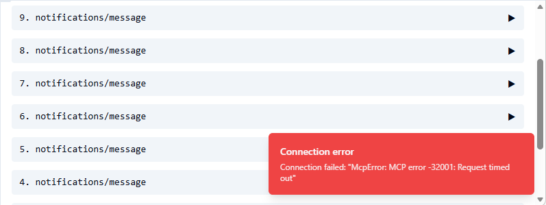

MCP Inspector provides a web interface for exploring and testing MCP server tools without an AI client. The interface displays available tools with their parameters and allows manual execution to verify behavior before integrating with Claude Code or other clients.

## Start MCP Inspector

MCP Inspector runs via npx and requires Node.js 18 or later. Verify the installation with `node --version`, then start the inspector:

```bash
npx @modelcontextprotocol/inspector
```

The inspector starts at `http://localhost:6274` and opens a browser window automatically.

<Info>
If the Inspector shows a blank white page after starting, the browser has cached a different version of the UI. Open the Inspector in a private/incognito window or press `Ctrl+Shift+R` to force a cache reload.
</Info>

## Connect to Gcore MCP Server

MCP Inspector supports two connection methods: stdio transport through the UI configuration, and HTTP transport for debugging scenarios where server logs need monitoring.

### Stdio transport

The stdio method launches the server directly from the Inspector interface.

1. Set **Transport Type** to `STDIO`.

2. Enter the command:

```
uvx
```

3. Enter the arguments:

```
--from gcore-mcp-server@git+https://github.com/G-Core/gcore-mcp-server.git gcore-mcp-server
```

4. Expand **Environment Variables** and add:

| Variable | Value |
|----------|-------|
| `GCORE_API_KEY` | [API&nbsp;token](/account-settings/api-tokens) |

Leave `GCORE_TOOLS` unset. The Inspector then lists the six dynamic tools. A pattern from [Tool&nbsp;filtering](/developer-tools/mcp-server/filter-tools-with-gcore-tools) narrows the operations those tools can reach.

5. Click **Connect**.

<Info>
`McpError: MCP error -32001: Request timed out` appears when the Inspector UI cannot reach its proxy process on port 6277. This is a known issue with MCP Inspector v0.21+ on Windows where the proxy process fails to start. Use the HTTP transport method instead. The steps are in the next section.
</Info>

<Frame></Frame>

### HTTP transport

HTTP mode allows monitoring server logs in a separate terminal.

1. Start the server with HTTP transport:

```bash
GCORE_API_KEY=API_TOKEN GCORE_TRANSPORT=http GCORE_PORT=8765 gcore-mcp-server
```

The process listens on `127.0.0.1` and logs that HTTP is read-only unless `GCORE_READ_ONLY=false`.

2. Point the Inspector at the session URL:

```
http://127.0.0.1:8765/mcp
```

3. Click **Connect**.

`GCORE_TRANSPORT=sse` exits with status 2. `GET /sse` returns 404. The `--http` flag is rejected.

## Explore available tools

After connecting, the Inspector displays three tabs: Tools (available MCP tools), Resources (MCP resources if configured), and Prompts (MCP prompts if configured). Selecting a tool reveals its description, input schema with required and optional parameters, and a test interface for manual execution.

In dynamic mode the Tools tab lists `search_tools`, `get_tool_schema`, `call_read_tool`, `call_write_tool`, `call_destructive_tool`, and `execute_code`. HTTP transport drops the write and destructive tools and leaves four. `GCORE_MCP_MODE=direct` with a `GCORE_TOOLS` pattern lists one tool per operation instead. `GCORE_TOOLS=*` in direct mode registers 818 tools.

## Execute tools manually

Tool execution requires selecting a tool from the list, filling parameter values according to the input schema, and clicking **Run Tool**. The Results panel displays the JSON response from the server.

Select `call_read_tool`, set `name` to `cloud.instances.list`, and leave `arguments` empty. Click **Run Tool**. The response names the project it used and the region on each instance:

```json
{
  "_scope": {
    "project": {
      "id": 1234567,
      "name": "Default"
    }
  },
  "count": 2,
  "regions_searched": 30,
  "note": "region_id was not given, so every active region was searched; each item shows its region_id.",
  "results": [
    {
      "id": "11111111-2222-3333-4444-555555555555",
      "name": "my-instance-1",
      "status": "ACTIVE",
      "vm_state": "active",
      "region": "Luxembourg-3",
      "region_id": 148,
      "project_id": 1234567
    }
  ]
}
```

Select `get_tool_schema` and set `name` to `cloud.instances.list` to read the argument schema, including which fields are optional. `call_destructive_tool` for `dns.zones.delete` returns `CONFIRMATION REQUIRED` and does not send the call.

## Understand tool schemas

Tool schemas define the expected input format and appear in the **Input Schema** section when selecting a tool. Each field includes its data type (string, number, object, or array), whether it is required, a description of its purpose, and default values if applicable. Expanding nested objects reveals all available configuration options.

Schema exploration helps understand exact parameter names and formats before constructing requests in Claude Code or other clients.

## Debug execution errors

The Inspector displays the full JSON-RPC request sent to the server, the response with results or errors, and execution timing. The server log names each API request and its status:

```text
INFO | Gcore SDK 0.62.0 | mode=dynamic | 818 operations {'read': 369, 'write': 227, 'destructive': 222} | 6 MCP tools | read_only=False confirm=destructive
INFO | HTTP Request: GET https://api.gcore.com/cdn/resources?limit=1000 "HTTP/1.1 200 OK"
INFO | cdn.cdn_resources.list ok in 1257 ms
```

This visibility helps diagnose issues that produce generic errors in AI clients.

<Warning>
Authentication errors (401) indicate an invalid or expired API key. Generate a new token in the [Gcore&nbsp;Customer&nbsp;Portal](/account-settings/api-tokens). Permission errors (403) indicate the token lacks the role for the operation. Resource not found errors (404) indicate a wrong ID or zone name. Validation errors indicate a missing parameter or a wrong type. Check the tool schema for the expected format.
</Warning>

## Practical applications

MCP Inspector serves as a reference tool when documenting or integrating Gcore MCP Server. Exploring tools reveals exact names, parameter requirements, types, and response structures. Testing [filter&nbsp;patterns](/developer-tools/mcp-server/filter-tools-with-gcore-tools) confirms that `GCORE_TOOLS` values match the intended tool set before configuring production clients. When Claude Code reports errors, replicating the tool call in the Inspector reveals the exact request and full error response for debugging.
