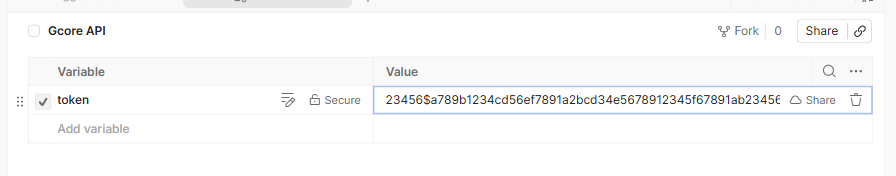
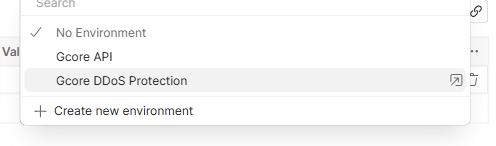
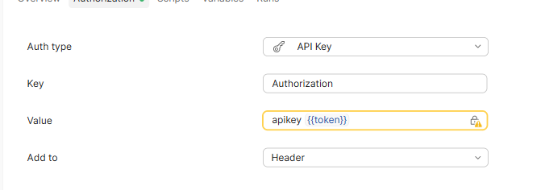
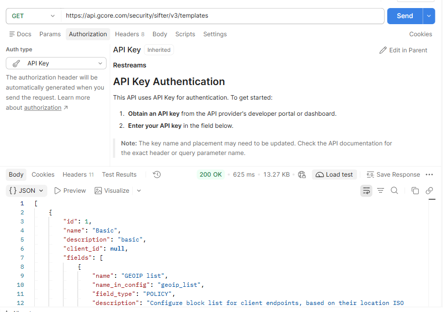

Postman provides a graphical interface for sending Gcore API requests and inspecting responses. Import the OpenAPI file for an API, authorize the collection with an API token, and reuse a value from one response in the next request.

<Steps>
  <Step title="Import the specification">
    Select **Use resources or import**, then **Import**. Paste the URL of the API:

    | API | URL |
    | --- | --- |
    | IAM | `https://raw.githubusercontent.com/G-Core/product-documentation/main/api-reference/services_docs_mintlify/iam_api.yaml` |
    | CDN | `https://raw.githubusercontent.com/G-Core/product-documentation/main/api-reference/services_docs_mintlify/cdn_api.yaml` |
    | Managed DNS | `https://raw.githubusercontent.com/G-Core/product-documentation/main/api-reference/services_docs_mintlify/dns_api.yaml` |
    | Cloud | `https://raw.githubusercontent.com/G-Core/product-documentation/main/api-reference/services_docs_mintlify/cloud_api.yaml` |
    | DDoS Protection | `https://raw.githubusercontent.com/G-Core/product-documentation/main/api-reference/services_docs_mintlify/ddos_protection_api.yaml` |
    | Edge Proxy | `https://raw.githubusercontent.com/G-Core/product-documentation/main/api-reference/services_docs_mintlify_enriched/edge_proxy_api.yaml` |
    | FastEdge | `https://raw.githubusercontent.com/G-Core/product-documentation/main/api-reference/services_docs_mintlify/fastedge_api.yaml` |
    | WAAP | `https://raw.githubusercontent.com/G-Core/product-documentation/main/api-reference/services_docs_mintlify/waap_api.yaml` |
    | Streaming | `https://raw.githubusercontent.com/G-Core/product-documentation/main/api-reference/services_docs_mintlify/streaming_api.yaml` |
    | Object Storage | `https://raw.githubusercontent.com/G-Core/product-documentation/main/api-reference/services_docs_mintlify/object_storage_api.yaml` |

    Select **Postman Collection**, then **Import**. The collection appears in the left sidebar and contains a request for every operation in that file.
  </Step>
  <Step title="Store the token">
    Click **Create new**, then **Environment**. Name the environment `Gcore API`. Add a variable named `token`, set the value to the [API&nbsp;token](/account-settings/api-tokens), and click **Secure** next to `token`.

    <Frame></Frame>

    Select `Gcore API` in **Environment**.

    <Frame></Frame>
  </Step>
  <Step title="Authorize the collection">
    Open the imported collection. On its **Authorization** tab:

    1. Set **Auth type** to **API Key**.
    2. Set **Key** to `Authorization`.
    3. Set **Value** to `apikey {{token}}`.
    4. Set **Add to** to **Header**.

    <Frame></Frame>

    Requests in the collection use this header when their authorization is inherited. The imported specification names the header and does not insert the token.
  </Step>
  <Step title="Read the templates">
    This example uses the DDoS Protection collection from the table above.

    <Info>
    Access to the DDoS Protection API is an [Enterprise&nbsp;feature](/ddos-protection/about-ddos-protection).
    </Info>

    Open **List protection templates**. On the **Authorization** tab, the collection authorization is shown as **Inherited**.

    The method is GET and the URL is `https://api.gcore.com/security/sifter/v3/templates`. The operation is [List&nbsp;protection&nbsp;templates](/api-reference/ddos-protection/protection-templates/list-protection-templates).

    Select **Send**.

    HTTP 200 means the request succeeded.

    <Frame></Frame>

    Find the template named `Basic` in the response. In the `Gcore API` environment, create a variable named `template_id` and set its value to the template's `id`.
  </Step>
  <Step title="Read one template">
    Open **Get protection template** in the same collection. On the **Authorization** tab, the collection authorization is shown as **Inherited**.

    On the **Params** tab, set `protection_template_id` to `{{template_id}}`. The operation is [Get&nbsp;protection&nbsp;template](/api-reference/ddos-protection/protection-templates/get-protection-template).

    Select **Send**.

    An HTTP 200 response confirms that the request succeeded. The response body contains the selected template.
  </Step>
</Steps>
