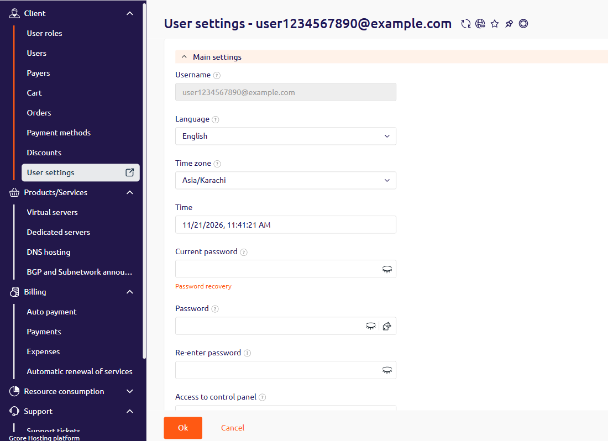
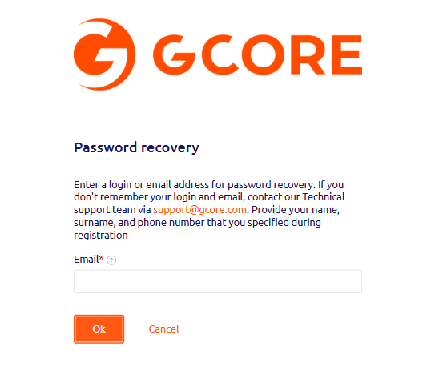

An account password is changed on **User settings** while logged in to the [Gcore&nbsp;Hosting&nbsp;Portal](https://hosting.gcore.com/billmgr). A forgotten password is recovered by email.

## Change a password

1. Log in to the Hosting Portal.
2. In the sidebar, open **Client** and select **User settings**.

<Frame></Frame>

3. In **Current password**, enter the current password.
4. In **Password**, enter the new password.
5. In **Re-enter password**, enter the new password again.
6. Click **Ok**.

## Recover a forgotten password

Forgotten passwords can be reset by email verification. On **User settings**, **Password recovery** opens the [recovery&nbsp;page](https://hosting.gcore.com/billmgr?func=recovery). Enter the account email in **Email** and click **Ok**.

<Frame></Frame>

A recovery email arrives from [billing@gcore.com](mailto:billing@gcore.com) with the subject **Password Recovery**. If it does not arrive within a few minutes, look in the spam folder. If the email is still missing, submit the request again on the [recovery&nbsp;page](https://hosting.gcore.com/billmgr?func=recovery).

After three failed login attempts, the account is temporarily locked. To unlock it, contact support via chat on [gcore.com](https://gcore.com).
