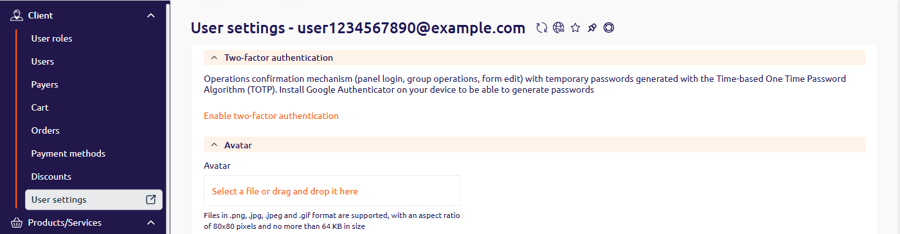
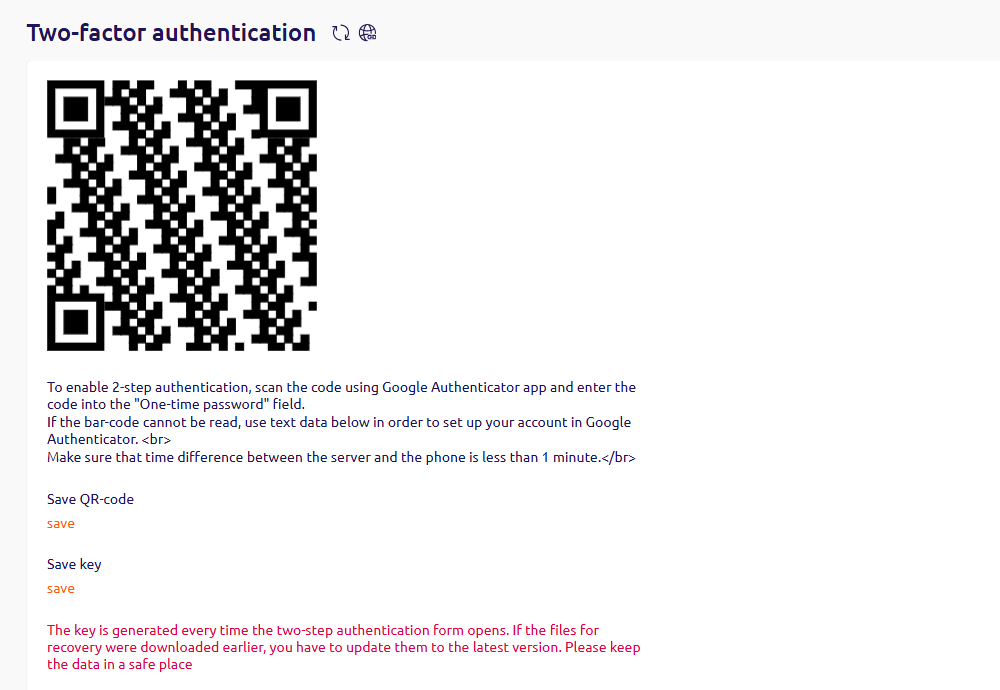
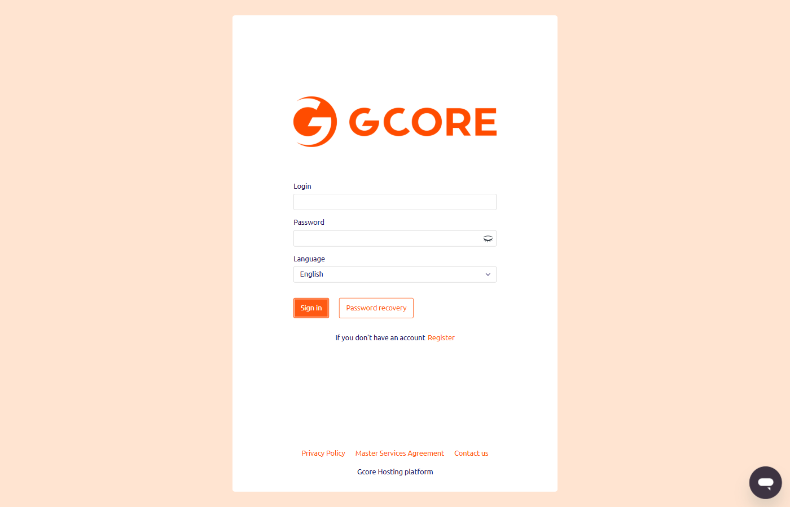

Two-factor authentication (2FA) adds a second verification step to Hosting Portal login. After enabling it, each login requires a six-digit one-time code from Google Authenticator in addition to the standard credentials.

## Enable two-factor authentication

1. Log in to the [Gcore&nbsp;Hosting&nbsp;Portal](https://hosting.gcore.com/billmgr).
2. In the **Client** section of the sidebar, click **User settings**.
3. Navigate to the **Two-factor authentication** section and click **Enable two-factor authentication**.

<Frame></Frame>

4. On the setup form, scan the QR code with the Google Authenticator app.

<Frame></Frame>

<Info>
If the QR code cannot be read, enter the value from the **Key** field manually into the app. The key is regenerated each time the setup form opens — if QR code or key files were saved previously, download fresh copies using the **Save QR-code** and **Save key** links on the form.
</Info>

5. In the **Temporary password** field, enter the six-digit code generated by the app.

<Warning>
The code is time-based. Verify that the time and time zone on the phone match the **Server time** shown on the form. A difference greater than one minute causes the code to be rejected.
</Warning>

6. Click **Ok**.

## Authorize with two-factor authentication

1. On the [Hosting&nbsp;Portal](https://hosting.gcore.com/billmgr?func=logon) login page, enter the account login and password.
2. In the **Language** field, select the interface language.
3. Click **Sign in**.

<Frame></Frame>

4. On the confirmation page, enter the six-digit code from Google Authenticator in the **Temporary password** field.

<Warning>
Verify that the exact time and time zone are set correctly on the phone. An incorrect clock causes the code to be rejected.
</Warning>

5. Click **Ok**.

## Disable two-factor authentication

1. In the **Client** section of the sidebar, click **User settings**.
2. Navigate to the **Two-factor authentication** section.
3. In the **Disable two-factor authentication** field, enter the six-digit code from the Google Authenticator app.
4. Click **Ok**.

## Recover access

If the verification code is unavailable, contact technical support at [support@gcore.com](mailto:support@gcore.com) or via chat on [gcore.com](https://gcore.com). Provide the account name and the phone number used during registration.
