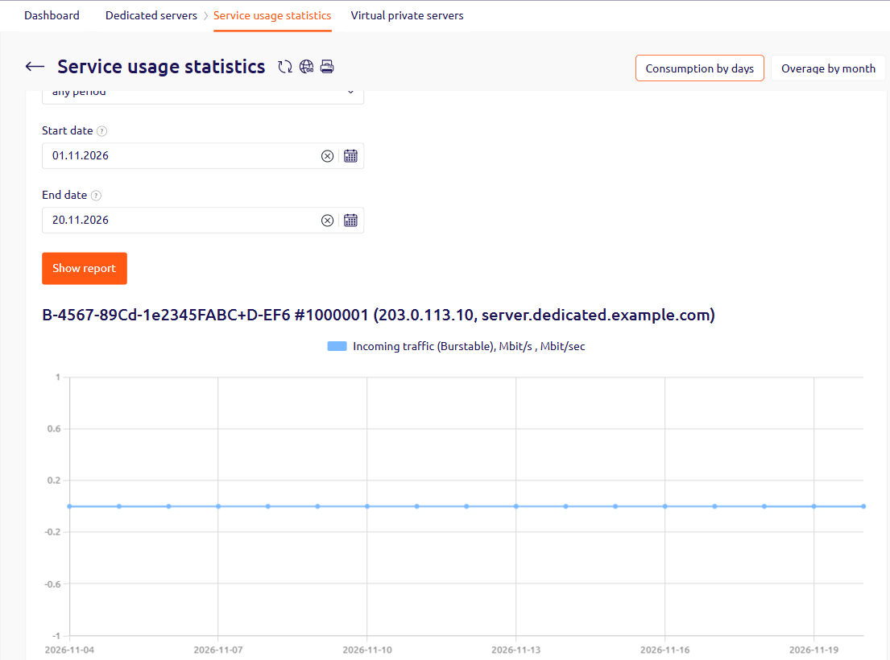
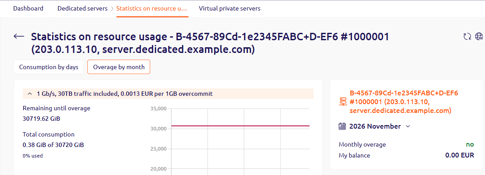

Dedicated server statistics show incoming and outgoing traffic by day, and monthly consumption against the included quota.

## Consumption by days

To view daily incoming and outgoing traffic:

1. In the [Gcore&nbsp;Hosting&nbsp;Portal](https://hosting.gcore.com/billmgr), navigate to **Dedicated servers**.

2. Select the server and click **Statistics** in the toolbar.

3. On the **Service usage statistics** page, set **Period**. For **any period**, set **Start date** and **End date**. Click **Show report**. The report charts incoming and outgoing traffic by day.

<Frame></Frame>

## Overage by month

The **Overage by month** report is titled **Statistics on resource usage**. It shows **Total consumption**, **Remaining until overage**, and **Monthly overage** for the month in the report.

To view the report, click **Overage by month** at the top of the **Service usage statistics** page.

<Frame></Frame>
