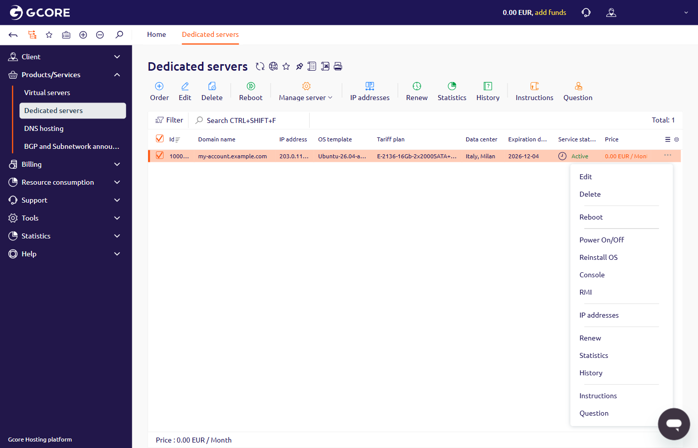

In the [Gcore&nbsp;Hosting&nbsp;Portal](https://hosting.gcore.com/billmgr), navigate to **Products/Services** → **Dedicated servers** and select the server. **Reboot** opens a confirmation before the server restarts. **Power On/Off** opens the server power controls. Both actions are in the toolbar and in the menu at the end of the row.

<Frame>
  
</Frame>

## Power on, power off, or reboot a server

**Reboot** opens a confirmation. **Ok** reboots the server. **Cancel** closes the dialog and leaves the server unchanged.

**Power On/Off** opens **Server power**. **Current state (DCI)** shows `on` or `off`, and the page has no separate control for the target state. **Execute power action** switches the server to the other state: `on` powers the server off, and `off` powers it on. The portal checks the state again before it sends the command. **Cancel** closes the page and leaves the server unchanged.

<Frame>
  
</Frame>

<Info>If **Server power** does not open or an error appears, [contact technical support](/hosting/contact-our-technical-support) and attach a screenshot of the error.</Info>
