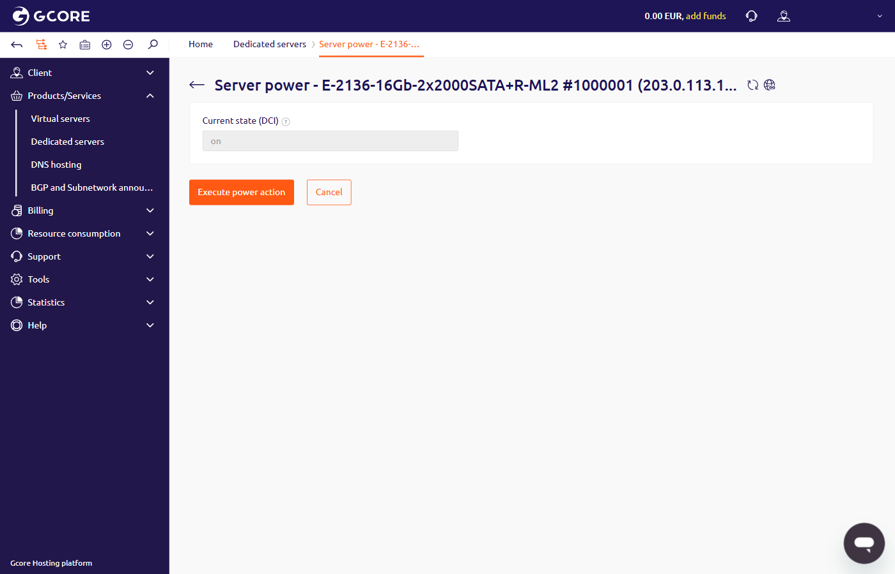

<Steps>
  <Step title="Open the dedicated servers list">
    In the [Gcore&nbsp;Hosting&nbsp;Portal](https://hosting.gcore.com/billmgr), navigate to **Products/Services** > **Dedicated servers** and select the server.
  </Step>
  <Step title="Open the power controls">
    **Power On/Off** is not a toolbar button.

    - On the toolbar, click **Manage server**, then click **Power On/Off**.
    - Click the button at the end of the row, then click **Power On/Off**.

    <Frame></Frame>
  </Step>
  <Step title="Switch the power state">
    **Current state (DCI)** shows `on` or `off`. The page has no separate control for the target state.

    - Click **Execute power action** to switch the server to the other state. `on` powers the server off, and `off` powers it on. The portal checks the state again before it sends the command.
    - Click **Cancel** to close the page and leave the server unchanged.

    <Frame></Frame>
  </Step>
  <Step title="Reboot the server">
    **Reboot** is a toolbar button.

    - On the toolbar, click **Reboot**.
    - Click the button at the end of the row, then click **Reboot**.

    The dialog asks whether to reboot the server. Click **Ok** to reboot the server. Click **Cancel** to close the dialog and leave the server unchanged.
  </Step>
</Steps>

<Info>If **Server power** does not open or an error appears, [contact&nbsp;technical&nbsp;support](/hosting/contact-our-technical-support) and attach a screenshot of the error.</Info>
