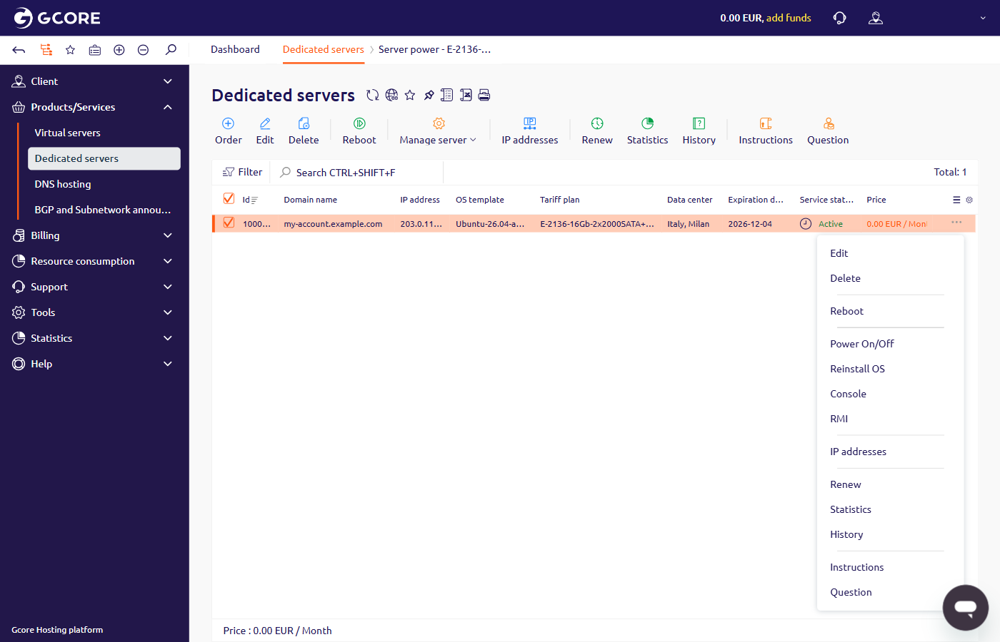

In the [Gcore&nbsp;Hosting&nbsp;Portal](https://hosting.gcore.com/billmgr), navigate to **Products/Services** → **Dedicated servers** and select the server. Open **RMI** from **Manage server** or from the menu at the end of the row. **Console** is a different item in that menu.

<Frame>
  
</Frame>

## Sign in

**RMI** opens the **DCImanager Console** page. **Connected** means the remote console connection is established, and signing in to the server's remote management interface is still required. The header has **Login**, **Password**, **Ctrl+Alt+Del**, and **Fullscreen**.

The form inside is the remote management login for that server. The labels depend on the hardware. On the server checked here they were **Username**, **Password**, **Domain**, and **Log In**.

Click the username field, then **Login**. Click the password field, then **Password**. Those buttons type into the field that has focus. Click **Log In**.
