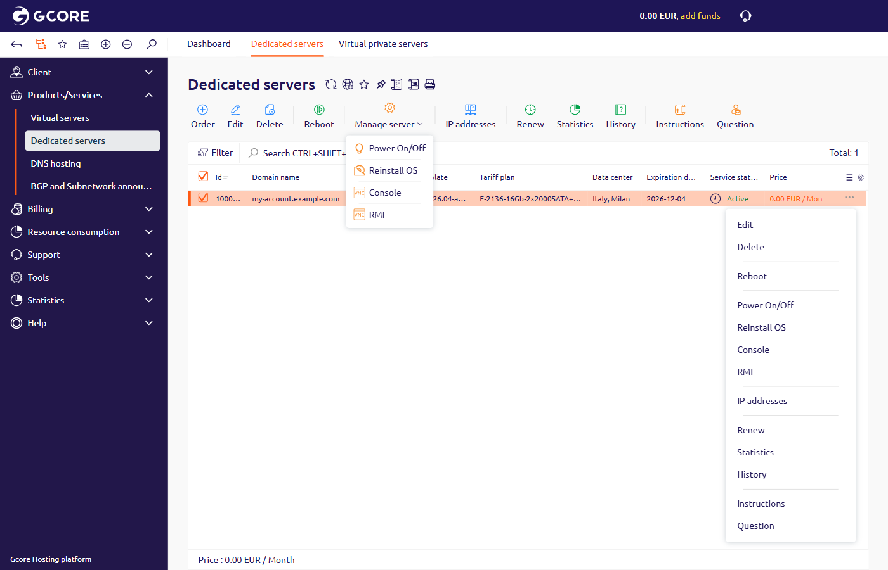

Reinstall replaces the operating system on a dedicated server and erases the data on that server.

<Steps>
  <Step title="Open the dedicated servers list">
    In the [Gcore&nbsp;Hosting&nbsp;Portal](https://hosting.gcore.com/billmgr), navigate to **Products/Services** > **Dedicated servers** and select the server.
  </Step>
  <Step title="Open the reinstall form">
    - On the toolbar, click **Manage server**, then click **Reinstall OS**.
    - Click the button at the end of the row, then click **Reinstall OS**.

    <Frame></Frame>
  </Step>
  <Step title="Fill in the reinstall form">
    1. In **New operating system**, select a Linux distribution and version. Available distributions include AlmaLinux, CentOS, Debian, Fedora, and Ubuntu. The list also includes FreeBSD, which is not a Linux distribution. Windows is not available in this list.

    2. **New OS administrator password** is already filled in. Keep that password, or replace it. Paste an SSH public key into **SSH public key** when the new system should accept that key. The key field can stay empty.

    3. Select **I understand all server data will be erased**, then click **Reinstall OS**. Click **Cancel** to close the page and leave the server unchanged.

    <Frame></Frame>
  </Step>
</Steps>
