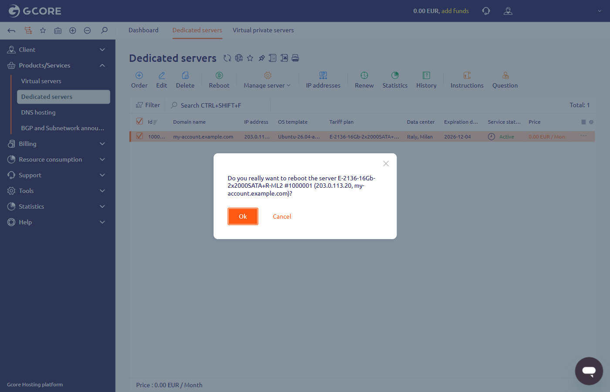

<Steps>
  <Step title="Open the dedicated servers list">
    In the [Gcore&nbsp;Hosting&nbsp;Portal](https://hosting.gcore.com/billmgr), navigate to **Products/Services** > **Dedicated servers** and select the server.
  </Step>
  <Step title="Open the reboot confirmation">
    **Reboot** is a toolbar button.

    - On the toolbar, click **Reboot**.
    - Click the button at the end of the row, then click **Reboot**.

    <Frame></Frame>
  </Step>
  <Step title="Confirm the reboot">
    The dialog asks whether to reboot the server.

    - Click **Ok** to reboot the server.
    - Click **Cancel** to close the dialog and leave the server unchanged.

    <Frame></Frame>
  </Step>
</Steps>
