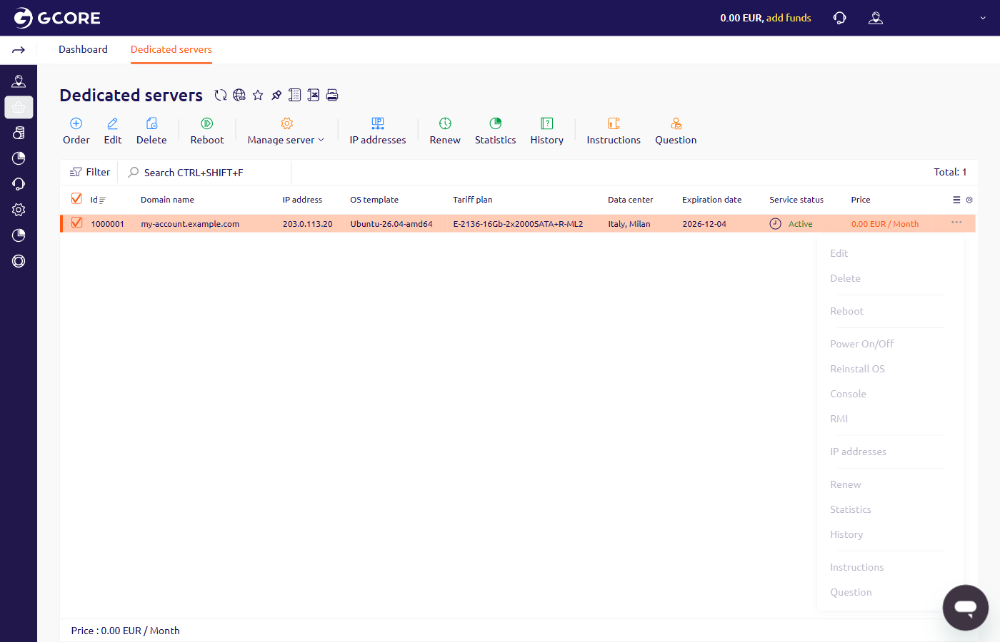

<Steps>
  <Step title="Open the dedicated servers list">

In the [Gcore&nbsp;Hosting&nbsp;Portal](https://hosting.gcore.com/billmgr), navigate to **Products/Services** → **Dedicated servers** and select the server.

<Frame>
  
</Frame>

  </Step>
  <Step title="Restart the server">

On the toolbar, click **Reboot**. The same command is in the menu at the end of the row.

  </Step>
</Steps>
