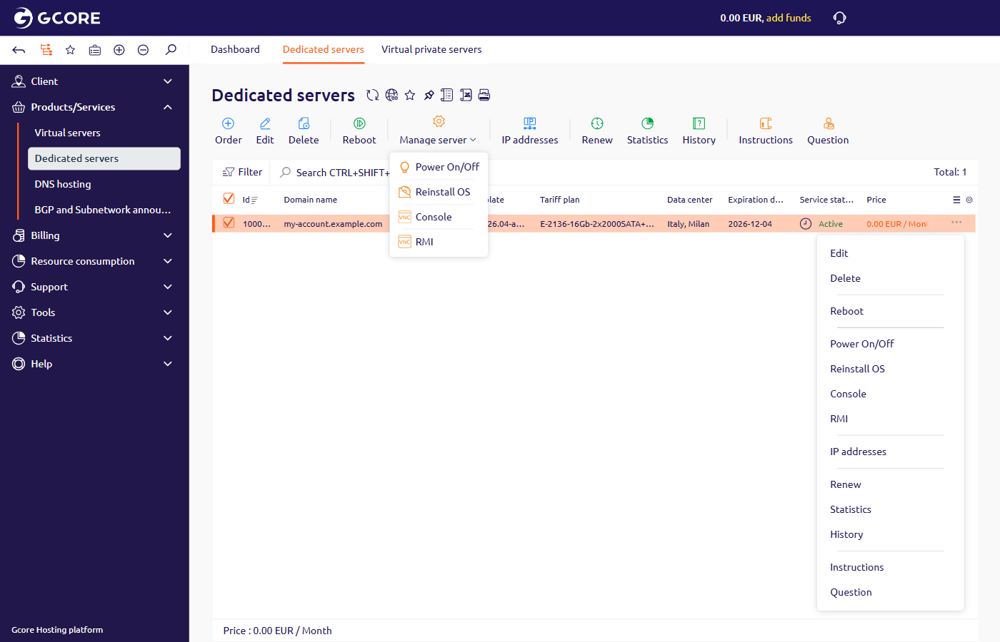

These checks cover IPMI sign-in failures and remote console errors on a dedicated server.

## Open the remote management page

Open the IPMI module or the server console from the dedicated servers list.

<Steps>
  <Step title="Open the dedicated servers list">
    In the [Gcore&nbsp;Hosting&nbsp;Portal](https://hosting.gcore.com/billmgr), navigate to **Products/Services** > **Dedicated servers** and select the server.
  </Step>
  <Step title="Open Console or RMI">
    - On the toolbar, click **Manage server**, then click **Console** or **RMI**.
    - Click the button at the end of the row, then click **Console** or **RMI**.

    **RMI** opens the IPMI module. **Connected** means the connection is established, and signing in to the IPMI module is still required. **Console** opens the server console.

    <Frame></Frame>
  </Step>
</Steps>

## Cannot log in

**Login** and **Password** in the header type into the field that has focus.

1. Click the username field, then click **Login**.

2. Click the password field, then click **Password**.

3. Click **Log In** on the form.

If the fields stay empty, type the username and password on that form. If login still fails, [contact&nbsp;technical&nbsp;support](/hosting/contact-our-technical-support).

## Error "Server disconnected: (code: 1006)"

This error appears when two IPMI sessions are open at the same time, for example from two devices or two browser tabs. IPMI supports only one active session at a time.

<Frame></Frame>

Try the following steps in order:

1. Check for two open browser tabs with IPMI. Close the duplicate tab.
2. Close the current browser, open a different browser, and reconnect to IPMI.
3. Clear browser cookies and reconnect to IPMI.
4. Connect to IPMI from a different device.

If two concurrent sessions are required, use SSH instead of IPMI.

If none of these steps resolve the issue, [contact&nbsp;technical&nbsp;support](/hosting/contact-our-technical-support) and mention that all steps in this article have been completed.

## Error "IPMI URL ... of selected server is not available"

This error can occur when the server fails or when emergency or planned work is taking place in the data center.

<Frame></Frame>

[Contact&nbsp;technical&nbsp;support](/hosting/contact-our-technical-support) and attach a screenshot of the error to the ticket.

## Remote console does not open

If the remote console fails to open, clear browser cookies, reload the page, and open **RMI** again.

If the issue persists, [contact&nbsp;technical&nbsp;support](/hosting/contact-our-technical-support).

## Remote console behavior

**Full screen**

1. Click **Fullscreen** in the header.

2. Click **Fullscreen** again to leave full screen.

**Switching between the browser and the console**

IPMI does not support switching between the browser and the remote console. The console closes when the browser window is clicked. Restart the console to reconnect.
