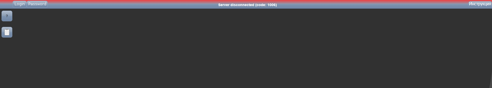
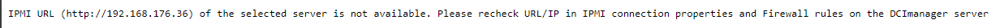

## Open the remote management page

In the [Gcore&nbsp;Hosting&nbsp;Portal](https://hosting.gcore.com/billmgr), navigate to **Products/Services** → **Dedicated servers** and select the server. Open **RMI** from **Manage server** or from the menu at the end of the row. **Console** is a different item in that menu.

<Frame>
  
</Frame>

**RMI** opens the **DCImanager Console** page. **Connected** means the remote console connection is established. Signing in on the form inside is still required. The header has **Login**, **Password**, **Ctrl+Alt+Del**, and **Fullscreen**.

## Cannot log in

Click the username field, then **Login**. Click the password field, then **Password**. Those buttons type into the field that has focus. Click **Log In** on the form.

If the fields stay empty, type the username and password on that form. If login still fails, [contact technical support](/hosting/contact-our-technical-support).

## Error "Server disconnected: (code: 1006)"

This error appears when two IPMI sessions are open at the same time, for example from two devices or two browser tabs. IPMI supports only one active session at a time.

<Frame></Frame>

Try the following steps in order:

1. Check for two open browser tabs with IPMI. Close the duplicate tab.
2. Close the current browser, open a different browser, and reconnect to IPMI.
3. Clear browser cookies and reconnect to IPMI.
4. Connect to IPMI from a different device.

If two concurrent sessions are required, use SSH instead of IPMI.

If none of these steps resolve the issue, [contact technical support](/hosting/contact-our-technical-support) and mention that all steps in this article have been completed.

## Error "IPMI URL ... of selected server is not available"

This error can occur when the server fails or when emergency or planned work is taking place in the data center.

<Frame></Frame>

[Contact technical support](/hosting/contact-our-technical-support) and attach a screenshot of the error to the ticket.

## Remote console does not open

If the remote console fails to open, clear browser cookies, reload the page, and open **RMI** again.

If the issue persists, [contact technical support](/hosting/contact-our-technical-support).

## Remote console behavior

**Full screen**

Click **Fullscreen** in the header. Click **Fullscreen** again to leave full screen.

**Switching between the browser and the console**

IPMI does not support switching between the browser and the remote console. The console closes when the browser window is clicked. Restart the console to reconnect.
