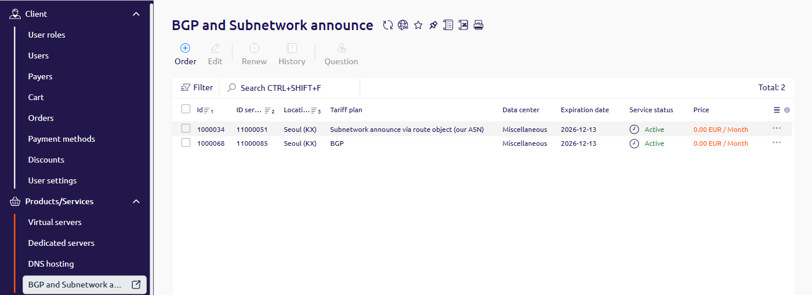
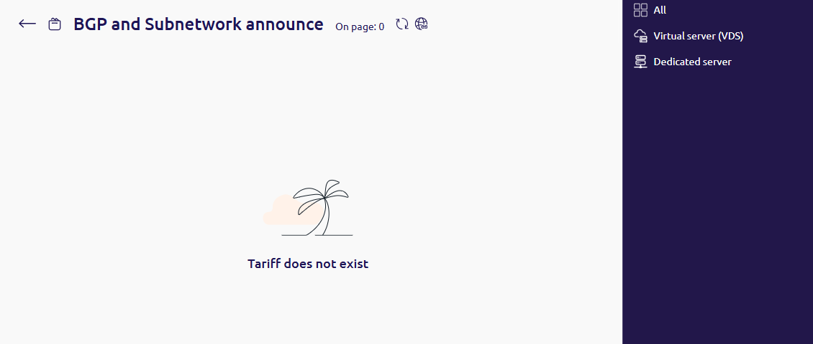

BGP announces IP addresses through Gcore equipment. The service is available on Dedicated Servers.

The **BGP and Subnetwork announce** list contains two services:

- **BGP**: announces IP addresses from a custom AS number.
- **Subnetwork announce via route object (our ASN)**: announces a subnet through the Gcore ASN.

To activate BGP or Subnetwork announce:

1. Log in to the [Gcore&nbsp;Hosting&nbsp;Portal](https://hosting.gcore.com/billmgr).
2. In the left sidebar, open **Products/Services** and select **BGP and Subnetwork announce**.

<Frame></Frame>

3. Click **Order**. The order page shows the tariffs that can be added. When none are offered, the page says **Tariff does not exist**.

<Frame></Frame>

4. Open a support ticket with the service name and the configuration details. Support configures the service after the request.
