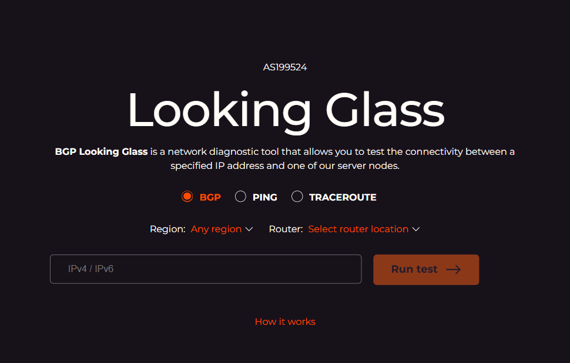
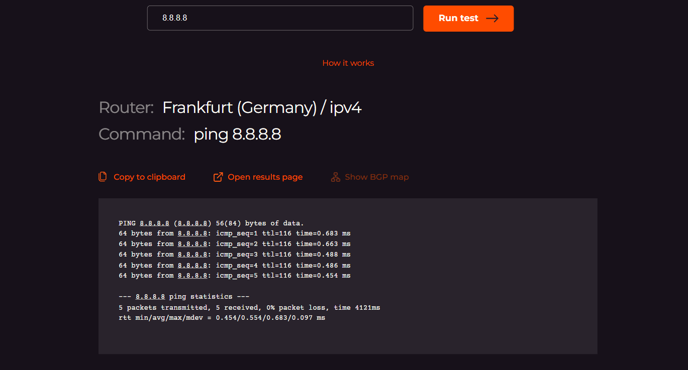
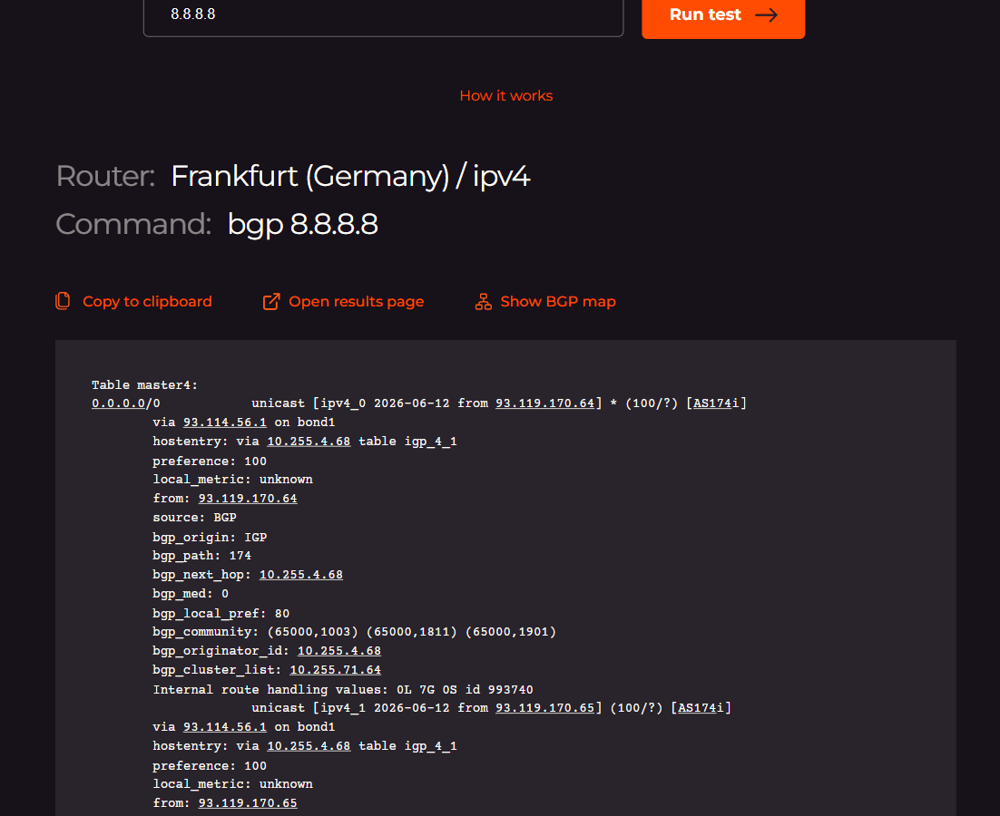
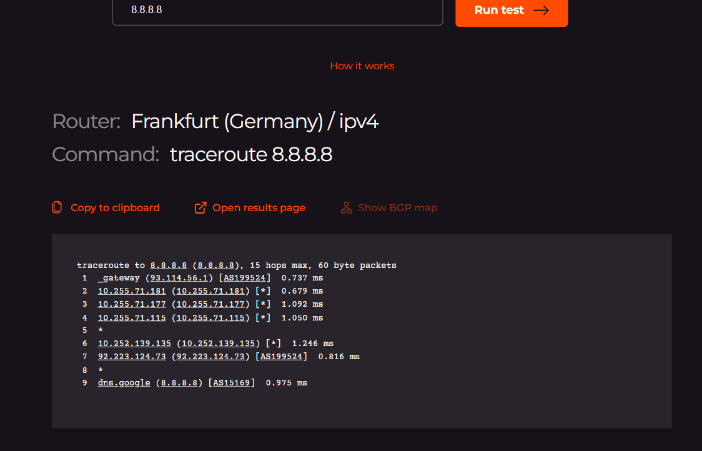

Before choosing where to deploy a server, use [Looking&nbsp;Glass](https://lg.gcore.lu) to check network latency and routing from Gcore locations to the target IP address.

## Run a test

<Steps>
  <Step title="Open Looking Glass">
    Navigate to [lg.gcore.lu](https://lg.gcore.lu).

    <Frame></Frame>
  </Step>
  <Step title="Select a command">
    Select one of the three test commands:

    - **BGP**: inspect the BGP route to the target address.
    - **PING**: measure latency and packet loss.
    - **TRACEROUTE**: identify the routers along the network path.
  </Step>
  <Step title="Filter by region">
    Use the **Region** dropdown to filter the router list by geography: Africa, Asia & Pacific, Europe, Latin America, North America, or Middle East. Select **Any region** to see all available routers.
  </Step>
  <Step title="Select a router">
    Select a specific Gcore server location from the **Router** dropdown. The list includes every Cloud region.
  </Step>
  <Step title="Enter the target IP address">
    Enter an IPv4 or IPv6 address in the **IPv4 / IPv6** field.
  </Step>
  <Step title="Run the test">
    Click **Run test**.
  </Step>
</Steps>

## Test results

Results appear below the form. Copy the raw output, open a shareable results page, or display an interactive BGP map. The BGP map is available for all three commands.

### PING

Shows RTT and TTL for individual packets, followed by packet counts, packet loss, and latency statistics.

<Frame></Frame>

### BGP

Shows the BIRD routing table entry for the IP address: the full AS path, next-hop address, BGP communities, local preference, and other routing attributes.

<Frame></Frame>

### TRACEROUTE

Lists each router hop along the path, showing intermediate IP addresses, AS numbers, hostnames where resolvable, and round-trip time per hop.

<Frame></Frame>
