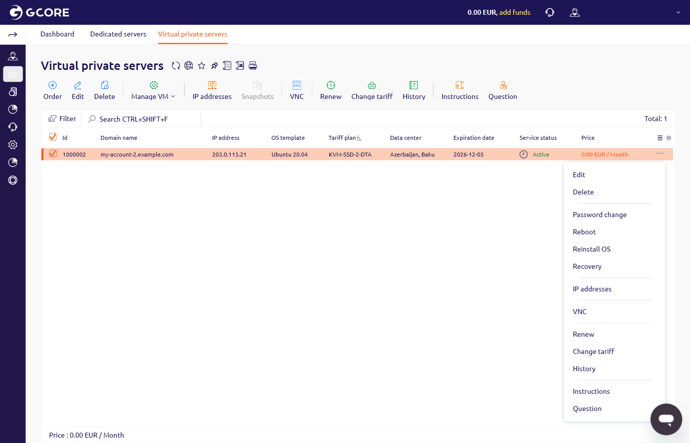
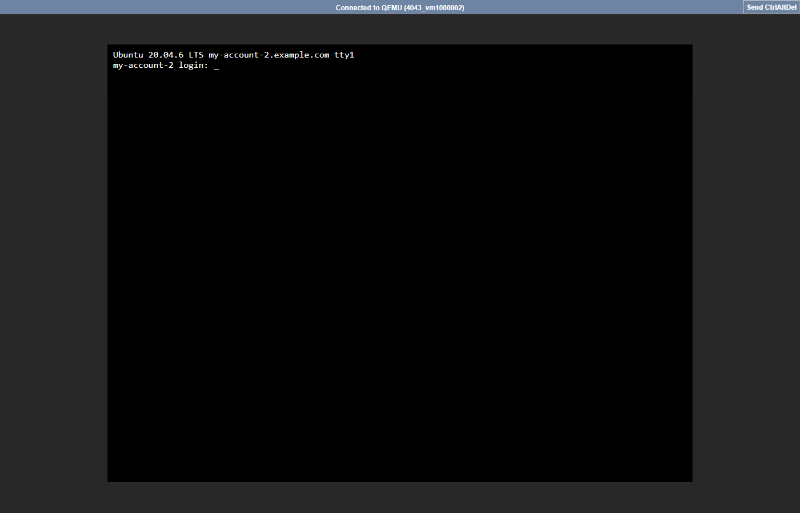

<Steps>
  <Step title="Open the server list">
    In the [Gcore&nbsp;Hosting&nbsp;Portal](https://hosting.gcore.com/billmgr), navigate to **Products/Services** > **Virtual private servers** and select the server.

    <Frame></Frame>
  </Step>
  <Step title="Read the sign-in details">
    - On the toolbar, click **Instructions**.
    - Click the button at the end of the row, then click **Instructions**.

    **Virtual server activation** lists **Server IP address**, **User**, and **Password** under **Server information**. A password changed after provisioning is not on this page.
  </Step>
  <Step title="Open the console">
    - On the toolbar, click **VNC**.
    - Click the button at the end of the row, then click **VNC**.

    The page opens at the login prompt of the installed operating system. Enter the **User** and **Password** from the Instructions page.

    <Frame></Frame>
  </Step>
</Steps>
