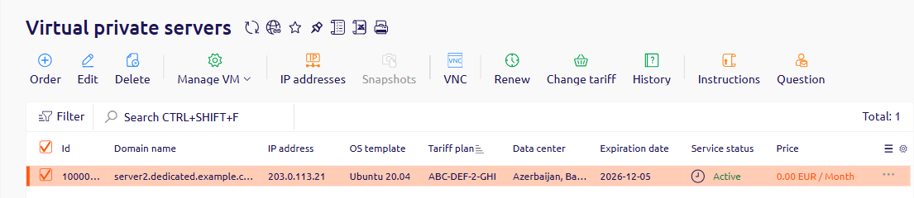

SSH provides encrypted remote access to Linux virtual servers — Windows servers connect via [RDP](/hosting/dedicated-servers/manage/connect/connect-to-a-windows-server).

<Steps>
  <Step title="Open Virtual servers">
    In the [Gcore&nbsp;Hosting&nbsp;Portal](https://hosting.gcore.com/billmgr), open **Products/Services** and select **Virtual servers**.
  </Step>
  <Step title="Open the server instructions">
    Select the server row by checking its checkbox, then click **Instructions** in the toolbar.

    <Frame></Frame>
  </Step>
  <Step title="Note the connection credentials">
    The Instructions page shows **Server IP address**, **User**, and **Password**. **User** is the account name for the SSH command.
  </Step>
  <Step title="Connect to the server">
    Open a terminal. On macOS and Linux, use the built-in Terminal app. On Windows, use Command Prompt, PowerShell, or Windows Terminal.

    Run the SSH command with the **User** value and the **Server IP address**:

    ```sh
    ssh <username>@<server_ip>
    ```
  </Step>
  <Step title="Enter the password">
    At the password prompt, enter the **Password** from the Instructions page.

    <Note>
      Some SSH clients do not display characters as they are typed. Enter the password and press Enter — the connection establishes even though the screen appears blank.
    </Note>
  </Step>
</Steps>
