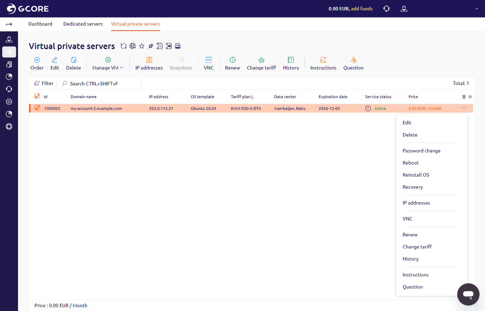

<Steps>
  <Step title="Open the server list">
    In the [Gcore&nbsp;Hosting&nbsp;Portal](https://hosting.gcore.com/billmgr), navigate to **Products/Services** → **Virtual private servers** and select the server. **Reinstall OS** is in **Manage VM** and in the menu at the end of the row.

    <Frame>
      
    </Frame>
  </Step>
  <Step title="Fill in the reinstall form">
    **Current installed OS** shows the system on the server and cannot be changed. **OS to install** is required. The templates are:

    - Alma Linux 8
    - Debian 11
    - Debian 12
    - Debian 13
    - FreeBSD 13
    - Ubuntu 20.04
    - Ubuntu 22.04
    - Ubuntu 24.04

    Enter **New VM password**. **Send email with password after installation** is selected by default. Click **Ok** to start the reinstall. **Cancel** closes the page and leaves the server unchanged.

    <Frame>
      
    </Frame>
  </Step>
</Steps>
