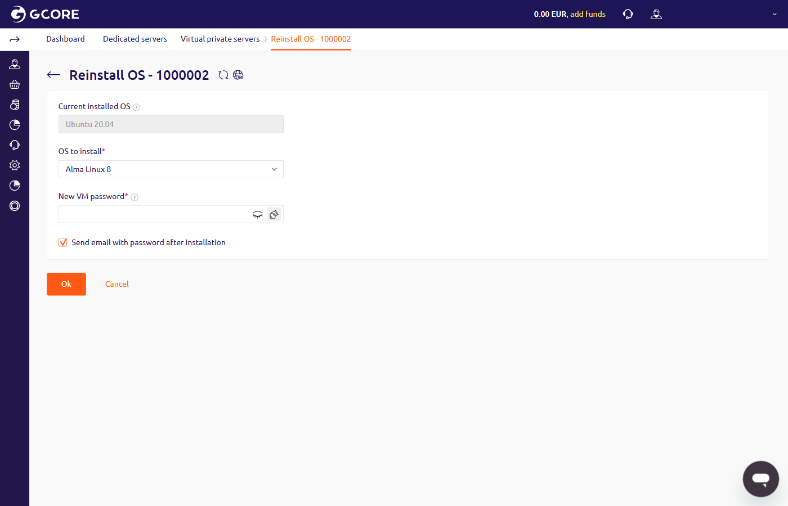

<Steps>
  <Step title="Open the server list">
    In the [Gcore&nbsp;Hosting&nbsp;Portal](https://hosting.gcore.com/billmgr), navigate to **Products/Services** > **Virtual private servers** and select the server.
  </Step>
  <Step title="Open the reinstall form">
    **Reinstall OS** is not a toolbar button.

    - On the toolbar, click **Manage VM**, then click **Reinstall OS**.
    - Click the button at the end of the row, then click **Reinstall OS**.

    <Frame></Frame>
  </Step>
  <Step title="Fill in the reinstall form">
    **Current installed OS** shows the system on the server and cannot be changed.

    1. In **OS to install**, select a template:

       - Alma Linux 8
       - Debian 11
       - Debian 12
       - Debian 13
       - FreeBSD 13
       - Ubuntu 20.04
       - Ubuntu 22.04
       - Ubuntu 24.04

    2. Enter **New VM password**.

    3. **Send email with password after installation** is selected by default. Clear it to skip the email.

    4. Click **Ok** to start the reinstall. Click **Cancel** to close the page and leave the server unchanged.

    <Frame></Frame>
  </Step>
</Steps>
