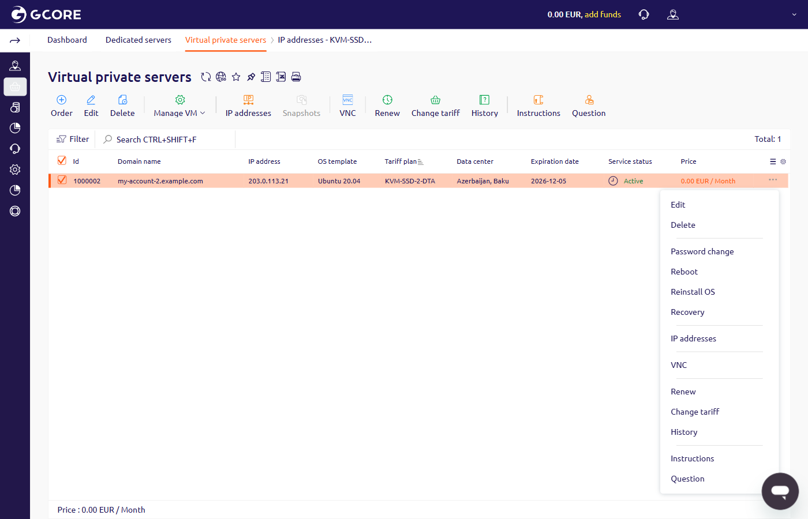
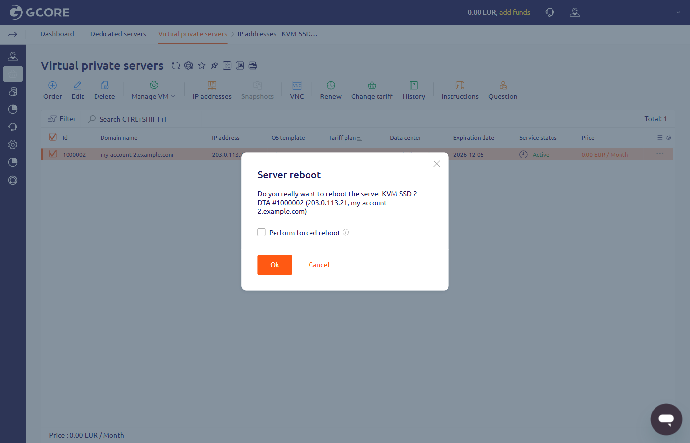

<Steps>
  <Step title="Open the server list">
    In the [Gcore&nbsp;Hosting&nbsp;Portal](https://hosting.gcore.com/billmgr), navigate to **Products/Services** → **Virtual private servers** and select the server. **Reboot** is in **Manage VM** and in the menu at the end of the row.

    <Frame>
      
    </Frame>
  </Step>
  <Step title="Confirm the reboot">
    Click **Reboot**. **Perform forced reboot** is cleared. Click **Ok** to reboot the server. **Cancel** closes the dialog and leaves the server unchanged.

    <Frame>
      
    </Frame>
  </Step>
</Steps>
