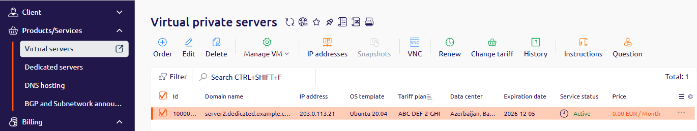
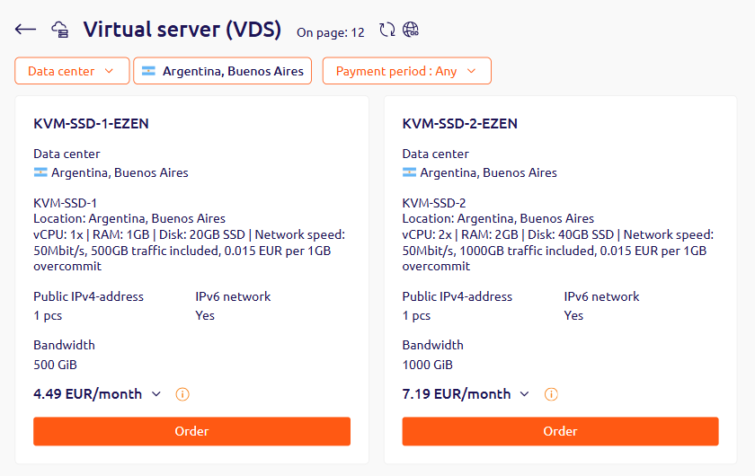
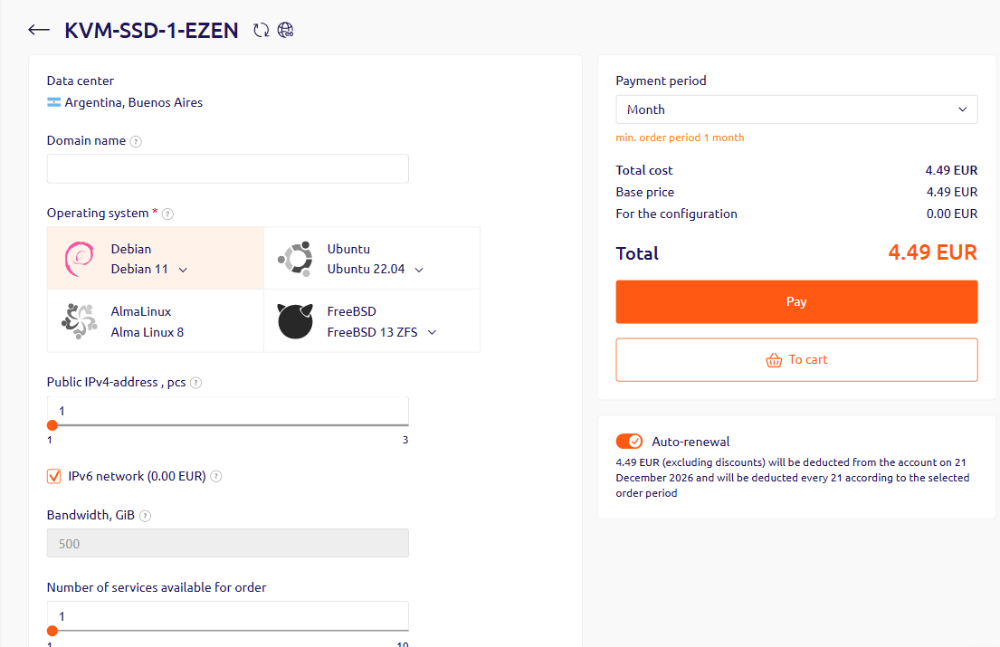

[Gcore&nbsp;Hosting](https://hosting.gcore.com/billmgr) provides Virtual Private Servers across more than 30 data centers; after selecting a plan and completing payment, the server activates within 3 hours.

## Server order

The ordering flow has two stages: select a plan and data center, then configure the server and complete payment.

<Steps>
  <Step title="Open the plan catalog">
    In the left sidebar, open **Products/Services** and select **Virtual servers**, then click **Order**.

    <Frame></Frame>
  </Step>
  <Step title="Select a data center and plan">
    Use the **Data center** filter to select a location. Optionally, use the **Payment period** filter to narrow the list.

    Each plan card shows hardware specs, included IPv4 and IPv6, bandwidth, and monthly price — the [plan&nbsp;overview](/hosting/virtual-servers/before-purchase/choose-a-virtual-server-for-your-needs) compares all configurations in detail. Click **Order** on the plan.

    <Frame></Frame>
  </Step>
  <Step title="Configure the server">
    On the configuration page, fill in the fields:

    | Field | Description |
    |-------|-------------|
    | **Domain name** | Enter a domain registered with a third-party provider — at least a second-level domain, max 63 characters per label, 255 characters total. Defaults to `example.com` when left blank; update it after ordering. |
    | **Operating system** | Select an OS. Debian, FreeBSD, Ubuntu, and AlmaLinux are available on all plans at no extra cost. Windows Server is available on select plans at an additional charge. |
    | **Public IPv4-address, pcs** | Use the slider to set the number of IPv4 addresses. The range depends on the plan (typically 1 to 3 or 1 to 10). |
    | **IPv6 network** | Included at no extra cost and selected by default. The label shows the price. Clear the checkbox to disable it. |
    | **Number of services available for order** | Set to more than one to order multiple identically configured servers in a single transaction. |
    | **Payment period** (right column) | Select a billing period. A note under the field shows the minimum order period. |
    | **Auto-renewal** | Selected by default. The note gives the amount and the date of the next deduction from the account balance. Clear the checkbox to turn renewal off. |

    The included public IPv4 address is dedicated to the server — it is not shared with other customers and is not behind NAT or CGNAT. Inbound connections reach the server when the service is running and the firewall allows them.

    <Frame></Frame>
  </Step>
  <Step title="Complete the order">
    Click **Pay** to proceed to payment immediately, or **To cart** to save the order and pay later from the cart.

    After payment, the server status changes to **Activation in progress**. Activation takes between 15 minutes and 3 hours. Once complete, the status changes to **Active** and the server is ready to use.
  </Step>
</Steps>

## Server statuses

A newly ordered server can have the following statuses:

| Status | Meaning |
|--------|---------|
| Ordered | Payment is pending — add funds to the account balance and complete payment to proceed. |
| Activation in progress | Payment received. Provisioning is underway. |
| Active | The server is ready to use. |

If the server remains in **Activation in progress** for more than 3 hours, contact support via **Support** > **Support tickets** in the left sidebar.

## Renewal

A new virtual server is billed monthly. [Renewal](/hosting/payments/renew-your-server) charges the monthly plan price for the next period.

A server ordered on the previous billing model stays on daily billing. The charge for each day equals the monthly plan price divided by the number of days in that month.
