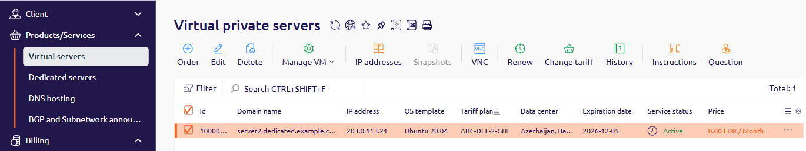
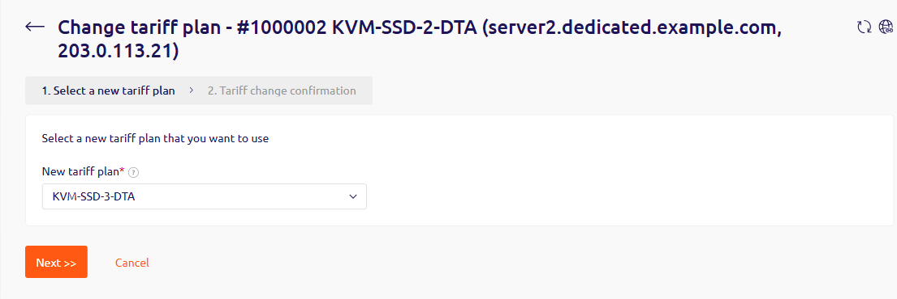
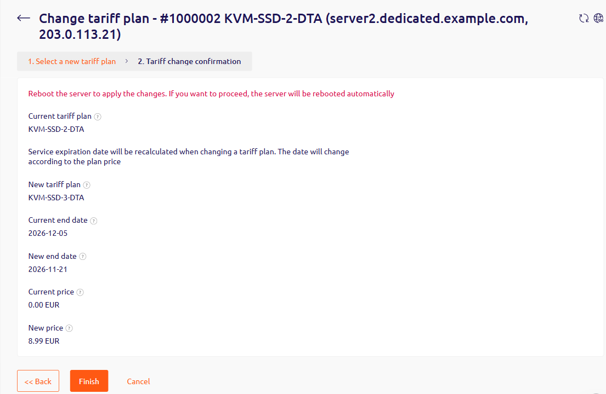

**Change tariff** opens the plan change for a virtual server. **Finish** applies the selected plan and reboots the server. **Cancel** leaves the server unchanged.

## Change the tariff plan

<Steps>
  <Step title="Open Change tariff">
    In the left sidebar, open **Products/Services** and select **Virtual servers**. Select the server and click **Change tariff**.

    <Frame></Frame>
  </Step>
  <Step title="Select the new plan">
    On **Change tariff plan**, select a plan in **New tariff plan** and click **Next >>**.

    <Frame></Frame>
  </Step>
  <Step title="Review the confirmation">
    The confirmation shows **Current tariff plan**, **New tariff plan**, **Current end date**, **New end date**, **Current price**, and **New price**. The service expiration date is recalculated from the new plan price, and the server reboots automatically when the change is applied.

    - Click **Finish** to apply the new plan.
    - Click **&lt;&lt; Back** to return to the plan list.
    - Click **Cancel** to leave the server unchanged.

    <Frame></Frame>
  </Step>
</Steps>
