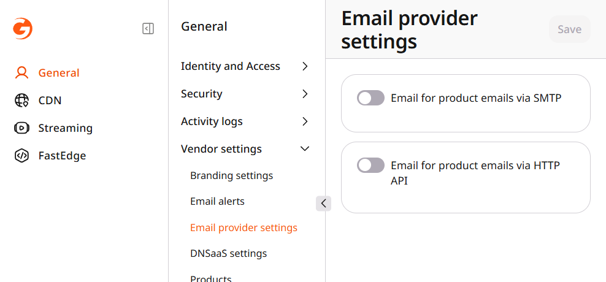
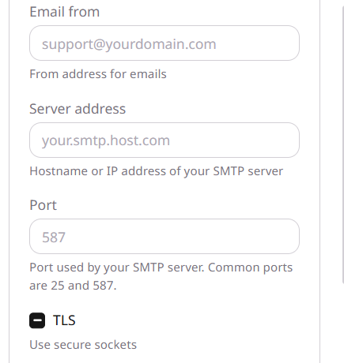
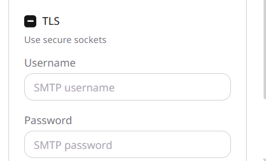
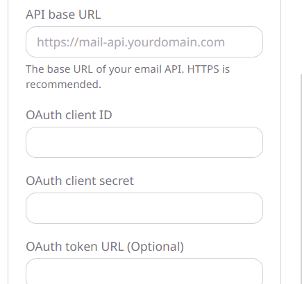

By default, service emails, including password resets and trial notifications, are sent from a Gcore address. Resellers using a different brand can send these emails through SMTP or an HTTP API instead. The **Email provider settings** option is not available when the brand name is Gcore.

<Steps>
  <Step title="Open Email provider settings">
    Navigate to **General** > **Vendor settings** > **Email provider settings**.

    <Frame></Frame>

  </Step>
  <Step title="Configure an email provider">
    Choose either SMTP or HTTP API to send service emails. Enabling one option automatically disables the other.

    <Tabs>
      <Tab title="SMTP">
        Turn on **Email for product emails via SMTP**. Enter the sender address in **Email from**, the SMTP hostname or IP address in **Server address**, and the mail service port in **Port**. Common ports are 25 and 587. Enable **TLS** to encrypt the connection, then enter **Username** and **Password**.

        <Frame></Frame>

        <Frame></Frame>

      </Tab>
      <Tab title="HTTP API">
        Turn on **Email for product emails via HTTP API**. Enter the mail service endpoint in **API base URL**, then the **OAuth client ID** and **OAuth client secret**. When **OAuth token URL (Optional)** is empty, the default token URL is used. **Unsupported headers (Optional)** names headers that are removed before the message is sent.

        <Frame></Frame>

      </Tab>
    </Tabs>

  </Step>
  <Step title="Save and test the configuration">
    Click **Save** to apply the configuration, then **Send test mail** to test the selected provider. Both buttons remain unavailable if the required fields are empty.
  </Step>
</Steps>
