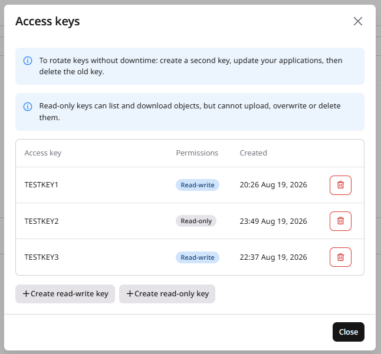

import { MethodSwitch, MethodSection } from "/snippets/method-switch.jsx";

<MethodSwitch>
  <MethodSection id="portal" label="Customer Portal">

<p>S3 access keys authenticate AWS CLI, SDKs, and other S3-compatible clients. An [S3&nbsp;storage](/storage/create-an-s3-or-sftp-storage) is required before keys can be created.</p>

<p>S3 Standard storage holds up to 10 keys, and S3 Fast storage holds up to two keys. If the storage has an available key slot, create a replacement key, update applications, then delete the old key to rotate credentials without downtime.</p>

<p>Read-only keys can list and download objects, but cannot upload, overwrite, or delete them, and cannot create or delete buckets. They are supported on S3 Standard only, and permissions are fixed at creation, so delete a key and create another to change access.</p>

<Steps>
  <Step title="Open Access keys">
    In the [Gcore Customer Portal](https://portal.gcore.com), navigate to **Storage** > **Object Storages**. Click **...** next to the storage name and select **Access keys**.
  </Step>
  <Step title="Create a key">
    On S3 Standard, click **Create read-write key** or **Create read-only key**, while S3 Fast shows **Create read-write key** only. The dialog shows the access key and secret key. Click **Copy credentials** and store both values, because the secret is shown only once.

    The list shows **Access key**, **Permissions**, and **Created** for each key.

    <Frame></Frame>
  </Step>
  <Step title="Delete a key">
    Click the delete control next to the key. Create a replacement and update clients before deleting a key that is still in use.
  </Step>
</Steps>

  </MethodSection>
  <MethodSection id="api" label="REST API">

<p>Access keys are created and deleted on an existing S3 storage, and the numeric storage ID is returned when creating storage or from the storage list. The secret key is returned only in the create response.</p>

<Info>
An [API&nbsp;token](/account-settings/api-tokens) is required.
</Info>

```bash
export GCORE_API_KEY="{YOUR_API_KEY}"
export STORAGE_ID="{STORAGE_ID}"
```

## Key creation

<p>An empty POST body creates a read-write key, and the response sets `read_only` to `false`. A JSON body with `read_only` set to `true` creates a read-only key on S3 Standard storage. Key permissions cannot be changed after creation. To change access, create a replacement key and delete the old one.</p>

<p>The following examples create access keys. Read-only keys are supported on S3 Standard only.</p>

<Tabs>
  <Tab title="Python SDK">
    ```python
    from gcore import Gcore

    client = Gcore()

    storage_id = 13864

    new_key = client.storage.object_storages.access_keys.create(storage_id)
    print(f"New access key: {new_key.access_key}")
    print(f"New secret key: {new_key.secret_key}")

    # Read-only keys are supported on S3 Standard only
    ro_key = client.storage.object_storages.access_keys.create(
        storage_id,
        extra_body={"read_only": True},
    )
    print(f"Read-only access key: {ro_key.access_key}")
    print(f"Read-only secret key: {ro_key.secret_key}")
    ```
  </Tab>
  <Tab title="Go SDK">
    ```go
    package main

    import (
        "context"
        "fmt"
        "log"

        gcore "github.com/G-Core/gcore-go"
    )

    func main() {
        client := gcore.NewClient()
        ctx := context.Background()

        var storageID int64 = 13864

        newKey, err := client.Storage.ObjectStorages.AccessKeys.New(ctx, storageID)
        if err != nil {
            log.Fatalf("create access key: %v", err)
        }
        fmt.Printf("New access key: %s\n", newKey.AccessKey)
        fmt.Printf("New secret key: %s\n", newKey.SecretKey)
    }
    ```
  </Tab>
  <Tab title="curl">
    ```bash
    curl -X POST "https://api.gcore.com/storage/v4/object_storages/$STORAGE_ID/access_keys" \
      -H "Authorization: APIKey $GCORE_API_KEY"
    ```

    Response:

    ```json
    {
      "access_key": "0CW9Q09ART50W9XB4O13",
      "secret_key": "oO5jztJ4ewahrFGX9pMNIq0X3nfVVlfu9XVO9NLz",
      "created_at": "2026-07-13T13:07:54Z",
      "read_only": false
    }
    ```

    Read-only key on S3 Standard:

    ```bash
    curl -X POST "https://api.gcore.com/storage/v4/object_storages/$STORAGE_ID/access_keys" \
      -H "Authorization: APIKey $GCORE_API_KEY" \
      -H "Content-Type: application/json" \
      -d '{"read_only": true}'
    ```

    Response:

    ```json
    {
      "access_key": "0CW9Q09ART50W9XB4O13",
      "secret_key": "oO5jztJ4ewahrFGX9pMNIq0X3nfVVlfu9XVO9NLz",
      "created_at": "2026-07-13T13:07:54Z",
      "read_only": true
    }
    ```
  </Tab>
</Tabs>

<p>S3 Fast returns HTTP 400, because read-only keys are supported on S3 Standard only.</p>

```json
{
  "error": "read-only access keys are only supported for Standard storages",
  "type": "validation-error",
  "title": "The request has invalid input.",
  "status": 400,
  "detail": "read-only access keys are only supported for Standard storages",
  "hint": "Correct the request and send it again.",
  "request_id": "8f1c9a2e4d6b4f0e9a1b3c5d7e9f0a1b",
  "trace_id": "4bf92f3577b34da6a3ce929d0e0e4736"
}
```

<p>When the limit is reached, the API returns HTTP 409.</p>

```json
{
  "error": "maximum number of access keys reached",
  "type": "quota-exceeded",
  "title": "The request exceeds a quota.",
  "status": 409,
  "detail": "maximum number of access keys reached",
  "hint": "Ask for a quota increase, or delete resources you no longer need.",
  "request_id": "2c4e6a8b0d1f3a5c7e9b1d3f5a7c9e0b",
  "trace_id": "6ba7b8109dad11d180b400c04fd430c8",
  "context": {
    "quotas": [
      {
        "available": 0,
        "limit": 2,
        "name": "access_keys",
        "overflow": 1,
        "region_id": null,
        "requested": 1,
        "resulting_usage": 3,
        "scope": null,
        "unit": null,
        "usage": 2
      }
    ]
  }
}
```

<p>Both responses use <code>Content-Type: application/problem+json</code>. <code>error</code> stays English, and <code>title</code>, <code>detail</code>, and <code>hint</code> follow <code>Accept-Language</code> for English, French, and German.</p>

## Key deletion

<p>Delete an access key after updating all clients to the remaining credentials. The same request deletes read-write and read-only keys.</p>

<Tabs>
  <Tab title="Python SDK">
    ```python
    from gcore import Gcore

    client = Gcore()

    storage_id = 13864
    old_access_key = "L1M3FSX3T0B3TWDVINKT"

    client.storage.object_storages.access_keys.delete(old_access_key, storage_id=storage_id)
    print("Old access key deleted")
    ```
  </Tab>
  <Tab title="Go SDK">
    ```go
    package main

    import (
        "context"
        "fmt"
        "log"

        gcore "github.com/G-Core/gcore-go"
        "github.com/G-Core/gcore-go/storage"
    )

    func main() {
        client := gcore.NewClient()
        ctx := context.Background()

        var storageID int64 = 13864
        oldAccessKey := "L1M3FSX3T0B3TWDVINKT"

        err := client.Storage.ObjectStorages.AccessKeys.Delete(ctx, oldAccessKey, storage.ObjectStorageAccessKeyDeleteParams{
            StorageID: storageID,
        })
        if err != nil {
            log.Fatalf("delete access key: %v", err)
        }
        fmt.Println("Old access key deleted")
    }
    ```
  </Tab>
  <Tab title="curl">
    ```bash
    export OLD_ACCESS_KEY="{OLD_ACCESS_KEY}"

    curl -X DELETE "https://api.gcore.com/storage/v4/object_storages/$STORAGE_ID/access_keys/$OLD_ACCESS_KEY" \
      -H "Authorization: APIKey $GCORE_API_KEY"
    ```

    Returns HTTP 204 with no response body.
  </Tab>
</Tabs>

  </MethodSection>
  <MethodSection id="terraform" label="Terraform">

<p>Create additional S3 access keys on an existing storage with the Gcore [Terraform&nbsp;provider](/developer-tools/terraform/overview) v2. `gcore_storage_access_key` creates a read-write key, and the storage already has one key from provisioning.</p>

## Additional key

<p>Declare `gcore_storage_access_key` with the storage ID. Apply creates the key, and the secret is available in Terraform state.</p>

```hcl
resource "gcore_storage_access_key" "extra" {
  storage_id = gcore_storage_object_storage.example.id
}

output "extra_access_key" {
  value = gcore_storage_access_key.extra.access_key
}

output "extra_secret_key" {
  value     = gcore_storage_access_key.extra.secret_key
  sensitive = true
}
```

```bash
terraform apply
```

## Key rotation

<p>This rotation applies only to additional keys declared as `gcore_storage_access_key`. The key created when the storage is provisioned belongs to `gcore_storage_object_storage` and is not deleted by removing an access key resource. Declare a new `gcore_storage_access_key`, update clients to the new credentials, then remove the resource block for the previous Terraform-managed key and apply.</p>

```hcl
# Add a new key resource, update clients, then remove this block:
# resource "gcore_storage_access_key" "extra" {
#   storage_id = gcore_storage_object_storage.example.id
# }
```

```bash
terraform apply
```

  </MethodSection>
</MethodSwitch>
