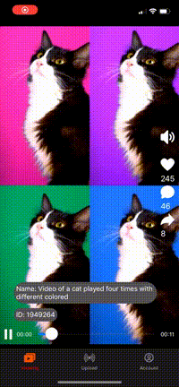

A video sharing app — a short-video feed, a community app, or a creator service — needs a back end that accepts uploads from phones, converts every video for any screen and network, and delivers it to web and mobile players. Gcore Video Streaming covers that chain with resumable upload, automatic transcoding, AI moderation, storage, and CDN delivery, so a small team ships the product features instead of a video pipeline. A Gcore account and an [API&nbsp;token](/account-settings/api-tokens) are required, and the [Gcore Customer Portal](https://portal.gcore.com) is available for setup and checks.

## Scenario

A startup builds an app where users record a video on the phone, add a title, and publish it to a feed that other users watch in the mobile app and on the website. The workflow must cover these needs:

- Recording and uploading from iOS and Android over unstable mobile networks, with large files resuming after a drop.
- Automatic conversion of every upload, including vertical video, into several qualities for any device.
- Playback in the app's own player on the web, iOS, and Android, with thumbnails for the feed.
- Moderation of user-generated content before it reaches other users.
- Status updates for the creator while the video processes.
- Delivery limited to the markets where the publisher holds the distribution rights, with regional data handling for the audience.
- Control of costs while the audience and the library grow.

The animation shows the flow: the user records a video, the app uploads it, and the feed plays the processed videos.

<Frame></Frame>

In short, the phone uploads the file to Gcore, Gcore transcodes it, and the CDN delivers it to every player:

```text
                                  +-----------------------------+
Phone: record --> TUS upload ---> |  Gcore storage              |
                                  |  + transcoding + moderation |--> Gcore CDN --> Web and mobile players
                                  +-----------------------------+    HLS
```

## Outcome and benefits

One Gcore account replaces a separate upload service, transcoder, storage, and CDN. The app's back end stays small, because it creates a video entry, passes the upload session to the phone, and listens for status events.

- Reliable mobile upload: the resumable TUS protocol continues from the last uploaded segment after an interruption.
- Any player, any screen: every video is transcoded into an adaptive bitrate ladder, with an HLS link that web and mobile players accept.
- Fast publishing: playback starts when the first rendition is ready, while higher qualities continue to process.
- Built-in moderation: AI tasks detect NSFW content and nudity in uploaded videos via AI-Moderation.
- Usage-based cost: transcoding up to 1080p at 30 FPS is free, while storage and delivery are billed by usage.

## Architecture

The phone talks to the app's back end for permission and to Gcore for the file transfer, so the Gcore API token never leaves the server.

```text
 Mobile app (iOS, Android)                     App back end
 records video                                 (holds the API token)
        |                                           |
        |  1. asks to upload  --------------------> |  creates the video entry
        | <-------- upload server + session token --|  (Gcore API)
        |                                           |
        |  2. TUS upload (resumable)                |
        v                                           |
 +--------------------------------------------+     |
 |  Gcore Video Streaming                     |     |
 |  Storage + transcoding to ABR renditions   | --> |  3. webhook: status
 |  AI moderation (NSFW, nudity)              | <-- |     moderation task
 +--------------------------------------------+     |
        |                                           |
        v                                           |
 Gcore CDN: HLS                                    |
        |                                           |
        v                                           |
 Web and mobile players  <-- playback URLs ---------+
```

The back end stores the creator, title, and visibility of each video, while Gcore stores the video files and the processing state.

## Step 1. Create the video entry

When the user starts an upload, the back end sends `POST /streaming/videos` to the Gcore [upload&nbsp;API](/streaming/video-hosting/upload-video-via-api) without an `origin_url`. The response returns the video `id` with the status `empty`, and the back end then requests the upload parameters with `GET /streaming/videos/{id}/upload`.

- The upload response contains the list of upload servers, of which the app uses one with `active: true`, and a session token that is valid for 4 hours.
- The back end sends the server, the session token, the video ID, and the client ID to the app, and it keeps the API token on the server. The Gcore Python and Go SDKs wrap these calls.
- The optional `client_user_id` and `client_entity_data` fields tag the video with the creator, and the video list can be filtered by them.

## Step 2. Upload from the phone with TUS

The app uploads the file directly to Gcore with a [TUS](https://tus.io) client library, using the upload server and the session token that the back end received in Step 1. TUS splits the file into segments and resumes from the last completed segment after an interruption, so a long upload from a phone survives a lost connection or a switch between Wi-Fi and mobile data. TUS libraries exist for iOS, Android, and the web, and the open-source demo projects show the full flow of recording, uploading, and playback: the [iOS&nbsp;demo&nbsp;project](https://github.com/G-Core/ios-demo-vod-hosting) in Swift and the [Android&nbsp;demo&nbsp;project](https://github.com/G-Core/android-demo-vod-hosting) in Kotlin.

- The app sends the upload to Gcore and never handles the API token. When the session expires or the upload server rejects it, the app asks its own back end for a new session.
- Gcore accepts many containers and codecs for VOD, including the mobile formats MP4, MOV, and 3GP. The [input&nbsp;parameters](/streaming/live-streams-and-videos-protocols-and-codecs/input-parameters-and-codecs) list the formats and the recommended limits.
- An existing video library enters by URL with `origin_url` or through the support-assisted batch migration.

## Step 3. Transcode and track the status

After the upload completes, Gcore transcodes the video automatically into the free ABR ladder of 1080p, 720p, 468p, and 360p with H.264 and AAC, and a vertical video keeps its orientation. The [transcoding&nbsp;output](/streaming/live-streams-and-videos-protocols-and-codecs/transcoding-output) article lists the ladder, and premium encoding adds larger resolutions and other codecs for enterprise accounts.

The video moves through the statuses `empty`, `pending`, `viewable`, and `ready`, or `error` when processing fails. The [VOD&nbsp;status](/streaming/video-hosting/vod-status) article describes the statuses, and the key rules for the app are:

- A video is `viewable` when at least one rendition is ready, and the manifest returns 404 before that. Lower qualities finish first, so the app publishes the video at `viewable` and the player adapts as more renditions appear.
- A video is `ready` when all renditions are complete, and each rendition in `converted_videos` has its own status and error description.
- [Webhooks](/streaming/extra-features/get-webhooks-from-the-streaming-platform) report every status change of a video to one endpoint, which support configures. Each event is sent once and is not retried, so the back end checks the video through the API after downtime.

## Step 4. Moderate user content (optional)

The back end checks every upload with an AI moderation task before the video reaches the feed. The [AI&nbsp;video&nbsp;services](/streaming/video-hosting/ai-video-service) offer NSFW detection, soft nudity detection, and hard nudity detection, and the tasks are free.

- The back end creates a moderation task for the uploaded video through the API and reads the result when the task completes.
- Each result lists the flagged frames with a confidence score, and Gcore excludes results below 30%. The app decides the threshold at which a video is blocked or sent to a human reviewer.
- The analysis runs on keyframes, so an object that appears only between keyframes isn't detected.
- The back end keeps the video hidden until the check completes and then sets its visibility in the app's own database.

## Step 5. Play on web and mobile

Every video gets an HLS playback URL in the `hls_url` field of `GET /streaming/videos/{id}`. It is one manifest that lists all renditions, so the player picks the quality that fits the viewer's bandwidth, and the app only stores the video ID and reads the URL from the API when it builds the feed. The [HLS&nbsp;playback](/streaming/video-hosting/hls-and-mp4) article describes the URL and its options.

- On the web, the app plays the HLS URL in hls.js, and Safari plays it natively.
- On iOS and Android, the app passes the same HLS URL to the native player.

## Step 6. Add thumbnails and subtitles

Each video gets five automatic screenshots in the `screenshots` array, and a custom poster of up to 1 MB can replace them, which gives the feed a cover image before the first frame loads. 

- The first automatic screenshot is often black, so the app lets the creator choose another screenshot with `screenshot_id` or upload a poster.
- [AI&nbsp;subtitles](/streaming/video-hosting/ai-for-video/generate-ai-subtitles-and-add-them-to-video) transcribe the audio automatically. The subtitles are available through the API.

## Step 7. Manage videos and creators

The app's back end updates and deletes videos with the API, and its own database links each video to a user, a title, and a visibility state.

- The API changes the name, description, and poster of a video and moves it between [directories](/streaming/video-hosting/organize-uploaded-videos), which can represent categories or channels.
- Deleting a video removes its renditions, subtitles, and screenshots permanently, and Gcore sends a `video_delete` webhook, as described in [delete&nbsp;videos](/streaming/video-hosting/delete-videos). Storage is billed at the peak of the month, so a deletion lowers the next month's value only.
- The source file of an existing video can't be replaced, so an edited video is uploaded as a new entry and the app points the feed to the new ID. Gcore deletes the uploaded original after transcoding, so an app that offers re-editing keeps its own copy.
- Each video has its own video ID, which is attached to the video and cannot be changed. The source file of an existing video can't be updated either, so to replace a video, the app deletes the previous one and uploads a new one, which gets a new video ID.
- The [account&nbsp;model](/streaming/getting-started/dev_environment) keeps all creators in one Gcore account, because strict isolation exists only between separate accounts, and `client_user_id` separates creators inside the app.

## Step 8. Restrict and protect videos

Public videos play from the default delivery domain. Videos that only subscribers, buyers, or friends may watch use secure tokens on a custom CDN resource with a paid CDN tariff, because the default domain doesn't support tokens.

- The back end signs the playback URL after it checks the viewer, and one [secure&nbsp;token](/streaming/interaction-with-cdn/video-secure-token) covers the manifest and all segments of the video.
- The custom CDN resource adds country, referrer, IP, and user-agent policies on top of tokens. A country policy allows delivery only in the markets where the publisher holds the distribution rights, and a change takes about 5-15 minutes to apply.

## Step 9. Plan costs and scale

Gcore bills transcoding, CDN delivery, and storage separately, and transcoding up to 1080p at 30 FPS is free. The [usage&nbsp;reports](/streaming/billing/usage-and-billing-reports) show transcoding minutes, delivery minutes, and stored minutes and gigabytes.

- A trial account has [limits](/streaming/billing/overview-of-tariffs#trial-and-active-payg-limits) on storage, transcoding, and delivery, so the app switches to the active PAYG plan before launch.
- The processing queue has no length limit, and the processing time grows with the video length, from seconds for a short clip to tens of minutes for a long recording.
- Enterprise plans add committed volumes, premium encoding, and premium support for dedicated events, which the account manager arranges.
- Statistics for unique viewers and watching duration are measured at the CDN for any player and can be filtered by `client_user_id`, while likes, comments, and feed ranking stay in the app's own database.

## Availability summary

The table groups the capabilities of this workflow by how a customer gets them today, based on the documented behavior.

| Capability | Status | Note |
|------------|--------|------|
| Resumable mobile upload with TUS | Available | Demo projects for iOS and Android |
| Upload by URL and batch migration | Available | Batch migration through support |
| Transcoding up to 1080p, vertical video | Available | Free ABR ladder |
| HLS playback | Available | Web and mobile players |
| AI moderation for NSFW and nudity | Available | Free, runs on keyframes |
| Status webhooks | Available | One endpoint through support, no retries |
| Thumbnails, posters, timeline previews | Available | Generated automatically |
| AI subtitles and translation | Available | Translation is a paid feature |
| Private videos with secure tokens | Available | Custom CDN resource on a paid tariff |
| Delivery limited to licensed countries | Available | Country policy on a custom CDN resource |
| Large delivery volumes, per-GB billing | On request | Hybrid model in an enterprise plan |
| EU data handling | To confirm | Storage and delivery regions agreed with the account manager |
| Premium encoding, 2K to 8K, HEVC, AV1 | On request | Enterprise accounts |
| Premium support for dedicated events | On request | Arranged in advance with the account manager |
