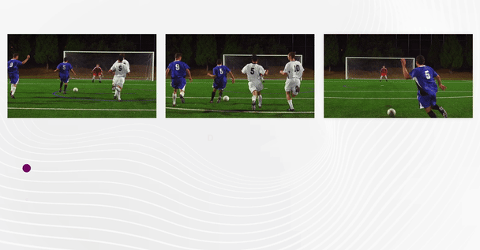

Gcore Video Streaming packages each live stream into three HTTP formats at once: HLS MPEG-TS for regular latency, and HLS CMAF (LL-HLS) and MPEG-DASH (LL-DASH) for low latency of 2 to 5 seconds. Low latency is enabled by default across all service tiers, including the trial period and free tier, so no separate streams or plan upgrades are required.

Each format has its own manifest URL, returned as [playback&nbsp;URLs](#playback-urls) in the Customer Portal and API.

## Streaming latency

Streaming latency is the time between a frame being captured and that frame being displayed on the viewer's screen. Three pipeline stages each contribute to it:

1. **Encoding (or packaging).** The streaming service converts the stream to the delivery format and splits it into fragments.
2. **Transferring.** CDN servers pull the processed stream, cache it, and send it to viewers.
3. **Receipt by players.** End-user players load the fragments and buffer them before playback.

Unoptimized pipelines accumulate 30–40 seconds of total delay, which is too high for sports events, metaverse experiences, and news broadcasts. The encoder and player settings that keep end-to-end latency stable are covered in [Configure&nbsp;low-latency&nbsp;playback](/streaming/live-streaming/configure-low-latency-playback).

<Frame>
  
</Frame>

## Format comparison

The formats differ in segment container and latency, so the choice depends on the target players and the delay the broadcast tolerates. LL-HLS and LL-DASH both use CMAF (Common Media Application Format), a standardized fragmented MP4 container, so they share the same encoded media. This reduces storage and encoding overhead and enables chunked delivery that can begin before the full segment is ready.

With free transcoding, all three formats carry H.264 video and AAC audio.

| Format | Segment format | Latency | How it works | Best for |
| --- | --- | --- | --- | --- |
| HLS MPEG-TS | MPEG-TS (`.ts`) | Regular, 15-30 seconds | Whole 6-second segments | Maximum compatibility with older devices, set-top boxes, Smart TVs, and legacy players |
| HLS CMAF (LL-HLS) | Fragmented MP4 (`.m4s`) | Low, 3-5 seconds | Partial segments and blocking playlist reloads | Modern HLS playback and Apple devices |
| MPEG-DASH (LL-DASH) | Fragmented MP4 (`.m4s`) | Low, 2-4 seconds | Chunked download of partially ready files from origin | Android, web players, and Smart TVs |

### HLS MPEG-TS

HLS MPEG-TS lists whole 6-second `.ts` segments without parts, so players load each segment completely. In the playlist, `EXT-X-PROGRAM-DATE-TIME` is the ingest time — the moment the packets reach Gcore servers — and not the capture time on the encoder.

Media playlist (shortened):

```
#EXTM3U
#EXT-X-VERSION:6
#EXT-X-TARGETDURATION:6
#EXT-X-MEDIA-SEQUENCE:1190
#EXT-X-INDEPENDENT-SEGMENTS
#EXTINF:6.000000,
#EXT-X-PROGRAM-DATE-TIME:2026-11-13T16:24:25.968+0000
ed-sl-gc5/seg6000-qsid813-media3-216743123-01190.ts
#EXTINF:6.000000,
#EXT-X-PROGRAM-DATE-TIME:2026-11-13T16:24:31.968+0000
ed-sl-gc5/seg6000-qsid813-media3-216743123-01191.ts
#EXTINF:6.000000,
#EXT-X-PROGRAM-DATE-TIME:2026-11-13T16:24:37.968+0000
ed-sl-gc5/seg6000-qsid813-media3-216743123-01192.ts
```

### HLS CMAF

HLS CMAF delivers fragmented MP4 (`.m4s`) chunks, and LL-HLS splits each 6-second segment into 0.5-second parts and uses blocking playlist reloads. The playlist announces the next part with `EXT-X-PRELOAD-HINT`, so players load the stream in small increments. `EXT-X-PROGRAM-DATE-TIME` is the ingest time here as well.

Media playlist (shortened):

```
#EXTM3U
#EXT-X-VERSION:6
#EXT-X-TARGETDURATION:6
#EXT-X-MEDIA-SEQUENCE:1151
#EXT-X-MAP:URI="init-stream1-216743123.m4s"
#EXT-X-SERVER-CONTROL:CAN-BLOCK-RELOAD=YES,PART-HOLD-BACK=1.5
#EXT-X-PART-INF:PART-TARGET=0.5
#EXT-X-PROGRAM-DATE-TIME:2026-11-13T16:20:27.000+0000
#EXTINF:6.0,
seg6000-part500-qsid813-stream1-216743123-01151.m4s
...
#EXT-X-PART:DURATION=0.5,URI="seg6000-part500-qsid813-stream1-216743123-01154_part_0.m4s",INDEPENDENT=YES
#EXT-X-PART:DURATION=0.5,URI="seg6000-part500-qsid813-stream1-216743123-01154_part_1.m4s"
#EXT-X-PART:DURATION=0.5,URI="seg6000-part500-qsid813-stream1-216743123-01154_part_2.m4s"
#EXT-X-PART:DURATION=0.5,URI="seg6000-part500-qsid813-stream1-216743123-01154_part_3.m4s",INDEPENDENT=YES
...
#EXT-X-PART:DURATION=0.5,URI="seg6000-part500-qsid813-stream1-216743123-01154_part_10.m4s"
#EXT-X-PART:DURATION=0.3,URI="seg6000-part500-qsid813-stream1-216743123-01154_part_11.m4s"
#EXT-X-PROGRAM-DATE-TIME:2026-11-13T16:20:45.000+0000
#EXTINF:6.0,
seg6000-part500-qsid813-stream1-216743123-01154.m4s
...
#EXT-X-PART:DURATION=0.5,URI="seg6000-part500-qsid813-stream1-216743123-01156_part_0.m4s",INDEPENDENT=YES
#EXT-X-PART:DURATION=0.5,URI="seg6000-part500-qsid813-stream1-216743123-01156_part_1.m4s"
#EXT-X-PRELOAD-HINT:TYPE=PART,URI="seg6000-part500-qsid813-stream1-216743123-01156_part_2.m4s"
#EXT-X-RENDITION-REPORT:URI="media_0.m3u8",LAST-MSN=1156,LAST-PART=1
```

### MPEG-DASH

MPEG-DASH delivers fragmented MP4 (`.m4s`) chunks described by an MPD manifest. The `availabilityTimeComplete="false"` attribute makes a segment available before it is complete, and `Resync dT="500000"` sets a resync point every 0.5 seconds.

MPD (shortened):

```xml
<?xml version="1.0" encoding="utf-8"?>
<MPD xmlns="urn:mpeg:dash:schema:mpd:2011"
	profiles="urn:mpeg:dash:profile:isoff-live:2011"
	type="dynamic"
	minimumUpdatePeriod="PT500S"
	availabilityStartTime="2026-11-13T14:25:27.059Z"
	publishTime="2026-11-13T16:28:20.704Z"
	timeShiftBufferDepth="PT30.0S"
	maxSegmentDuration="PT6.0S"
	minBufferTime="PT2.0S">
	<ServiceDescription id="0">
		<Latency target="1500" referenceId="0"/>
	</ServiceDescription>
	<Period id="0" start="PT0.0S">
		<AdaptationSet id="0" contentType="video" startWithSAP="1" segmentAlignment="true" bitstreamSwitching="true" frameRate="25/1" maxWidth="1920" maxHeight="1080" par="16:9">
			<Resync dT="500000" type="0"/>
			<Representation id="1" mimeType="video/mp4" codecs="avc1.42c028" bandwidth="4050000" width="1920" height="1080" sar="1:1">
				<ProducerReferenceTime id="1" inband="true" type="captured" wallClockTime="2026-11-13T14:25:27.061Z" presentationTime="0">
					<UTCTiming schemeIdUri="urn:mpeg:dash:utc:http-xsdate:2014" value="https://time.gvideo.co/?iso&amp;ms"/>
				</ProducerReferenceTime>
				<Resync dT="2000000" type="1"/>
				<SegmentTemplate timescale="1000000" duration="6000000" availabilityTimeOffset="5.500" availabilityTimeComplete="false" initialization="init-stream$RepresentationID$-216743123.m4s" media="seg6000-part500-qsid813-stream$RepresentationID$-216743123-$Number%05d$.m4s" startNumber="1">
				</SegmentTemplate>
			</Representation>
			...
		</AdaptationSet>
		...
	</Period>
	<UTCTiming schemeIdUri="urn:mpeg:dash:utc:http-xsdate:2014" value="https://time.gvideo.co/?iso&amp;ms"/>
</MPD>
```

## Default parameters

LL-HLS and LL-DASH are processed in the same low-latency transcoding and packaging pipeline, so both outputs use aligned keyframes and segment boundaries, which eliminates drift between the two formats. The default parameters are:

- **GOP**: 2 seconds, which ensures rapid seek and playback start
- **Segment size**: 6 seconds in all three formats
- **Part size**: 0.5 seconds, which allows players to download content in small increments
- **Minimal buffer**: 1.5 seconds

Enterprise accounts on [premium&nbsp;encoding](/streaming/live-streams-and-videos-protocols-and-codecs/premium-encoding) can set other values, including 2-second segments.

## CDN delivery

Standard CDNs wait for a file to be fully downloaded before sending it to the viewer ("store and forward"). Gcore uses a proprietary Chunked-Proxy module that streams data immediately, as the [Gcore&nbsp;blog](https://gcore.com/blog/optimizing-hls-dash-3sec) describes in detail:

- **Immediate distribution**: the CDN edge begins sending bytes to the viewer while still receiving them from the origin
- **Protocol optimization**: chunked transfer encoding for HTTP/1.1 and native framing for HTTP/2 and HTTP/3
- **Smart caching**: efficient handling of the high volume of requests for partial segments and blocking playlist reloads

<Tip>
  When using Gcore CDN with an external transcoder (not Gcore's Streaming ingest and transcoding service), the Chunked-Proxy module must be explicitly activated. Contact [Gcore&nbsp;Support](https://gcore.com/contact-us) to enable it.
</Tip>

## Playback URLs

Each live stream exposes the manifest URLs of all three outputs in the Customer Portal and in the API.

### Customer Portal

In the Customer Portal, open a live stream and copy one of these links from **Links for the export**:

| Customer Portal field | Protocol | Use case |
| :--- | :--- | :--- |
| **MPEG-DASH manifest URL** | LL-DASH CMAF | Web, Android, dash.js, ExoPlayer |
| **HLS manifest URL** | LL-HLS CMAF | Modern HLS players, iOS, Safari, hls.js |
| **HLS non-low-latency manifest URL** | Legacy HLS MPEG-TS | Older devices and maximum compatibility |

<Frame>

</Frame>

The **HLS non-low-latency manifest URL** provides MPEG-TS segments for legacy devices or software that cannot play CMAF. All three outputs share the same segment sizes and manifest lengths for DVR compatibility.

### API

Retrieve stream URLs via the [Get&nbsp;live&nbsp;stream](/api-reference/streaming/streams/get-live-stream) endpoint:

```http
GET https://api.gcore.com/streaming/streams/{stream_id}
```

Use these response fields:

| API field | Protocol | Example |
| :--- | :--- | :--- |
| `hls_cmaf_url` | LL-HLS (HLS CMAF) | `https://demo.gvideo.io/cmaf/2675_19146/master.m3u8` |
| `dash_url` | LL-DASH (MPEG-DASH CMAF) | `https://demo.gvideo.io/cmaf/2675_19146/index.mpd` |
| `hls_mpegts_url` | Legacy HLS (MPEG-TS) | `https://demo.gvideo.io/mpegts/2675_19146/master_mpegts.m3u8` |

LL-HLS and LL-DASH links contain the `/cmaf/` path. Legacy HLS links contain the `/mpegts/` path and are used when compatibility is more important than latency. The [API&nbsp;reference](/api-reference/streaming/streams/get-all-live-streams) covers all stream retrieval endpoints.

## Demo players

The embedded player plays a live stream transcoded to 1080p H.264, and the [demo](/streaming/getting-started/demo) page lists live and VOD players for every output format.

<Frame>
<iframe
  title="Live streaming demo player"
  src="https://player.gvideo.co/broadcasts/2675_21606?no_low_latency"
  width="100%"
  height="420"
  allow="autoplay; fullscreen; picture-in-picture"
  allowFullScreen
/>
</Frame>

Playback URLs:

- [HTML&nbsp;player](https://player.gvideo.co/broadcasts/2675_21606?no_low_latency)
- [MPEG-DASH&nbsp;CMAF](https://demo.gvideo.io/cmaf/2675_19146/index.mpd) (low latency)
- [LL&nbsp;HLS&nbsp;CMAF](https://demo.gvideo.io/cmaf/2675_19146/master.m3u8) (low latency)
- [HLS&nbsp;MPEG-TS](https://demo.gvideo.io/mpegts/2675_19146/master_mpegts.m3u8) (regular latency)
