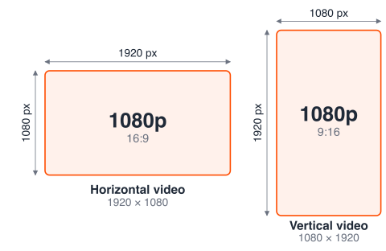

Gcore Video Streaming transcodes every live stream and VOD file to H.264 video and AAC audio at no cost, with output up to Full HD 1080p and 30 FPS. [Premium&nbsp;encoding](/streaming/live-streams-and-videos-protocols-and-codecs/premium-encoding) adds 2K, 4K, 8K, other codecs, and custom bitrate ladders for enterprise accounts.

## Free transcoding scope

Live streams and VOD files get the same output settings, so one table covers both.

| Item | Free transcoding |
| --- | --- |
| Video codec | H.264 |
| Audio codec | AAC, 44.1 kHz, stereo |
| Maximum resolution | Full HD 1080p (1920 × 1080) |
| Maximum frame rate | 30 FPS |
| Content | Live streams and VOD files |
| Delivery formats | HLS MPEG-TS, HLS CMAF, MPEG-DASH, MP4 |
| Cost | €0 |

<Note>
A source above 1080p is transcoded down to 1080p, and Gcore does not upscale smaller sources. A 720p source produces renditions up to 720p.
</Note>

Free transcoding still appears on the billing page as an amount of minutes, with a cost of €0. Live and VOD minutes are reported separately in the [usage&nbsp;and&nbsp;billing&nbsp;reports](/streaming/billing/usage-and-billing-reports).

## ABR renditions

Gcore builds an adaptive bitrate (ABR) set of renditions from each source, so players switch between qualities as the connection changes. The table lists the free renditions from Full HD down to 360p.

| Video quality | Resolution | FPS | Video bitrate, kbps | Audio bitrate, kbps |
| --- | --- | --- | --- | --- |
| Full HD 1080p | 1920 × 1080 | 30 | 4,050 | 128 |
| HD 720p | 1280 × 720 | 30 | 1,800 | 128 |
| SD 468p | 832 × 468 | 30 | 800 | 96 |
| 360p | 640 × 360 | 30 | 450 | 64 |

Gcore transcodes horizontal and vertical video alike, including video recorded in mobile apps, and every rendition keeps the orientation of the source. The table lists horizontal 16:9 sizes, while vertical video uses the same sizes with width and height swapped, so 1080p is 1920 × 1080 horizontal and 1080 × 1920 vertical.

<Frame></Frame>

Other aspect ratios, including 4:3 and 1:1, are supported as well, and the only limit is the 1080p cap. The width and height of the video must be divisible by 2.

Gcore uses variable bitrate (VBR) encoding, so the table shows average values. The Gcore Customer Portal displays a combined audio and video bitrate.

## Live streams and VOD

Free transcoding covers both content types with the same renditions, and the difference lies in when the source arrives.

### Live streams

A live stream is transcoded in real time from the master stream that an encoder pushes to Gcore or that Gcore pulls from a source. The master stream must stay stable during the broadcast, so the [recommended&nbsp;input&nbsp;settings](/streaming/live-streams-and-videos-protocols-and-codecs/input-parameters-and-codecs#recommended-parameters-for-live) apply.

### VOD files

A VOD file is transcoded after upload, and the source can use many containers and codecs. The [accepted&nbsp;source&nbsp;parameters](/streaming/live-streams-and-videos-protocols-and-codecs/input-parameters-and-codecs#recommended-parameters-for-vod) list the requirements.

## Premium encoding

Premium encoding extends free transcoding with 2K, 4K, and 8K resolutions, 240p and 144p renditions, 60+ FPS, HEVC, AV1, and VP9 codecs, and custom bitrate ladders. Enterprise accounts request it from support or a sales manager, as described in [premium&nbsp;encoding](/streaming/live-streams-and-videos-protocols-and-codecs/premium-encoding#request-premium-encoding).

## Output formats

The ABR renditions are delivered over HTTP, and the available formats depend on the content type. The [demo](/streaming/getting-started/demo) page has live and VOD players with copyable playback links, so each format can be watched in action.

### Live stream formats

Live streams are delivered as HLS MPEG-TS at regular latency, and as HLS CMAF (LL-HLS) and MPEG-DASH at low latency of 2 to 5 seconds. The [HLS,&nbsp;LL-HLS,&nbsp;and&nbsp;MPEG-DASH](/streaming/live-streaming/hls-ll-hls-and-mpeg-dash) article compares the three formats by latency and segment format and shows the default manifests.

### VOD formats

VOD files are delivered as HLS MPEG-TS or HLS CMAF, MPEG-DASH, and MP4. HLS and MPEG-DASH give adaptive playback from one manifest, while MP4 gives one file per rendition for playback or download, and the [HLS,&nbsp;MPEG-DASH,&nbsp;and&nbsp;MP4](/streaming/video-hosting/hls-and-mp4) article covers manifest URLs, quality range modifiers, and playback links.
