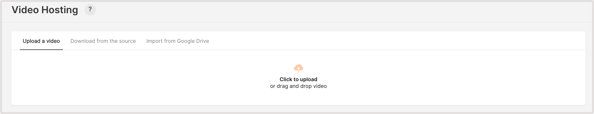
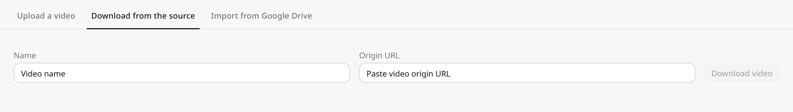
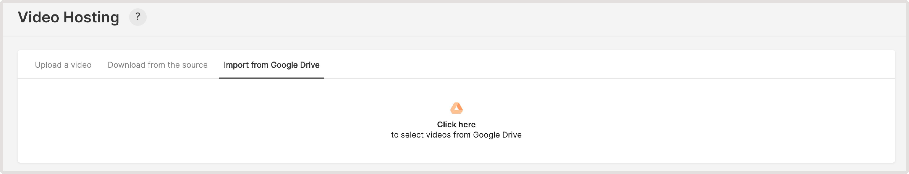
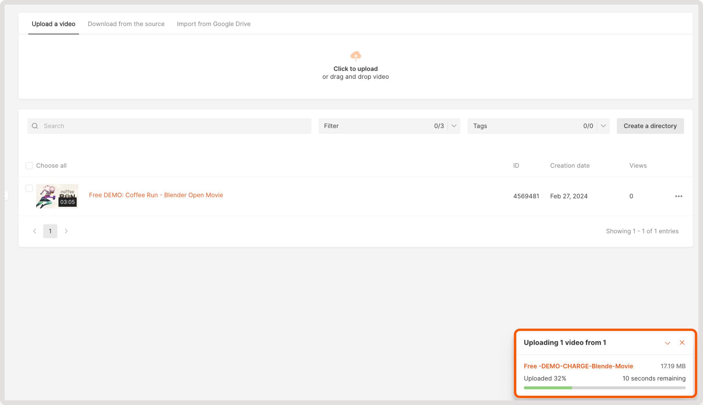
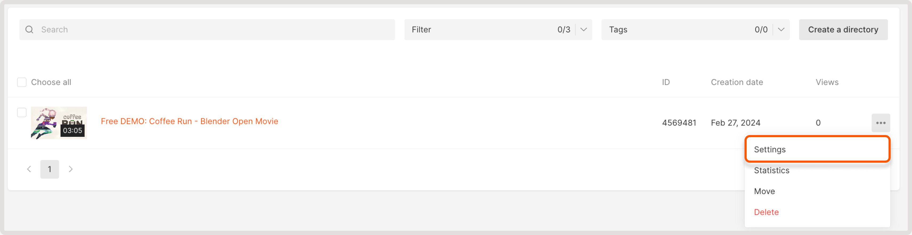
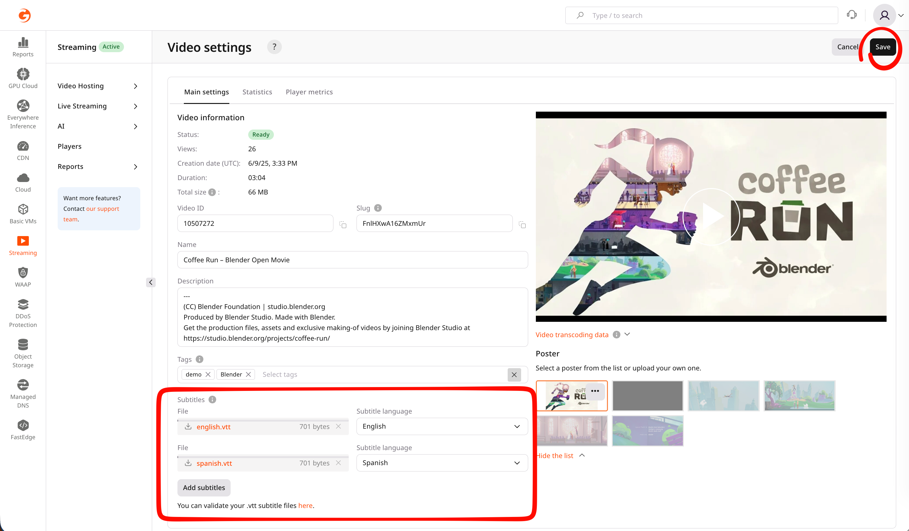
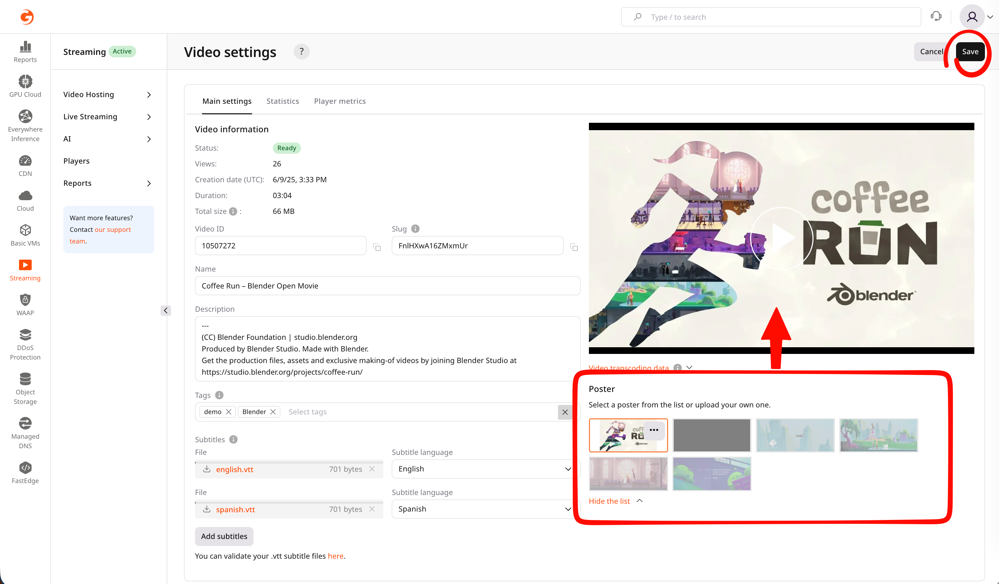
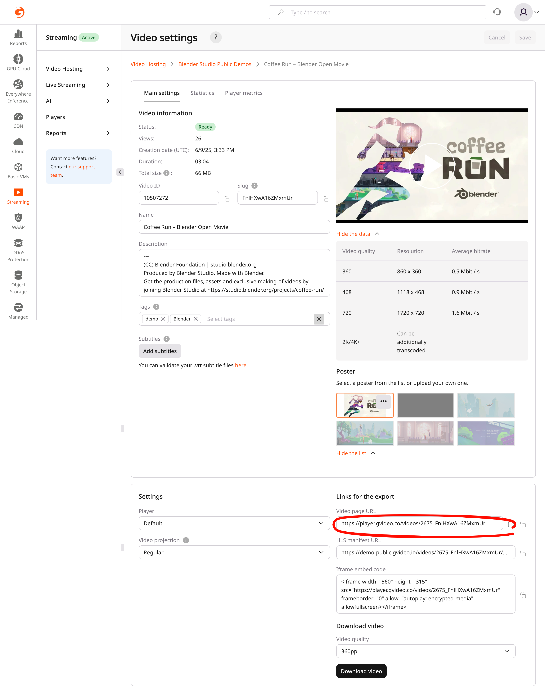

import { MethodSwitch, MethodSection } from "/snippets/method-switch.jsx";

<MethodSwitch>
  <MethodSection id="portal" label="Customer Portal">

<p>Upload a video to Gcore Video Hosting, edit its settings, then embed it with the Gcore player, an iframe snippet, or a direct playback link.</p>

## Upload a video

<Steps>
  <Step title="Open the video list">
    <p>In the [Gcore Customer Portal](https://portal.gcore.com):</p>

    1. Navigate to **Streaming**.
    2. Select **Video Hosting**.
    3. Open **All videos**.
  </Step>
  <Step title="Upload a video">
    <p>Use one of these methods:</p>

- **Upload a video**: Drag and drop a file, or click **Click to upload**.

<Frame></Frame>

- **Download from the source**: Enter the video name in **Name** and the source address in **Origin URL**, then click **Download video**.

<Frame></Frame>

- **Import from Google Drive**: Click **Click here**, sign in to a Google account, and select a video.

<Frame></Frame>
  </Step>
</Steps>

<p>After the file is received, the portal shows one of these status badges:</p>

| Status | What it means |
|--------|---------------|
| Empty | The video record exists, but the source file is still being received |
| Pending | The source file was received and is being prepared for processing |
| Viewable | The video can already be watched in one of the available qualities |
| Ready | The video is fully prepared and available in all processed qualities |
| Error | The video could not be uploaded or prepared. Check the file and try again |

<p>Processing moves through the values documented in [video&nbsp;statuses](/streaming/video-hosting/vod-status).</p>

<Frame></Frame>

<Info>
If a video enters `Error` status after upload, inspect the original file. A pixel-format change or a color-range change near the end of the file causes this failure, so uploading the same file again leaves the status on Error. Re-export or trim the source, then upload the corrected file.
</Info>

## Video settings

<p>Name, description, tags, subtitles, and the poster are optional. Change them on the **Main settings** tab before copying a playback link when the published video should use those values.</p>

<Steps>
  <Step title="Open video settings">
    <p>Click the video name, or open the three-dot menu and click **Settings**.</p>

    <Frame></Frame>
  </Step>
  <Step title="Adjust fields">
    <p>Change only the fields that should differ from the current values:</p>

    - **Name**: The video name in the Customer Portal.
    - **Description**: Text stored with the video.
    - **Tags**: Labels from [video&nbsp;tags](/streaming/video-hosting/organize-uploaded-videos#tags).
    - **Subtitles**: A subtitle file and language. [VOD&nbsp;subtitles](/streaming/video-hosting/subtitles-and-closed-captions-for-vod) covers both.

    <Frame></Frame>
  </Step>
  <Step title="(Optional) Review renditions">
    <p>Open **Video transcoding data** for **Video quality**, **Resolution**, and **Average bitrate** on each rendition.</p>
  </Step>
  <Step title="Select a poster">
    <p>Under **Poster**, select one of the generated posters or upload a file. The generated posters are the five automatic screenshots of the video, and the first one is black when the video starts from a black image.</p>

    <Frame></Frame>
  </Step>
</Steps>

## Poster and screenshots

<p>Every video gets five automatic screenshots. The example shows the five screenshots of one video. The default is the first one. It can be black because the video opens on a black frame. If needed, select another one or upload your custom image. The size of custom poster should be less than 1 MB, formats: JPG, PNG.</p>


## Player and video projection

<p>**Player** and **Video projection** change how the built-in player renders this video. Set both before copying a playback link when the embed should use a custom player or a VR projection.</p>

<Steps>
  <Step title="Select a player">
    <p>In **Player**, select **Default** or a custom player. A new player is created in [player&nbsp;appearance](/streaming/player/customize-appearance-of-the-built-in-player).</p>
  </Step>
  <Step title="Select a projection">
    <p>In **Video projection**, select **Regular**, **VR 180**, **VR 360**, or **VR 360 TB (Top/Bottom)**.</p>
  </Step>
</Steps>

## Playback and embed links

<p>Open the video settings and find **Links for the export**. Copy the value that fits the task:</p>

- **Video page URL**: Copy it to share the video as a link. The link opens a page with the Gcore player.
- **Iframe embed code**: Copy it and paste it into the HTML of a website or app page to show the Gcore player there.
- **HLS manifest URL**: Copy it to play the video in a custom player or an app that supports HLS.

<p>Example of a video page URL:</p>

```text
https://player.gvideo.co/videos/2675_iKbrdNMcS9ylGuw
```

<p>Example of an iframe embed code:</p>

```html
<iframe width="560" height="315" src="https://player.gvideo.co/videos/2675_iKbrdNMcS9ylGuw" frameborder="0" allow="autoplay; encrypted-media" allowfullscreen></iframe>
```

<p>Example of an HLS manifest URL for a 1080p H.264 video in HLS MPEG-TS with multi-language subtitles:</p>

```text
https://demo-public.gvideo.io/videos/2675_iKbrdNMcS9ylGuw/master.m3u8
```

<Frame></Frame>

</MethodSection>
  <MethodSection id="api" label="REST API">

<p>Upload a video from an external URL, edit its settings, wait until processing finishes, and take the playback links from the video object. [Videos&nbsp;API](/api-reference/streaming/videos/get-list-of-videos) lists existing videos. A file on local storage uses [TUS&nbsp;upload](/streaming/video-hosting/upload-video-via-api).</p>

<p>Requests authenticate with an [API&nbsp;token](/account-settings/api-tokens). Set it before the calls:</p>

```bash
export GCORE_API_KEY="{YOUR_API_KEY}"
```

## Create a video from an external URL

<p>Create a video entity and start downloading the source file from a public URL. After creation, the video enters `empty` or `pending` status while processing. Poll `GET /streaming/videos/{video_id}` until the status reaches `viewable` or `ready` before embedding.</p>

<Tabs>
  <Tab title="Python SDK">
    ```python
    from gcore import Gcore

    client = Gcore()

    result = client.streaming.videos.create(
        video={
            "name": "My Video",
            "origin_url": "https://example.com/source.mp4",
        }
    )
    video_id = result.id
    print(f"Created video ID: {video_id}")
    print(f"Status: {result.status}")
    ```
  </Tab>
  <Tab title="Go SDK">
    ```go
    package main

    import (
    	"bytes"
    	"encoding/json"
    	"fmt"
    	"io"
    	"net/http"
    	"os"
    )

    // createVideo creates a video from an external URL and returns its ID.
    func createVideo(name, originURL string) (int64, error) {
    	body := map[string]interface{}{
    		"video": map[string]interface{}{
    			"name":       name,
    			"origin_url": originURL,
    		},
    	}
    	b, _ := json.Marshal(body)
    	req, _ := http.NewRequest(
    		"POST",
    		"https://api.gcore.com/streaming/videos",
    		bytes.NewReader(b),
    	)
    	req.Header.Set("Authorization", "APIKey "+os.Getenv("GCORE_API_KEY"))
    	req.Header.Set("Content-Type", "application/json")

    	resp, err := http.DefaultClient.Do(req)
    	if err != nil {
    		return 0, err
    	}
    	defer resp.Body.Close()
    	raw, _ := io.ReadAll(resp.Body)
    	var v map[string]interface{}
    	if err := json.Unmarshal(raw, &v); err != nil {
    		return 0, fmt.Errorf("parse response: %w", err)
    	}
    	id, ok := v["id"].(float64)
    	if !ok {
    		return 0, fmt.Errorf("no id in response")
    	}
    	return int64(id), nil
    }

    func main() {
    	videoID, err := createVideo("My Video", "https://example.com/source.mp4")
    	if err != nil {
    		panic(err)
    	}
    	fmt.Printf("Created video ID: %d\n", videoID)
    }
    ```
  </Tab>
  <Tab title="curl">
    ```bash
    curl -X POST "https://api.gcore.com/streaming/videos" \
      -H "Authorization: APIKey $GCORE_API_KEY" \
      -H "Content-Type: application/json" \
      -d '{
        "video": {
          "name": "My Video",
          "origin_url": "https://example.com/source.mp4"
        }
      }'
    ```

    <p>The API returns the created video object:</p>

    ```json
    {
      "id": 1001,
      "name": "My Video",
      "status": "empty",
      "iframe_url": "https://player.gvideo.co/videos/1000503_abc123",
      "hls_url": "https://1000503.gvideo.io/videos/1000503_abc123/master.m3u8",
      "hls_cmaf_url": "https://1000503.gvideo.io/videos/1000503_abc123/master-cmaf.m3u8"
    }
    ```
  </Tab>
</Tabs>

<p>Save the returned video ID for the requests below:</p>

```bash
export VIDEO_ID="{RETURNED_VIDEO_ID}"
```

## Update video settings

<p>This request is optional. Run it before reading playback links when the name, description, projection, or a custom player should apply to playback. Projection values are `regular`, `vr180`, `vr360`, and `vr360tb`.</p>

<p>The same request edits `directory_id`, which moves the video to a [directory](/streaming/video-hosting/organize-uploaded-videos) while the video ID and playback URL stay the same, and the poster fields described in the next section. The source file of an existing video can't be replaced. To publish a new version, create a new video with the [upload&nbsp;API](/streaming/video-hosting/upload-video-via-api) and point the player to the new ID.</p>

<Tabs>
  <Tab title="Python SDK">
    ```python
    import os
    from gcore import Gcore

    client = Gcore()
    video_id = int(os.environ["VIDEO_ID"])

    updated = client.streaming.videos.update(
        video_id,
        name="My Renamed Video",
        description="Updated via API",
        projection="regular",
    )
    print(f"Updated: {updated.name}, projection: {updated.projection}")
    ```
  </Tab>
  <Tab title="Go SDK">
    ```go
    package main

    import (
    	"context"
    	"fmt"
    	"os"
    	"strconv"

    	gcore "github.com/G-Core/gcore-go"
    	"github.com/G-Core/gcore-go/packages/param"
    	"github.com/G-Core/gcore-go/streaming"
    )

    func main() {
    	client := gcore.NewClient()
    	ctx := context.Background()

    	videoID, _ := strconv.ParseInt(os.Getenv("VIDEO_ID"), 10, 64)
    	updated, err := client.Streaming.Videos.Update(ctx, videoID, streaming.VideoUpdateParams{
    		CreateVideo: streaming.CreateVideoParam{
    			Name:        "My Renamed Video",
    			Description: param.NewOpt("Updated via API"),
    			Projection:  param.NewOpt("regular"),
    		},
    	})
    	if err != nil {
    		panic(err)
    	}
    	fmt.Printf("Updated: %s, projection: %s\n", updated.Name, updated.Projection)
    }
    ```
  </Tab>
  <Tab title="curl">
    ```bash
    curl -X PATCH "https://api.gcore.com/streaming/videos/$VIDEO_ID" \
      -H "Authorization: APIKey $GCORE_API_KEY" \
      -H "Content-Type: application/json" \
      -d '{
        "name": "My Renamed Video",
        "description": "Updated via API",
        "projection": "regular"
      }'
    ```

    <p>The response returns the updated video object.</p>
  </Tab>
</Tabs>

## Processing status and playback links

<p>Poll `GET /streaming/videos/{video_id}` and read the playback URLs from that same object. Playback is available at `viewable`. Wait for `ready` when every rendition is required.</p>

<Tabs>
  <Tab title="Python SDK">
    ```python
    import os
    import time
    from gcore import Gcore

    client = Gcore()
    video_id = int(os.environ["VIDEO_ID"])

    while True:
        video = client.streaming.videos.get(video_id)
        print(f"Status: {video.status}")
        if video.status in ("viewable", "ready"):
            print(f"HLS URL: {video.hls_url}")
            print(f"HLS CMAF URL: {video.hls_cmaf_url}")
            print(f"MPEG-DASH URL: {video.dash_url}")
            print(f"Iframe URL: {video.iframe_url}")
            break
        if video.status == "error":
            raise RuntimeError(f"Video processing failed: {video.error}")
        time.sleep(10)
    ```
  </Tab>
  <Tab title="Go SDK">
    ```go
    package main

    import (
    	"context"
    	"fmt"
    	"os"
    	"strconv"
    	"time"

    	gcore "github.com/G-Core/gcore-go"
    )

    func main() {
    	client := gcore.NewClient()
    	ctx := context.Background()

    	videoID, _ := strconv.ParseInt(os.Getenv("VIDEO_ID"), 10, 64)
    	for {
    		video, err := client.Streaming.Videos.Get(ctx, videoID)
    		if err != nil {
    			panic(err)
    		}
    		fmt.Printf("Status: %s\n", video.Status)
    		if video.Status == "viewable" || video.Status == "ready" {
    			fmt.Printf("HLS URL: %s\n", video.HlsURL)
    			fmt.Printf("HLS CMAF URL: %s\n", video.HlsCmafURL)
    			fmt.Printf("MPEG-DASH URL: %s\n", video.DashURL)
    			fmt.Printf("Iframe URL: %s\n", video.IframeURL)
    			break
    		}
    		if video.Status == "error" {
    			panic(fmt.Sprintf("Video processing failed: %s", video.Error))
    		}
    		time.Sleep(10 * time.Second)
    	}
    }
    ```
  </Tab>
  <Tab title="curl">
    ```bash
    curl "https://api.gcore.com/streaming/videos/$VIDEO_ID" \
      -H "Authorization: APIKey $GCORE_API_KEY"
    ```

    <p>Repeat the request about every 10 seconds until `status` is `viewable` or `ready`. That response also includes `hls_url`, `hls_cmaf_url`, `dash_url`, and `iframe_url`.</p>
  </Tab>
</Tabs>


</MethodSection>
</MethodSwitch>
