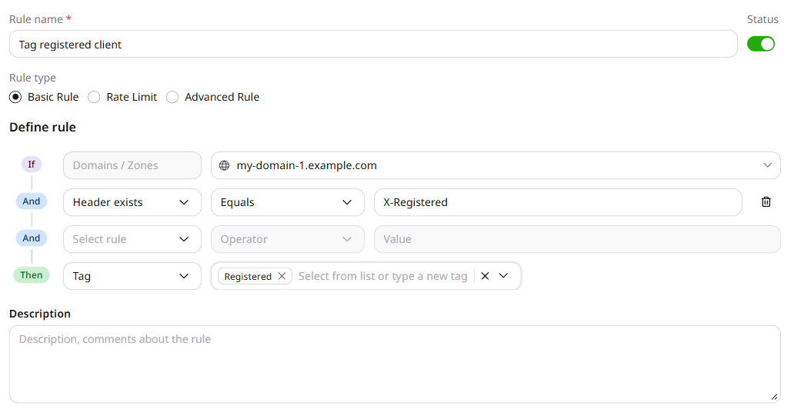
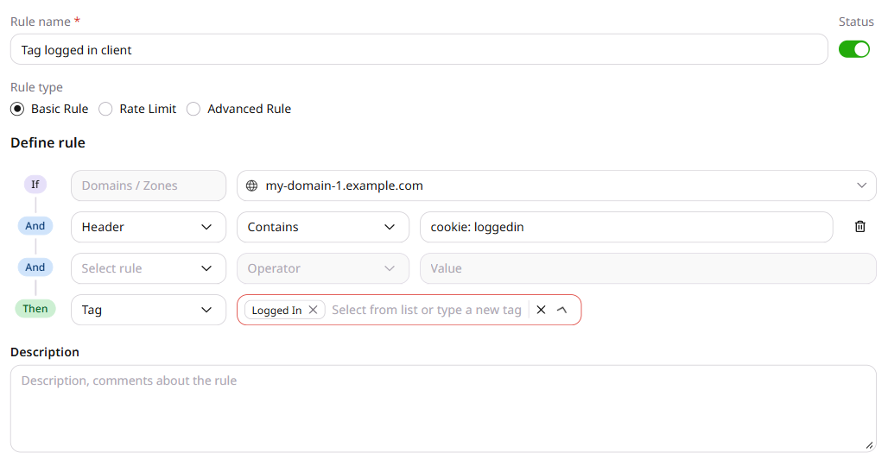
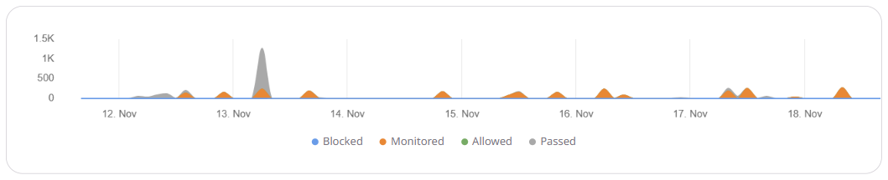
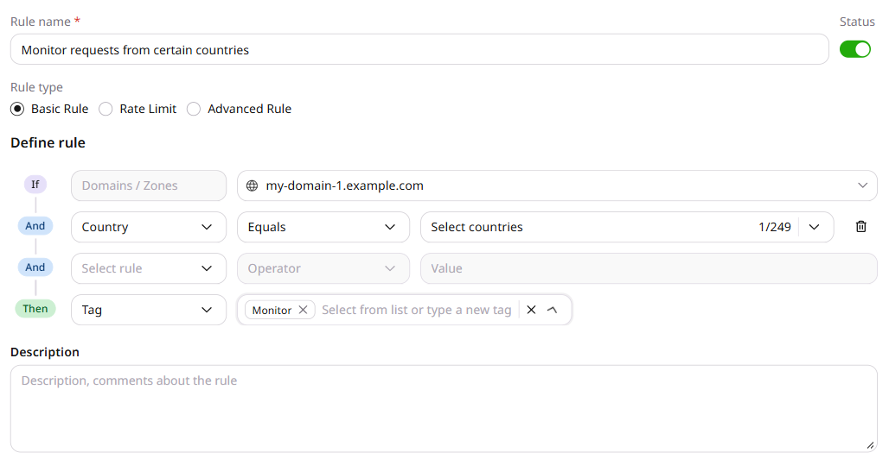
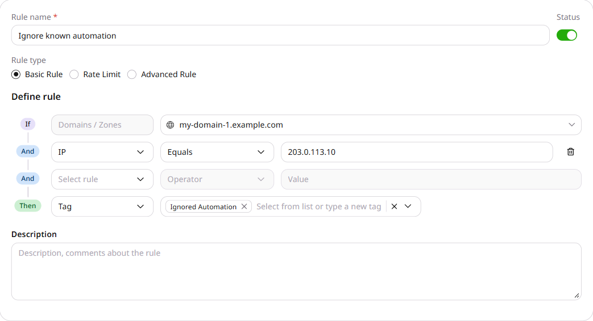
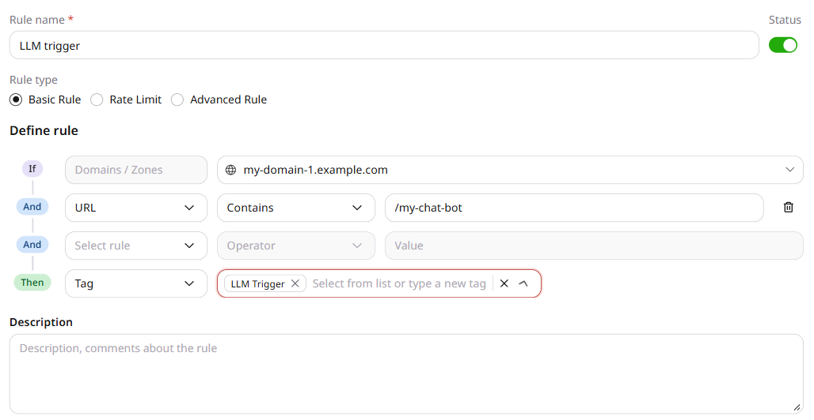
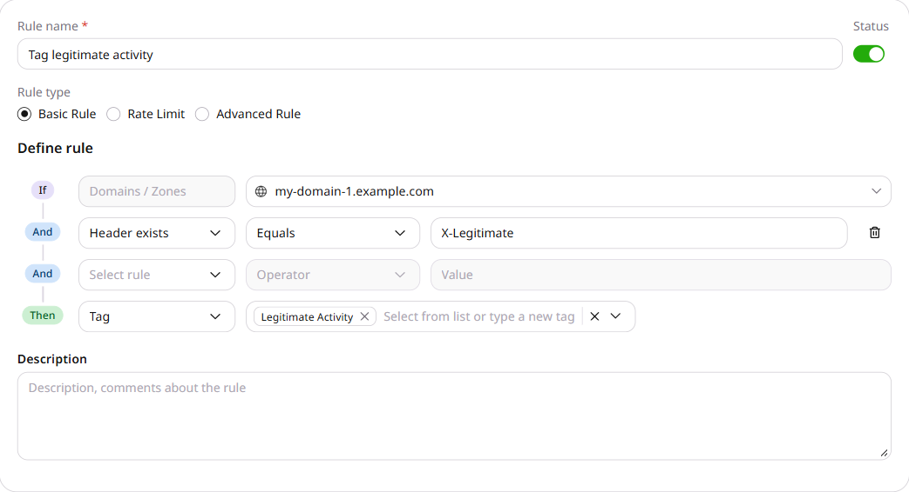
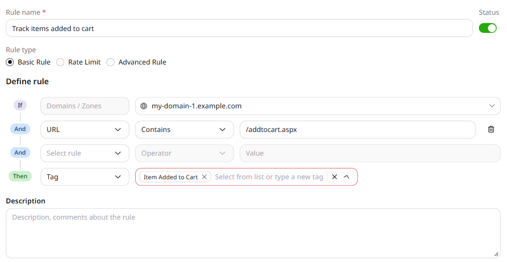

Reserved tags are predefined tags. A custom rule assigns one in the **Then** action. The condition selects which requests receive the tag. 

## Available reserved tags

Reserved tags can be divided into two categories: **general** tags that are used in custom rules with various conditions and **API protection** tags that are specifically designed to protect your APIs. [API protection](/waap/api-discovery-and-protection/configure-api-access-with-reserved-tags) tags contain the URL rule condition. 

General tags: 

  * Registered 
  * Logged In 
  * Paid
  * Monitor 
  * Ignored Automation 
  * Login Page 
  * Legitimate Activity 
  * Malicious Activity 
  * Item Added to Cart 
  * Cart Checkout
  * LLM Trigger

API protection tags: 

  * API Privileged Access 
  * API Admin Access 
  * Indicate API Privileged User 
  * Indicate API Admin User 
  * Ignore Email Address Detection 
  * Ignore Phone Number Detection 
  * Auth Endpoint 
  * Ignore CCN Detection 
  * Ignore SSN Detection

Unlike [user-defined tags](/waap/waap-rules/custom-rules/tag-rules#tag-generating-rules) that are automatically generated based on specific request conditions, reserved tags aren't customizable. However, you can use them to create a variety of rules, each adjusted to a specific scenario as documented in the following sections.

## Tag requests from logged-in, registered, or paid users

The **registered**, **logged-in**, and **paid** tags allow you to identify requests from users who have created accounts on your domain, are authenticated, or have paid subscriptions. 

When creating a rule, make sure that you specify a secure condition. For example, explicitly define the IP address from which the requests will be coming (e.g., IP=1.2.3.4). Don't use the conditions that are easy to spoof, such as the User Agent header. 

You can also use a server signal that will serve as a unique identifier and can verify the client. For instance, apply a tag based on a session cookie or a specific HTTP response header. 

For example, you can create the rule that looks for the X-Registered header, which designates registered users: 

<Frame></Frame>

Alternatively, you can inject a header for logged-in users. WAAP will use this header to tag the request. After the WAAP generates such tags, they will be integrated with our security cloud and associated with the user session. All tags that indicate harmful behavior will be cleaned for the user.

<Frame></Frame>

## Inspect WAAP traffic

To track certain traffic on the [Events](/waap/analytics/events) page, use the reserved **monitor** tag. Each request marked with this tag will appear: 

  * On the Events chart, in the **Monitored** series. 

  * In the events table, where **Action** is **Monitored**.

<Frame></Frame>

When you add the monitor tag to a request, it won't affect WAAP's behavior. If the request is potentially dangerous, it will be blocked. The monitor tag only ensures that such requests are visible on the [Events](/waap/analytics/events) page.

### Sample rule with the monitor tag

As an example, create a rule that will allow you to view analytics on monitored requests from particular countries: 

1\. In the condition row, select **Country**. The operator is **Equals**.

2\. Choose the country.

3\. In the **Then** section, select **Tag** and select **Monitor**.

4\. Click **Save**. 

<Frame></Frame>

All monitored requests are displayed on the [Events](/waap/analytics/events) page.

## Ignore automation services

This functionality will notify WAAP of legitimate automation behavior and exclude requests from being affected by our [Anti-automation and bot protection](/waap/waap-policies/anti-automation-and-bot-protection) policy group. This means that you stay protected from unknown automation services while allowing known bots to access your domain. 

To allow a known automation service, create a custom rule that matches its IP address and assigns the **Ignored Automation** tag:

1\. In the condition row, select **IP**. The operator is **Equals**.

2\. Enter `203.0.113.10`.

3\. In the **Then** section, select **Tag**, then select **Ignored Automation**.

<Frame></Frame>

4\. Click **Save**. 

## Protect login pages

Use this tag to notify WAAP if certain endpoints are used as login pages. This functionality will help identify such threats such as brute force attacks. 

To identify login pages for the WAAP, create the following custom rule: 

1\. In the condition row, select **URL**. The operator is **Contains**.

2\. Enter the login page path.

3\. In the **Then** section, select **Tag** and select **Login Page**. 

<Frame></Frame>

4\. Click **Save**. 

## Identify LLM resources

The **LLM Trigger** reserved tag marks traffic that belongs to Large Language Model (LLM) endpoints. The [LLM Attack](/waap/waap-policies/waf-and-owasp-top-threats#configure-owasp-threats-rules) policy inspects only requests with this tag — enabling the policy without tagging LLM resources leaves that traffic unprotected by LLM Attack rules.

Create a custom or advanced rule that matches reliable LLM resource identifiers — URL path segments, request headers, or response headers — then apply the **LLM Trigger** tag:

1\. In the **IF** section, add conditions that identify the LLM resource. Match a URL path that contains the LLM endpoint, or match a dedicated request or response header that the application sets for LLM traffic.

2\. In the **Then** section, select **Tag** and select **LLM Trigger**.

<Frame></Frame>

3\. Click **Save** to create the rule.

4\. Enable the **LLM Attack** policy for the domain under **WAAP** \> **Default Rules** \> **OWASP Threats**.

After the rule is active, WAAP applies LLM Attack inspection to tagged requests and blocks matches for prompt injection (OWASP LLM01) and improper output handling (OWASP LLM05).

## Detect malicious and legitimate activity

Gcore WAAP has preconfigured thresholds that identify and tag requests as malicious or legitimate. This works as follows: 

1\. Our heuristic models check for good and bad behavioral patterns associated with a particular request. 

2\. Based on the analyzed behavior, the request is tagged as either malicious or legitimate. The relevant tag sticks to the client based on identifiers like the IP or session data. 

3\. If the client behavior changes, our heuristic models can remove the previous tag and update it either to a legitimate or malicious one. However, the tag can only be replaced after the client consistently demonstrates a particular behavior, meeting the defined **threshold**. This threshold represents the number of times a request has to be tagged as malicious or legitimate until it sticks to the client. 

For example, if the threshold for declined orders is set to three, and the threshold for successful orders is set to two, then a client would be considered a legitimate actor if it made two successful orders after being wrong twice. 

### Sample rule with the legitimate and malicious activity tags

Assign **Legitimate Activity** when the request contains a header that the application sets for this behavior:

1\. In the condition row, select **Header exists**. The operator is **Equals**.

2\. In **Header key**, enter `X-Legitimate`.

3\. In the **Then** section, select **Tag**, then select **Legitimate Activity**.

<Frame></Frame>

4\. Click **Save**. 

<Info>
**Info**

Contact our [support team](mailto:support@gcore.com) to get additional configuration for the **malicious activity** and **legitimate activity** tags.
</Info>

## Detect denial of inventory

Custom rules assign reserved tags to the cart and checkout endpoints that denial of inventory (inventory hoarding) attacks use.

This mitigation method aims to detect hoarder bots that use endpoints to rapidly add items to a cart without completing the purchase.

Support configures the cart threshold. The rules below assign **Cart Checkout** to the checkout URL and **Item Added to Cart** to the cart URL.

WAAP counts the items in each client's cart and compares that count with the threshold. If the count exceeds the threshold and the client does not check out, WAAP tags the client as hoarderbot.

Create a rule that assigns **Cart Checkout**: 

1\. In the condition row, select **URL**. The operator is **Contains**.

2\. Enter `/checkout.aspx`.

3\. In the **Then** section, select **Tag** and select **Cart Checkout**.

<Frame></Frame>

4\. Click **Save**.

Create a rule that assigns **Item Added to Cart**: 

1\. In the condition row, select **URL**. The operator is **Contains**.

2\. Enter `/addtocart.aspx`.

3\. In the **Then** section, select **Tag** and select **Item Added to Cart**.

<Frame></Frame>

4\. Click **Save**.

## Use reserved tags for API protection

There's a range of tags that you can use to manage access to API endpoints. These tags include: 

  * API Privileged Access 
  * API Admin Access 
  * Indicate API Privileged User 
  * Indicate API Admin User 
  * Auth Endpoint 
  * Ignore Email Address Detection 
  * Ignore Phone Number Detection

Check our [API protection with reserved tags](/waap/api-discovery-and-protection/configure-api-access-with-reserved-tags) guide for information on how to use these tags and applicable scenarios.